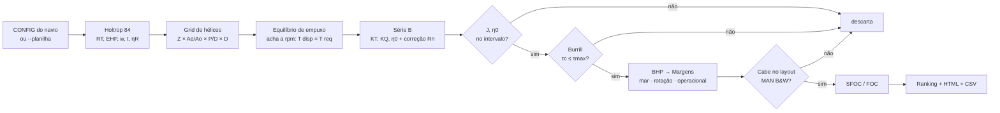

> Atualização da implementação: consulte o README do projeto para diagnóstico de motor, ranking por violação, configuração registrada e limites de SFOC. O catálogo CSV usa dados oficiais históricos de 2021; os exemplos e cenários abaixo documentam a versão original com catálogo aproximado.

<div align="center">

# ⚓ Propulsão Naval Automatizada + Backtest

**Holtrop-Mennen 84 → Hélice Série B → Cavitação (Burrill) → Margens → Motor MAN B&W → Melhor combinação**


*Baseado na planilha `Holtrop 84 SerieB – Navio Holtrop – Padrão – SCELN 2026.xls` (abas Holtrop, SérieB, Cavitação, Margens, Motor, Rt x Vs).*

</div>

---

## 📑 Sumário

1. [Início rápido (3 passos)](#-início-rápido-3-passos)
2. [Como o fluxo funciona](#-como-o-fluxo-funciona)
3. [Mapa planilha → código](#-mapa-planilha--código)
4. [O código completo (`propulsao.py`)](#-o-código-completo-propulsaopy)
5. [Parâmetros do `CONFIG`](#-parâmetros-do-config)
6. [Validação contra a planilha](#-validação-contra-a-planilha)
7. [Exemplo de saída real](#-exemplo-de-saída-real)
8. [Pontos de atenção encontrados na planilha](#-pontos-de-atenção-encontrados-na-planilha)
9. [Descrição completa das partes automatizadas e do que falta](#-descrição-completa-das-partes-automatizadas-e-do-que-falta)

---

## 🚀 Início rápido (3 passos)

| # | O que fazer | Comando / ação |
|---|---|---|
| **1** | Instale as dependências | `pip install numpy pandas xlrd openpyxl` |
| **2** | Copie o bloco de código da [seção 4](#-o-código-completo-propulsaopy) para um arquivo chamado `propulsao.py` | — |
| **3** | Rode | `python propulsao.py` |

Pronto: o script imprime o **funil de restrições**, o **Top 15** e grava em `saida/` o `relatorio.html` (visual, com modo escuro), `ranking.csv` e `curva_velocidades.csv`.

### Comandos disponíveis

```bash
python propulsao.py                         # roda tudo (backtest + curva + relatório HTML)
python propulsao.py validar                 # confere o código com os números da planilha SCELN 2026
python propulsao.py backtest                # só o grid search, direto no terminal
python propulsao.py curva                   # Rt x Vs e EHP por velocidade
python propulsao.py importar "Planilha.xls" # lê as células azuis de uma planilha Holtrop 84 existente
python propulsao.py tudo --planilha "Holtrop 84 SerieB - Projeto de Máquinas - Navio Aurora Spirit.xlsx"
```

> [!TIP]
> **Seu fluxo de trabalho normal vira isto:** edite só o bloco `CONFIG` (ou aponte `--planilha` para uma planilha pronta de outro navio), rode, abra `saida/relatorio.html`. Todas as planilhas do seu ZIP têm o mesmo layout e foram testadas na importação.

---

## 🗺️ Como o fluxo funciona



O passo **D** é o que o *Solver* do Excel fazia à mão (restrição `M12 = 0`, diferença de forças propulsivas igual a zero). Aqui ele é resolvido por bissecção vetorizada para **todas** as combinações de uma vez (dezenas de milhares em cerca de 10 s).

---

## 🧭 Mapa planilha → código

| Aba / células da planilha | Função no código | O que faz |
|---|---|---|
| `Holtrop` B58:L83 | `resistencia()` | Rf, (1+k1), (1+k2)eq, Rapp, Rw (3 regimes de Fn), Rb, Rtr, Ra → **RT** e **EHP** |
| `Holtrop` C86, F86, I86 | `coef_propulsivos()` | w, t, ηR (hélice única e bi-hélice) |
| `SérieB` C28:H125 | `KT_TERMOS`, `KQ_TERMOS`, `serie_b()` | Polinômios Oosterveld (39 termos KT, 47 KQ) |
| `SérieB` I5:I10, I128:I153 | `serie_b()` | Correção de escala/Reynolds (ΔKT, ΔKQ, ΔCD) |
| `Holtrop` M12 (Solver) | `_resolver_rpm()` | Equilíbrio de empuxo → rotação |
| `Cavitação`, `Cavitação2`, `SérieB` E13:E24 | `burrill()` | σ, τc, τmax (curvas T1–T4: 5/10/20/30 % de dorso) |
| `Margens` B14:B22 | `margens()` | Margem de mar → rotação → operacional → ponto **MCR** |
| `Motor`, diagrama MAN B&W | `MOTORES`, `motores_que_cabem()` | Layout BHP × rpm |
| `Margens` E24:E25, `Motor` | `sfoc()` | SFOC e FOC (t/h) |
| `Rt x Vs`, `Margens` C81:D84 | `curva_velocidades()` | Rt, EHP, rpm, BHP e FOC por velocidade |
| `Holtrop` linhas 99–115 (Solver) | `CONFIG["restricoes"]`, `AE_AO_POR_Z` | Restrições do Solver agora explícitas |
| — | `backtest()` | Grid search + funil + ranking |
| — | `importar_planilha()` | Lê planilhas `.xls/.xlsx` existentes |
| — | `relatorio_html()` | Relatório visual com cartões, funil, ranking e gráfico |

---

## 💻 O código completo (`propulsao.py`)

> [!NOTE]
> Arquivo **único**, ~750 linhas, só `numpy` e `pandas`. Copie tudo e salve como `propulsao.py`.

```python
#!/usr/bin/env python3
# -*- coding: utf-8 -*-
"""
propulsao.py - Automacao completa: Holtrop-Mennen 84 -> Serie B -> Cavitacao (Burrill)
               -> Margens -> Motor MAN B&W -> Backtest (grid search)

Uso rapido:
    python propulsao.py                  # roda tudo com o CONFIG abaixo
    python propulsao.py validar          # confere com os valores da planilha SCELN 2026
    python propulsao.py curva            # Rt x Vs, EHP e consumo por velocidade
    python propulsao.py backtest         # varredura de helices (grid search)
    python propulsao.py importar ARQ.xls # le uma planilha Holtrop 84 e imprime o CONFIG
    python propulsao.py tudo --planilha ARQ.xls   # usa o navio da planilha

Dependencias: numpy, pandas  (opcional: xlrd para .xls, openpyxl para .xlsx)
"""
import argparse
import copy
import math
import os
import sys
import html as html_utils
import json
import hashlib
from datetime import datetime, timezone

import numpy as np
import pandas as pd
WEB_API_VERSION = 2

# =============================================================================
# 1) CONFIGURACAO  (so mexa aqui)  - origem de cada campo = celula da planilha
# =============================================================================
CONFIG = {
    "navio": {                                  # aba 'Holtrop'
        "nome": "Navio Holtrop",                # B7
        "lpp": 200.0,                           # E8   Comp. perpendiculares (m)
        "lwl": 205.0,                           # E9   Comp. linha d'agua (m)
        "boca": 32.0,                           # E10  Boca moldada (m)
        "calado_proa": 10.0,                    # E11  Calado PV (m)
        "calado_popa": 10.0,                    # E12  Calado PR (m)
        "deslocamento": 37500.0,                # E13  Volume deslocado (m3)
        "lcb_pr": 104.0,                        # E14  LCB rel. a PR (m)
        "abt": 20.0,                            # E15  Area transv. do bulbo (m2)
        "hb": 4.0,                              # E16  Altura centro area bulbo (m)
        "cm": 0.98,                             # E17  Coef. secao mestra
        "cwp": 0.75,                            # E18  Coef. linha d'agua
        "at": 16.0,                             # E19  Area do transom (m2)
        "c_popa": 10,                           # E21  Parametro forma de popa (-25 a +10)
        "velocidade_nos": 25.0,                 # E22  Velocidade de servico (nos)
        "n_motores": 1,                         # E24  (BHP e MCR dos resultados sao POR MOTOR)
        "n_helices": 1,                         # E25  (1 = hel. unica; 2 = bi-helice)
        # F41:G51  -> nome: (area m2, 1+k2)
        "apendices": {
            "Leme a re de cadaste": (0, 1.75), "Leme a re de popa": (0, 1.4),
            "Lemes compensados bi-helice": (0, 2.8), "Pe-de-galinha": (0, 3.0),
            "Cadaste": (0, 1.75), "Leme a re do propulsor": (67, 1.96),
            "Bosso do eixo": (0, 2.0), "Eixo do propulsor": (0, 3.0),
            "Estabilizador": (0, 2.8), "Sonar-dome": (0, 2.7), "Bolina": (0, 1.4),
        },
    },
    "agua": {                                   # H34:H37
        "rho": 1025.0,                          # kg/m3
        "mu": 0.85e-3,                          # viscosidade dinamica (N.s/m2)
        "g": 9.805,                             # m/s2
        "p_atm": 101325.0, "p_vapor": 2278.0,   # SerieB!C13, C14 (Pa)
    },
    "helice": {                                 # espaco de busca do backtest
        "z": [3, 4, 5, 6, 7],                   # Solver: 3 <= Z <= 7
        "ae_ao": {"min": 0.30, "max": 1.05, "passo": 0.05},   # Solver: 0.3..1.05 (e limites por Z)
        "p_d": {"min": 0.50, "max": 1.40, "passo": 0.05},     # Solver: 0.5..1.4
        "diametro": {"min": 5.0, "max": None, "passo": 0.1},  # max=None -> calado_popa/ta_sobre_d_min
        "rpm": {"min": 40.0, "max": 250.0},     # faixa de busca da rotacao do helice
    },
    "restricoes": {
        "eta0_min": 0.10, "eta0_max": 0.90,     # Solver: 0.1 <= h0 <= 0.9
        "j_min": 0.01,                          # Solver: J >= 0.01
        "cavitacao_pct": 5,                     # G26: 5 | 10 | 20 | 30 (% de dorso, Burrill)
        "ta_sobre_d_min": 1.25,                 # J56: Ta/D (folga helice-casco/calado)
        "potencia_max_motor_kw": None,          # M27 (None = sem limite)
        "motor": "estrito",                     # 'estrito' = exige caber no layout MAN B&W
    },                                          # 'informativo' = so informa o motor mais proximo
    "margens": {                                # Holtrop!M21:M23 / aba 'Margens'
        "mar": 15.0, "rotacao": 5.0, "operacional": 10.0,   # %; rotacao entra na potencia por (1+rotacao/100)^3
        "expoente_rpm": 1.0 / 3.0,              # a planilha usa 1/3 (Holtrop) ou 0.33 (Margens)
        "acoplamento": "direto",                # 'direto' (0.97) | 'caixa' (0.93)  - Margens!F9:F10
        "eta_t": {"direto": 0.97, "caixa": 0.93},
    },
    "motor": {                                  # modelo simples de consumo (SFOC)
        "sfoc_min": 165.0,                      # g/kWh no ponto otimo
        "carga_otima": 0.80,                    # fracao do MCR do ponto otimo
        "curvatura": 0.30,                      # SFOC = min * (1 + k * (carga - otima)^2)
        "arquivo_csv": "motores.csv",           # se existir, substitui o catalogo interno
        "carga_min_sfoc": 0.25, "carga_max_sfoc": 1.0,  # faixa valida do modelo; fora dela consumo e apenas limitado
    },
    "compat_planilha": False,                   # False = formulas corrigidas (recomendado)
                                                # True  = reproduz a planilha bit a bit, incluindo 3 pontos suspeitos:
                                                #   (a) w: termo C11 trocado por celula vazia CD11 (Holtrop!C86)
                                                #   (b) C15 = 91 p/ L3/Vol > 1726 (Holtrop!M62); Holtrop 84 manda 0
                                                #   (c) BHP = THP*etaH/... (M16:M18) omite o etaH da cadeia propulsiva
    "backtest": {"objetivo": "bhp", "top": 15, "saida": "saida"},   # objetivo: 'bhp' | 'foc'
    "perfil_velocidades": [5, 7, 10, 12, 15, 17, 20, 22, 25, 28, 30],   # aba 'Rt x Vs'
}

# Limites de Ae/Ao por numero de pas (SerieB!F6:G6)
AE_AO_POR_Z = {2: (0.30, 0.38), 3: (0.35, 0.80), 4: (0.40, 1.00), 5: (0.45, 1.05),
               6: (0.50, 0.80), 7: (0.55, 0.85)}

# Burrill: tau_c,max = a*ln(sigma) + b  (aba 'Cavitacao', curvas T1..T4)
BURRILL = {5: (0.1082, 0.2675), 10: (0.1452, 0.3498), 20: (0.1852, 0.4577), 30: (0.2148, 0.5276)}

# Catalogo APROXIMADO lido do diagrama 'BHP x RPM MAN B&W' (substitua pelo Project Guide / motores.csv)
# (modelo, n_min, n_max, P_max em n_max [kW], P_min em n_max [kW]) - bordas laterais seguem P ~ n (MEP const.)
MOTORES = [
    ("G95ME-C10.6", 70, 80, 82000, 31000), ("G90ME-C10.5", 72, 84, 76000, 30000),
    ("G80ME-C10.6", 55, 68, 35000, 20000), ("S70ME-C10.5", 73, 91, 27000, 12500),
    ("G70ME-C10.5", 63, 79, 17500, 11000), ("G60ME-C10.5", 82, 102, 22300, 9500),
    ("S60ME-C10.5", 83, 105, 19800, 9000), ("S50ME-C10.6", 85, 125, 17000, 5500),
    ("S46ME-C8.6", 105, 130, 10900, 4800), ("S40ME-C9.5", 104, 147, 10200, 3500),
    ("S35ME-C9.7", 118, 168, 6900, 2600), ("S30ME-B9.5", 149, 196, 5000, 2000),
]

# =============================================================================
# 2) SERIE B DE WAGENINGEN - polinomios (Oosterveld & van Oossanen) extraidos da aba 'SerieB'
#    cada termo: (coeficiente, exp. J, exp. P/D, exp. Ae/Ao, exp. Z)   -> 39 termos KT, 47 KQ
# =============================================================================
KT_TERMOS = [  # (coef, J, P/D, Ae/Ao, Z)
    (0.00880496, 0, 0, 0, 0),
    (-0.204554, 1, 0, 0, 0),
    (0.166351, 0, 1, 0, 0),
    (0.158114, 0, 2, 0, 0),
    (-0.147581, 2, 0, 1, 0),
    (-0.481497, 1, 1, 1, 0),
    (0.415437, 0, 2, 1, 0),
    (0.0144043, 0, 0, 0, 1),
    (-0.0530054, 2, 0, 0, 1),
    (0.0143481, 0, 1, 0, 1),
    (0.0606826, 1, 1, 0, 1),
    (-0.0125894, 0, 0, 1, 1),
    (0.0109689, 1, 0, 1, 1),
    (-0.133698, 0, 3, 0, 0),
    (0.00638407, 0, 6, 0, 0),
    (-0.00132718, 2, 6, 0, 0),
    (0.168496, 3, 0, 1, 0),
    (-0.0507214, 0, 0, 2, 0),
    (0.0854559, 2, 0, 2, 0),
    (-0.0504475, 3, 0, 2, 0),
    (0.010465, 1, 6, 2, 0),
    (-0.00648272, 2, 6, 2, 0),
    (-0.00841728, 0, 3, 0, 1),
    (0.01684246, 1, 3, 0, 1),
    (-0.00102296, 3, 3, 0, 1),
    (-0.0317791, 0, 3, 1, 1),
    (0.018604, 1, 0, 2, 1),
    (-0.00410798, 0, 2, 2, 1),
    (-0.000606848, 0, 0, 0, 2),
    (-0.0049819, 1, 0, 0, 2),
    (0.0025983, 2, 0, 0, 2),
    (-0.000560528, 3, 0, 0, 2),
    (-0.00163652, 1, 2, 0, 2),
    (-0.000328787, 1, 6, 0, 2),
    (0.000116502, 2, 6, 0, 2),
    (0.000690904, 0, 0, 1, 2),
    (0.00421749, 0, 3, 1, 2),
    (5.652229e-05, 3, 6, 1, 2),
    (-0.00146564, 0, 3, 2, 2),
]
KQ_TERMOS = [  # (coef, J, P/D, Ae/Ao, Z)
    (0.00379368, 0, 0, 0, 0),
    (0.00886523, 2, 0, 0, 0),
    (-0.032241, 1, 1, 0, 0),
    (0.00344778, 0, 2, 0, 0),
    (-0.0408811, 0, 1, 1, 0),
    (-0.108009, 1, 1, 1, 0),
    (-0.0885381, 2, 1, 1, 0),
    (0.188561, 0, 2, 1, 0),
    (-0.00370871, 1, 0, 0, 1),
    (0.00513696, 0, 1, 0, 1),
    (0.0209449, 1, 1, 0, 1),
    (0.00474319, 2, 1, 0, 1),
    (-0.00723408, 2, 0, 1, 1),
    (0.00438388, 1, 1, 1, 1),
    (-0.0269403, 0, 2, 1, 1),
    (0.0558082, 3, 0, 1, 0),
    (0.0161886, 0, 3, 1, 0),
    (0.00318086, 1, 3, 1, 0),
    (0.015896, 0, 0, 2, 0),
    (0.0471729, 1, 0, 2, 0),
    (0.0196283, 3, 0, 2, 0),
    (-0.0502782, 0, 1, 2, 0),
    (-0.030055, 3, 1, 2, 0),
    (0.0417122, 2, 2, 2, 0),
    (-0.0397722, 0, 3, 2, 0),
    (-0.00350024, 0, 6, 2, 0),
    (-0.0106854, 3, 0, 0, 1),
    (0.00110903, 3, 3, 0, 1),
    (-0.000313912, 0, 6, 0, 1),
    (0.0035985, 3, 0, 1, 1),
    (-0.00142121, 0, 6, 1, 1),
    (-0.00383637, 1, 0, 2, 1),
    (0.0126803, 0, 2, 2, 1),
    (-0.00318278, 2, 3, 2, 1),
    (0.00334268, 0, 6, 2, 1),
    (-0.00183491, 1, 1, 0, 2),
    (0.000112451, 3, 2, 0, 2),
    (-2.97228e-05, 3, 6, 0, 2),
    (0.000269551, 1, 0, 1, 2),
    (0.00083265, 2, 0, 1, 2),
    (0.00155334, 0, 2, 1, 2),
    (0.000302683, 0, 6, 1, 2),
    (-0.0001843, 0, 0, 2, 2),
    (-0.000425399, 0, 3, 2, 2),
    (8.69243e-05, 3, 3, 2, 2),
    (-0.0004659, 0, 6, 2, 2),
    (5.54194e-05, 1, 6, 2, 2),
]

# Correcao de Reynolds (Rn0.75R > 2e6): (coef, exp (logRn-0.301), exp Z, exp Ae/Ao, exp P/D, exp J)
DKT_TERMOS = [
    (0.000353485, 0, 0, 0, 0, 0), (-0.00333758, 0, 0, 1, 0, 2), (-0.00478125, 0, 0, 1, 1, 1),
    (0.000257792, 2, 0, 1, 0, 2), (6.43192e-05, 1, 0, 0, 6, 2), (-1.10636e-05, 2, 0, 0, 6, 2),
    (-2.76305e-05, 2, 1, 1, 0, 2), (9.54e-05, 1, 1, 1, 1, 1), (3.2049e-06, 1, 2, 1, 3, 1)]
DKQ_TERMOS = [
    (-0.000591412, 0, 0, 0, 0, 0), (0.00696898, 0, 0, 0, 1, 0), (-6.66654e-05, 0, 1, 0, 6, 0),
    (0.0160818, 0, 0, 2, 0, 0), (-0.000938091, 1, 0, 0, 1, 0), (-0.00059593, 1, 0, 0, 2, 0),
    (7.82099e-05, 2, 0, 0, 2, 0), (5.2199e-06, 1, 1, 1, 0, 2), (-8.8528e-07, 2, 1, 1, 1, 1),
    (2.30171e-05, 1, 1, 0, 6, 0), (-1.84341e-06, 2, 1, 0, 6, 0), (-0.00400252, 1, 0, 2, 0, 0),
    (0.000220915, 2, 0, 2, 0, 0)]

_KT = np.array(KT_TERMOS, dtype=float)
_KQ = np.array(KQ_TERMOS, dtype=float)
_DKT = np.array(DKT_TERMOS, dtype=float)
_DKQ = np.array(DKQ_TERMOS, dtype=float)


def _a(x):
    return np.asarray(x, dtype=float)


def _poli(T, J, pd_, ae, z):
    J, pd_, ae, z = (_a(v)[..., None] for v in np.broadcast_arrays(J, pd_, ae, z))
    return np.sum(T[:, 0] * J ** T[:, 1] * pd_ ** T[:, 2] * ae ** T[:, 3] * z ** T[:, 4], axis=-1)


def _poli_rn(T, lrn, z, ae, pd_, J):
    lrn, z, ae, pd_, J = (_a(v)[..., None] for v in np.broadcast_arrays(lrn, z, ae, pd_, J))
    return np.sum(T[:, 0] * lrn ** T[:, 1] * z ** T[:, 2] * ae ** T[:, 3] * pd_ ** T[:, 4] * J ** T[:, 5], axis=-1)


def serie_b(J, pd_, ae, z, D, va, n, nu):
    """KTs, KQs, eta0 e Rn0.75R do helice Serie B (com correcao de escala). n em rps."""
    J, pd_, ae, z, D, va, n = np.broadcast_arrays(*(_a(v) for v in (J, pd_, ae, z, D, va, n)))
    c075 = 2.073 * ae * D / z                                        # SerieB!C8
    rn = c075 * np.sqrt(va ** 2 + (0.75 * np.pi * n * D) ** 2) / nu  # SerieB!C9
    kt0, kq0 = _poli(_KT, J, pd_, ae, z), _poli(_KQ, J, pd_, ae, z)
    lrn = np.log10(np.maximum(rn, 1.0)) - 0.301
    dkt = np.where(rn > 2e6, _poli_rn(_DKT, lrn, z, ae, pd_, J), 0.0)
    dkq = np.where(rn > 2e6, _poli_rn(_DKQ, lrn, z, ae, pd_, J), 0.0)
    tc = (0.0185 - 0.00125 * z) * D / c075                           # t/c 0.75R
    dcd = (2 + 4 * tc) * (0.003605 - (1.89 + 1.62 * np.log10(c075 / 0.00003)) ** -2.5)
    kts = kt0 + dkt + dcd * 0.3 * pd_ * c075 * z / D                 # SerieB!I9
    kqs = kq0 + dkq - dcd * 0.25 * c075 * z / D                      # SerieB!I10
    with np.errstate(divide="ignore", invalid="ignore"):
        eta0 = J * kts / (2 * np.pi * kqs)
    eta0 = np.where((eta0 < 0) | (eta0 > 1) | ~np.isfinite(eta0), 0.001, eta0)   # Holtrop!I22
    return kts, kqs, eta0, rn


# =============================================================================
# 3) HOLTROP-MENNEN 1984  (aba 'Holtrop', celulas B58:L87)
# =============================================================================
def resistencia(nv, ag, v_kn, compat=False):
    """Resistencia total e coeficientes (kN). Escalar. Espelha as formulas da planilha."""
    L, Lpp, B = nv["lwl"], nv["lpp"], nv["boca"]
    Tf, Ta, Vol = nv["calado_proa"], nv["calado_popa"], nv["deslocamento"]
    ABT, hB, Cm, Cwp, AT, cst = nv["abt"], nv["hb"], nv["cm"], nv["cwp"], nv["at"], nv["c_popa"]
    rho, g = ag["rho"], ag["g"]
    nu = ag["mu"] / rho
    V = v_kn * 1852 / 3600
    T = (Tf + Ta) / 2
    CB = Vol / (B * L * T)                                           # J42
    Cp = Vol / (Cm * B * T * L)                                      # E62
    lcb = ((nv["lcb_pr"] + L - Lpp) - L / 2) / L * 100               # E64 (%)
    Lr = (1 - Cp + 0.06 * Cp * lcb / (4 * Cp - 1)) * L               # E63
    Fn = V / math.sqrt(g * L)
    Re = V * L / nu
    Cf = 0.075 / (math.log10(Re) - 2) ** 2
    S = (L * (2 * T + B) * math.sqrt(Cm) * (0.453 + 0.4425 * CB - 0.2862 * Cm
         - 0.003467 * B / T + 0.3696 * Cwp) + 2.38 * ABT / CB)       # G64
    # apendices
    sapp = sum(a for a, _ in nv["apendices"].values())
    k2eq = (sum(a * k for a, k in nv["apendices"].values()) / sapp) if sapp > 0 else 1.0
    # fator de forma
    c14 = 1 + 0.011 * cst
    k1 = (0.93 + 0.487118 * c14 * (B / L) ** 1.06806 * (T / L) ** 0.46106 * (L / Lr) ** 0.121563
          * (L ** 3 / Vol) ** 0.36486 * (1 - Cp) ** -0.604247)       # G67 = 1+k1
    kk = k1 + (k2eq - k1) * sapp / (sapp + S)                        # G68 = 1+k
    # ondas
    bl = B / L
    c7 = 0.229577 * bl ** 0.33333 if bl < 0.11 else (0.5 - 0.0625 * L / B if bl > 0.25 else bl)
    ie = 1 + 89 * math.exp(-(L / B) ** 0.80856 * (1 - Cwp) ** 0.30484 * (1 - Cp - 0.0225 * lcb) ** 0.6367
                           * (Lr / B) ** 0.34574 * (100 * Vol / L ** 3) ** 0.16302)
    c1 = 2223105 * c7 ** 3.78613 * (T / B) ** 1.07961 * (90 - ie) ** -1.37565
    hB1 = min(hB, 0.6 * Tf)                                          # M42
    c3 = 0.56 * ABT ** 1.5 / (B * T * (0.31 * math.sqrt(ABT) + Tf - hB1))
    c2 = math.exp(-1.89 * math.sqrt(c3))
    c5 = 1 - 0.8 * AT / (B * T * Cm)
    c16 = (8.07981 * Cp - 13.8673 * Cp ** 2 + 6.984388 * Cp ** 3) if Cp < 0.8 else (1.73014 - 0.7067 * Cp)
    m1 = 0.0140407 * L / T - 1.75254 * Vol ** (1 / 3) / L - 4.79323 * B / L - c16
    l3v = L ** 3 / Vol
    if l3v < 512:
        c15 = -1.69385
    elif l3v > 1726:
        c15 = 91.0 if compat else 0.0
    else:
        c15 = -1.69385 + (L / Vol ** (1 / 3) - 8) / 2.36
    m4 = c15 * 0.4 * math.exp(-0.034 * Fn ** -3.29)
    lam = (1.446 * Cp - 0.36) if L / B > 12 else (1.446 * Cp - 0.03 * L / B)
    d = -0.9
    m3 = -7.2035 * (B / L) ** 0.326869 * (T / B) ** 0.605375
    c17 = 6919.3 * Cm ** -1.3346 * (Vol / L ** 3) ** 2.0097 * (L / B - 2) ** 1.40692
    k = 0.001 * rho * g * Vol
    rw_a = k * c1 * c2 * c5 * math.exp(m1 * Fn ** d + m4 * math.cos(lam / Fn ** 2))
    rw_b = k * c17 * c2 * c5 * math.exp(m3 * Fn ** d + m4 * math.cos(lam / Fn ** 2))
    b80 = rho * g * Vol * c17 * c2 * c5 * math.exp(m3 * 0.44 ** d + m4 * math.cos(lam * 0.44 ** -2))   # B80
    b81 = rho * g * Vol * c1 * c2 * c5 * math.exp(m1 * 0.55 ** d + m4 * math.cos(lam * 0.55 ** -2))    # B81
    rw04 = 0.001 * (b80 + (10 * Fn - 4) * (b81 - b80) / 1.5)         # D82
    rw = rw_a if Fn <= 0.4 else (rw_b if Fn > 0.55 else rw04)       # D83 (interpolacao como na planilha)
    # bulbo
    pb = 0.56 * math.sqrt(ABT) / (Tf - 1.5 * hB) if ABT > 0 else 0.0
    fni = V / math.sqrt(g * (Tf - hB1 - 0.25 * math.sqrt(ABT)) + 0.15 * V ** 2)
    rb = 0.0 if pb == 0 else 0.00011 * math.exp(-3 * pb ** -2) * fni ** 3 * ABT ** 1.5 * rho * g / (1 + fni ** 2)
    # transom
    fnt = V / math.sqrt(2 * g * AT / (B + B * Cwp)) if AT > 0 else 99
    c6 = 0.2 * (1 - 0.2 * fnt) if fnt < 5 else 0.0
    rtr = 0.0005 * rho * V ** 2 * AT * c6
    # correlacao
    c4 = min(Tf / L, 0.04)
    ca = 0.006 * (L + 100) ** -0.16 - 0.00205 + 0.003 * math.sqrt(L / 7.5) * CB ** 4 * c2 * (0.04 - c4)
    q = 0.0005 * rho * V ** 2
    rf, ra, rapp = q * S * Cf, q * S * ca, q * sapp * k2eq * Cf
    rt = rf * k1 + rapp + rw + rb + rtr + ra                         # L83
    return dict(V=V, Fn=Fn, Re=Re, Cf=Cf, S=S, CB=CB, Cp=Cp, lcb=lcb, Lr=Lr, T=T, k1=k1, k2eq=k2eq, kk=kk,
                Rf=rf, Rapp=rapp, Rw=rw, Rb=rb, Rtr=rtr, Ra=ra, RT=rt, EHP_kW=rt * V,
                Cv=kk * Cf + ca, Ca=ca, sapp=sapp, c14=c14)


def coef_propulsivos(nv, r, D, ae, pd_, compat=False):
    """w, t, etaR (Holtrop 84) - aceitam arrays em D, ae, pd_. Planilha: C86, F86, I86."""
    L, B, Ta, Cm, cst = nv["lwl"], nv["boca"], nv["calado_popa"], nv["cm"], nv["c_popa"]
    D, ae, pd_ = np.broadcast_arrays(_a(D), _a(ae), _a(pd_))
    CB, Cp, lcb, S, T, Cv = r["CB"], r["Cp"], r["lcb"], r["S"], r["T"], r["Cv"]
    c8 = np.where(B / Ta < 5, B * S / (L * D * Ta), S * (7 * B / Ta - 25) / (L * D * (B / Ta - 3)))
    c9 = np.where(c8 < 28, c8, 32 - 16 / (c8 - 24))
    tad = Ta / D
    c11 = np.where(tad < 2, tad, 0.0833333 * tad ** 3 + 1.33333)
    c19 = (0.12997 / (0.95 - CB) - 0.11056 / (0.95 - Cp)) if Cp < 0.7 else \
          (0.18567 / (1.3571 - Cm) - 0.71276 + 0.38648 * Cp)
    c20 = 1 + 0.015 * cst
    cp1 = 1.45 * Cp - 0.315 - 0.0225 * lcb
    if nv["n_helices"] < 2:
        w = (c9 * c20 * Cv * (L / Ta) * (0.050776 + 0.93405 * (0.0 if compat else c11) * Cv / (1 - cp1))
             + 0.27915 * c20 * math.sqrt(B / (L * (1 - cp1))) + c19 * c20)
        t = (0.25014 * (B / L) ** 0.28956 * (np.sqrt(B * T) / D) ** 0.2624
             / (1 - Cp + 0.0225 * lcb) ** 0.01762 + 0.0015 * cst)
        er = 0.9922 - 0.05908 * ae + 0.07424 * (Cp - 0.0225 * lcb)
    else:
        w = 0.3095 * CB + 10 * Cv * CB - 0.23 * D / np.sqrt(B * T)
        t = 0.325 * CB - 0.1885 * D / np.sqrt(B * T)
        er = 0.9737 + 0.111 * (Cp - 0.0225 * lcb) - 0.06325 * pd_
    return w + 0 * D, t + 0 * D, er + 0 * D


# =============================================================================
# 4) CAVITACAO (Burrill), MARGENS E MOTOR
# =============================================================================
def burrill(ag, nv, D, ae, pd_, va, n, T_helice_kN, pct):
    """Retorna (ok, tau_c, tau_max, sigma). Planilha: Cavitacao2 + SerieB!C13:E24."""
    a, b = BURRILL[int(pct)]
    D, ae, pd_, va, n, T = np.broadcast_arrays(*(_a(x) for x in (D, ae, pd_, va, n, T_helice_kN)))
    rho = ag["rho"]
    h = nv["calado_popa"] - D / 2                                    # I9: profundidade do eixo
    po_pv = ag["p_atm"] - ag["p_vapor"] + rho * ag["g"] * h          # SerieB!E22
    q = 0.5 * rho * (va ** 2 + (0.7 * np.pi * n * D) ** 2)           # qt (0.7R)
    sigma = po_pv / q
    ap = (np.pi * D ** 2 / 4) * ae * (1.067 - 0.229 * pd_)           # area projetada (Cavitacao2!B11)
    tau = T * 1000 / (ap * q)
    with np.errstate(invalid="ignore", divide="ignore"):
        tau_max = a * np.log(sigma) + b
    return (tau <= tau_max) & (tau_max > 0), tau, tau_max, sigma


def margens(bhp, rpm, mg):
    """Cadeia da aba 'Margens': mar -> rotacao -> operacional. Retorna dict (BHP3, RPM3 = ponto MCR)."""
    e = mg["expoente_rpm"]
    bhp1 = bhp * (1 + mg["mar"] / 100)
    rpm1 = (1 + mg["mar"] / 100) ** e * rpm
    rpm2 = rpm1 * (1 + mg["rotacao"] / 100)
    bhp2 = (rpm2 / rpm1) ** 3 * bhp1
    bhp3 = bhp2 * (1 + mg["operacional"] / 100)
    rpm3 = (bhp3 / bhp2) ** e * rpm2
    return dict(bhp1=bhp1, rpm1=rpm1, rpm2=rpm2, bhp2=bhp2, bhp3=bhp3, rpm3=rpm3)


def carregar_motores(cfg):
    recorded = cfg['motor'].get('catalogo_registrado')
    arq = cfg["motor"].get("arquivo_csv")
    if arq:
        if not os.path.isfile(arq) and not os.path.isabs(arq):
            arq = os.path.join(os.path.dirname(__file__), arq)
    if recorded is not None or (arq and os.path.isfile(arq)):
        df = pd.DataFrame(recorded) if recorded is not None else pd.read_csv(arq)
        if df.empty or df['modelo'].duplicated().any():
            raise ValueError('Catálogo vazio ou com modelos duplicados.')
        for _, row in df.iterrows():
            numbers = [float(row[k]) for k in ('n_min', 'n_max', 'p_max_kw', 'p_min_kw')]
            if not all(math.isfinite(v) and v > 0 for v in numbers) or numbers[0] > numbers[1] or numbers[3] > numbers[2]:
                raise ValueError('Limites inválidos no catálogo: %s' % row['modelo'])
        return [tuple(r) for r in df[["modelo", "n_min", "n_max", "p_max_kw", "p_min_kw"]].values]
    return MOTORES


def motores_que_cabem(p_kw, n_rpm, motores):
    """Layout MAN B&W simplificado: n_min<=n<=n_max e Pmin(n)<=P<=Pmax(n), com P ~ n nas bordas."""
    ok = []
    for nome, n0, n1, pmax, pmin in motores:
        if n0 <= n_rpm <= n1:
            f = n_rpm / n1
            if pmin * f <= p_kw <= pmax * f:
                ok.append((pmax * f, nome))
    return [nome for _, nome in sorted(ok)]


def sfoc(carga, cfg):
    m = cfg["motor"]
    carga = np.clip(carga, m.get('carga_min_sfoc', .25), m.get('carga_max_sfoc', 1.0))
    return m["sfoc_min"] * (1 + m["curvatura"] * (carga - m["carga_otima"]) ** 2)


def diagnostico_motor(p_kw, n_rpm, motores):
    """Distance to each layout, matching Folga_motor in analise_propulsao.xlsx.

    Violations use requested RPM and MCR as denominators. Power bounds
    are evaluated at RPM clipped to the motor layout, never extrapolated.
    The closest motor minimizes max(viol_rpm, viol_kw); zero means it fits.
    """
    power, rpm = (v.ravel() for v in np.broadcast_arrays(_a(p_kw), _a(n_rpm)))
    if np.any(~np.isfinite(power) | ~np.isfinite(rpm) | (power <= 0) | (rpm <= 0)):
        raise ValueError('Diagnóstico exige MCR e RPM positivos e finitos.')
    if not motores:
        raise ValueError('O diagnóstico exige um catálogo de motores não vazio.')
    best = np.full(power.shape, np.inf)
    out = {key: np.empty(len(power), dtype=object if key == 'motor_proximo' else float)
           for key in ('motor_proximo', 'viol_rpm', 'viol_kw', 'viol_total', 'motor_n_min', 'motor_n_max', 'rpm_layout', 'motor_p_min_kw', 'motor_p_max_kw')}
    for name, n0, n1, pmax, pmin in motores:
        layout_rpm = np.clip(rpm, n0, n1)
        lower, upper = pmin * layout_rpm / n1, pmax * layout_rpm / n1
        vr = np.maximum.reduce([np.zeros_like(rpm), (n0-rpm)/rpm, (rpm-n1)/rpm])
        vp = np.maximum.reduce([np.zeros_like(power), (lower-power)/power, (power-upper)/power])
        total = np.maximum(vr, vp)
        mask = total < best
        values = dict(motor_proximo=name, viol_rpm=vr, viol_kw=vp, viol_total=total,
                      motor_n_min=n0, motor_n_max=n1, rpm_layout=layout_rpm,
                      motor_p_min_kw=lower, motor_p_max_kw=upper)
        for key, value in values.items():
            out[key][mask] = value if np.isscalar(value) else value[mask]
        best = np.minimum(best, total)
    out['motivo_motor'] = np.select([(out['viol_rpm'] > 0) & (out['viol_kw'] > 0), out['viol_rpm'] > 0, out['viol_kw'] > 0],
                                    ['rpm e potência', 'só rpm', 'só potência'], default='cabe')
    return pd.DataFrame(out)


def tamanho_malha(cfg):
    hl = cfg['helice']
    def count(span, minimum=None, maximum=None):
        lo = span['min'] if minimum is None else minimum
        hi = span['max'] if maximum is None else maximum
        return max(0, math.floor((hi - lo + 1e-9) / span['passo']) + 1)
    dmax = hl['diametro']['max'] or cfg['navio']['calado_popa'] / cfg['restricoes']['ta_sobre_d_min']
    areas = sum(count(hl['ae_ao'], max(hl['ae_ao']['min'], AE_AO_POR_Z[z][0]), min(hl['ae_ao']['max'], AE_AO_POR_Z[z][1])) for z in hl['z'])
    return count(hl['diametro'], maximum=dmax) * count(hl['p_d']) * areas


# =============================================================================
# 5) AVALIAR UM PONTO (helice dado) E RESOLVER A ROTACAO (equilibrio de empuxo)
# =============================================================================
def eta_t(cfg):
    return cfg["margens"]["eta_t"][cfg["margens"]["acoplamento"]]


def avaliar_ponto(cfg, D, z, ae, pd_, rpm, v_kn=None, eta_t_override=None):
    """Replica as celulas M7:M25 da aba Holtrop para um helice e uma rotacao dados."""
    nv, ag = cfg["navio"], cfg["agua"]
    r = resistencia(nv, ag, v_kn or nv["velocidade_nos"], cfg["compat_planilha"])
    w, t, er = (float(x) for x in coef_propulsivos(nv, r, D, ae, pd_, cfg["compat_planilha"]))
    va, n = r["V"] * (1 - w), rpm / 60
    J = va / (n * D)
    kts, kqs, eta0, rn = (float(x) for x in serie_b(J, pd_, ae, z, D, va, n, ag["mu"] / ag["rho"]))
    rho, Nh = ag["rho"], nv["n_helices"]
    t_disp = kts * rho * n ** 2 * D ** 4 / 1000 * Nh
    t_req = r["RT"] / (1 - t)
    etaH = (1 - t) / (1 - w)
    et = eta_t_override or eta_t(cfg)
    q_kNm = kqs * rho * n ** 2 * D ** 5 / 1000
    ok_cav, tau, tau_max, sigma = burrill(ag, nv, D, ae, pd_, va, n, t_disp / Nh, cfg["restricoes"]["cavitacao_pct"])
    bhp_phys = r["EHP_kW"] / (etaH * eta0 * er * et) / nv["n_motores"] if eta0 > 0 else float("inf")
    bhp_pl = t_disp / Nh * va * etaH / eta0 / er / et / nv["n_motores"] if eta0 > 0 else float("inf")  # M16:M18 (kW)
    return dict(RT=r["RT"], EHP_kW=r["EHP_kW"], w=w, t=t, etaR=er, etaH=etaH, Va=va, J=J, KTs=kts, KQs=kqs,
                eta0=eta0, etaD=eta0 * etaH * er, T_disp=t_disp, T_req=t_req, dif_empuxo=t_disp - t_req,
                Q_kNm=q_kNm, BHP_kW=bhp_phys, BHP_planilha_kW=bhp_pl, tau_c=float(tau), tau_max=float(tau_max),
                sigma=float(sigma), cavita_ok=bool(ok_cav), Rn=float(rn), res=r)


def _resolver_rpm(nv, ag, D, ae, pd_, z, va, t_req_h, rmin, rmax, it=60):
    """Bisseccao vetorizada: acha n (rps) tal que T_disp(n) = T_req por helice."""
    nu, rho = ag["mu"] / ag["rho"], ag["rho"]

    def f(n):
        J = va / (n * D)
        kts = serie_b(J, pd_, ae, z, D, va, n, nu)[0]
        return kts * rho * n ** 2 * D ** 4 / 1000 - t_req_h

    lo = np.maximum(rmin / 60, va / (1.5 * D))
    hi = np.full_like(lo, rmax / 60)
    ok = (f(lo) < 0) & (f(hi) > 0) & (lo < hi)
    for _ in range(it):
        mid = 0.5 * (lo + hi)
        pos = f(mid) > 0
        hi = np.where(pos, mid, hi)
        lo = np.where(pos, lo, mid)
    return 0.5 * (lo + hi) * 60, ok


# =============================================================================
# 6) BACKTEST - funil de restricoes
# =============================================================================
def _faixa(d):
    return np.round(np.arange(d["min"], d["max"] + 1e-9, d["passo"]), 6)


def validar_config(cfg, verbose=False, limite_malha=150000):
    """Reject invalid inputs and unbounded grids before allocating arrays."""
    nv, ag, hl, rs = (cfg[k] for k in ('navio', 'agua', 'helice', 'restricoes'))
    def positive(value, name):
        if not isinstance(value, (int, float)) or not math.isfinite(value) or value <= 0:
            raise ValueError('%s deve ser um número positivo e finito.' % name)
    for key in ('lpp', 'lwl', 'boca', 'calado_proa', 'calado_popa', 'deslocamento', 'velocidade_nos', 'cm', 'cwp'):
        positive(nv[key], key)
    for key in ('rho', 'mu', 'g'):
        positive(ag[key], key)
    for key in ('n_motores', 'n_helices'):
        if nv[key] not in (1, 2):
            raise ValueError('%s deve ser 1 ou 2 nesta versão.' % key)
    if not hl['z'] or any(z not in AE_AO_POR_Z for z in hl['z']):
        raise ValueError('Número de pás fora da Série B (2–7).')
    positive(rs['ta_sobre_d_min'], 'Ta/D')
    count = len(hl['z'])
    for key in ('diametro', 'ae_ao', 'p_d'):
        span = hl[key]
        maximum = span['max'] if span['max'] is not None else nv['calado_popa'] / rs['ta_sobre_d_min']
        positive(span['min'], key + ' mínimo')
        positive(maximum, key + ' máximo')
        positive(span['passo'], key + ' passo')
        if maximum < span['min']:
            raise ValueError('%s: máximo menor que mínimo.' % key)
        count *= math.floor((maximum - span['min']) / span['passo']) + 1
    count = tamanho_malha(cfg)
    if verbose:
        print('Tamanho da malha: %s combinações (limites da Série B incluídos).' % format(count, ','))
    if limite_malha is not None and count > limite_malha:
        raise ValueError('Malha de %s combinações; limite por lote: 150.000. Use propulsao_busca.backtest_perfil ou aumente os passos.' % format(count, ','))
    if rs['cavitacao_pct'] not in BURRILL or rs['motor'] not in ('estrito', 'informativo'):
        raise ValueError('Critério de cavitação ou modo de motor inválido.')
    positive(hl['rpm']['min'], 'rpm mínima')
    positive(hl['rpm']['max'], 'rpm máxima')
    if hl['rpm']['max'] <= hl['rpm']['min']:
        raise ValueError('rpm máxima deve superar a mínima.')
    if cfg['backtest']['objetivo'] not in ('bhp', 'foc') or not 1 <= cfg['backtest']['top'] <= 100:
        raise ValueError('Objetivo deve ser bhp/foc e top deve estar entre 1 e 100.')
    for v in cfg['perfil_velocidades']:
        positive(v, 'Velocidade do perfil')
    if not 0 < cfg['motor'].get('carga_min_sfoc', .25) < cfg['motor'].get('carga_max_sfoc', 1.0) <= 1:
        raise ValueError('Faixa de carga SFOC deve satisfazer 0 < mínimo < máximo <= 1.')
    for key in ('mar', 'rotacao', 'operacional'):
        value = cfg['margens'][key]
        if not isinstance(value, (int, float)) or not math.isfinite(value) or value < 0:
            raise ValueError('Margem %s deve ser finita e não negativa.' % key)
    positive(cfg['margens']['expoente_rpm'], 'Expoente de rpm')
    return count


def backtest(cfg, verbose=True):
    validar_config(cfg, verbose=verbose)
    nv, ag, hl, rs, mg = cfg["navio"], cfg["agua"], cfg["helice"], cfg["restricoes"], cfg["margens"]
    r = resistencia(nv, ag, nv["velocidade_nos"], cfg["compat_planilha"])
    Nh = nv["n_helices"]
    dmax = hl["diametro"]["max"] or nv["calado_popa"] / rs["ta_sobre_d_min"]
    Ds = _faixa({**hl["diametro"], "max": dmax})
    pds = _faixa(hl["p_d"])
    linhas = []
    for z in hl["z"]:
        lo, hi = AE_AO_POR_Z.get(z, (0.30, 1.05))
        aes = _faixa({**hl["ae_ao"], "min": max(hl["ae_ao"]["min"], lo), "max": min(hl["ae_ao"]["max"], hi)})
        if len(aes) == 0:
            continue
        D_, A_, P_ = (x.ravel() for x in np.meshgrid(Ds, aes, pds, indexing="ij"))
        linhas.append(pd.DataFrame({"Z": z, "D": D_, "Ae/Ao": A_, "P/D": P_}))
    if not linhas:
        raise ValueError('A malha não contém hélices dentro dos limites de Ae/Ao para as pás selecionadas.')
    g = pd.concat(linhas, ignore_index=True)
    funil = [("Combinacoes geradas", len(g))]

    w, t, er = coef_propulsivos(nv, r, g["D"].values, g["Ae/Ao"].values, g["P/D"].values, cfg["compat_planilha"])
    va = r["V"] * (1 - w)
    t_req_h = r["RT"] / (1 - t) / Nh
    rpm, ok = _resolver_rpm(nv, ag, g["D"].values, g["Ae/Ao"].values, g["P/D"].values, g["Z"].values, va, t_req_h,
                            hl["rpm"]["min"], hl["rpm"]["max"])
    g = g.assign(w=w, t=t, etaR=er, Va=va, rpm=rpm)[ok].reset_index(drop=True)
    funil.append(("Empuxo disponivel = requerido (M12 = 0)", len(g)))

    n = g["rpm"].values / 60
    D, ae, pd_, z, va = (g[c].values for c in ("D", "Ae/Ao", "P/D", "Z", "Va"))
    J = va / (n * D)
    kts, kqs, eta0, rn = serie_b(J, pd_, ae, z, D, va, n, ag["mu"] / ag["rho"])
    etaH = (1 - g["t"].values) / (1 - g["w"].values)
    g = g.assign(J=J, KTs=kts, KQs=kqs, eta0=eta0, etaH=etaH, etaD=eta0 * etaH * g["etaR"].values)
    g = g[(g["J"] >= rs["j_min"]) & (g["KTs"] > 0) & (g["KQs"] > 0)].reset_index(drop=True)
    funil.append(("J >= %.2f e KT, KQ > 0" % rs["j_min"], len(g)))
    g = g[(g["eta0"] >= rs["eta0_min"]) & (g["eta0"] <= rs["eta0_max"])].reset_index(drop=True)
    funil.append(("%.1f <= eta0 <= %.1f" % (rs["eta0_min"], rs["eta0_max"]), len(g)))

    t_h = r["RT"] / (1 - g["t"].values) / Nh                         # empuxo por helice (kN)
    ok_cav, tau, tmax, sigma = burrill(ag, nv, g["D"].values, g["Ae/Ao"].values, g["P/D"].values, g["Va"].values,
                                       g["rpm"].values / 60, t_h, rs["cavitacao_pct"])
    g = g.assign(tau_c=tau, tau_max=tmax, sigma=sigma)[ok_cav].reset_index(drop=True)
    funil.append(("Cavitacao Burrill <= %d%% dorso" % rs["cavitacao_pct"], len(g)))

    et = eta_t(cfg)
    ehp = r["EHP_kW"]
    bhp = ehp / (g["etaH"] * g["eta0"] * g["etaR"] * et) / nv["n_motores"]
    if cfg["compat_planilha"]:                                        # M16:M18 da aba Holtrop (omite etaH)
        bhp = bhp * g["etaH"]
    g["BHP_kW"] = bhp
    mcr = [margens(b, n_, mg) for b, n_ in zip(g["BHP_kW"], g["rpm"])]
    g["MCR_kW"] = [m["bhp3"] for m in mcr]
    g["RPM_MCR"] = [m["rpm3"] for m in mcr]
    if rs["potencia_max_motor_kw"]:
        g = g[g["MCR_kW"] <= rs["potencia_max_motor_kw"]].reset_index(drop=True)
        funil.append(("MCR <= potencia maxima do motor", len(g)))

    motores = carregar_motores(cfg)
    g = pd.concat([g, diagnostico_motor(g['MCR_kW'].values, g['RPM_MCR'].values, motores)], axis=1)
    g["Motores"] = [", ".join(motores_que_cabem(p, n_, motores)[:3]) or "-" for p, n_ in zip(g["MCR_kW"], g["RPM_MCR"])]
    g["cabe_motor"] = g["Motores"] != "-"
    sem_motor = g.copy()
    if rs["motor"] == "estrito":
        g = g[g["cabe_motor"]].reset_index(drop=True)
        funil.append(("Cabe no layout de um motor MAN B&W", len(g)))
    for df_ in (g, sem_motor):
        carga = df_["BHP_kW"] / df_["MCR_kW"]
        df_["SFOC"] = sfoc(carga, cfg)
        df_["FOC_t_h"] = df_["SFOC"] * df_["BHP_kW"] * nv["n_motores"] / 1e6
        df_["FOC_MCR_t_h"] = df_["SFOC"] * df_["MCR_kW"] * nv["n_motores"] / 1e6     # como a aba 'Margens'
    chave = {"bhp": "BHP_kW", "foc": "FOC_t_h"}[cfg["backtest"]["objetivo"]]
    g = g.sort_values(([chave] if rs['motor'] == 'estrito' else ['viol_total', chave]) + ['Z', 'D', 'Ae/Ao', 'P/D'], kind='stable').reset_index(drop=True)
    sem_motor = sem_motor.sort_values(['viol_total', chave, 'Z', 'D', 'Ae/Ao', 'P/D'], kind='stable').reset_index(drop=True)
    if verbose:
        print("\nFUNIL DO BACKTEST")
        for nome, q in funil:
            print("  %-48s %8d" % (nome, q))
    return g, sem_motor, funil, r


# =============================================================================
# 7) ANALISES COMPLEMENTARES (abas 'Rt x Vs', 'Margens', 'Motor')
# =============================================================================
def curva_velocidades(cfg, helice=None, mcr_kw=None):
    """Rt, EHP e (se houver helice) BHP/FOC por velocidade. helice = (D, Z, Ae/Ao, P/D); mcr_kw define a carga p/ SFOC."""
    nv, ag = cfg["navio"], cfg["agua"]
    out = []
    for v in cfg["perfil_velocidades"]:
        r = resistencia(nv, ag, v, cfg["compat_planilha"])
        linha = {"V_nos": v, "Fn": r["Fn"], "Rt_kN": r["RT"], "EHP_kW": r["EHP_kW"], 'status_envelope': 'sem hélice selecionada', 'consumo_confiavel': False}
        if helice:
            D, z, ae, pd_ = helice
            w, t, er = (float(x) for x in coef_propulsivos(nv, r, D, ae, pd_, cfg["compat_planilha"]))
            va = r["V"] * (1 - w)
            rpm, ok = _resolver_rpm(nv, ag, np.array([D]), np.array([ae]), np.array([pd_]), np.array([z]),
                                    np.array([va]), np.array([r["RT"] / (1 - t) / nv["n_helices"]]),
                                    5.0, cfg["helice"]["rpm"]["max"])
            if ok[0]:
                p = avaliar_ponto(cfg, D, z, ae, pd_, float(rpm[0]), v)
                carga = p["BHP_kW"] / mcr_kw if mcr_kw else cfg["motor"]["carga_otima"]
                low, high = cfg['motor'].get('carga_min_sfoc', .25), cfg['motor'].get('carga_max_sfoc', 1.0)
                valid = bool(mcr_kw and low <= carga <= high)
                state = 'fora do envelope: carga > 100%' if carga > 1 else ('abaixo da faixa SFOC' if carga < low else ('acima da faixa SFOC' if carga > high else ('na faixa SFOC' if mcr_kw else 'sem MCR de referência')))
                limited_foc = sfoc(carga, cfg) * p['BHP_kW'] * nv['n_motores'] / 1e6
                linha.update({"rpm": float(rpm[0]), "J": p["J"], "eta0": p["eta0"], "BHP_kW": p["BHP_kW"],
                              "carga": carga, 'carga_sfoc': float(np.clip(carga, low, high)), 'SFOC_g_kWh': float(sfoc(carga, cfg)),
                              'status_envelope': state, 'consumo_confiavel': valid, 'FOC_limitado_t_h': float(limited_foc),
                              "FOC_t_h": float(limited_foc) if valid else np.nan})
            else:
                linha['status_envelope'] = 'fora do envelope: sem equilíbrio na faixa de rpm'
        out.append(linha)
    return pd.DataFrame(out)


# =============================================================================
# 8) IMPORTAR PLANILHAS .xls/.xlsx (aba 'Holtrop')  - le as celulas azuis
# =============================================================================
def importar_planilha(caminho):
    df = pd.read_excel(caminho, sheet_name=0, header=None)
    g = lambda col, lin: df.iloc[lin - 1, col]            # col 0-based (E=4, I=8), lin 1-based
    nomes = ["Leme a re de cadaste", "Leme a re de popa", "Lemes compensados bi-helice", "Pe-de-galinha", "Cadaste",
             "Leme a re do propulsor", "Bosso do eixo", "Eixo do propulsor", "Estabilizador", "Sonar-dome", "Bolina"]
    nv = {"nome": str(g(1, 7)).replace("Tipo do Navio:", "").strip(), "lpp": g(4, 8), "lwl": g(4, 9), "boca": g(4, 10),
          "calado_proa": g(4, 11), "calado_popa": g(4, 12), "deslocamento": g(4, 13), "lcb_pr": g(4, 14),
          "abt": g(4, 15), "hb": g(4, 16), "cm": g(4, 17), "cwp": g(4, 18), "at": g(4, 19), "c_popa": g(4, 21),
          "velocidade_nos": g(4, 22), "n_motores": int(g(4, 24)), "n_helices": int(g(4, 25)),
          "apendices": {n: (float(g(5, 41 + i)), float(g(6, 41 + i))) for i, n in enumerate(nomes)}}
    nv = {k: (float(v) if isinstance(v, (int, float, np.floating, np.integer)) and k not in ("n_motores", "n_helices")
              else v) for k, v in nv.items()}
    helice = {"D": float(g(8, 7)), "z": int(g(8, 8)), "rpm": float(g(8, 10)), "ae_ao": float(g(8, 11)),
              "p_d": float(g(8, 12))}
    return nv, helice


# =============================================================================
# 9) SAIDAS: console, CSV e relatorio HTML
# =============================================================================
def avisos_limites(cfg, row):
    """Flag the last sampled value, including per-blade area limits."""
    z = int(row['Z'])
    hl = cfg['helice']
    dmax = hl['diametro']['max'] or cfg['navio']['calado_popa'] / cfg['restricoes']['ta_sobre_d_min']
    spans = [('D', hl['diametro'], hl['diametro']['min'], dmax),
             ('P/D', hl['p_d'], hl['p_d']['min'], hl['p_d']['max']),
             ('Ae/Ao', hl['ae_ao'], max(hl['ae_ao']['min'], AE_AO_POR_Z[z][0]), min(hl['ae_ao']['max'], AE_AO_POR_Z[z][1]))]
    warnings = []
    for column, span, lower, upper in spans:
        last = lower + math.floor((upper - lower + 1e-9) / span['passo']) * span['passo']
        if math.isclose(float(row[column]), last, abs_tol=1e-6):
            warnings.append('no limite de %s (último ponto da malha: %.6g; teto: %.6g)' % (column, last, upper))
    return warnings


def registro_execucao(cfg, funil, perfil='personalizado'):
    motors = carregar_motores(cfg)
    catalog = [dict(zip(('modelo', 'n_min', 'n_max', 'p_max_kw', 'p_min_kw'), row)) for row in motors]
    provenance = 'MOTORES interno aproximado (reserva)'
    if cfg['motor'].get('catalogo_registrado') is not None:
        catalog = copy.deepcopy(cfg['motor']['catalogo_registrado'])
        provenance = 'Catálogo incorporado no registro da execução anterior'
    else:
        csv_path = cfg['motor'].get('arquivo_csv')
        if csv_path and not os.path.isfile(csv_path) and not os.path.isabs(csv_path):
            csv_path = os.path.join(os.path.dirname(__file__), csv_path)
        if csv_path and os.path.isfile(csv_path):
            provenance = 'CSV: ' + cfg['motor']['arquivo_csv']
            catalog = json.loads(pd.read_csv(csv_path).to_json(orient='records'))
    catalog_json = json.dumps(catalog, ensure_ascii=False, sort_keys=True, default=float)
    with open(__file__, 'rb') as model_file:
        model_hash = hashlib.sha256(model_file.read()).hexdigest()
    return dict(data_utc=datetime.now(timezone.utc).isoformat(), perfil=perfil, config=copy.deepcopy(cfg),
                combinacoes_geradas=funil[0][1] if funil else tamanho_malha(cfg),
                funil=funil, catalogo=catalog, catalogo_origem=provenance, catalogo_sha256=hashlib.sha256(catalog_json.encode('utf-8')).hexdigest(),
                criterio_violacao='viol_total = max(viol_rpm, viol_kw); denominadores: RPM e MCR solicitados; potência avaliada em rpm limitada ao layout',
                modelo_sha256=model_hash)


def diagnostico_csv(frame, caminho=None):
    columns = ['Z', 'D', 'Ae/Ao', 'P/D', 'rpm', 'BHP_kW', 'MCR_kW', 'RPM_MCR', 'cabe_motor',
               'motor_proximo', 'viol_rpm', 'viol_kw', 'viol_total', 'motivo_motor',
               'motor_n_min', 'motor_n_max', 'rpm_layout', 'motor_p_min_kw', 'motor_p_max_kw']
    return frame[columns].to_csv(caminho, index=False)


def _svg_linha(x, ys, titulo, unid):
    W, H, m = 520, 220, 38
    if len(x) < 2:
        return ""
    xs = [m + (v - min(x)) / (max(x) - min(x)) * (W - 2 * m) for v in x]
    cores = ["#2563eb", "#16a34a", "#d97706"]
    s = ['<svg viewBox="0 0 %d %d" role="img"><title>%s</title>' % (W, H, titulo)]
    ymax = max(max(v) for v in ys.values()) or 1
    for i, (nome, ysv) in enumerate(ys.items()):
        pts = " ".join("%.1f,%.1f" % (a, H - m - b / ymax * (H - 2 * m)) for a, b in zip(xs, ysv))
        s.append('<polyline fill="none" stroke="%s" stroke-width="2.5" points="%s"/>' % (cores[i % 3], pts))
        s.append('<text x="%d" y="%d" fill="%s" font-size="11">%s</text>' % (m + 6 + i * 130, 14, cores[i % 3], nome))
    s.append('<line x1="%d" y1="%d" x2="%d" y2="%d" stroke="currentColor" opacity=".4"/>' % (m, H - m, W - m, H - m))
    s.append('<text x="%d" y="%d" font-size="11" fill="currentColor">%s (max %.0f %s)</text>' % (m, H - 8, "V [nos]", ymax, unid))
    s.append("</svg>")
    return "".join(s)


def relatorio_html(cfg, topo, funil, curva, caminho, aviso="", registro=None):
    nv = cfg["navio"]
    tab = lambda d: d.to_html(index=False, border=0, float_format=lambda v: "%.3f" % v, classes="t")
    cards = ""
    extra = ''
    factors = margens(1.0, 1.0, cfg['margens'])
    margin_rows = [('Mar', 1 + cfg['margens']['mar']/100), ('Rotação na potência: (1+r)³', (1 + cfg['margens']['rotacao']/100)**3),
                   ('Operacional', 1 + cfg['margens']['operacional']/100), ('MCR/BHP total', factors['bhp3']), ('RPM_MCR/rpm total', factors['rpm3'])]
    extra += '<h2>Margens de potência e rotação</h2><div class="w">%s</div>' % tab(pd.DataFrame(margin_rows, columns=['Fator', 'Valor']))
    extra += '<p>As margens são empilhadas: (1+mar) × (1+rotação)³ × (1+operacional). A margem de rotação entra na potência pelo cubo.</p>'
    if len(topo):
        b = topo.iloc[0]
        chain = margens(float(b['BHP_kW']), float(b['rpm']), cfg['margens'])
        extra += '<div class="w">%s</div>' % tab(pd.DataFrame([chain]))
        extra += '<p>%s</p>' % html_utils.escape('; '.join(avisos_limites(cfg, b)))
        extra += '<p>Motor mais próximo: %s; violação RPM %.2f%%; potência %.2f%%; total %.2f%%. Zero significa que cabe no layout simplificado.</p>' % (html_utils.escape(str(b['motor_proximo'])), b['viol_rpm']*100, b['viol_kw']*100, b['viol_total']*100)
        for rot, val in [("Melhor helice", "Z=%d  P/D=%.2f  Ae/Ao=%.2f  D=%.1f m" % (b["Z"], b["P/D"], b["Ae/Ao"], b["D"])),
                         ("Rotacao", "%.1f rpm" % b["rpm"]), ("eta0 / etaD", "%.3f / %.3f" % (b["eta0"], b["etaD"])),
                         ("BHP servico", "%.0f kW" % b["BHP_kW"]), ("MCR (c/ margens)", "%.0f kW @ %.1f rpm" % (b["MCR_kW"], b["RPM_MCR"])),
                         ("FOC", "%.2f t/h" % b["FOC_t_h"])]:
            cards += '<div class="c"><small>%s</small><b>%s</b></div>' % (rot, val)
    if registro is None:
        registro = registro_execucao(cfg, funil)
    extra += '<h2>Reprodutibilidade</h2><p>Perfil: %s · combinações: %s · data UTC: %s</p><details><summary>CONFIG efetivo e catálogo usados</summary><pre>%s</pre></details>' % (html_utils.escape(str(registro['perfil'])), registro['combinacoes_geradas'], registro['data_utc'], html_utils.escape(json.dumps(registro, ensure_ascii=False, indent=2, default=float)))
    ys = {"Rt [kN]": list(curva["Rt_kN"]), "EHP [kW]": list(curva["EHP_kW"])}
    html = """<!doctype html><html lang="pt-br"><meta charset="utf-8"><meta name="viewport" content="width=device-width,initial-scale=1">
<title>Backtest de propulsao - %(nome)s</title><style>
:root{--bg:#f8fafc;--fg:#0f172a;--card:#fff;--bd:#e2e8f0;--ac:#2563eb}
@media(prefers-color-scheme:dark){:root{--bg:#0b1220;--fg:#e5e7eb;--card:#111a2e;--bd:#25324d;--ac:#60a5fa}}
body{margin:0;background:var(--bg);color:var(--fg);font:15px/1.5 system-ui,sans-serif;padding:24px;max-width:1100px;margin:auto}
h1{margin:0 0 4px}h2{margin:28px 0 8px;border-left:4px solid var(--ac);padding-left:10px}.s{opacity:.7}
.g{display:grid;grid-template-columns:repeat(auto-fit,minmax(200px,1fr));gap:10px}.c{background:var(--card);border:1px solid var(--bd);border-radius:12px;padding:12px}
.c small{display:block;opacity:.65}.c b{font-size:16px}.w{overflow-x:auto;background:var(--card);border:1px solid var(--bd);border-radius:12px}
table.t{border-collapse:collapse;width:100%%;font-size:13px}table.t th{background:var(--bd);padding:6px 8px;text-align:right}
table.t td{padding:5px 8px;text-align:right;border-top:1px solid var(--bd)}svg{width:100%%;max-width:560px;color:var(--fg)}
</style><h1>Backtest de propulsao &mdash; %(nome)s</h1>
<div class="s">%(v).1f nos | L=%(L).0f m | B=%(B).1f m | T=%(T).1f m | gerado em %(dt)s</div>%(aviso)s
<h2>Melhor combinacao</h2><div class="g">%(cards)s</div>
<h2>Funil de restricoes</h2><div class="w">%(funil)s</div>
<h2>Top %(n)d</h2><div class="w">%(top)s</div>
<h2>Rt x Vs</h2><p>FOC_t_h fica vazio fora da faixa válida de carga. FOC_limitado_t_h usa SFOC limitado e é apenas uma estimativa; não valida operação fora do envelope. consumo_confiavel indica apenas atendimento à faixa de carga do modelo simplificado, não aprovação do motor ou validação de consumo pelo fabricante.</p>%(svg)s<div class="w">%(curva)s</div>%(extra)s</html>""" % dict(
        nome=html_utils.escape(str(nv["nome"])), v=nv["velocidade_nos"], L=nv["lwl"], B=nv["boca"], T=nv["calado_popa"],
        dt=datetime.now().strftime("%d/%m/%Y %H:%M"), cards=cards, n=len(topo),
        aviso=('<p class="c">%s</p>' % html_utils.escape(aviso)) if aviso else "", extra=extra,
        funil=tab(pd.DataFrame(funil, columns=["Etapa", "Sobreviventes"])), top=tab(topo), curva=tab(curva),
        svg=_svg_linha(list(curva["V_nos"]), ys, "Rt e EHP", ""))
    with open(caminho, "w", encoding="utf-8") as f:
        f.write(html)


def rodar_tudo(cfg, perfil='personalizado'):
    out = cfg["backtest"]["saida"]
    os.makedirs(out, exist_ok=True)
    pd.set_option("display.width", 220, "display.max_columns", 30)
    nv = cfg["navio"]
    print("=" * 78 + "\n  PROPULSAO - %s - %.1f nos\n" % (nv["nome"], nv["velocidade_nos"]) + "=" * 78)
    batched = perfil != 'personalizado' or validar_config(cfg, limite_malha=None) > 150000
    if batched:
        import propulsao_busca as busca
        g, sem_motor, funil, r, cfg = busca.backtest_perfil(cfg, perfil,
            progresso=lambda done, total: print('Tamanho da malha: %s combinações, processadas em lotes.' % format(total, ',')) if done == 0 else None,
            diagnostico_destino=os.path.join(out, 'diagnostico_motor.csv'))
    else:
        g, sem_motor, funil, r = backtest(cfg)
    print("\nRESISTENCIA (Holtrop 84): RT=%.1f kN | EHP=%.0f kW | Fn=%.3f | (1+k1)=%.3f | S=%.0f m2"
          % (r["RT"], r["EHP_kW"], r["Fn"], r["k1"], r["S"]))
    cols = ["Z", "P/D", "Ae/Ao", "D", "rpm", "J", "eta0", "etaD", "tau_c", "tau_max", "BHP_kW", "MCR_kW", "RPM_MCR",
            "FOC_t_h", "Motores", 'motor_proximo', 'viol_rpm', 'viol_kw', 'viol_total']
    aviso = ""
    if len(g):
        topo = g.head(cfg["backtest"]["top"])
    else:
        topo = sem_motor.head(cfg["backtest"]["top"])
    if topo.empty or not bool(topo.iloc[0]['cabe_motor']):
        aviso = ("Nenhuma combinacao coube no layout de motor do catalogo. Exibindo as melhores SEM a restricao de motor "
                 "ordenadas pela menor violação até o catálogo. Nenhuma delas está aprovada para motor.")
        print("\n>>> " + aviso)
    print("\nTOP %d\n" % len(topo))
    print(topo[cols].to_string(index=False, float_format=lambda v: "%.3f" % v) if len(topo) else "(vazio)")
    melhor = None if not len(topo) else (topo.iloc[0]["D"], int(topo.iloc[0]["Z"]), topo.iloc[0]["Ae/Ao"], topo.iloc[0]["P/D"])
    curva = curva_velocidades(cfg, melhor, float(topo.iloc[0]["MCR_kW"]) if len(topo) else None)
    topo.to_csv(os.path.join(out, "ranking.csv"), index=False)
    if not batched:
        diagnostico_csv(sem_motor, os.path.join(out, 'diagnostico_motor.csv'))
    registro = registro_execucao(cfg, funil, perfil)
    with open(os.path.join(out, 'config_execucao.json'), 'w', encoding='utf-8') as f:
        json.dump(registro, f, ensure_ascii=False, indent=2, default=float)
    print('Fator total de potência das margens: %.9f; fator de rpm: %.9f' % (margens(1, 1, cfg['margens'])['bhp3'], margens(1, 1, cfg['margens'])['rpm3']))
    if len(topo):
        for warning in avisos_limites(cfg, topo.iloc[0]):
            print('AVISO:', warning)
    curva.to_csv(os.path.join(out, "curva_velocidades.csv"), index=False)
    relatorio_html(cfg, topo, funil, curva, os.path.join(out, "relatorio.html"), aviso, registro)
    print("\nArquivos em '%s/': ranking.csv, diagnostico_motor.csv, config_execucao.json, curva_velocidades.csv, relatorio.html" % out)


def validar(cfg):
    """Confere o codigo contra a planilha 'Holtrop 84 SerieB - Navio Holtrop - Padrao - SCELN 2026'."""
    c = copy.deepcopy(cfg)
    c["navio"] = copy.deepcopy(CONFIG["navio"])
    c["compat_planilha"] = True
    p = avaliar_ponto(c, D=8.0, z=4, ae=0.74, pd_=0.75, rpm=100.0, eta_t_override=0.99)
    esperado = [("RT [kN]", p["RT"], 1787.43314030283), ("w", p["w"], 0.254119850829509),
                ("t", p["t"], 0.197733166439933), ("etaR", p["etaR"], 0.986489536684918),
                ("J", p["J"], 0.719463560554036), ("KTs", p["KTs"], 0.0413116101237034),
                ("KQs", p["KQs"], 0.00703677031625249), ("eta0", p["eta0"], 0.672245154588473),
                ("T disponivel [kN]", p["T_disp"], 481.785177620435), ("T requerido [kN]", p["T_req"], 2227.97835524507),
                ("Q [kN.m]", p["Q_kNm"], 656.515033238988),
                ("BHP planilha M18 [hp]", p["BHP_planilha_kW"] * 1.3405, 10149.9107437106)]
    print("%-24s %16s %16s %10s" % ("grandeza", "codigo", "planilha", "erro rel."))
    ok = True
    for nome, a, b in esperado:
        e = abs(a - b) / abs(b)
        ok &= e < 2e-3
        print("%-24s %16.6f %16.6f %9.2e %s" % (nome, a, b, e, "OK" if e < 2e-3 else "<<< DIVERGE"))
    print("\nRESULTADO:", "TUDO CONFERE" if ok else "HA DIVERGENCIAS")
    return ok


def main(argv=None):
    """argv=None usa sys.argv; em Jupyter/Colab/IDE chame main([]) ou main(["backtest"])."""
    ap = argparse.ArgumentParser(description="Automacao de propulsao naval + backtest")
    ap.add_argument("cmd", nargs="?", default="tudo")
    ap.add_argument("arquivo", nargs="?", help="planilha .xls/.xlsx (para 'importar')")
    ap.add_argument("--planilha", help="usa o navio de uma planilha Holtrop 84 existente")
    ap.add_argument('--config', help='CONFIG JSON ou registro config_execucao.json de uma execução anterior')
    ap.add_argument('--perfil', choices=['personalizado', 'rapido', 'completo', 'detalhado'], default='personalizado')
    a, _ignorados = ap.parse_known_args(argv)          # ignora argumentos extras de Jupyter/Colab/IDE (-f kernel.json)
    if a.cmd not in ("tudo", "validar", "curva", "backtest", "importar"):
        a.cmd, a.arquivo = "tudo", None                # em notebook, '-f kernel.json' nao e um comando
    cfg = copy.deepcopy(CONFIG)
    if a.config:
        with open(a.config, encoding='utf-8') as config_file:
            saved = json.load(config_file)
        cfg = saved.get('config', saved)
        if 'catalogo' in saved:
            # Replay the exact recorded catalogue even if the installed CSV changed.
            cfg['motor']['catalogo_registrado'] = saved['catalogo']
    arq = a.planilha or (a.arquivo if a.cmd == "importar" else None)
    if arq:
        nv, hel = importar_planilha(arq)
        cfg["navio"].update(nv)
        print("Navio importado:", nv["nome"], "| helice da planilha:", hel)
        if a.cmd == "importar":
            import pprint
            pprint.pprint(nv, sort_dicts=False)
            return
    if a.cmd == "validar":
        ok = validar(cfg)
        if argv is None and sys.argv[0].endswith("propulsao.py"):
            sys.exit(0 if ok else 1)
        return ok
    elif a.cmd == "curva":
        print(curva_velocidades(cfg).to_string(index=False, float_format=lambda v: "%.2f" % v))
    elif a.cmd == "backtest":
        if a.perfil == 'personalizado' and tamanho_malha(cfg) <= 150000:
            g, sm, _, _ = backtest(cfg)
        else:
            import propulsao_busca as busca
            g, sm, _, _, cfg = busca.backtest_perfil(cfg, a.perfil)
        cols = ["Z", "P/D", "Ae/Ao", "D", "rpm", "J", "eta0", "etaD", "BHP_kW", "MCR_kW", "RPM_MCR", "FOC_t_h", "Motores", 'motor_proximo', 'viol_rpm', 'viol_kw', 'viol_total']
        print((g if len(g) else sm).head(cfg["backtest"]["top"])[cols].to_string(index=False, float_format=lambda v: "%.3f" % v))
    else:
        if a.perfil == 'personalizado':
            rodar_tudo(cfg)
        else:
            rodar_tudo(cfg, a.perfil)


if __name__ == "__main__":
    main()
```

---

## ⚙️ Parâmetros do `CONFIG`

| Bloco | Campo | Padrão | Origem na planilha | Observação |
|---|---|---|---|---|
| `navio` | `lpp`, `lwl`, `boca`, `calado_proa/popa`, `deslocamento`, `lcb_pr`, `abt`, `hb`, `cm`, `cwp`, `at`, `c_popa`, `velocidade_nos` | Navio Holtrop | `Holtrop!E8:E22` | Células azuis |
| `navio` | `n_motores`, `n_helices` | 1 / 1 | `E24`, `E25` | `n_helices=2` ativa as equações de bi-hélice |
| `navio` | `apendices` | Leme 67 m² (1+k2=1,96) | `F41:G51` | Nome → (área, 1+k2) |
| `agua` | `rho`, `mu`, `g`, `p_atm`, `p_vapor` | 1025 / 0,85e-3 / 9,805 | `H34:H37`, `SérieB!C13:C14` | |
| `helice` | `z` | 3 a 7 | Solver | Lista; use `[4]` para travar |
| `helice` | `ae_ao` | 0,30 a 1,05, passo 0,05 | Solver + `SérieB!F6:G6` | Limitado automaticamente por Z |
| `helice` | `p_d` | 0,50 a 1,40, passo 0,05 | Solver | |
| `helice` | `diametro` | 5,0 a `Ta/1,25`, passo 0,1 | `J56` | `max=None` calcula pelo calado |
| `restricoes` | `eta0_min/max` | 0,10 / 0,90 | Solver (`I22`) | |
| `restricoes` | `j_min` | 0,01 | Solver (`M9`) | |
| `restricoes` | `cavitacao_pct` | 5 | `Holtrop!G26` | 5, 10, 20 ou 30 |
| `restricoes` | `ta_sobre_d_min` | 1,25 | `J56` | Folga hélice–casco |
| `restricoes` | `potencia_max_motor_kw` | `None` | `M27` | Limite de MCR |
| `restricoes` | `motor` | `"estrito"` | — | `"informativo"` não elimina quem não cabe |
| `margens` | `mar`, `rotacao`, `operacional` | 15 / 5 / 10 % | `M21:M23` | A aba `Margens` usa 20 / 5 / 10 |
| `margens` | `acoplamento` | `"direto"` | `Margens!F9:F10` | ηt = 0,97 direto, 0,93 com caixa |
| `motor` | `sfoc_min`, `carga_otima`, `curvatura` | 165 / 0,80 / 0,30 | `Margens!E24` | Modelo simples e editável |
| `motor` | `arquivo_csv` | `motores.csv` | — | Substitui o catálogo interno |
| — | `compat_planilha` | `False` | — | `True` reproduz a planilha bit a bit (ver seção 8) |
| `backtest` | `objetivo` | `"bhp"` | — | `"bhp"` ou `"foc"` |

### Como trocar o catálogo de motores (recomendado)

Crie `motores.csv` na mesma pasta, com os dados do Project Guide / CEAS do motor real:

```csv
modelo,n_min,n_max,p_max_kw,p_min_kw
S70ME-C10.5,73,91,27000,12500
G60ME-C10.5,82,102,22300,9500
```

`p_max_kw` e `p_min_kw` são as potências em `n_max` (pontos L1 e L2); as bordas laterais seguem a linha de PME constante (P ∝ n).

### Como travar Z e Ae/Ao (ex.: seu grupo recebeu um diagrama específico)

```python
"helice": {"z": [4], "ae_ao": {"min": 0.55, "max": 0.55, "passo": 0.05}, ...}
```

---

## ✅ Validação contra a planilha

Ponto de referência da planilha: `D = 8 m`, `Z = 4`, `Ae/Ao = 0,74`, `P/D = 0,75`, `n = 100 rpm`, 25 nós. Comando: `python propulsao.py validar`.

```text
grandeza                           codigo         planilha  erro rel.
RT [kN]                       1787.433140      1787.433140  7.63e-16 OK
w                                0.254120         0.254120  1.75e-15 OK
t                                0.197733         0.197733  8.42e-16 OK
etaR                             0.986490         0.986490  1.13e-16 OK
J                                0.719464         0.719464  4.63e-16 OK
KTs                              0.041312         0.041312  2.02e-15 OK
KQs                              0.007037         0.007037  4.19e-15 OK
eta0                             0.672245         0.672245  4.13e-15 OK
T disponivel [kN]              481.785178       481.785178  8.26e-16 OK
T requerido [kN]              2227.978355      2227.978355  2.04e-16 OK
Q [kN.m]                       656.515033       656.515033  4.33e-15 OK
BHP planilha M18 [hp]        10149.910744     10149.910744  5.38e-16 OK

RESULTADO: TUDO CONFERE
```

Resistência total também conferida nas 11 velocidades da aba `Rt x Vs` (5 a 30 nós): erro relativo máximo de **2,5 × 10⁻⁴** (a diferença é só o arredondamento dos valores digitados na aba).

---

## 📊 Exemplo de saída real

Rodando com `--planilha` do **Navio Aurora Spirit** (14,5 nós), que está no seu ZIP:

```text
FUNIL DO BACKTEST
  Combinacoes geradas                                 67450
  Empuxo disponivel = requerido (M12 = 0)             56129
  J >= 0.01 e KT, KQ > 0                              56129
  0.1 <= eta0 <= 0.9                                  56129
  Cavitacao Burrill <= 5% dorso                       52456
  Cabe no layout de um motor MAN B&W                  19936

RESISTENCIA (Holtrop 84): RT=1039.5 kN | EHP=7754 kW | Fn=0.143 | (1+k1)=1.303 | S=16508 m2

 Z   P/D  Ae/Ao     D    rpm     J  eta0  etaD   BHP_kW   MCR_kW  RPM_MCR  FOC_t_h  Motores
 3 0.700  0.550 8.600 72.379 0.584 0.743 0.745 5367.633 7860.339   82.192    1.779  G60ME-C10.5
 3 0.700  0.500 8.500 73.094 0.584 0.742 0.744 5375.054 7871.206   83.004    1.781  S60ME-C10.5, G60ME-C10.5
 3 0.750  0.500 8.200 72.880 0.605 0.743 0.743 5380.095 7878.587   82.762    1.783  G60ME-C10.5
```

> [!IMPORTANT]
> `BHP_kW` e `MCR_kW` são **por motor** (o Aurora Spirit tem 2). `MCR` já inclui as margens de mar, rotação e operacional.

Com o **Navio Holtrop padrão** (25 nós, hélice única, D ≤ 8 m) nenhuma combinação cabe em um motor de acoplamento direto do catálogo (a hélice pede ~116 rpm para ~31 MW). O script avisa isso, mostra as melhores **sem** a restrição de motor e explica no relatório. Isso é um resultado físico real, não um erro: para esse caso, as saídas são aumentar o diâmetro, usar bi-hélice, ou caixa redutora (item ⬜ da seção 9).

---

## ⚠️ Pontos de atenção encontrados na planilha

Ao reconstruir célula por célula, apareceram estes pontos. Por padrão o código usa a versão **corrigida**; com `compat_planilha = True` ele reproduz a planilha exatamente (foi assim que a validação acima foi feita).

| # | Onde | O que acontece | Impacto | No código |
|---|---|---|---|---|
| 1 | `Holtrop!C86` (w) | Usa `CD11` (célula vazia) no lugar de `C11` (`M66`) | w = 0,2541 em vez de 0,2569 (≈ 1 %) | Corrigido; `compat` reproduz |
| 2 | `Holtrop!M62` (C15) | Retorna **91** quando L³/∇ > 1726 (Holtrop 84 define 0) | Só em cascos muito esbeltos | Corrigido; `compat` reproduz |
| 3 | `Holtrop!M16:M18` | THP é multiplicado por ηH e o BHP fica sem ηH na cadeia | BHP ≈ ηH vezes maior (7,6 % neste caso) | Usa a cadeia da aba `Margens`: EHP/(ηH·η0·ηR·ηt) |
| 4 | `Holtrop!K67` | Usa `CD8` em vez de `C8` | Só quando C8 ≥ 28 | Corrigido |
| 5 | `SérieB!E142` | ΔKQ usa o número **4** fixo no lugar de Z | Só difere para Z ≠ 4 | Usa Z |
| 6 | `SérieB!H23`, `Cavitação2!B8:B11` | Área em quadrante fixa para Z = 4 (`πD²/16`) e fórmula de Fp mín com dimensão incorreta | Burrill errado para Z ≠ 4 | Burrill canônico: Ap = Ao·(Ae/Ao)·(1,067 − 0,229·P/D), τc = T/(Ap·q) |
| 7 | `Holtrop!M24` × `Margens!B19` | A aba Holtrop omite o fator (1+margem rotação)³ na potência | MCR menor na aba Holtrop | Usa a cadeia da aba `Margens` |
| 8 | `Holtrop!E23` × `Margens!F9` | ηt = 0,99 / 0,98 vs 0,97 / 0,93 | BHP ~2 % | Usa `Margens` (configurável) |
| 9 | `Margens` | Expoente 0,33 vs 1/3 na aba Holtrop | Desprezível | 1/3 (configurável) |
| 10 | `Rt x Vs`, `SCELN 2026` | Conversão nós → m/s com 0,514 / 0,51 (exato: 0,5144) | EHP 0,1–0,8 % diferente | Usa 1852/3600 como `Holtrop!C62` |
| 11 | `Margens!E25` | FOC = SFOC × BHP3 (com margens) | FOC superestimado para serviço | Saída traz `FOC_t_h` (serviço) **e** `FOC_MCR_t_h` (como a planilha) |
| 12 | `Holtrop!D80:D82` | Interpolação para 0,4 < Fn ≤ 0,55 usa 0,44 e inverte as fórmulas a/b | Só afeta Fn entre 0,4 e 0,55 (≈ 35 a 47 nós aqui) | **Mantida como na planilha. A conferir** contra o artigo de Holtrop (o PDF do ZIP é escaneado e não foi lido) |
| 13 | `Holtrop!E55:E56` | Bow thruster preenchido, mas não entra em RT | — | Também não entra |
| 14 | `Holtrop!G104:G115` | Restrições do Solver apontam para células vazias (`H10`, `H11`, `M27`) | Restrições sem efeito real | Agora explícitas em `CONFIG["restricoes"]` |

---

## 🧩 Descrição completa das partes automatizadas e do que falta

Legenda: ✅ feito e validado · 🟡 feito com simplificação (precisa de dado seu) · ⬜ próximo passo

### 1. Entrada de dados do navio
- ✅ Bloco `CONFIG["navio"]`: dimensões, coeficientes de forma, bulbo, transom, apêndices (11 itens), velocidade, nº de motores e hélices.
- ✅ `importar_planilha()` lê as células azuis (`E8:E25`, `I7:I12`, `F41:G51`) de qualquer planilha Holtrop 84 do ZIP (`.xls` e `.xlsx`).
- ⬜ Rodar **em lote** todas as planilhas de uma pasta e gerar um comparativo entre navios.

### 2. Resistência ao avanço (Holtrop-Mennen 1984)
- ✅ Atrito (ITTC-57 com fator de forma 1+k1), apêndices (1+k2 equivalente), ondas (3 regimes de Fn), bulbo, transom e correlação modelo-navio.
- ✅ Validado nas 11 velocidades da aba `Rt x Vs`.
- ⬜ Resistência do **bow thruster** (a planilha tem os campos, mas não os usa).
- ⬜ Conferir a interpolação de ondas 0,4 < Fn ≤ 0,55 com o artigo original (item 12 da seção 8).
- ⬜ Condição de **trim** (calado de proa ≠ popa) já é aceita, mas não foi validada contra um caso com trim forte.

### 3. Coeficientes propulsivos
- ✅ w, t e ηR para hélice única e bi-hélice; ηH e ηD calculados.
- ✅ Dependência de w, t e ηR com o diâmetro e com Ae/Ao tratada dentro do grid (a planilha obrigava o Solver a recalcular).

### 4. Hélice Série B de Wageningen
- ✅ Polinômios extraídos **da própria planilha** (39 termos KT, 47 KQ) e correção de Reynolds/escala.
- ✅ Limites de Ae/Ao por número de pás (`SérieB!F6:G6`).
- ⬜ Os diagramas `Kt-Kq-J.pdf` do ZIP não são necessários: os polinômios substituem a leitura gráfica.
- ⬜ Um modo para **travar** o diagrama atribuído ao grupo (códigos `B3.90`, `B5.80` etc. da aba `SCELN 2026`). Falta confirmar o significado desses códigos.

### 5. Equilíbrio de empuxo (substitui o Solver)
- ✅ Para cada (Z, Ae/Ao, P/D, D) acha a rpm com `T disponível = T requerido`, vetorizado.
- ⬜ Otimização contínua (por exemplo `scipy.optimize.differential_evolution`) para refinar além da malha.

### 6. Cavitação
- ✅ Critério de Burrill com σ na profundidade do eixo, velocidade a 0,7R e curvas de 5, 10, 20 e 30 % de dorso.
- ⬜ Critério alternativo da aba `SérieB` (coeficiente independente de velocidade, `H14:H17`), hoje só informativo na planilha.
- ⬜ Conferir o digitalizado do `Diagrama de Burril` do ZIP contra as curvas ajustadas (as retas `a·ln σ + b` valem para σ de 0,16 a 1,5).

### 7. Margens e ponto de operação do motor
- ✅ Cadeia da aba `Margens`: mar → rotação → operacional → MCR e rpm do MCR.
- ✅ Acoplamento direto (ηt = 0,97) ou caixa (0,93).

### 8. Seleção do motor MAN B&W e consumo
- 🟡 Catálogo **aproximado**, lido à mão do diagrama `BHP × RPM` do ZIP (12 motores). **Substitua** pelo `motores.csv` com os dados do Project Guide / CEAS.
- 🟡 SFOC modelado por uma parábola simples (ótimo em 80 % de carga). Troque pelos valores do CEAS ou pelas curvas do `Consumo do Motor.jpeg`.
- ⬜ **Caixa redutora** com relação de redução (permitiria motores de média rotação para o Navio Holtrop de 25 nós).
- ⬜ Aba `Motor`: preencher modelo, fabricante e consumo específico (`g/HP·h`) automaticamente no relatório.

### 9. Perfil operacional
- ✅ `curva_velocidades()`: Rt, EHP, rpm, J, η0, BHP e FOC para as velocidades da aba `Rt x Vs`, com a hélice vencedora.
- ⬜ Consumo por **viagem** (perfil de velocidade × tempo) e custo de combustível.

### 10. Backtest e relatórios
- ✅ Grid search com funil (combinações → equilíbrio → J → η0 → cavitação → motor), ranking por BHP ou FOC e fallback quando nada cabe no motor.
- ✅ `relatorio.html` (cartões, funil, top N, gráfico Rt/EHP, modo escuro), `ranking.csv`, `curva_velocidades.csv`.
- ⬜ Análise de sensibilidade (±margens, ±calado, ±velocidade) e gráficos de dispersão η0 × rpm.

### 11. Qualidade
- ✅ Comando `validar` com 12 grandezas (erro < 1e-14) e checagem das 11 velocidades.
- ⬜ Testes automatizados (`pytest`) com os outros navios do ZIP como casos de regressão.

---

<div align="center">

**Dica final:** comece por `python propulsao.py validar`, depois troque o `CONFIG` pelo seu navio.

</div>
