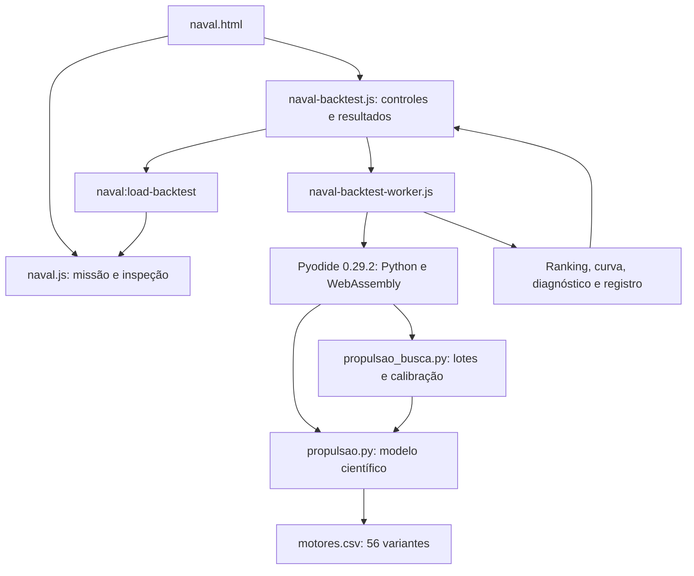
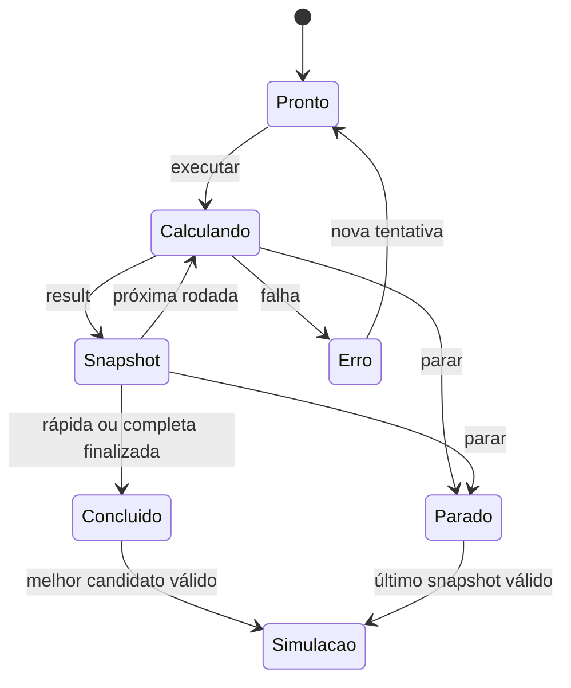

# Manual completo do simulador de propulsão naval

**Edição:** 13 de outubro de 2026, atualização de comparação por pás e PDF. **Contrato do navegador:** `WEB_API_VERSION = 4`. **Versão dos recursos de busca:** `exploration-4-pas-pdf`.

Este documento reúne manual de operação, referência matemática, descrição da implementação, contratos de dados, procedimentos de reprodução e transcrição integral dos arquivos do sistema. A descrição foi conferida contra a implementação local. Os anexos são cópias dos arquivos, sem omissão de coeficientes, funções ou testes; apenas as terminações de linha são normalizadas para LF.

O conteúdo distingue três coisas: o que o código calcula, o que a interface apresenta e o que ainda não está validado ou implementado. “Compatível” significa atendimento ao layout simplificado do catálogo, e “melhor” significa melhor candidato encontrado segundo os critérios e o espaço de busca configurados.

## 1. Como consultar este documento

| Interesse | Seções |
|---|---|
| Usar a página e carregar resultados | 3, 4, 19 e 20 |
| Entender os cálculos e as unidades | 5 a 13 |
| Entender malhas, ranking e calibração | 14 a 18 |
| Executar Python e reproduzir resultados | 21 a 23 |
| Entender falhas e limitações | 24 e 25 |
| Verificar testes e manutenção | 26 a 28 |
| Consultar parâmetros, funções e código integral | Inventários e anexos ao final |

As equações abaixo usam ponto decimal em pseudocódigo e frações adimensionais. Na interface, a formatação visual utiliza `pt-BR`, com vírgula decimal. Campos de porcentagem no CONFIG usam números como `15`, enquanto carga, eficiências e violações usam frações como `0.80` e `0.0695`.

## 2. Visão geral e arquitetura

O projeto é um site estático, compatível com GitHub Pages. Não há um servidor próprio calculando propulsão, banco de dados do simulador ou envio de planilhas a uma API de cálculo. O servidor entrega arquivos; o navegador executa JavaScript e carrega Python/WebAssembly quando a automação é solicitada.

Existem dois caminhos numéricos. A missão visual usa o motor JavaScript de `naval.js`. O backtest e a calibração usam os módulos Python `propulsao.py` e `propulsao_busca.py`, executados em um Web Worker por Pyodide. O mesmo módulo científico também pode ser executado diretamente no Python do computador.



### 2.1 Responsabilidades dos arquivos

| Arquivo | Responsabilidade |
|---|---|
| `naval.html` | Estrutura dos painéis, inputs, seletores, SVG do navio, tabelas, gráficos e diálogo de equações |
| `naval.css` | Tema do laboratório, responsividade, animação visual, controles e tabelas |
| `naval.js` | Série B em JavaScript, estado da missão, curvas, integração visual, importação do resultado e exportações da simulação |
| `naval-backtest.js` | Leitura do JSON, escolha de modo, comunicação com o Worker, continuidade, parada e downloads |
| `naval-backtest-worker.js` | Inicialização do Pyodide, importação dos módulos e planilhas, execução de uma rodada e serialização das saídas |
| `projects/propulsao.py` | CONFIG, resistência, coeficientes propulsivos, Série B, cavitação, margens, motores, consumo, backtest básico, relatório e CLI |
| `projects/propulsao_busca.py` | Perfis, divisão em lotes, ranking global e exploração/calibração em rodadas |
| `projects/motores.csv` | Variantes de motor com cilindros definidos e origem dos valores |
| `projects/CATALOGO_MOTORES.md` | Proveniência e limitações do catálogo |
| `projects/requirements-propulsao.txt` | Dependências da execução Python local |
| `minimal.css`, `minimal.js`, `favicon.svg` | Apresentação e comportamento compartilhados do portfólio |
| `projects/test_propulsao*.py` | Testes numéricos, de busca, diagnóstico e calibração |
| `projects/test_propulsao_worker.cjs` | Teste do protocolo real do Worker dentro de Pyodide |
| `projects/test_propulsao_browser.cjs` | Teste da interface, downloads, parada e transferência em navegador |

`naval-hub.js`, a home e o aplicativo ML Learner não fazem parte do motor deste simulador. A planilha `analise_propulsao.xlsx` é uma análise de referência, não uma dependência de execução nem a planilha Holtrop que o importador espera.

### 2.2 Cópia local e versão publicada

A cópia local de `naval.html` contém os recursos do laboratório e o cabeçalho compartilhado. A versão publicada preserva também `i18n.css` e `i18n.js`, para o seletor de idioma do portfólio. Quando disponíveis na cópia publicada usada para montar este manual, esses três arquivos aparecem em um suplemento separado. O suplemento não altera os modelos hidrodinâmicos e evita apresentar duas variantes de HTML como se fossem um único arquivo idêntico.

Os códigos científicos e de controle são transcritos da cópia local indicada no manifesto. Um manual é um snapshot: depois de editar um arquivo de origem, sua transcrição precisa ser regenerada e a explicação revisada.

## 3. Modos de operação disponíveis

| Modo | Entrada principal | Resultado |
|---|---|---|
| Missão didática | Campos do formulário superior | Série B, curvas, empuxo, potência e dinâmica visual com resistência quadrática |
| Backtest finito | CONFIG + perfil + objetivo | Ranking do catálogo inteiro, diagnóstico e curva da melhor hélice |
| Calibração rápida | CONFIG + motor opcional | Uma rodada ampla, seguida de carregamento automático do melhor resultado válido |
| Calibração completa | CONFIG + motor opcional | Busca ampla completa e três refinamentos por número de pás |
| Exploração contínua | CONFIG + motor opcional | Rodadas alternadas de refinamento e cobertura global por blocos até parar |
| Python local | CLI ou chamadas de funções | Mesmos cálculos científicos, arquivos de saída e APIs de busca |

O seletor **Alternativas de pás** tem duas opções. **Explorar todas** sobrescreve a lista de pás do CONFIG efetivo com `[2,3,4,5,6,7]`. **Respeitar apenas as pás do JSON** mantém a lista informada. Esta escolha é aplicada antes de enviar a configuração ao Worker e fica refletida na configuração do resultado.

Escolher todas as pás não elimina os limites de área. Por exemplo, com AE/AO fixado em `0.70`, uma hélice de duas pás não pertence ao espaço permitido da Série B implementada, cujo intervalo para Z=2 é `0.30–0.38`. Nesse caso, ela não constitui uma alternativa válida naquele intervalo de área.

## 4. Operação da interface, passo a passo

### 4.1 Missão superior

1. Informe velocidade, RPM, diâmetro, pás, passo relativo, área relativa, esteira, dedução de empuxo e propriedades da água.
2. Escolha o nível A, B ou C do modelo de hélice.
3. A alteração de um input agenda um recálculo após 120 ms e interrompe a animação em curso.
4. **Atualizar simulação** recalcula o ponto configurado e inicia a animação de aceleração quando as entradas e a resistência são válidas.
5. Os gráficos mostram KT, 10KQ e η₀ contra J, com o ponto de operação e o máximo de eficiência amostrado.
6. O diálogo de equações apresenta fórmulas, substituições e unidades do ponto configurado.

### 4.2 Backtest finito

1. Clique em **Carregar configuração**. O primeiro carregamento inicializa Pyodide e os pacotes.
2. Edite o JSON do navio, dos intervalos, das restrições e das margens.
3. Opcionalmente importe uma planilha Holtrop `.xls` ou `.xlsx` no layout esperado.
4. Escolha pás, perfil de malha e objetivo BHP ou FOC.
5. Execute e acompanhe a contagem de combinações.
6. Examine funil, ranking, motor mais próximo, violações, fatores de margem e perfil de velocidades.
7. Use **Testar melhor hélice na simulação** para transferir um backtest finito normal; esse caminho mantém o botão manual.

### 4.3 Calibração e exploração até parar

No modo de calibração, o motor pode permanecer sem seleção. Assim, o catálogo configurado inteiro participa da comparação. Quando um motor é escolhido, a busca usa somente aquela variante; uma outra variante não pode aprovar um candidato no lugar dela.

No backtest normal há também **Explorar até parar · sem motor específico**. Essa opção aciona o mesmo mecanismo contínuo com motor vazio, sem exigir que o usuário entre em uma seleção de motor.

Na rápida, uma rodada é concluída. Na completa, a interface solicita quatro rodadas no total. Na infinita, a interface solicita a rodada seguinte enquanto a busca estiver ativa. A decisão de continuar é JavaScript, não um laço Python que bloqueia indefinidamente a comunicação.

Ao concluir a calibração finita ou ao pressionar parar, o último melhor candidato concluído é transferido automaticamente ao painel superior. Se uma rodada está em andamento, seu trabalho incompleto não substitui o último resultado finalizado. Se nenhum candidato válido existe, a missão anterior é preservada.

## 5. Unidades, símbolos e separação entre navio, hélice e motor

| Símbolo/campo | Significado | Unidade ou convenção |
|---|---|---|
| `V_nos`, `speed` | Velocidade do navio | nós |
| V | Velocidade convertida | m/s |
| Va | Velocidade de avanço na hélice | m/s |
| `rpm` | Rotação de serviço da hélice | rpm |
| n | Rotação por segundo | rps = rpm/60 |
| D | Diâmetro | m |
| Z | Número inteiro de pás | 2 a 7 na implementação |
| P/D | Passo dividido pelo diâmetro | adimensional |
| AE/AO | Área expandida relativa | adimensional |
| J | Coeficiente de avanço | adimensional |
| KT, KQ | Coeficientes de empuxo e torque | adimensionais |
| RT | Resistência total em Python | kN |
| `resistance`, `thrust` | Resistência/empuxo em JavaScript | N |
| Q | Torque | Python: kN·m; JavaScript: N·m |
| EHP | Potência efetiva RT × V | kW |
| PD | Potência entregue à hélice | W no cálculo JS, exibida em kW por hélice |
| BHP | Potência de serviço do motor | kW por motor |
| MCR | Potência de referência com margens | kW por motor |
| `RPM_MCR` | Rotação com margens | rpm |
| `navio.deslocamento` | Volume deslocado usado por Holtrop | m³, não toneladas |
| `displacement` | Entrada da dinâmica visual | toneladas |
| ρ | Densidade | kg/m³ |
| μ | Viscosidade dinâmica | Pa·s |
| ν | Viscosidade cinemática | m²/s = μ/ρ |
| SFOC | Consumo específico | g/kWh |
| FOC | Consumo total dos motores | t/h |
| w, t | Esteira e dedução de empuxo | frações |
| η₀, ηH, ηR, ηD, ηt | Eficiências | frações, exibidas em % |

Conversões fundamentais:

```text
V = velocidade_nos × 1852 / 3600
n = rpm / 60
ν = μ / ρ
massa_em_toneladas = volume_em_m³ × ρ / 1000
N → kN: dividir por 1000
W → kW: dividir por 1000
g/h → t/h: dividir por 1 000 000
```

A resistência RT e a potência efetiva EHP pertencem ao navio inteiro. O empuxo total necessário é dividido entre `n_helices`. A potência do conjunto é dividida entre `n_motores`. A interface superior mostra empuxo e potência entregue **por hélice**, mas a folga de empuxo utiliza a contribuição total das hélices.

## 6. CONFIG e valores iniciais

Há dois conjuntos iniciais deliberadamente distintos. A missão didática começa com 12 nós, 100 rpm, D=5 m, quatro pás, P/D=0.75, AE/AO=0.74 e resistência de referência de 150.4 kN. O CONFIG científico começa com o Navio Holtrop, Lpp=200 m, Lwl=205 m, boca=32 m, calados=10 m, volume=37500 m³ e velocidade de 25 nós.

Não se deve comparar a potência da missão de 12 nós com o backtest do navio de 25 nós como se fossem a mesma condição. Os dados de um resultado importado substituem os campos da missão e instalam um contexto Holtrop.

### 6.1 Grupos de configuração

| Grupo | O que controla |
|---|---|
| `navio` | Geometria, bulbo, transom, apêndices, velocidade, quantidade de hélices e motores |
| `agua` | Densidade, viscosidade, gravidade e pressões usadas em Burrill |
| `helice` | Lista de pás, intervalos/steps de D, P/D e AE/AO, limites de RPM |
| `restricoes` | J, η₀, cavitação, Ta/D, limite de MCR e modo estrito/informativo |
| `margens` | Mar, rotação, operação, expoente e eficiência de transmissão |
| `motor` | Catálogo e modelo de consumo; pode receber um catálogo incorporado em um registro |
| `compat_planilha` | Reprodução de aspectos específicos da planilha original |
| `backtest` | Objetivo, quantidade de linhas no topo e diretório de saída |
| `perfil_velocidades` | Velocidades da curva científica exportada |
| `calibracao` | Metadados adicionados durante a execução, não um input obrigatório do CONFIG inicial |

O inventário automático de parâmetros ao final lista as folhas do CONFIG e seus valores de origem. O bloco integral de `propulsao.py` preserva também os comentários com células da planilha.

### 6.2 Validação efetivamente implementada

`validar_config` verifica dimensões principais positivas e finitas, água positiva, números de motores/hélices em 1 ou 2, pás reconhecidas, intervalos ordenados, steps positivos, RPM máxima maior que mínima, objetivo válido, top entre 1 e 100, velocidades positivas, faixa SFOC coerente e margens não negativas.

O tamanho da malha é calculado considerando os limites de área por número de pás. Uma chamada básica aceita, por padrão, no máximo 150000 candidatos; a mensagem de erro informa o tamanho. O parâmetro `verbose` imprime a contagem. O parâmetro `limite_malha=None` permite validar sem impor esse limite na preparação de uma execução em lotes.

Isso não constitui uma validação completa da geometria naval. Nem todos os coeficientes, denominadores e domínios das fórmulas empíricas são verificados antecipadamente. O intervalo declarado de referência de P/D é 0.50–1.40, mas o validador Python não contém uma checagem explícita que imponha esses dois extremos; editar o JSON além deles pode levar a extrapolação. A interface JavaScript emite avisos para várias faixas, em vez de tratar todos os avisos como erros fatais.

## 7. Resistência Holtrop-Mennen implementada

`resistencia(nv, ag, v_kn, compat=False)` é escalar em velocidade e retorna resistência em kN, potência efetiva em kW e coeficientes intermediários. Ela espelha as expressões reconstruídas da planilha do projeto.

### 7.1 Preparação geométrica

```text
T = (calado_proa + calado_popa) / 2
CB = volume / (B × Lwl × T)
Cp = volume / (Cm × B × T × Lwl)
lcb[%] = ((lcb_pr + Lwl - Lpp) - Lwl/2) / Lwl × 100
Lr = (1 - Cp + 0.06 Cp lcb/(4 Cp - 1)) × Lwl
Fn = V / sqrt(g × Lwl)
Re = V × Lwl / ν
Cf = 0.075 / (log10(Re) - 2)²
```

A função calcula a superfície molhada S por uma expressão de geometria do casco acrescida do termo de bulbo. A soma das áreas dos apêndices é `sapp`. `k2eq` é a média dos fatores de apêndices ponderada por área; sem área de apêndices, vale 1.

### 7.2 Componentes e soma

```text
q_kN = 0.0005 × ρ × V²
Rf = q_kN × S × Cf
Rapp = q_kN × sapp × k2eq × Cf
Ra = q_kN × S × Ca
RT = Rf × k1 + Rapp + Rw + Rb + Rtr + Ra
EHP_kW = RT_kN × V_ms
```

O nome retornado `k1` representa o fator **1+k1** da planilha, já completo. Portanto a soma usa `Rf*k1`; adicionar novamente 1 modificaria o modelo. O fator combinado `kk` participa de `Cv`, que é usado nos coeficientes propulsivos.

| Parcela | Cálculo/papel |
|---|---|
| Rf × k1 | Atrito do casco corrigido pelo fator de forma |
| Rapp | Resistência dos apêndices ponderados por área |
| Rw | Resistência de ondas em regimes de Fn |
| Rb | Resistência adicional associada ao bulbo |
| Rtr | Parcela do espelho de popa/transom |
| Ra | Correlação modelo-navio |

### 7.3 Ondas e ressalva da interpolação

O código monta `c7`, `ie`, `c1`, `c3`, `c2`, `c5`, `c16`, `m1`, `c15`, `m4`, `lam`, `m3` e `c17`. As expressões exatas, seus expoentes e suas decisões condicionais estão no código integral.

Para Fn ≤ 0.4 utiliza `rw_a`; para Fn > 0.55 utiliza `rw_b`; no intervalo intermediário utiliza `rw04`. A expressão intermediária conserva a construção da planilha, incluindo avaliação em 0.44 e 0.55. Essa parte continua pendente de conferência contra a formulação original. O manual não apresenta essa interpolação como uma correção científica já concluída.

Quando L³/volume > 1726, `c15` é zero no modo padrão e 91 no modo de compatibilidade. O código calcula ainda submersão do bulbo, seu Froude local, Froude do transom e coeficiente Ca. Não há resistência de bow thruster acrescentada ao total.

## 8. Coeficientes propulsivos e cadeia de eficiência

`coef_propulsivos` aceita arrays de geometria por broadcasting NumPy. Ela calcula `w`, `t` e `etaR`, recalculando sua dependência da hélice em cada combinação. O ramo de hélice única usa os coeficientes `c8`, `c9`, `c11`, `c19`, `c20` e `cp1`; o ramo de duas hélices utiliza expressões próprias.

```text
Va = V × (1-w)
ηH = (1-t)/(1-w)
ηD = η₀ × ηH × ηR
BHP_por_motor = EHP / (ηH × η₀ × ηR × ηt × n_motores)
```

η₀ é eficiência em águas abertas. ηH representa o efeito de interação casco-hélice e pode ser maior que 1; isso não equivale a uma máquina criando energia. ηD combina as três parcelas propulsivas. ηt corresponde à transmissão e aparece separadamente na conversão para BHP.

O modo `compat_planilha` substitui um termo de esteira por zero para reproduzir o comportamento de uma referência de célula vazia. Também modifica a potência do backtest multiplicando-a por ηH. Esse modo existe para comparar implementações com a planilha, não para esconder a distinção entre cadeias físicas.

## 9. Hélice Wageningen Série B

### 9.1 Polinômios

Existem 39 termos de KT e 47 termos de KQ. Cada termo tem coeficiente e quatro expoentes:

```text
KT = Σ Cᵢ × J^sᵢ × (P/D)^tᵢ × (AE/AO)^uᵢ × Z^vᵢ
KQ = Σ Cᵢ × J^sᵢ × (P/D)^tᵢ × (AE/AO)^uᵢ × Z^vᵢ
J = Va/(nD)
η₀ = J × KT/(2π × KQ)
```

`_poli` expande os arrays e soma a última dimensão. O JavaScript `poly` realiza a soma termo a termo. As listas completas de coeficientes e expoentes estão incluídas nos dois códigos; nenhum gráfico externo é necessário para interpolar KT/KQ no modelo implementado.

### 9.2 Reynolds e rugosidade

```text
c075 = 2.073 × (AE/AO) × D / Z
Rn075 = c075 × sqrt(Va² + (0.75πnD)²) / ν
lrn = log10(max(Rn075,1)) - 0.301
t/c = (0.0185 - 0.00125 Z) × D / c075
ΔCD = (2+4t/c) × [0.003605 - (1.89+1.62log10(c075/0.00003))^(-2.5)]
KT_s = KT_0 + ΔKT_Rn + ΔCD × 0.3 × (P/D) × c075 × Z / D
KQ_s = KQ_0 + ΔKQ_Rn - ΔCD × 0.25 × c075 × Z / D
```

Os polinômios de correção de Reynolds usam seis colunas: coeficiente e expoentes de `lrn`, Z, AE/AO, P/D e J. As correções Reynolds são ativadas quando Rn > 2×10⁶. O valor de rugosidade usado na expressão é 30 μm, sem um input separado de rugosidade na interface.

No Python `serie_b`, a correção de rugosidade é acrescentada mesmo se a correção Reynolds estiver desligada. No JavaScript, o nível A é polinômio puro, B acrescenta Reynolds e C acrescenta rugosidade; para Rn ≤ 2×10⁶, o nível efetivo regride a A e não acrescenta rugosidade. Portanto existe uma diferença de tratamento no regime de baixo Reynolds. Os casos de transferência testados operam no regime em que a equivalência foi conferida.

No Python, η₀ inválida, não finita ou fora de 0–1 é substituída por 0.001 antes das restrições de eficiência. No JavaScript, KT/KQ não positivos produzem η₀ zero e avisos. Isso é um tratamento computacional, não uma eficiência física atribuída a uma condição inválida.

### 9.3 Limites por número de pás

| Z | AE/AO mínimo | AE/AO máximo |
|---|---|---|
| 2 | 0.30 | 0.38 |
| 3 | 0.35 | 0.80 |
| 4 | 0.40 | 1.00 |
| 5 | 0.45 | 1.05 |
| 6 | 0.50 | 0.80 |
| 7 | 0.55 | 0.85 |

O backtest intersecta esses limites com o intervalo do usuário. A missão JavaScript também apresenta os limites, mas usa avisos de extrapolação quando os campos manuais estão fora deles.

### 9.4 Empuxo, torque e potência

```text
T_por_helice = KT_s × ρ × n² × D⁴
Q_por_helice = KQ_s × ρ × n² × D⁵
PD_por_helice = 2πnQ
T_liquido_total = T_por_helice × n_helices × (1-t)
folga = T_liquido_total - resistência_total
```

As equações acima estão em N, N·m e W quando ρ está em kg/m³. As funções Python convertem os resultados apresentados em kN e kN·m. Um empate visual de empuxo considera tolerância relativa de 2% na missão; o solver de RPM usa bisseção numérica e não essa tolerância visual.

## 10. Solver de RPM e equilíbrio de empuxo

`_resolver_rpm` procura uma raiz para cada geometria, simultaneamente:

```text
f(n) = KT_s(Va/(nD),...) × ρ × n² × D⁴ / 1000 - T_requerido_por_helice_kN
T_requerido_por_helice = RT/[(1-t) × n_helices]
lo = max(rpm_min/60, Va/(1.5D))
hi = rpm_max/60
aceita_bracket = f(lo)<0 e f(hi)>0 e lo<hi
```

A rotina executa 60 iterações por padrão. Em cada iteração avalia o meio do intervalo e substitui uma das extremidades conforme o sinal. Retorna a média final em rpm e um array booleano de brackets válidos.

O algoritmo usa a hipótese operacional de um cruzamento apropriado no intervalo. Não procura todas as raízes de uma função arbitrária. Os sinais dos extremos são estritos; uma raiz exatamente na extremidade pode não passar no critério atual. A bisseção ainda é calculada em arrays que incluem brackets inválidos, mas o backtest descarta os elementos marcados como inválidos.

RPM não é um quarto eixo enumerado do grid principal. Os eixos enumerados são Z, D, AE/AO e P/D; para cada combinação, RPM é resolvida para atender o empuxo necessário. Essa distinção evita apresentar o total de combinações como se incluísse uma malha independente de rotações.

## 11. Cavitação de Burrill

`burrill` usa pressão local na profundidade do eixo e velocidade relativa em 0.7R:

```text
h = calado_popa - D/2
Δp = p_atm - p_vapor + ρgh
q = 0.5ρ × [Va² + (0.7πnD)²]
σ = Δp/q
AO = πD²/4
Ap = AO × (AE/AO) × (1.067 - 0.229P/D)
τc = T_por_helice_N/(Ap × q)
τmax = a × ln(σ) + b
aprovado = τc ≤ τmax e τmax > 0
```

| Percentual escolhido | a | b |
|---|---|---|
| 5 | 0.1082 | 0.2675 |
| 10 | 0.1452 | 0.3498 |
| 20 | 0.1852 | 0.4577 |
| 30 | 0.2148 | 0.5276 |

O percentual seleciona a curva ajustada; não é uma medição obtida do casco ou uma simulação de bolhas. O material de origem indica validade aproximada das retas para σ de 0.16 a 1.5. O código atual não implementa um filtro separado para esse intervalo; deve-se examinar σ antes de interpretar uma extrapolação.

Na busca, o empuxo usado em τc é o requerido por hélice no equilíbrio. Na inspeção JavaScript de um ponto alterado manualmente, é o empuxo calculado da hélice. Portanto o critério pode mudar ao editar RPM, mesmo que a resistência de referência do casco permaneça a mesma.

## 12. Margens e ponto MCR

`margens(bhp,rpm,mg)` produz uma cadeia completa, não apenas uma multiplicação final:

```text
bhp1 = BHP × (1+mar/100)
rpm1 = rpm × (1+mar/100)^e
rpm2 = rpm1 × (1+rotacao/100)
bhp2 = bhp1 × (rpm2/rpm1)^3
bhp3 = bhp2 × (1+operacional/100)
rpm3 = rpm2 × (bhp3/bhp2)^e
MCR = bhp3
RPM_MCR = rpm3
```

Logo:

```text
fator_potencia = (1+mar/100) × (1+rotacao/100)^3 × (1+operacional/100)
fator_rpm = (1+mar/100)^e × (1+rotacao/100) × (1+operacional/100)^e
```

Para 15%, 5%, 10% e e=1/3, o fator de potência é **1.464395625** e o de rotação aproximadamente **1.13558454755598**. A margem de rotação de 5% corresponde a um fator de potência 1.05³=1.157625 naquela etapa. Não se deve interpretar o fator total como simples soma de 15+5+10%.

O padrão de transmissão é ηt=0.97 em acoplamento direto e 0.93 com caixa. O modo caixa muda a eficiência, mas não aplica uma relação de redução. A comparação de RPM no catálogo continua sendo a comparação direta do ponto calculado; o sistema não dimensiona um redutor.

## 13. Motores, compatibilidade e diagnóstico

### 13.1 Origem e precedência do catálogo

O CSV contém 56 variantes de 12 famílias com número de cilindros definido. A fonte efetivamente consultada foi o [Marine Engine Programme 2021, documento oficial MAN](https://man-es.com/docs/default-source/document-sync-archive/marine-engine-programme-eng.pdf). O Project Guide identificado na consulta anterior retornou 404. O sistema registra esse catálogo como histórico e mantém a hipótese simplificada P ∝ n nas bordas.

`carregar_motores` dá prioridade a `motor.catalogo_registrado`. Sem ele, procura o caminho de `arquivo_csv` no diretório de execução e, para caminhos relativos ausentes, junto de `propulsao.py`. Se o arquivo não existe, usa a constante aproximada `MOTORES` como reserva. Um CSV encontrado porém inválido gera erro; não é silenciosamente tratado como um catálogo verificado.

As cinco colunas obrigatórias são `modelo`, `n_min`, `n_max`, `p_max_kw`, `p_min_kw`. As colunas de família, cilindros, fonte, página e edição fornecem proveniência. Para o 8G90ME-C10.5, o CSV registra 72–84 rpm, 49920 kW máximos e 37360 kW mínimos em 84 rpm.

### 13.2 Teste de compatibilidade

```text
n_min ≤ RPM_MCR ≤ n_max
f = RPM_MCR/n_max
p_min_kw × f ≤ MCR_kW ≤ p_max_kw × f
```

`motores_que_cabem` retorna os nomes aprovados ordenados pela potência máxima admissível no ponto e pelo nome em desempate. O ranking guarda no máximo três nomes unidos por vírgula em `Motores`. `-` significa que nenhum layout do catálogo utilizado aprovou o ponto.

### 13.3 Motor mais próximo e medida de violação

Para cada candidato e cada motor:

```text
rpm_layout = clip(RPM_MCR,n_min,n_max)
Pmin = p_min_kw × rpm_layout/n_max
Pmax = p_max_kw × rpm_layout/n_max
viol_rpm = max(0,(n_min-RPM_MCR)/RPM_MCR,(RPM_MCR-n_max)/RPM_MCR)
viol_kw = max(0,(Pmin-MCR)/MCR,(MCR-Pmax)/MCR)
viol_total = max(viol_rpm,viol_kw)
```

O motor mais próximo minimiza `viol_total`; empates preservam a ordem do catálogo. A potência é avaliada em uma rotação limitada ao layout, não extrapolada acima da rotação máxima para produzir um limite artificialmente maior. Os denominadores são os valores solicitados, conforme as fórmulas da aba `Folga_motor` da planilha de análise.

Por isso 90.274 rpm contra 84 rpm representam uma violação próxima de 6.95% usando `(90.274-84)/90.274`. Se a pergunta fosse aumento relativo ao limite do motor, o denominador seria 84 e o percentual seria outro. Os dois números não devem ser trocados no relatório.

O diagnóstico acrescenta `motor_proximo`, `viol_rpm`, `viol_kw`, `viol_total`, `motor_n_min`, `motor_n_max`, `rpm_layout`, `motor_p_min_kw`, `motor_p_max_kw` e `motivo_motor`. O motivo distingue só RPM, só potência, ambas ou cabe. Uma violação é uma distância normalizada de projeto, não uma probabilidade de aprovação.

## 14. Consumo e curva de velocidades

### 14.1 Modelo SFOC

```text
carga_real = BHP/MCR
carga_sfoc = clip(carga_real,carga_min_sfoc,carga_max_sfoc)
SFOC = sfoc_min × [1+curvatura × (carga_sfoc-carga_otima)²]
FOC_total = SFOC × BHP_por_motor × n_motores / 1 000 000
```

O padrão usa SFOC mínimo 165 g/kWh, ótimo em 80%, curvatura 0.30 e faixa de carga 25–100%. É uma parábola genérica, não uma curva medida de cada motor do CSV. Escolher outro motor não importa automaticamente sua curva CEAS nem atualiza `sfoc_min`.

`FOC_MCR_t_h` no ranking multiplica o SFOC calculado pelo MCR, como a aproximação de planilha descrita no projeto. Não deve ser confundido com consumo medido em plena carga nem com o consumo de serviço `FOC_t_h`.

### 14.2 Curva científica

`curva_velocidades` usa a hélice vencedora em todas as velocidades configuradas. Para cada velocidade recalcula resistência, w, t, ηR e RPM de equilíbrio; a busca de RPM da curva começa em 5 rpm e termina no máximo de RPM configurado, não necessariamente no mínimo do grid de serviço.

| Condição | Comportamento |
|---|---|
| Sem hélice | Retorna RT/EHP e status “sem hélice selecionada” |
| Sem bracket de RPM | Marca “fora do envelope: sem equilíbrio na faixa de rpm” |
| Carga abaixo de 25% no padrão | Limita SFOC; `FOC_t_h` fica ausente e a estimativa separada é mantida |
| Carga válida com MCR de referência | `FOC_t_h` recebe a estimativa e `consumo_confiavel` é verdadeiro |
| Carga acima da faixa SFOC configurada | Consumo principal ausente; estimativa limitada separada |
| Carga acima de 100% | Marca explicitamente “fora do envelope” |

Os campos são `carga`, `carga_sfoc`, `SFOC_g_kWh`, `status_envelope`, `consumo_confiavel`, `FOC_limitado_t_h` e `FOC_t_h`. Na serialização para o navegador, valores ausentes tornam-se `null`; em CSV normalmente aparecem como células vazias.

`consumo_confiavel` indica somente atendimento à faixa de carga do modelo com referência MCR; não certifica o catálogo, o consumo real, a cavitação em toda a viagem nem a operação do motor em todas as velocidades. A curva não refaz a seleção do catálogo de motores em cada ponto e não aplica um envelope completo do fabricante.

## 15. Backtest básico: ordem exata do funil

`backtest` retorna `(g, sem_motor, funil, resistencia)`. O fluxo é:

1. Validar o CONFIG e o tamanho da malha.
2. Calcular a resistência no ponto de serviço.
3. Resolver D máximo: valor explícito ou calado de popa dividido por Ta/D mínimo.
4. Gerar e combinar malhas D × AE/AO × P/D separadamente para cada Z permitido.
5. Recalcular w, t e ηR e resolver a RPM para cada geometria.
6. Descartar brackets inválidos de empuxo.
7. Calcular J, KT, KQ, η₀, ηH e ηD.
8. Filtrar J mínimo e KT/KQ positivos.
9. Filtrar η₀ mínimo e máximo.
10. Aplicar Burrill.
11. Calcular BHP, MCR e RPM_MCR.
12. Aplicar um limite opcional de MCR por motor.
13. Calcular diagnóstico e motores aprovados.
14. Copiar a tabela de candidatos hidrodinamicamente válidos para `sem_motor`.
15. No modo estrito, filtrar `g` por motores aprovados.
16. Calcular SFOC, FOC de serviço e FOC_MCR.
17. Ordenar as tabelas e retornar as contagens.

Consequentemente, o diagnóstico não contém as geometrias eliminadas antes de cavitação, eficiência, equilíbrio ou limite opcional de MCR. Ele contém todos os candidatos que chegaram à análise do catálogo. O nome `sem_motor` significa “sem exigir aprovação final do catálogo”, e não “uma tabela sem informações de motor”.

### 15.1 Ordenação

| Tabela/modo | Chaves principais |
|---|---|
| `g`, estrito | Objetivo BHP ou FOC |
| `g`, informativo | Violação total, depois objetivo |
| `sem_motor` | Violação total, depois objetivo |
| Desempate final | Z, D, AE/AO, P/D, com ordenação estável |

O critério BHP corresponde à coluna `BHP_kW`; FOC corresponde a `FOC_t_h`. Com os parâmetros padrão, a razão BHP/MCR é constante pela cadeia de margens, e o modelo SFOC é igual entre muitos candidatos. Por isso os dois objetivos podem produzir ordenações muito semelhantes; isso não demonstra que consumo e potência sejam universalmente equivalentes.

## 16. Perfis e processamento em lotes

| Perfil | ΔD | ΔAE/AO | ΔP/D |
|---|---|---|---|
| Rápido | 0.25 m | 0.10 | 0.10 |
| Completo | 0.10 m | 0.05 | 0.05 |
| Extremamente detalhado | 0.05 m | 0.025 | 0.025 |
| Personalizado | CONFIG | CONFIG | CONFIG |

`configurar_perfil` cria uma cópia profunda e altera somente os três steps. Os limites e os inputs do navio não são ampliados. `_faixa` utiliza `np.arange(min,max+1e-9,step)` e arredonda os valores a seis casas; o teto só é incluído se for atingido pela malha. Por exemplo, um intervalo com máximo 8.04 e step 0.1 iniciado em 5.0 termina em 8.0.

Contagens calculadas com o CONFIG científico desta edição:

| Lista de pás | Rápido | Completo | Detalhado |
|---|---|---|---|
| `[3,4,5,6,7]`, padrão do arquivo Python | 3510 | 29450 | 214415 |
| `[2,3,4,5,6,7]`, escolha “todas” da interface | 3640 | 30628 | 223443 |

Esses totais dependem de diâmetro, área, passo e seus limites. Não são constantes universais nem números que devam aparecer para um navio importado diferente.

`backtest_perfil` recebe `tamanho_lote=8000` por padrão. Calcula quantos valores de diâmetro cabem em um lote para cada Z, considerando quantidade de áreas e passos. Cada lote chama o backtest básico com uma faixa de diâmetro parcial. A rotina limita a estimativa preliminar total a 2 milhões de combinações e rejeita um plano de área × passo maior que o limite de um lote básico.

O teste preliminar de 2 milhões usa uma estimativa conservadora antes dos limites individuais de área e não é uma promessa de que toda configuração com menos de 2 milhões reais será aceita. Também não é um limite acumulado da exploração infinita: esta realiza muitas chamadas pequenas.

O ranking global mescla os melhores de cada lote, preserva o top N e soma o funil. O CSV diagnóstico é escrito em partes, com cabeçalho apenas na primeira parte; a ordenação de um arquivo diagnóstico completo não é necessariamente uma ordenação global por violação. Para ler o ranking, use `ranking.csv` ou ordene explicitamente o diagnóstico.

## 17. Calibração: seleção, memória e refinamento

`calibrar_motor` executa **uma rodada** e retorna seis objetos:

```python
aprovados, candidatos, funil, resistencia, config_resultado, estado = calibrar_motor(
    cfg, motor=None, nivel="infinita", estado=estado_anterior,
    progresso=callback, diagnostico_destino="diagnostico_motor.csv"
)
```

### 17.1 Catálogo e variáveis preservadas

Se `motor` tem um nome, a função encontra exatamente esse nome no catálogo, incorpora somente sua linha ao CONFIG e usa modo estrito. Se não há nome, mantém o catálogo da configuração. “Todo o catálogo” significa todo o catálogo **configurado**, que pode ser um catálogo incorporado pelo usuário, e não todos os motores existentes no mercado.

Os números de pás válidos são a lista configurada intersectada com a possibilidade de AE/AO para cada Z. A função não modifica velocidade de serviço, forma do casco, número de motores, número de hélices, margens, pressão, limite de RPM ou Ta/D para conseguir uma aprovação. Esses são inputs do problema.

### 17.2 Memória de candidatos

O estado guarda um ranking global e até cinco candidatos por número de pás. Isso impede que o top global dominado por Z=5 apague todas as referências úteis de Z=3, 4, 6 ou 7.

Ao mesclar rodadas, a chave de identidade é `(Z,D,AE/AO,P/D)`. Cópias da mesma geometria são removidas. A ordenação prioriza `viol_total` e depois o objetivo BHP/FOC e os desempates geométricos. Assim, zero de violação tem prioridade; quando nenhum ponto cabe, o melhor diagnóstico é preservado.

### 17.3 Rodada inicial

Na rápida e na infinita, a rodada inicial usa o perfil rápido. Na completa, usa o completo. A rodada ampla é montada separadamente para cada Z válido, conservando informações por pás antes de cortar o ranking global.

### 17.4 Refinamento por pás

Para cada Z, o código escolhe ciclicamente um dos candidatos preservados daquela categoria. Monta uma janela em torno dele para cada um dos três parâmetros contínuos. O step inicial de refinamento é 0.1 para D e 0.05 para área e passo, dividido por `2**min(iteracao,10)` e limitado inferiormente a 0.0001.

A janela tem raio de até dois steps e é recortada pelos limites originais e pelo intervalo válido de área daquele Z. A extremidade inferior é alinhada para preservar o candidato central amostrado quando possível. Os limites são arredondados a seis casas.

Se um Z ainda não tem candidato preservado, ele recebe uma busca ampla rápida dentro de sua faixa. O código não substitui toda a lista de pás pelas pás do campeão global.

## 18. Exploração infinita e cobertura global

### 18.1 Sequência real

O contador `iteracao` no estado significa rodadas já concluídas. A função decide a próxima rodada com base nesse valor:

| Rodada concluída | Estado de entrada | Etapa |
|---|---|---|
| 1 | Sem estado | Varredura ampla |
| 2 | `iteracao=1` | Refinamento de todas as pás |
| 3 | `iteracao=2` | Primeiro bloco global |
| 4 | `iteracao=3` | Refinamento de todas as pás |
| 5 | `iteracao=4` | Segundo bloco global, ou nova resolução se a primeira passagem já acabou |
| Seguintes | Alternado | Refinamento e próximo bloco global |

Na calibração completa o nível não é infinito, então depois da primeira rodada as três seguintes são refinamentos; a interface encerra ao atingir quatro rodadas. A função Python isolada não impõe por si só esse limite de quatro chamadas.

### 18.2 Construção dos blocos

Na resolução global r:

```text
ΔD = max(0.0001,0.10/2^min(r,10))
ΔAE/AO = max(0.0001,0.05/2^min(r,10))
ΔP/D = max(0.0001,0.05/2^min(r,10))
largura do bloco = até 5 valores por eixo
```

São construídos vetores lineares de D e P/D e vetores próprios de área por Z. A maior quantidade de blocos de área entre as pás define a dimensão de blocos de área da passagem. O produto dos números de blocos de D, P/D e área é `blocos_globais`.

```text
d_index = cursor // (n_blocos_P × n_blocos_A)
p_index = (cursor // n_blocos_A) % n_blocos_P
a_index = cursor % n_blocos_A
```

Para cada Z, são selecionadas as fatias correspondentes. Cada grade parcial contém até 5³=125 geometrias daquele Z; o produto cartesiano global inteiro não é criado de uma vez. Se uma categoria possui menos blocos de área que outra, ela não entra nos blocos além do fim de seu vetor. Isso é ausência de geometrias válidas naquela região, não congelamento de Z.

Ao finalizar o último bloco, o cursor volta a zero e a resolução aumenta. Até o mínimo de step, a passagem seguinte é mais fina. Depois de atingir o mínimo, as passagens podem revisitar a mesma resolução. O contador de avaliações acumula execuções, incluindo refinamentos e revisitas; não é uma contagem de geometrias distintas.

### 18.3 O que significa “todas as alternativas”

Uma passagem global concluída cobre todos os pontos válidos **da malha daquela resolução e dos limites configurados**, para as pás permitidas. Não significa enumerar infinitos números reais, ampliar D além da folga de popa, mudar automaticamente o navio, variar a quantidade de motores ou provar ótimo global contínuo.

O teste de cobertura monta o conjunto de tuplas visitadas pelos blocos e o compara ao conjunto cartesiano esperado, além de comparar contagens. Isso verifica ausência de lacunas naquela malha de teste, não apenas igualdade de quantidade.

## 19. Estado, protocolo do Worker e ciclo de vida

### 19.1 Inicialização e cache

O controlador cria um Worker com versão na URL. O Worker carrega Pyodide 0.29.2 do jsDelivr, depois NumPy/Pandas. Obtém `os.getcwd()` do Python e escreve os dois módulos nesse diretório virtual, normalmente `/home/pyodide`, que está no caminho de importação.

As requisições dos módulos e do CSV usam `?v=exploration-4` e `cache:'no-store'`. Antes de executar uma busca, a inicialização verifica API 4 nos dois módulos, presença de `diagnostico_destino` na assinatura de `backtest_perfil` e existência de `calibrar_motor`. Uma versão misturada produz uma mensagem de atualização antes da chamada incompatível.

Um 404 do CSV permite a reserva interna; outros erros de carregamento do catálogo geram falha. A importação de Excel carrega `openpyxl` ou `xlrd` apenas quando solicitada.

### 19.2 Mensagens enviadas

| `action` | Campos | Efeito |
|---|---|---|
| `init` | Nenhum obrigatório | Retorna CONFIG padrão e lista de motores |
| `import` | `config`, `name`, `bytes` | Grava a planilha virtual e atualiza os dados de navio |
| `run` | `config`, `profile` | Executa backtest finito em lotes |
| `calibrate` | `config`, `motor`, `level`, `state` opcional | Executa uma rodada, com motor opcional e estado anterior |

### 19.3 Mensagens recebidas

| `type` | Conteúdo | Tratamento |
|---|---|---|
| `config` | `config`, `motors` na inicialização | Preenche JSON e seletor de motor |
| `progress` | `completed`, `total` | Atualiza barra e contagem da rodada |
| `result` | Pacote completo `result` | Atualiza tabelas, guarda snapshot e eventualmente agenda a próxima rodada |
| `error` | `message` | Mostra a falha e encerra a continuidade ativa |

O pacote `result` contém `config`, `profile`, `calibrationState`, `limits`, `margins`, `marginFactors`, `resistanceCurve`, `funnel`, `ranking`, `curve`, `warning`, `rankingCsv`, `diagnosticCsv`, `configJson`, `curveCsv` e `html`.

### 19.4 Continuidade e parada

O controlador conserva os inputs originais da busca em `calibration`. Ao receber um snapshot concluído, decide se deve continuar: nível infinito sempre continua enquanto ativo; completo continua enquanto `iteracao<4`. Agenda a próxima chamada depois de 100 ms, passando o estado recebido.



Parar limpa o timer e termina o Worker. O estado numérico da rodada interrompida é perdido, mas o último pacote concluído continua no controlador para simulação e download. A instância de Worker é conferida ao receber mensagens para que uma instância antiga não substitua um resultado depois de parada ou reinicialização.

As entradas de modo, motor, perfil, objetivo, pás e arquivo ficam desabilitadas durante a execução. O JSON é uma área editável, mas a busca já recebeu uma configuração serializada no início; editar o texto durante uma busca não altera retroativamente essa busca.

## 20. Transferência exata e funcionamento da simulação superior

### 20.1 Evento de transferência

`loadResult` dispara `CustomEvent('naval:load-backtest',{detail:results})`. `mount` escuta esse evento, para a animação, cancela um recálculo pendente, chama `backtestInput`, instala `backtestContext`, preenche os campos, seleciona o nível C e renderiza o ponto.

| Campo superior | Origem |
|---|---|
| `speed` | `config.navio.velocidade_nos` |
| `rpm` | Primeira linha do ranking, `rpm` |
| `diameter` | `D` |
| `blades` | `Z` |
| `pd` | `P/D` |
| `area` | `Ae/Ao` |
| `wake` | `w` calculado para o candidato |
| `deduction` | `t` calculado para o candidato |
| `rho` | `config.agua.rho` |
| `nu` | `config.agua.mu/config.agua.rho` |
| `displacement` | Volume × densidade / 1000, em toneladas |
| `etaR` | `etaR` do candidato |
| `etaT` | Eficiência do acoplamento configurado |
| `nHelices`, `nMotors` | Quantidades do navio da busca |
| `context.reference` | Linha vencedora completa |
| `context.config` | CONFIG da execução |
| `context.resistanceCurve` | Curva Holtrop de apoio |
| Nome acessível do navio | `config.navio.nome` |

As linhas são serializadas por `json_records` sem aplicar o arredondamento de apresentação das tabelas. A função transforma valores ausentes em `None`, mas conserva os floats do DataFrame. O navegador recebe os valores completos; a exibição em quatro casas ou em percentuais não é utilizada para alimentar a simulação.

### 20.2 Curva Holtrop utilizada pela missão importada

O Worker gera 100 velocidades lineares de 0.5 nós até `max(40,velocidade_servico)`, inclui explicitamente a velocidade de serviço e acrescenta o ponto zero com resistência zero. `resistanceAt` interpola linearmente os pares de resistência em N.

Assim, a velocidade de serviço está incluída como ponto, enquanto velocidades intermediárias usam interpolação. Acima da última velocidade da curva retorna `NaN`, mostra aviso e não inicia a animação por submissão do formulário. Sem contexto importado, usa `150400*(speed/12)²`.

### 20.3 Inspeção de eficiência, potência, cavitação e consumo

`operatingDetails` calcula BHP a partir do torque/potência efetivamente entregues pela hélice no ponto manual:

```text
BHP_kW_por_motor = PD_W_por_helice × n_helices / (ηR × ηt × n_motores × 1000)
carga = BHP/MCR_referencia
```

No equilíbrio físico, essa potência corresponde à cadeia EHP/ηD/ηt. Fora do equilíbrio, uma potência de torque da hélice não deve ser confundida com EHP do casco. O painel informa ηH, ηR, ηD, BHP, MCR de referência, consumo estimado, τc/τmax e motor.

Quando o usuário altera os campos, o JavaScript recalcula a hélice e o consumo, mas **w, t e ηR permanecem os valores dos campos**; ele não executa novamente Holtrop para recomputar automaticamente esses coeficientes em cada edição. MCR e motor permanecem referências do snapshot. Trocar D, passo ou RPM não refaz o ranking do catálogo em segundo plano.

O rótulo do painel é “ponto configurado”. Durante a animação, os quatro indicadores principais e a folga acompanham a velocidade transitória; o painel detalhado e os gráficos gerados por `render` permanecem associados ao ponto configurado. Essa distinção evita interpretar uma tabela estática como telemetria integral do transiente.

### 20.4 Dinâmica visual

`runSimulation` parte de velocidade zero, mantém RPM e geometria configuradas e integra a força líquida com um passo temporal limitado:

```text
mass = max(displacement_t,1) × 1100
dt = min(tempo_real_do_frame,0.05) × 60
V_nova = V_atual + força_liquida/mass × dt
```

O fator 1100 é a massa efetiva aproximada do modelo visual, e 60 acelera o tempo. A velocidade é limitada entre zero e o alvo. Se a folga relativa cai a 2%, encerra em equilíbrio. Se a força fica negativa após avanço, procura um equilíbrio em velocidade por 36 bisseções entre zero e a velocidade corrente. Se atinge o alvo, encerra com “velocidade-alvo atingida”, mesmo que haja empuxo excedente.

Não é integração de seis graus de liberdade, simulação de ondas, manobra, torque dinâmico de eixo ou controlador real de motor. A rotação visual do SVG tem duração limitada de 220 a 1600 ms e um fator visual 1.8; a animação não representa a RPM em escala temporal física exata. O desenho da hélice no SVG é esquemático e não reconstrói o número de pás nem a geometria tridimensional otimizada.

### 20.5 Curvas e desafio

`findJZero` amostra J com step 0.002 até 2 e refina um cruzamento KT=0 com 55 bisseções. Os gráficos utilizam 230 divisões, intervalo até 1.05J₀ e correções calculadas para o Reynolds do ponto configurado; não recomputam o Reynolds físico de uma nova operação em cada amostra de J. A curva CSV da missão usa 200 divisões até J₀.

O modo desafio concede estrelas por equilíbrio dentro de 2%, η₀≥65% e ausência de avisos com J válido. A pontuação é didática; não acrescenta uma restrição ao backtest nem uma aprovação de motor.

## 21. Arquivos de saída e interpretação

| Saída | Escopo e conteúdo |
|---|---|
| `ranking.csv` | Top N exibido, aprovado ou exploratório com diagnóstico |
| `diagnostico_motor.csv` | Candidatos que chegaram ao motor; em calibração, somente os da última rodada |
| `curva_velocidades.csv` | RT/EHP e operação estimada da hélice escolhida nas velocidades configuradas |
| `config_execucao.json` | CONFIG, data UTC, perfil, funil, catálogo efetivo e hashes; no Worker inclui estado de calibração |
| `relatorio.html` | Cartões, funil, tabela, gráfico RT/EHP, margens, limites e dados de reprodução |
| `naval-mission-01.json` | Exportação do ponto superior, com inputs/contexto, resultados, avisos e hash de coeficientes |
| `naval-series-b-curves.csv` | J, KT, 10KQ e η₀ da curva da missão superior |

### 21.1 Colunas do ranking

As tabelas Python contêm geometria (`Z,D,Ae/Ao,P/D`), interação (`w,t,etaR,Va`), RPM, J, KTs, KQs, η₀/ηH/ηD, τc, τmax, σ, BHP, MCR, RPM_MCR, informações de motor, diagnóstico, SFOC e FOC. O controlador escolhe um subconjunto de colunas para a tabela visual; o CSV pode conter colunas que não aparecem no resumo.

`viol_total` e eficiências no CSV são frações. Uma célula `0.0695` corresponde a aproximadamente 6.95%; não é 0.0695%. A coluna `cabe_motor` é booleana. Uma linha exploratória pode ter ótima η₀ e ainda ser incompatível por RPM do MCR.

### 21.2 Registro e hashes

`registro_execucao` registra `data_utc`, `perfil`, `config`, `combinacoes_geradas`, `funil`, `catalogo`, `catalogo_origem`, `catalogo_sha256`, `criterio_violacao` e `modelo_sha256`. O hash do catálogo é calculado sobre sua representação JSON ordenada por chaves. O hash do modelo é calculado sobre os bytes de `propulsao.py`; diferenças de terminações de linha podem alterar esse hash mesmo sem alterar as equações.

O hash do modelo não representa sozinho todos os arquivos do sistema: não é um hash combinado de `propulsao_busca.py`, JavaScript e CSS. O manifesto deste manual registra separadamente os arquivos transcritos para permitir uma auditoria mais ampla do snapshot.

No browser, o estado de calibração inclui ranking global, melhores por Z, cursor e resolução. O funil é da rodada, enquanto `avaliacoes` é acumulado. Um candidato global preservado pode ter sido encontrado em uma rodada anterior, e portanto não estar no diagnóstico da última rodada.

### 21.3 Limites de apresentação e do relatório

`avisos_limites` compara o candidato ao **último ponto da malha**, não somente ao teto decimal solicitado. Usa a faixa de AE/AO correspondente ao Z. Os avisos não expandem automaticamente o domínio.

O gráfico HTML de RT/EHP usa um eixo vertical comum para séries com unidades diferentes; é uma visualização de tendência, não um gráfico dimensional de dois eixos calibrados. `_svg_linha` pressupõe velocidades suficientes e distintas para formar um intervalo horizontal; configurações degeneradas merecem atenção.

Os arquivos locais em `saida/` são sobrescritos numa nova execução com o mesmo diretório. O registro tem data, mas não há criação automática de uma pasta histórica para cada execução. No navegador, os arquivos são baixados explicitamente; a memória virtual não é um armazenamento persistente após fechar/recarregar a página.

## 22. Execução local, notebook e APIs

### 22.1 Servir a página

Na raiz do projeto:

```bash
python -m http.server 8080
```

Abra `http://localhost:8080/naval.html`. `file://` não é o fluxo suportado para Worker e requisições de módulos. O primeiro carregamento científico precisa acessar o CDN de Pyodide e pacotes.

### 22.2 Instalar e executar Python

```bash
pip install -r projects/requirements-propulsao.txt
python projects/propulsao.py validar
python projects/propulsao.py backtest
python projects/propulsao.py tudo --perfil detalhado
python projects/propulsao.py curva
python projects/propulsao.py importar "Navio.xls"
python projects/propulsao.py tudo --planilha "Navio.xlsx"
python projects/propulsao.py tudo --config saida/config_execucao.json
```

`--perfil` aceita `personalizado`, `rapido`, `completo` e `detalhado`. A CLI não tem um argumento `--perfil infinita` ou um comando próprio que controle a calibração; a interface contínua chama a API por rodadas.

### 22.3 Notebook

```python
import sys
sys.path.insert(0, "projects")
import propulsao
propulsao.main(["backtest"])
ok = propulsao.main(["validar"])
# propulsao.main([]) executa tudo e escreve as saídas.
```

`main(argv=None)` aceita uma lista explícita. `parse_known_args` tolera argumentos extras de notebook; um comando não reconhecido é convertido em `tudo`. Esse comportamento evita o erro de kernel, mas também pode ocultar um comando digitado errado; em notebook, prefira listas explícitas.

No comando `validar`, uma chamada de API retorna True/False. A execução como script com `sys.argv[0]` terminando em `propulsao.py` utiliza `sys.exit` para fornecer código de saída. Nenhuma execução implícita acontece ao fazer somente `import propulsao`.

### 22.4 Backtest e calibração por função

```python
import copy
import propulsao as p
import propulsao_busca as busca
cfg = copy.deepcopy(p.CONFIG)

g, fallback, funil, resistencia, efetivo = busca.backtest_perfil(
    cfg, "detalhado", diagnostico_destino="diagnostico_motor.csv"
)

estado = None
# Uma rodada, sem motor específico:
g, candidatos, funil, resistencia, efetivo, estado = busca.calibrar_motor(
    cfg, motor=None, nivel="infinita", estado=estado
)
# Próxima rodada usa o estado anterior:
g, candidatos, funil, resistencia, efetivo, estado = busca.calibrar_motor(
    cfg, motor=None, nivel="infinita", estado=estado
)
```

Para um motor específico, passe seu identificador completo, como `8G90ME-C10.5`. Um motor desconhecido gera erro. Em Python local, o chamador precisa implementar a quantidade de rodadas e a condição de parada; a palavra `infinita` não cria sozinha um laço que nunca retorna.

## 23. Planilhas e reprodução

### 23.1 Importação Holtrop

`importar_planilha` lê a primeira aba com `header=None` e usa posições fixas de linha/coluna. Obtém nome em B7, geometria em E8:E19, parâmetro de popa em E21, velocidade em E22, quantidades em E24/E25, apêndices em F41:G51 e dados de hélice em I7/I8/I10:I12.

O retorno é `(navio, helice_referencia)`. No fluxo atual, os dados de navio atualizam o CONFIG; a referência de hélice é retornada/impressa, mas não substitui automaticamente os intervalos da busca. O importador não identifica layouts arbitrários, não procura a aba por nome e não valida fórmulas de qualquer workbook.

A planilha `analise_propulsao.xlsx` tem sete abas com conteúdo e uma aba vazia `Sheet`, segundo a leitura realizada durante o desenvolvimento. Seus 97 campos de fórmula e as contagens de cenários são documentação de análise. Ela não deve ser passada como se fosse uma planilha de entrada no layout Holtrop.

### 23.2 Reprodução de backtest finito

`main --config` aceita um CONFIG simples ou um registro que contém a chave `config`. Se houver `catalogo` no registro, incorpora os dados para reutilizar os valores mesmo após alteração do CSV instalado. A reprodução pressupõe versão do modelo e critérios compatíveis; o hash permite conferir a fonte usada.

Para repetir o total histórico 214415, use Z=3–7, D de 5 a 8 com step 0.05, área de 0.30 a 1.05 com step 0.025 e P/D de 0.50 a 1.40 com step 0.025, com os limites individuais de área aplicados. A escolha “todas” da interface acrescenta Z=2 e produz outro total.

### 23.3 Retomada de calibração

O Worker salva `calibracao_estado`. A API `calibrar_motor` aceita esse objeto como `estado`, junto da configuração e do mesmo motor/nível. O controlador usa isso entre rodadas enquanto está ativo. Porém a interface ainda não possui um botão dedicado para importar um registro e retomar automaticamente uma calibração interrompida.

Da mesma forma, `python propulsao.py tudo --config registro_calibracao.json` não interpreta automaticamente `calibracao_estado` para continuar do cursor. Ele executa o caminho CLI de backtest. Para retomar uma calibração por API, leia explicitamente o estado e passe-o a `calibrar_motor`.

## 24. Falhas conhecidas e diagnóstico operacional

| Sintoma | Causa possível/ação coerente com o código |
|---|---|
| `No module named propulsao` | Módulo não escrito no diretório importável; loader atual usa `os.getcwd()` |
| Argumento `diagnostico_destino` inesperado | Mistura de versões; API e URLs atuais impedem a chamada incompatível |
| “Arquivos de cálculo em versões diferentes” | Publicação/cache inconsistente; aguarde publicação e recarregue |
| Dependência não carregada | CDN, conexão ou pacote indisponível; inicialização depende de rede |
| JSON inválido | `JSON.parse` falha antes de enviar a busca; corrija sintaxe e estrutura |
| Malha acima do limite | Use lotes ou reduza intervalos/aumente steps; não desative limites sem avaliar o plano |
| Nenhuma hélice válida | Pode ter falhado equilíbrio, J/coeficientes, eficiência, cavitação ou MCR; leia o funil |
| Zero motores aprovados | Leia violação e motor mais próximo; isso não implica bug do solver |
| Módulo/CSV HTTP não OK | Recurso faltante ou falha de rede; um CSV 404 aciona a reserva |
| Planilha com `iloc` inválido/valor não numérico | Workbook não corresponde ao layout de entrada esperado |
| Carga >100% | Condição fora do MCR de referência; o consumo limitado não aprova a operação |
| Rodada parada sem resultado novo | O último snapshot concluído é conservado; não há resultado parcial oculto |
| Só certas pás aparecem em um bloco | Outras categorias não têm áreas naquele segmento; observe a cobertura da passagem |

Os avisos da missão JavaScript são separados de erros fatais. Velocidades fora de referência, esteira alta e extrapolações podem produzir uma simulação acompanhada de avisos; “não deu erro” não significa “validação naval completa”.

## 25. Limitações científicas e de implementação

1. **Catálogo histórico:** os limites são dados oficiais de um programa de 2021 com envelope simplificado, não uma seleção atual final de Project Guide/CEAS.
2. **Consumo genérico:** não existem curvas de combustível por variante de motor, nem custo por viagem, partidas ou combustível alternativo calculados pelo modelo atual.
3. **Holtrop intermediário:** a interpolação de ondas 0.4<Fn≤0.55 conserva a planilha e requer conferência.
4. **Baixo Reynolds:** Python e JavaScript têm diferenças descritas na aplicação de rugosidade abaixo do limiar.
5. **Compatibilidade de planilha:** alguns resultados de potência nessa opção diferem da cadeia física usada na inspeção; a interface avisa.
6. **Domínios empíricos:** geometria positiva não garante casco dentro da aplicabilidade dos métodos; o código não é um auditor completo de suas hipóteses.
7. **Burrill:** critério ajustado, sem CFD, ruído, erosão, cavitação dinâmica ou filtro rígido do intervalo de σ declarado no material.
8. **Caixa redutora:** eficiência configurável, relação de redução ausente.
9. **Dinâmica visual:** integração simplificada com tempo acelerado, sem resposta de motor/controle, manobra ou ondas.
10. **Geometria visual:** SVG esquemático; não gera uma hélice CAD com pás otimizadas.
11. **Edição da missão:** não recalcula automaticamente w/t/ηR de Holtrop nem troca motor quando se edita a geometria acima.
12. **Busca:** melhor na malha e na exploração realizada; não é prova de ótimo contínuo. Menor violação não torna uma hélice reprovada utilizável.
13. **Estado:** o último resultado concluído é preservado na sessão, mas não há persistência automática após fechar a página nem retomada automática de arquivo.
14. **Contagem:** avaliações podem repetir pontos; funil e diagnóstico de calibração são da rodada, não um arquivo de todas as rodadas históricas.
15. **CLI:** o modo infinito é uma API em rodadas e um controlador no navegador, não uma opção pronta da CLI.
16. **Avisos de dimensão:** campos com HTML `min/max/step` e o formulário `novalidate` não substituem todas as verificações necessárias do modelo.

Esses itens documentam limites reais do software para que o usuário não atribua funções ausentes ao sistema. Este manual não modifica os cálculos para eliminar silenciosamente essas diferenças.

## 26. Testes existentes e o que comprovam

| Arquivo | Verificações principais |
|---|---|
| `test_propulsao.py` | Referências numéricas, grid inválido, arquivos, equilíbrio, entradas de notebook e chamadas explícitas |
| `test_propulsao_busca.py` | Ranking/funil em lotes contra malha única, resolução crescente, não mutação e limites |
| `test_propulsao_diagnostico.py` | Fórmula de violação, limites inferiores/superiores, catálogo, CSV completo, margens, fronteiras, clamp SFOC e reprodução |
| `test_propulsao_calibracao.py` | Motor exclusivo, preservação do navio, melhor monotônico, limites, sem alvo, aprovação de caso compatível e cobertura dos blocos |
| `test_propulsao_worker.cjs` | Runtime Pyodide real, protocolo, URLs sem cache, snapshot, exportações, equivalência de ponto único/duplo e erro de módulo antigo |
| `test_propulsao_browser.cjs` | Modos de UI, edição, downloads, completa em quatro rodadas, contínua sem alvo, parada, transferência automática precisa e largura móvel |

O comando `validar` compara 12 grandezas contra valores numéricos incorporados. O critério do código é erro relativo `<2e-3`, não `<1e-14`. Os valores observados anteriormente coincidiram perto da precisão de máquina naquele ponto, mas a tolerância implementada é mais permissiva. Esse comando não lê o workbook original a cada execução e não valida sozinho todos os navios, o intervalo intermediário de Fn ou todas as correções de cavitação.

A execução detalhada de referência com Z=3–7, 25 nós e margens padrão produziu 214415 gerados, 199557 brackets, 14213 após cavitação e zero motores aprovados. O melhor exploratório por violação foi Z=5, D=8, AE/AO=0.975 e P/D=1.40, com RPM≈79.49565, MCR≈49653.728 kW e violação≈0.06949984 frente ao 8G90ME-C10.5. Isso é um resultado daquele caso, não uma garantia para outros CONFIGs.

### 26.1 Comandos de verificação

```bash
python -m unittest discover -s projects -p "test_propulsao*.py"
node --check naval.js
node --check naval-backtest.js
node --check naval-backtest-worker.js
node projects/test_propulsao_worker.cjs <caminho-do-pacote-pyodide-0.29.2>
node projects/test_propulsao_browser.cjs <caminho-do-pacote-playwright-core> http://127.0.0.1:8080
```

Os dois testes `.cjs` não implicam uma dependência de Node para o usuário final da página. Node/Pyodide e Playwright Core/Edge são ferramentas de verificação. O teste de navegador usa Edge headless, requer servidor HTTP e marca a mensagem compartilhada de manifesto como já vista na sessão para não bloquear cliques com o overlay.

## 27. Manutenção e sincronização de versões

Uma alteração no contrato entre Worker e Python exige sincronizar `WEB_API_VERSION` nos dois módulos, a checagem do Worker, sua versão de recurso e as URLs de carregamento no controlador/HTML. Alterar somente a chamada de função sem atualizar o arquivo servido pode reproduzir o erro de argumento inesperado.

Mudanças numéricas precisam considerar as duas implementações da Série B. Os coeficientes existem em Python e JavaScript, e não são carregados de um único JSON compartilhado. A comparação de transferência em Pyodide é a proteção existente contra divergências do ponto testado.

Ao ampliar uma busca, preserve as fronteiras de validade, o significado das contagens e o critério de ranking. Se modificar o diagnóstico, documente denominadores e agregação: trocar máximo por soma altera o significado de `viol_total` e a comparação com a planilha.

O arquivo gerador deste manual atualiza transcrições, manifesto e inventários a partir dos arquivos disponíveis. Ele não reescreve automaticamente as explicações científicas. Depois de alterar algoritmos ou contratos, revise as seções narrativas e execute o gerador novamente.

## 28. Como reconstruir o código a partir dos anexos

Cada bloco integral tem nome de arquivo, linguagem, quantidade de linhas e SHA-256 do texto normalizado. Copie cada bloco para o caminho indicado, sem as cercas Markdown e sem o cabeçalho descritivo. Os arquivos Python permanecem em `projects/`; os recursos de interface permanecem na raiz.

Os anexos não constituem um único programa concatenado executável. Juntar Python, HTML, CSS e JavaScript num mesmo `.py` não reproduz o sistema. O objetivo de reunir tudo neste `.md` é preservar o código e sua organização em um documento único.

Para a variante publicada com i18n, utilize o HTML do suplemento no lugar da cópia local e instale também os dois recursos de idioma na raiz. Links do portfólio que levam a outras páginas continuam dependendo dessas páginas, mas a operação científica do laboratório depende dos arquivos listados neste manual.

Terminações CRLF são normalizadas para LF na transcrição; conteúdo, indentação, coeficientes, comentários e strings não são reformatados. O manifesto informa se o arquivo original tinha newline final, permitindo verificar a cópia extraída sem confundir a newline necessária para fechar uma cerca Markdown com conteúdo original.

## 28.1. Atualização P0: baseline, diagnóstico e histórico

Esta atualização acrescenta observação do algoritmo legado. As explicações físicas anteriores continuam válidas. As assinaturas completas e transcrições ao final refletem os argumentos opcionais `auditoria=None` adicionados em `backtest`, `backtest_perfil` e `calibrar_motor`. O Worker também carrega `projects/propulsao_auditoria.py`. A API permanece v4; as URLs de busca usam `exploration-4-p0` e o handshake verifica a presença do argumento de auditoria para rejeitar arquivos antigos.

O callback recebe `(frame, status)` sem alterar os critérios de aceitação. Cada geometria gerada em um lote é registrada uma vez na primeira rejeição ou após análise de motores: `SEM_BRACKET`, `J_KT_KQ`, `EFICIENCIA`, `CAVITACAO`, `MCR_LIMITE`, `RPM_MOTOR`, `POTENCIA_MOTOR`, `RPM_E_POTENCIA_MOTOR` ou `VIAVEL`. Geometrias excluídas pela interseção de área por Z não foram geradas e não contam como avaliadas. Valores de etapas ainda não alcançadas ficam vazios no CSV. O modo informativo não torna um candidato incompatível viável.

`diagnostico_restricoes.csv` contém os candidatos da última rodada concluída; `diagnostico_motor.csv` conserva seu significado anterior. `historico_busca.json` e `historico_busca.csv` acumulam resumos das rodadas concluídas, distinguindo avaliados brutos, analisados por motor e rejeitados antes do motor. Na calibração, o melhor registrado é o melhor global preservado, podendo ter sido encontrado antes. Não há contagem de geometrias únicas, cache ou retomada persistente nesta entrega. Uma nova execução começa um novo histórico; parar durante uma rodada mantém o snapshot e histórico anteriores, sem incorporar resultados parciais.

O Worker recebe opcionalmente `history` junto com a próxima rodada e retorna `history`, `historyJson`, `historyCsv`, `rejectionCsv` e `viability`. O controlador oferece os três novos downloads e explica RPM de serviço, RPM MCR, faixa do motor, potência requerida e envelope de potência. As fórmulas de violação e a lógica de parada permanecem iguais. `viability.limites_geometricos` distingue teto efetivo e último ponto amostrado; a tolerância padrão depende do passo e pode ser configurada por `diagnostico.tolerancia_limite`, sem alterar os limites físicos.

Os registros incorporam hashes brutos e LF de Python, catálogo e recursos da interface; o catálogo efetivo serializado e o arquivo CSV têm hashes separados. No navegador, os hashes de JS/HTML/CSS identificam fontes baixadas com `no-store`, sem introspecção dos scripts já carregados. `baselines/p0_antes.json` preserva o estado anterior e `baselines/p0_depois.json` guarda a comparação numérica. `registrar_baseline_p0.py` recusa sobrescrever destinos existentes. `comparar_baseline_p0.py` compara CONFIG, contagens, candidato e grandezas com `abs(novo-antigo) <= 1e-9 + 1e-10*abs(antigo)`.

Foram aprovados 33 testes Python, além dos testes reais de Worker/Pyodide e navegador/Playwright. A referência detalhada permanece com zero motores aprovados e RPM MCR 90,27403028244929 frente ao máximo de 84 rpm. O [relatório da entrega P0](Relatorio_Entrega_P0.md) contém a tabela antes/depois, comandos, hashes e pendências. Os arquivos novos, baselines e testes também estão transcritos integralmente abaixo.

## 28.2. Comparação por pás e PDF científico

O painel agora apresenta Z=2 a 7 mesmo quando uma categoria é excluída. Os dados reais do callback geram contagens por Z e etapa. As situações diferenciam exclusão pela configuração, exclusão pela interseção de AE/AO, categoria não avaliada no bloco atual, ausência de solução hidrodinâmica, ausência de motor e aprovação nos filtros legados. Contagens da rodada e contagens acumuladas são separadas; as acumuladas podem repetir geometrias.

O observador mantém rankings independentes de até `backtest.top` candidatos por Z, além do ranking global original. Um candidato ausente do corte global pode ser escolhido no filtro por pás, carregado na simulação e exportado. A calibração conserva o algoritmo e seu estado original; o Worker recebe `bladeState` separado e retorna `bladeSummary`/`propellerCurves`. A conclusão e a parada automática continuam carregando o melhor global. Uma categoria sem candidato hidrodinâmico mostra diagnóstico, sem fabricar curva ou solução.

`naval-pdf.js` gera PDFs A4 com gráficos vetoriais K_T, 10 K_Q e eta_0 em função de J, marcador operacional, detalhes, configuração e anexo UTF-8 `dados_propulsao.json` com todos os valores numéricos. Há exportação da configuração atual da simulação, da hélice selecionada no backtest e do comparativo com o melhor preservado de cada Z. O PDF usa fonte padrão com transliteração de textos; o anexo mantém strings e precisão originais.

Os PDFs de backtest chamam a Série B Python existente, com RPM/D fixos e Va=J·n·D, recalculando Reynolds em cada amostra. Os PDFs da simulação seguem o CSV JavaScript, fixando Reynolds/rugosidade do ponto. São métodos explicitados nos relatórios: não houve unificação das correções ou modificação de equações. As curvas de coeficientes não representam validação do envelope/cavitação em cada velocidade. Comparar melhores geometrias por Z também não isola apenas o efeito do número de pás, pois D, área, passo e RPM podem diferir.

Foram aprovados 36 testes Python, testes reais de Worker/Pyodide e Edge/Playwright, incluindo escolha de uma categoria ausente do top global 1 e transferência exata para a simulação. Os PDFs foram lidos por pypdf, verificando anexo, operadores vetoriais e igualdade de KT/KQ no J operacional. O [relatório desta atualização](Relatorio_Comparacao_Pas_PDF.md) documenta uso, contratos, situações, métodos e comandos. O pypdf é opcional para validar relatórios; não é dependência do navegador ou do cálculo.

<!-- ANEXOS_GERADOS_PROPULSAO -->

## 29. Manifesto das transcrições integrais

Os hashes brutos identificam os bytes lidos. Os hashes LF identificam o texto incluído nos anexos. O suplemento `publicado/` preserva os recursos adicionais do site publicado.

| Arquivo | Bytes originais | Linhas | LF final | SHA-256 bruto | SHA-256 LF |
|---|---:|---:|---|---|---|
| `naval.html` | 29215 | 181 | sim | `bea6b0c2e7dbfb155377e7894bd64b701b4a929a5efba884ad0341c456add855` | `bea6b0c2e7dbfb155377e7894bd64b701b4a929a5efba884ad0341c456add855` |
| `naval.css` | 17237 | 34 | sim | `5252c2d033732c3612f7c1638aea0cde3170c4df3a2052d8195b7f9bb4ad574c` | `5252c2d033732c3612f7c1638aea0cde3170c4df3a2052d8195b7f9bb4ad574c` |
| `naval.js` | 33656 | 321 | sim | `33386d9453a2492e1430ee1a538ff5915fe4716e96694b4ad9836d7745ab4880` | `33386d9453a2492e1430ee1a538ff5915fe4716e96694b4ad9836d7745ab4880` |
| `naval-backtest.js` | 15294 | 93 | sim | `330ae9b4a6cd80575d555797b5cd32bff034d6595536d93f0348f85ffac34612` | `330ae9b4a6cd80575d555797b5cd32bff034d6595536d93f0348f85ffac34612` |
| `naval-backtest-worker.js` | 9575 | 119 | sim | `0193bb7845c39ce7a2a588f34c8ccb71b139386fd0edd1e4a87f25b14215071e` | `0193bb7845c39ce7a2a588f34c8ccb71b139386fd0edd1e4a87f25b14215071e` |
| `projects/propulsao.py` | 57753 | 1006 | sim | `4c05f5f52d817c82fe09a6eb4295d9ad697b7d7d2784232198d6eb1bd655c4f4` | `4c05f5f52d817c82fe09a6eb4295d9ad697b7d7d2784232198d6eb1bd655c4f4` |
| `projects/propulsao_busca.py` | 12820 | 232 | sim | `c6b20331515dae74eb94f3f0241ab6aea73e398dc78e780abb0bed522921914c` | `c6b20331515dae74eb94f3f0241ab6aea73e398dc78e780abb0bed522921914c` |
| `projects/motores.csv` | 8297 | 57 | sim | `1fc5d0c89b3c2b541bc45d56d2d00a55b8cfdaaec6106f4669eab56f915a390e` | `0e9a595c665332162034809a8c6ae9c8582481913514e771efac3e40b277a3b8` |
| `projects/requirements-propulsao.txt` | 48 | 4 | sim | `6aabe26fb66dc06fccf7c796f6ab35655cbbeb96ad5d03fd682d45240bb28e7a` | `6aabe26fb66dc06fccf7c796f6ab35655cbbeb96ad5d03fd682d45240bb28e7a` |
| `projects/CATALOGO_MOTORES.md` | 2528 | 23 | sim | `50c953b3bbd43fa79320f5320216e54d6409f1ece105b6058ad77add0810fcbc` | `50c953b3bbd43fa79320f5320216e54d6409f1ece105b6058ad77add0810fcbc` |
| `minimal.css` | 11141 | 37 | sim | `611bfa792a183a191763295623c1899283f90755f88701bf942fc4f99ceadc09` | `611bfa792a183a191763295623c1899283f90755f88701bf942fc4f99ceadc09` |
| `minimal.js` | 5182 | 88 | sim | `586afce908c39c60cf9ff35be69a75e8d6e41880b10ce1b3bdccf8a4313fd979` | `586afce908c39c60cf9ff35be69a75e8d6e41880b10ce1b3bdccf8a4313fd979` |
| `favicon.svg` | 251 | 1 | não | `9e6da4879f00dfdc9b7c82b045d7cfd8fdb02e95810b7ecfe75a363a19fa11e1` | `9e6da4879f00dfdc9b7c82b045d7cfd8fdb02e95810b7ecfe75a363a19fa11e1` |
| `projects/test_propulsao.py` | 2489 | 62 | sim | `8c13101932f70919707610fc50619144cf0bddd71b5314d57a3a768d533acb84` | `8c13101932f70919707610fc50619144cf0bddd71b5314d57a3a768d533acb84` |
| `projects/test_propulsao_busca.py` | 2123 | 54 | sim | `76fc5ccf87343733112fac7bc72d5758441b01f14ff8bf859c5df02d24ccea26` | `76fc5ccf87343733112fac7bc72d5758441b01f14ff8bf859c5df02d24ccea26` |
| `projects/test_propulsao_diagnostico.py` | 6493 | 126 | sim | `01c2631df6483fa9f835d8bafd6dcd7b927c141e658723a39da4d105f6e89bca` | `01c2631df6483fa9f835d8bafd6dcd7b927c141e658723a39da4d105f6e89bca` |
| `projects/test_propulsao_calibracao.py` | 4432 | 86 | sim | `7112e3810a64cbee8035dbbf5417d92e9a4b7d8208be5ea808a896562cd69a96` | `7112e3810a64cbee8035dbbf5417d92e9a4b7d8208be5ea808a896562cd69a96` |
| `projects/test_propulsao_worker.cjs` | 8244 | 130 | sim | `75f9bcb567fd6d96160e3ff17224e7337f49994bd2c6ad37b0d35381ea554bac` | `75f9bcb567fd6d96160e3ff17224e7337f49994bd2c6ad37b0d35381ea554bac` |
| `projects/test_propulsao_browser.cjs` | 9666 | 125 | sim | `9dfdbf858a236d09f5140c6ea770bfe9c8e9ed4e705df9f09b936500e35d80df` | `9dfdbf858a236d09f5140c6ea770bfe9c8e9ed4e705df9f09b936500e35d80df` |
| `projects/gerar_manual_propulsao.py` | 7525 | 133 | sim | `82104779dc43e3f0149c6689438883baff42e227408eda14d4004592feb8cfc8` | `82104779dc43e3f0149c6689438883baff42e227408eda14d4004592feb8cfc8` |
| `projects/propulsao_auditoria.py` | 9858 | 172 | sim | `e541b619b0a7696c6a058ea28e776cdd2de0dc4dbf28b9fa0c5aa46f61808b9b` | `e541b619b0a7696c6a058ea28e776cdd2de0dc4dbf28b9fa0c5aa46f61808b9b` |
| `projects/test_propulsao_auditoria.py` | 7439 | 142 | sim | `4b7d3ba1ecb901fcd9bf01a3a7d3c1ca083b4c7f10aa8d30968883e03a7804c9` | `4b7d3ba1ecb901fcd9bf01a3a7d3c1ca083b4c7f10aa8d30968883e03a7804c9` |
| `projects/registrar_baseline_p0.py` | 2359 | 52 | sim | `92cb1c90a741aa9f97918860e64dac2053073ea31aacb3e5291d6b5a5439363f` | `92cb1c90a741aa9f97918860e64dac2053073ea31aacb3e5291d6b5a5439363f` |
| `projects/comparar_baseline_p0.py` | 9439 | 73 | sim | `fcfc9e356d6cc420817fbd5abb76a14bdfcb50fa97e43dd4f0f480812638d7f5` | `fcfc9e356d6cc420817fbd5abb76a14bdfcb50fa97e43dd4f0f480812638d7f5` |
| `projects/baselines/p0_antes.json` | 12622 | 480 | não | `7964877364f188a710b0eae7e79341f853d62fb0163dbf59e88e5690c9a6cc8d` | `969626310b3232e2cb267efdd1b1eaf999e293706c5916b3c300680db9d73b05` |
| `projects/baselines/p0_depois.json` | 12622 | 480 | não | `4282514cffc92de653761745538e46c651834b5d8aa2a811e470317b43643413` | `785fa42ebce01b95f898c155b384a50ff98b59a09b320880c7eaa16c569c63fe` |
| `projects/baselines/p0_auditoria_referencia.json` | 4135 | 124 | não | `12e006c28454b7633f3b2bccb55563dfb8dab431e71b3daef3cff9b3a25bde20` | `a781646265cd5b65af1a0564802b60edf88f168e9c376ceed41fa201b7a1f9e1` |
| `projects/Relatorio_Entrega_P0.md` | 9000 | 118 | sim | `1b888a88a2b8ad07705f02b39e3cde24b465bb899828bc757f0720039dee64c6` | `1b888a88a2b8ad07705f02b39e3cde24b465bb899828bc757f0720039dee64c6` |
| `naval-pdf.js` | 7944 | 107 | sim | `08fb595af70c69f6e602f05e7262178505b3c6d1538141d1ce84c536cc3baca8` | `08fb595af70c69f6e602f05e7262178505b3c6d1538141d1ce84c536cc3baca8` |
| `projects/test_propulsao_pas.py` | 3057 | 60 | sim | `c64ccb184a289b15daccc572dd99f9967e62999738dd7c9b1a7fcb7b82bd6a0a` | `c64ccb184a289b15daccc572dd99f9967e62999738dd7c9b1a7fcb7b82bd6a0a` |
| `projects/validar_pdf_propulsao.py` | 1822 | 42 | sim | `f116778d0debe7e97f8575afab4e7c2a4646ccaa49579bbfca29334f84bedec5` | `f116778d0debe7e97f8575afab4e7c2a4646ccaa49579bbfca29334f84bedec5` |
| `projects/Relatorio_Comparacao_Pas_PDF.md` | 7784 | 76 | sim | `a7b867b825ac9b2adccf39e470d1928e9b8223e248e237023ef82b76858db8e9` | `a7b867b825ac9b2adccf39e470d1928e9b8223e248e237023ef82b76858db8e9` |
| `publicado/naval.html` | 29296 | 182 | sim | `409f69afe0dee13cac438880044756d9876d85e6863da2f17af8eb63bf2d86a7` | `409f69afe0dee13cac438880044756d9876d85e6863da2f17af8eb63bf2d86a7` |
| `publicado/i18n.css` | 1979 | 18 | sim | `ac0d20d1de3b7b4392ee23f6969a300b28f8a5796911da221b77d92c374fc61f` | `eabff46eb30329533a9a9cd4c4f9f4a5531e0d6e6ae783026b46c470d4b4c213` |
| `publicado/i18n.js` | 7298 | 115 | sim | `a2573808fd22645a81111312f003293a2fa988352130e62d391419acdf77bb29` | `4681989337471f729c930e57a9db7a47f5147657503d437d507df8cfae2dd0ed` |

## 30. Inventário exato dos parâmetros CONFIG

Expressões transcritas da árvore sintática do Python; nomes como `RHO` referem-se às constantes do código integral.

| Caminho | Expressão padrão |
|---|---|
| `CONFIG.navio.nome` | `'Navio Holtrop'` |
| `CONFIG.navio.lpp` | `200.0` |
| `CONFIG.navio.lwl` | `205.0` |
| `CONFIG.navio.boca` | `32.0` |
| `CONFIG.navio.calado_proa` | `10.0` |
| `CONFIG.navio.calado_popa` | `10.0` |
| `CONFIG.navio.deslocamento` | `37500.0` |
| `CONFIG.navio.lcb_pr` | `104.0` |
| `CONFIG.navio.abt` | `20.0` |
| `CONFIG.navio.hb` | `4.0` |
| `CONFIG.navio.cm` | `0.98` |
| `CONFIG.navio.cwp` | `0.75` |
| `CONFIG.navio.at` | `16.0` |
| `CONFIG.navio.c_popa` | `10` |
| `CONFIG.navio.velocidade_nos` | `25.0` |
| `CONFIG.navio.n_motores` | `1` |
| `CONFIG.navio.n_helices` | `1` |
| `CONFIG.navio.apendices.Leme a re de cadaste` | `(0, 1.75)` |
| `CONFIG.navio.apendices.Leme a re de popa` | `(0, 1.4)` |
| `CONFIG.navio.apendices.Lemes compensados bi-helice` | `(0, 2.8)` |
| `CONFIG.navio.apendices.Pe-de-galinha` | `(0, 3.0)` |
| `CONFIG.navio.apendices.Cadaste` | `(0, 1.75)` |
| `CONFIG.navio.apendices.Leme a re do propulsor` | `(67, 1.96)` |
| `CONFIG.navio.apendices.Bosso do eixo` | `(0, 2.0)` |
| `CONFIG.navio.apendices.Eixo do propulsor` | `(0, 3.0)` |
| `CONFIG.navio.apendices.Estabilizador` | `(0, 2.8)` |
| `CONFIG.navio.apendices.Sonar-dome` | `(0, 2.7)` |
| `CONFIG.navio.apendices.Bolina` | `(0, 1.4)` |
| `CONFIG.agua.rho` | `1025.0` |
| `CONFIG.agua.mu` | `0.00085` |
| `CONFIG.agua.g` | `9.805` |
| `CONFIG.agua.p_atm` | `101325.0` |
| `CONFIG.agua.p_vapor` | `2278.0` |
| `CONFIG.helice.z` | `[3, 4, 5, 6, 7]` |
| `CONFIG.helice.ae_ao.min` | `0.3` |
| `CONFIG.helice.ae_ao.max` | `1.05` |
| `CONFIG.helice.ae_ao.passo` | `0.05` |
| `CONFIG.helice.p_d.min` | `0.5` |
| `CONFIG.helice.p_d.max` | `1.4` |
| `CONFIG.helice.p_d.passo` | `0.05` |
| `CONFIG.helice.diametro.min` | `5.0` |
| `CONFIG.helice.diametro.max` | `None` |
| `CONFIG.helice.diametro.passo` | `0.1` |
| `CONFIG.helice.rpm.min` | `40.0` |
| `CONFIG.helice.rpm.max` | `250.0` |
| `CONFIG.restricoes.eta0_min` | `0.1` |
| `CONFIG.restricoes.eta0_max` | `0.9` |
| `CONFIG.restricoes.j_min` | `0.01` |
| `CONFIG.restricoes.cavitacao_pct` | `5` |
| `CONFIG.restricoes.ta_sobre_d_min` | `1.25` |
| `CONFIG.restricoes.potencia_max_motor_kw` | `None` |
| `CONFIG.restricoes.motor` | `'estrito'` |
| `CONFIG.margens.mar` | `15.0` |
| `CONFIG.margens.rotacao` | `5.0` |
| `CONFIG.margens.operacional` | `10.0` |
| `CONFIG.margens.expoente_rpm` | `1.0 / 3.0` |
| `CONFIG.margens.acoplamento` | `'direto'` |
| `CONFIG.margens.eta_t.direto` | `0.97` |
| `CONFIG.margens.eta_t.caixa` | `0.93` |
| `CONFIG.motor.sfoc_min` | `165.0` |
| `CONFIG.motor.carga_otima` | `0.8` |
| `CONFIG.motor.curvatura` | `0.3` |
| `CONFIG.motor.arquivo_csv` | `'motores.csv'` |
| `CONFIG.motor.carga_min_sfoc` | `0.25` |
| `CONFIG.motor.carga_max_sfoc` | `1.0` |
| `CONFIG.compat_planilha` | `False` |
| `CONFIG.backtest.objetivo` | `'bhp'` |
| `CONFIG.backtest.top` | `15` |
| `CONFIG.backtest.saida` | `'saida'` |
| `CONFIG.perfil_velocidades` | `[5, 7, 10, 12, 15, 17, 20, 22, 25, 28, 30]` |

## 31. Índice de funções e assinaturas

As linhas referem-se aos arquivos originais, não à numeração deste Markdown. Os capítulos anteriores explicam os fluxos; os anexos permitem consultar cada implementação inteira.


### `naval.js`

| Linha | Assinatura |
|---:|---|
| 18 | `clamp(value,min,max)` |
| 19 | `poly(terms,j,pd,area,blades)` |
| 21 | `resistanceAt(input, speed)` |
| 32 | `backtestInput(results)` |
| 38 | `operatingDetails(input, value)` |
| 54 | `reynoldsCorrection(j,pd,area,blades,reynolds)` |
| 61 | `calculateAtJ(input,j,level,reynolds,roughness)` |
| 69 | `findJZero(input,level,reynolds,roughness)` |
| 79 | `calculate(input)` |
| 139 | `mount(doc)` |
| 144 | `fmt(value,digits=3)` |
| 146 | `readInput()` |
| 149 | `setShipMotion(speedKn)` |
| 157 | `dynamicAtSpeed(input,speedKn)` |
| 171 | `stopSimulation(reason='SIMULAÇÃO PRONTA')` |
| 176 | `updateLiveMetrics(dynamics)` |
| 185 | `runSimulation(value)` |
| 189 | `finish(speedKn,label)` |
| 194 | `frame(now)` |
| 211 | `drawChart(canvas,series,point,range,maximum,options={})` |
| 232 | `updateGraphs(value)` |
| 242 | `updateChallenge(value)` |
| 249 | `render()` |
| 290 | `schedule()` |
| 304 | `save(filename,type,content)` |
| 305 | `coefficientHash()` |

### `naval-backtest.js`

| Linha | Assinatura |
|---:|---|
| 21 | `selectedRow()` |
| 22 | `renderRanking()` |
| 32 | `curveEntry(row)` |
| 33 | `reportBase()` |
| 37 | `busy(value)` |
| 39 | `table(rows)` |
| 49 | `getWorker()` |
| 85 | `configuration()` |
| 88 | `loadResult(row=selectedRow()` |

### `naval-backtest-worker.js`

| Linha | Assinatura |
|---:|---|
| 5 | `initialize()` |

### `projects/propulsao.py`

| Linha | Assinatura |
|---:|---|
| 236 | `_a(x)` |
| 240 | `_poli(T, J, pd_, ae, z)` |
| 245 | `_poli_rn(T, lrn, z, ae, pd_, J)` |
| 250 | `serie_b(J, pd_, ae, z, D, va, n, nu)` |
| 272 | `resistencia(nv, ag, v_kn, compat=False)` |
| 348 | `coef_propulsivos(nv, r, D, ae, pd_, compat=False)` |
| 377 | `burrill(ag, nv, D, ae, pd_, va, n, T_helice_kN, pct)` |
| 393 | `margens(bhp, rpm, mg)` |
| 405 | `carregar_motores(cfg)` |
| 423 | `motores_que_cabem(p_kw, n_rpm, motores)` |
| 434 | `sfoc(carga, cfg)` |
| 440 | `diagnostico_motor(p_kw, n_rpm, motores)` |
| 473 | `tamanho_malha(cfg)` |
| 475 | `count(span, minimum=None, maximum=None)` |
| 487 | `eta_t(cfg)` |
| 491 | `avaliar_ponto(cfg, D, z, ae, pd_, rpm, v_kn=None, eta_t_override=None)` |
| 514 | `_resolver_rpm(nv, ag, D, ae, pd_, z, va, t_req_h, rmin, rmax, it=60)` |
| 518 | `f(n)` |
| 537 | `_faixa(d)` |
| 541 | `validar_config(cfg, verbose=False, limite_malha=150000)` |
| 544 | `positive(value, name)` |
| 592 | `backtest(cfg, verbose=True, auditoria=None)` |
| 613 | `rejeicoes(frame, mask, status)` |
| 699 | `curva_velocidades(cfg, helice=None, mcr_kw=None)` |
| 733 | `importar_planilha(caminho)` |
| 753 | `avisos_limites(cfg, row)` |
| 769 | `registro_execucao(cfg, funil, perfil='personalizado')` |
| 797 | `diagnostico_csv(frame, caminho=None)` |
| 804 | `_svg_linha(x, ys, titulo, unid)` |
| 822 | `relatorio_html(cfg, topo, funil, curva, caminho, aviso='', registro=None)` |
| 872 | `rodar_tudo(cfg, perfil='personalizado')` |
| 932 | `validar(cfg)` |
| 955 | `main(argv=None)` |

### `projects/propulsao_busca.py`

| Linha | Assinatura |
|---:|---|
| 16 | `configurar_perfil(cfg, perfil)` |
| 28 | `backtest_perfil(cfg, perfil='completo', progresso=None, tamanho_lote=8000, diagnostico_destino=None, auditoria=None)` |
| 72 | `merge(previous, frame, exploratory=False)` |
| 104 | `calibrar_motor(cfg, motor=None, nivel='rapido', estado=None, progresso=None, diagnostico_destino=None, auditoria=None)` |
| 229 | `json_records(frame)` |

### `minimal.js`

| Linha | Assinatura |
|---:|---|
| 4 | `closeMenu()` |
| 44 | `on()` |
| 51 | `read()` |
| 52 | `mark()` |
| 63 | `focusables()` |
| 64 | `open()` |
| 70 | `close()` |

### `projects/test_propulsao.py`

| Linha | Assinatura |
|---:|---|
| 13 | `test_notebook_argv(self)` |
| 19 | `test_explicit_empty_argv_ignores_kernel(self)` |
| 25 | `test_explicit_backtest_in_notebook(self)` |
| 31 | `test_validation_returns_without_exiting_notebook(self)` |
| 37 | `test_reference_values(self)` |
| 40 | `test_invalid_grid(self)` |
| 46 | `test_complete_workflow_and_balance(self)` |

### `projects/test_propulsao_busca.py`

| Linha | Assinatura |
|---:|---|
| 12 | `config(self)` |
| 20 | `test_batch_ranking_matches_single_grid(self)` |
| 31 | `test_profiles_increase_resolution_without_mutating_input(self)` |
| 44 | `test_invalid_profiles_and_excessive_grids(self)` |

### `projects/test_propulsao_diagnostico.py`

| Linha | Assinatura |
|---:|---|
| 15 | `config(self)` |
| 23 | `test_violation_matches_workbook_and_all_bounds(self)` |
| 35 | `test_official_catalog_variants(self)` |
| 41 | `test_empty_and_invalid_diagnostic(self)` |
| 46 | `test_fallback_order_and_complete_batched_diagnostic(self)` |
| 58 | `test_margin_chain_and_boundary_warnings(self)` |
| 68 | `test_sfoc_clamp_and_curve_envelope(self)` |
| 86 | `test_save_and_replay_recorded_catalog(self)` |
| 105 | `test_validation_reports_actual_grid_size(self)` |
| 112 | `test_cli_profile_writes_effective_configuration(self)` |

### `projects/test_propulsao_calibracao.py`

| Linha | Assinatura |
|---:|---|
| 8 | `config(self)` |
| 16 | `test_target_is_exclusive_and_inputs_preserved(self)` |
| 26 | `test_refinement_preserves_best_and_stays_in_bounds(self)` |
| 43 | `test_unknown_motor_rejected(self)` |
| 47 | `test_compatible_target_is_approved(self)` |
| 55 | `test_without_motor_uses_entire_catalog(self)` |
| 61 | `test_global_tiles_cover_entire_grid_before_refining(self)` |

### `projects/test_propulsao_worker.cjs`

| Linha | Assinatura |
|---:|---|
| 8 | `main()` |

### `projects/test_propulsao_browser.cjs`

| Linha | Assinatura |
|---:|---|
| 3 | `main()` |

### `projects/gerar_manual_propulsao.py`

| Linha | Assinatura |
|---:|---|
| 31 | `digest(value)` |
| 35 | `normalized(path)` |
| 39 | `cell(value)` |
| 43 | `config_leaves(node, prefix='CONFIG')` |
| 51 | `generate(published=None)` |
| 109 | `verify(compare_sources=False)` |

### `projects/propulsao_auditoria.py`

| Linha | Assinatura |
|---:|---|
| 18 | `seguro(value)` |
| 32 | `__init__(self, caminho, rodada=1, config=None)` |
| 42 | `registrar(self, frame, status)` |
| 62 | `finalizar(self, cfg, funil, melhor=None, contexto=None)` |
| 76 | `resumo_pas(self, cfg, anteriores=None)` |
| 114 | `diagnosticar_viabilidade(candidato, config)` |
| 146 | `hashes_fontes(extra=None)` |
| 162 | `historico_csv(historico)` |

### `projects/test_propulsao_auditoria.py`

| Linha | Assinatura |
|---:|---|
| 16 | `config(self)` |
| 22 | `run_audit(self, cfg)` |
| 35 | `test_observer_preserves_values_and_records_unavailable_as_empty(self)` |
| 45 | `test_first_rejections_bracket_coefficients_efficiency_and_power_limit(self)` |
| 60 | `test_cavitation_rejection(self)` |
| 62 | `rejected(*args, **kwargs)` |
| 70 | `test_compatible_and_only_power_incompatible_catalog(self)` |
| 80 | `test_batched_trace_conservation_and_calibration_unchanged(self)` |
| 98 | `test_frozen_reference_point_and_hashes(self)` |
| 112 | `test_reference_geometry_stays_incompatible_by_rpm(self)` |
| 130 | `test_limit_input_and_last_sample_are_distinct(self)` |

### `projects/registrar_baseline_p0.py`

| Linha | Assinatura |
|---:|---|
| 17 | `capture()` |

### `projects/comparar_baseline_p0.py`

| Linha | Assinatura |
|---:|---|
| 10 | `comparar()` |

### `naval-pdf.js`

| Linha | Assinatura |
|---:|---|
| 7 | `text(value,x,y,size=10)` |
| 8 | `graph(samples,field,label,point,y)` |
| 32 | `pagesFor(report)` |
| 80 | `build(report)` |
| 102 | `download(report,name)` |

### `projects/test_propulsao_pas.py`

| Linha | Assinatura |
|---:|---|
| 12 | `config(self)` |
| 19 | `execute(self, cfg, previous=None)` |
| 26 | `test_real_counts_and_independent_rankings_even_when_global_excludes_z(self)` |
| 42 | `test_missing_config_and_no_solution_remain_visible(self)` |
| 52 | `test_preserved_rankings_and_accumulated_calls_do_not_change_round_counts(self)` |

### `projects/validar_pdf_propulsao.py`

| Linha | Assinatura |
|---:|---|
| 8 | `validar(path)` |

### `publicado/i18n.js`

| Linha | Assinatura |
|---:|---|
| 22 | `updateSelection()` |
| 27 | `dynamic(text)` |
| 36 | `translated(text)` |
| 50 | `textNode(node)` |
| 62 | `elementAttributes(element)` |
| 80 | `apply(root)` |
| 88 | `loadDictionary()` |
| 94 | `selectLanguage(code)` |

## 32. Código-fonte integral

Cada arquivo aparece completo em seu próprio bloco. Nenhum trecho foi omitido; os testes e o gerador deste documento também estão incluídos.


### 32.1. `naval.html`

<!-- SOURCE naval.html SHA256_LF bea6b0c2e7dbfb155377e7894bd64b701b4a929a5efba884ad0341c456add855 FINAL_LF 1 -->
````html
<!DOCTYPE html>
<html lang="pt-BR">
<head>
  <meta charset="UTF-8">
  <meta name="viewport" content="width=device-width, initial-scale=1.0">
  <meta name="theme-color" content="#080a0c">
  <meta name="description" content="Simulador didático da hélice Wageningen Série B com cálculo aberto e validação numérica.">
  <title>Simulador de propulsão — Alan Miranda</title>
        <link rel="icon" href="favicon.svg" type="image/svg+xml"><link rel="stylesheet" href="minimal.css">
<link rel="stylesheet" href="naval.css?v=exploration-4-pas-pdf">
<script src="minimal.js" defer></script>
</head>
<body>
  <a class="skip-link" href="#conteudo">Ir para o conteúdo</a><header class="header"><a class="logo" href="index.html">ALAN MIRANDA<span>Pesquisa & Sistemas</span></a><button class="menu-toggle" aria-expanded="false" aria-controls="navigation" aria-label="Abrir menu"><span></span><span></span></button><nav id="navigation" aria-label="Navegação principal"><a href="projetos-navais.html" aria-current="page">Navais</a><a href="outros-projetos.html">Projetos</a><a href="sobre.html">Autor</a><a href="arquivos-uteis.html">Arquivos úteis</a><a class="nav-alert" href="manifesto.html">Manifesto</a></nav></header>

  <main class="workspace" id="conteudo">
    <section class="masthead">
      <div>
        <p class="eyebrow"><span class="status-dot"></span> LABORATÓRIO DE PROPULSÃO · V0.1.0</p>
        <h1>NAVAL <em>PROPULSION</em><br>SIMULATOR</h1>
        <p class="lede">Missão 01 · Primeiro Propulsor. Explore a hélice Wageningen B-series e acompanhe cada etapa do cálculo.</p>
      </div>
      <div class="scope-note"><b>DOIS MODOS DE ANÁLISE</b><span>Série B em águas abertas</span><span>Missão didática interativa</span><a href="#automacao">Holtrop + Burrill + Backtest ↓</a></div>
    </section>

    <section class="sim-layout" aria-label="Simulação da hélice">
      <div class="visual-column">
        <section class="ship-panel panel" aria-label="Visualização do navio">
          <div class="panel-heading"><div><span class="eyebrow">MISSÃO 01 / OCEANO ABERTO</span><h2>Condição de operação</h2></div><span class="live-tag" id="liveTagText"><i></i> SIMULAÇÃO PRONTA</span></div>
          <div class="sea-scene" id="seaScene">
            <div class="horizon"></div>
            <div class="wake wake-one"></div><div class="wake wake-two"></div>
            <svg class="ship" id="shipVisual" viewBox="0 0 720 240" role="img" aria-labelledby="shipTitle shipDesc">
              <title id="shipTitle">Navio porta-contêineres com hélice animada</title>
              <desc id="shipDesc">Visualização esquemática da embarcação; a rotação do hélice acompanha a rotação informada.</desc>
              <defs><linearGradient id="hull" x1="0" x2="0" y1="0" y2="1"><stop stop-color="#e5eee8"/><stop offset="1" stop-color="#718d8c"/></linearGradient></defs>
              <path class="hull" d="M92 155h535l-48 39H162c-31-6-52-18-70-39Z" fill="url(#hull)"/>
              <path d="M126 163h477" stroke="#e9a765" stroke-width="3"/><rect x="250" y="139" width="45" height="12.4" fill="#d99a2b" stroke="#0b1a1f" stroke-opacity=".35" stroke-width=".6"/><rect x="250" y="126" width="45" height="12.4" fill="#e6dfd2" stroke="#0b1a1f" stroke-opacity=".35" stroke-width=".6"/><rect x="250" y="113" width="45" height="12.4" fill="#e07a2e" stroke="#0b1a1f" stroke-opacity=".35" stroke-width=".6"/><rect x="250" y="100" width="45" height="12.4" fill="#2f6fa8" stroke="#0b1a1f" stroke-opacity=".35" stroke-width=".6"/><rect x="250" y="87" width="45" height="12.4" fill="#c8442f" stroke="#0b1a1f" stroke-opacity=".35" stroke-width=".6"/><rect x="296.5" y="139" width="22" height="12.4" fill="#8c93a0" stroke="#0b1a1f" stroke-opacity=".35" stroke-width=".6"/><rect x="296.5" y="126" width="22" height="12.4" fill="#4e9a54" stroke="#0b1a1f" stroke-opacity=".35" stroke-width=".6"/><rect x="296.5" y="113" width="22" height="12.4" fill="#2a8a7a" stroke="#0b1a1f" stroke-opacity=".35" stroke-width=".6"/><rect x="296.5" y="100" width="22" height="12.4" fill="#2a8a7a" stroke="#0b1a1f" stroke-opacity=".35" stroke-width=".6"/><rect x="296.5" y="87" width="22" height="12.4" fill="#e07a2e" stroke="#0b1a1f" stroke-opacity=".35" stroke-width=".6"/><rect x="296.5" y="74" width="22" height="12.4" fill="#4e9a54" stroke="#0b1a1f" stroke-opacity=".35" stroke-width=".6"/><rect x="320.0" y="139" width="22" height="12.4" fill="#3a4f86" stroke="#0b1a1f" stroke-opacity=".35" stroke-width=".6"/><rect x="320.0" y="126" width="22" height="12.4" fill="#d99a2b" stroke="#0b1a1f" stroke-opacity=".35" stroke-width=".6"/><rect x="320.0" y="113" width="22" height="12.4" fill="#2a8a7a" stroke="#0b1a1f" stroke-opacity=".35" stroke-width=".6"/><rect x="320.0" y="100" width="22" height="12.4" fill="#d99a2b" stroke="#0b1a1f" stroke-opacity=".35" stroke-width=".6"/><rect x="320.0" y="87" width="22" height="12.4" fill="#4e9a54" stroke="#0b1a1f" stroke-opacity=".35" stroke-width=".6"/><rect x="320.0" y="74" width="22" height="12.4" fill="#3a4f86" stroke="#0b1a1f" stroke-opacity=".35" stroke-width=".6"/><rect x="343.5" y="139" width="45" height="12.4" fill="#2f6fa8" stroke="#0b1a1f" stroke-opacity=".35" stroke-width=".6"/><rect x="343.5" y="126" width="45" height="12.4" fill="#d99a2b" stroke="#0b1a1f" stroke-opacity=".35" stroke-width=".6"/><rect x="343.5" y="113" width="45" height="12.4" fill="#c8442f" stroke="#0b1a1f" stroke-opacity=".35" stroke-width=".6"/><rect x="343.5" y="100" width="45" height="12.4" fill="#8c93a0" stroke="#0b1a1f" stroke-opacity=".35" stroke-width=".6"/><rect x="343.5" y="87" width="45" height="12.4" fill="#c8442f" stroke="#0b1a1f" stroke-opacity=".35" stroke-width=".6"/><rect x="390.0" y="139" width="22" height="12.4" fill="#e07a2e" stroke="#0b1a1f" stroke-opacity=".35" stroke-width=".6"/><rect x="390.0" y="126" width="22" height="12.4" fill="#3a4f86" stroke="#0b1a1f" stroke-opacity=".35" stroke-width=".6"/><rect x="390.0" y="113" width="22" height="12.4" fill="#3a4f86" stroke="#0b1a1f" stroke-opacity=".35" stroke-width=".6"/><rect x="390.0" y="100" width="22" height="12.4" fill="#3a4f86" stroke="#0b1a1f" stroke-opacity=".35" stroke-width=".6"/><rect x="390.0" y="87" width="22" height="12.4" fill="#e07a2e" stroke="#0b1a1f" stroke-opacity=".35" stroke-width=".6"/><rect x="413.5" y="139" width="22" height="12.4" fill="#e6dfd2" stroke="#0b1a1f" stroke-opacity=".35" stroke-width=".6"/><rect x="413.5" y="126" width="22" height="12.4" fill="#2f6fa8" stroke="#0b1a1f" stroke-opacity=".35" stroke-width=".6"/><rect x="413.5" y="113" width="22" height="12.4" fill="#c8442f" stroke="#0b1a1f" stroke-opacity=".35" stroke-width=".6"/><rect x="413.5" y="100" width="22" height="12.4" fill="#d99a2b" stroke="#0b1a1f" stroke-opacity=".35" stroke-width=".6"/><rect x="413.5" y="87" width="22" height="12.4" fill="#e07a2e" stroke="#0b1a1f" stroke-opacity=".35" stroke-width=".6"/><rect x="437.0" y="139" width="45" height="12.4" fill="#3a4f86" stroke="#0b1a1f" stroke-opacity=".35" stroke-width=".6"/><rect x="437.0" y="126" width="45" height="12.4" fill="#8c93a0" stroke="#0b1a1f" stroke-opacity=".35" stroke-width=".6"/><rect x="437.0" y="113" width="45" height="12.4" fill="#3a4f86" stroke="#0b1a1f" stroke-opacity=".35" stroke-width=".6"/><rect x="483.5" y="139" width="22" height="12.4" fill="#e6dfd2" stroke="#0b1a1f" stroke-opacity=".35" stroke-width=".6"/><rect x="483.5" y="126" width="22" height="12.4" fill="#4e9a54" stroke="#0b1a1f" stroke-opacity=".35" stroke-width=".6"/><rect x="483.5" y="113" width="22" height="12.4" fill="#3a4f86" stroke="#0b1a1f" stroke-opacity=".35" stroke-width=".6"/><rect x="483.5" y="100" width="22" height="12.4" fill="#2a8a7a" stroke="#0b1a1f" stroke-opacity=".35" stroke-width=".6"/><rect x="507.0" y="139" width="45" height="12.4" fill="#c8442f" stroke="#0b1a1f" stroke-opacity=".35" stroke-width=".6"/><rect x="507.0" y="126" width="45" height="12.4" fill="#8c93a0" stroke="#0b1a1f" stroke-opacity=".35" stroke-width=".6"/><rect x="507.0" y="113" width="45" height="12.4" fill="#d99a2b" stroke="#0b1a1f" stroke-opacity=".35" stroke-width=".6"/><rect x="507.0" y="100" width="45" height="12.4" fill="#e6dfd2" stroke="#0b1a1f" stroke-opacity=".35" stroke-width=".6"/><rect x="553.5" y="139" width="45" height="12.4" fill="#2f6fa8" stroke="#0b1a1f" stroke-opacity=".35" stroke-width=".6"/><rect x="553.5" y="126" width="45" height="12.4" fill="#2a8a7a" stroke="#0b1a1f" stroke-opacity=".35" stroke-width=".6"/><rect x="553.5" y="113" width="45" height="12.4" fill="#8c93a0" stroke="#0b1a1f" stroke-opacity=".35" stroke-width=".6"/><rect x="553.5" y="100" width="45" height="12.4" fill="#8c93a0" stroke="#0b1a1f" stroke-opacity=".35" stroke-width=".6"/><path d="M150 155V92h66v63Z" fill="#e8efe9" stroke="#9baea8" stroke-width="2"/><path d="M144 92V72h78v20Z" fill="#e8efe9" stroke="#9baea8" stroke-width="2"/><path d="M150 82h66" stroke="#0e2531" stroke-width="7"/><path d="M158 72V46h18v26Z" fill="#12293f"/><path d="M158 56h18v7h-18Z" fill="#d3402f"/><path d="M204 72V38m-10 14h20" stroke="#e9a765" stroke-width="3" fill="none"/><path d="M156 108h54m-54 14h54m-54 14h54" stroke="#9baea8" stroke-width="1.6" stroke-dasharray="4 5"/><path d="M586 155v-14h30l12 14Z" fill="#e8efe9" stroke="#9baea8" stroke-width="2"/><g class="propeller" id="propeller" transform="translate(116 189)"><circle id="propellerHub" r="6" fill="#071820" stroke="#e9a765" stroke-width="2"/><g class="propeller-blades" id="propellerBlades"><path d="M0-4c-12-22-7-31 0-30 7 1 9 16 4 30M4 0c22-12 31-7 30 0-1 7-16 9-30 4M0 4c12 22 7 31 0 30-7-1-9-16-4-30M-4 0c-22 12-31 7-30 0 1 7 16 9 30 4" fill="#a9c0b9" stroke="#e9a765" stroke-width="2"/></g></g>
              <path d="M0 214q46-12 92 0t92 0 92 0 92 0 92 0 92 0 92 0 92 0 92 0" fill="none" stroke="#5dd9d0" stroke-opacity=".55" stroke-width="2"/>
            </svg>
            <div class="scene-readout"><span>VELOCIDADE</span><b id="sceneSpeed">12,0 kn</b><span>ROTAÇÃO VISUAL</span><b id="sceneRpm">100 rpm</b></div>
          </div>
          <div class="thrust-line"><span>FOLGA DE EMPUXO <small>T(1 − t) − R</small></span><b id="thrustMargin">0,0 kN</b><span class="balance-state" id="balanceState">EM EQUILÍBRIO</span></div>
        </section>

        <section class="metrics-grid" aria-label="Resultados principais" aria-live="polite">
          <article class="metric"><span>COEF. DE AVANÇO</span><b id="metricJ">0,593</b><small>J [—]</small></article>
          <article class="metric"><span>EFICIÊNCIA η₀</span><b id="metricEta">68,1%</b><small>águas abertas</small></article>
          <article class="metric"><span>EMPUXO T</span><b id="metricThrust">179,0</b><small>kN por hélice</small></article>
          <article class="metric"><span>POTÊNCIA P<sub>D</sub></span><b id="metricPower">1.298</b><small>kW entregues por hélice</small></article>
        </section>

        <section class="panel backtest-inspection" id="simulationBacktest" hidden aria-labelledby="inspectionTitle">
          <p class="eyebrow">HÉLICE DO BACKTEST · PONTO CONFIGURADO</p>
          <h2 id="inspectionTitle">Eficiência e operação</h2>
          <p id="simulationSource" role="status"></p>
          <dl class="inspection-grid">
            <div><dt>Eficiência do casco ηH</dt><dd id="inspectionEtaH">—</dd></div>
            <div><dt>Eficiência rotativa ηR</dt><dd id="inspectionEtaR">—</dd></div>
            <div><dt>Eficiência propulsiva ηD</dt><dd id="inspectionEtaD">—</dd></div>
            <div><dt>BHP por motor</dt><dd id="inspectionBhp">—</dd></div>
            <div><dt>MCR do backtest por motor</dt><dd id="inspectionMcr">—</dd></div>
            <div><dt>Consumo total estimado</dt><dd id="inspectionFoc">—</dd></div>
            <div><dt>Burrill: τc / τmáx</dt><dd id="inspectionCavitation">—</dd></div>
            <div><dt>Motor no ponto do backtest</dt><dd id="inspectionMotor">—</dd></div>
          </dl>
          <p>Ao editar os campos, η₀, ηD, potência, consumo e Burrill são recalculados. Os coeficientes w, t e ηR permanecem nos valores dos campos; a seleção de motor e o MCR são referências da busca. A resistência entre os pontos Holtrop é interpolada.</p>
        </section>

        <section class="charts-panel panel">
          <div class="panel-heading chart-heading"><div><span class="eyebrow">CURVAS DE DESEMPENHO</span><h2>Coeficientes × avanço</h2></div><span class="chart-note">OPERAÇÃO MARCADA · CURVAS 0 → J₀</span></div>
          <div class="charts-grid">
            <figure><figcaption><i class="legend-kt"></i> KT × J</figcaption><canvas id="chartKt" aria-label="Gráfico do coeficiente de empuxo KT por J"></canvas></figure>
            <figure><figcaption><i class="legend-kq"></i> 10·KQ × J</figcaption><canvas id="chartKq" aria-label="Gráfico de dez vezes o coeficiente de torque por J"></canvas></figure>
            <figure class="wide-chart"><figcaption><i class="legend-eta"></i> η₀ × J <small>máximo indicado</small></figcaption><canvas id="chartEta" aria-label="Gráfico de eficiência em águas abertas por J"></canvas></figure>
          </div>
          <details class="curve-table"><summary>Ver tabela da curva</summary><div class="table-scroll"><table><thead><tr><th>J</th><th>KT</th><th>10·KQ</th><th>η₀</th></tr></thead><tbody id="curveRows"></tbody></table></div></details>
        </section>
      </div>

      <aside class="control-column">
        <section class="panel controls-panel">
          <div class="panel-heading"><div><span class="eyebrow">PAINEL DE CONTROLE</span><h2>Parâmetros</h2></div><button class="reset-button" id="resetButton" type="button" title="Restaurar missão">↺</button></div>
          <div class="model-select" role="group" aria-label="Nível do modelo">
            <button type="button" data-level="A" aria-pressed="false"><b>A</b><span>POLINÔMIO</span></button>
            <button type="button" data-level="B" aria-pressed="false"><b>B</b><span>+ REYNOLDS</span></button>
            <button type="button" data-level="C" aria-pressed="true"><b>C</b><span>+ RUGOSIDADE</span></button>
          </div>
          <p class="model-caption" id="modelCaption">Modelo C · Reynolds + rugosidade de 30 µm.</p>
          <form id="simForm" novalidate>
            <div class="input-grid">
              <label class="field"><span>Velocidade do navio <i>V</i></span><span class="input-wrap"><input name="speed" type="number" min="0.1" max="40" step="0.1" value="12" required><small>kn</small></span></label>
              <label class="field"><span>Rotação <i>n</i></span><span class="input-wrap"><input name="rpm" type="number" min="5" max="600" step="1" value="100" required><small>rpm</small></span></label>
              <label class="field"><span>Diâmetro <i>D</i></span><span class="input-wrap"><input name="diameter" type="number" min="0.1" max="12" step="0.01" value="5" required><small>m</small></span></label>
              <label class="field"><span>Número de pás <i>Z</i></span><span class="input-wrap"><select name="blades"><option>2</option><option>3</option><option selected>4</option><option>5</option><option>6</option><option>7</option></select><small>pás</small></span></label>
              <label class="field"><span>Passo / diâmetro <i>P/D</i></span><span class="input-wrap"><input name="pd" type="number" min="0.5" max="1.4" step="0.01" value="0.75" required><small>—</small></span></label>
              <label class="field"><span>Razão de áreas <i>AE/AO</i></span><span class="input-wrap"><input name="area" type="number" min="0.3" max="1.05" step="0.01" value="0.74" required><small>—</small></span><small class="range-hint" id="areaRange">faixa para Z = 4: 0,40–1,00</small></label>
              <label class="field"><span>Coef. de esteira <i>w</i></span><span class="input-wrap"><input name="wake" type="number" min="0" max="0.6" step="0.01" value="0.20" required><small>—</small></span></label>
              <label class="field"><span>Redução de empuxo <i>t</i></span><span class="input-wrap"><input name="deduction" type="number" min="0" max="0.35" step="0.01" value="0.16" required><small>—</small></span></label>
              <label class="field"><span>Densidade da água <i>ρ</i></span><span class="input-wrap"><input name="rho" type="number" min="990" max="1035" step="1" value="1025" required><small>kg/m³</small></span></label>
              <label class="field"><span>Deslocamento <i>Δ</i></span><span class="input-wrap"><input name="displacement" type="number" min="1" max="500000" step="1" value="10000" required><small>t</small></span><small class="range-hint">usado somente para a dinâmica visual</small></label>
              <label class="field"><span>Viscosidade cinemática <i>ν</i></span><span class="input-wrap"><input name="nu" type="number" min="0.0000008" max="0.0000018" step="0.00000001" value="0.0000011883" required><small>m²/s</small></span></label>
              <label class="field"><span>Eficiência rotativa <i>ηR</i></span><span class="input-wrap"><input name="etaR" type="number" min="0.1" max="1.5" step="0.001" value="1" required><small>—</small></span></label>
              <label class="field"><span>Número de hélices</span><span class="input-wrap"><select name="nHelices"><option selected>1</option><option>2</option></select></span></label>
              <label class="field"><span>Número de motores</span><span class="input-wrap"><select name="nMotors"><option selected>1</option><option>2</option></select></span></label>
              <label class="field"><span>Eficiência de transmissão <i>ηt</i></span><span class="input-wrap"><input name="etaT" type="number" min="0.1" max="1" step="0.001" value="0.97" required><small>—</small></span></label>
            </div>
            <p class="form-message" id="formMessage" role="alert"></p>
            <div class="action-row"><button class="primary-button" type="submit">ATUALIZAR SIMULAÇÃO <span>↗</span></button><button class="icon-button" id="exportJson" type="button" title="Exportar resultados como JSON" aria-label="Exportar resultados como JSON">JSON</button></div>
          </form>
          <div class="validity" id="validity"><span class="validity-light"></span><div><b id="validityTitle">DENTRO DO DOMÍNIO</b><small id="validityText">Série B · Z = 4 · P/D = 0,75</small></div></div>
        </section>

        <section class="panel mission-panel">
          <div class="eyebrow">DADOS FIXOS DA MISSÃO</div>
          <div class="mission-row"><span>Resistência de referência</span><b id="missionResistance">150,4 kN</b></div>
          <div class="mission-row"><span>Velocidade de referência</span><b id="missionSpeed">12 kn</b></div>
          <div class="mission-row"><span>Curva de resistência</span><b id="missionModel">R ∝ V²</b></div>
          <button class="text-button" id="equationButton" type="button">COMO CHEGAMOS AOS RESULTADOS? <span>↗</span></button>
          <div class="mission-actions"><button class="text-button" id="exportCsv" type="button">EXPORTAR CURVAS CSV ↓</button><button class="text-button" id="exportPdf" type="button">EXPORTAR CURVAS PDF ↓</button><button class="text-button" id="challengeButton" type="button" aria-pressed="false">MODO DESAFIO <span>＋</span></button></div>
          <div class="challenge-result" id="challengeResult" hidden></div>
        </section>
      </aside>
    </section>

    <section class="panel automation-panel" id="automacao" aria-labelledby="automationTitle">
      <p class="eyebrow">PROJETO DE PROPULSÃO · AUTOMAÇÃO</p>
      <h2 id="automationTitle">Holtrop → Série B → Burrill → Motor</h2>
      <p>Configure o navio e procure a melhor combinação de hélice por potência ou consumo. O cálculo inclui equilíbrio de empuxo, margens e seleção de motor.</p>
      <p>O catálogo CSV usa 56 variantes com cilindros definidos do programa oficial MAN de 2021; é histórico e mantém o layout simplificado P ∝ n. <a href="projects/CATALOGO_MOTORES.md">Fonte e limites do catálogo</a>. O SFOC usa um modelo simplificado, limitado à faixa de carga configurada (padrão: 25–100%). Consumo fora dessa faixa é identificado como estimativa limitada. BHP e MCR são por motor; FOC é o consumo total. A interpolação de ondas entre Fn 0,4 e 0,55 ainda requer conferência.</p>
      <div class="action-row"><button class="primary-button" id="backtestLoad" type="button">CARREGAR CONFIGURAÇÃO</button><a href="projects/propulsao.py" download>Baixar Python ↓</a><a href="projects/Automacao_Propulsao_Backtest.md">Consultar metodologia ↗</a></div>
      <div class="input-grid search-options">
        <label class="field" for="backtestMode"><span>Modo de análise</span><select id="backtestMode"><option value="backtest">Backtest atual · motor mais próximo</option><option value="calibrate">Calibrar até encontrar a melhor alternativa</option></select></label>
        <label class="field" id="backtestProfileField" for="backtestProfile"><span>Tipo de backtest</span><select id="backtestProfile" aria-describedby="backtestProfileHint"><option value="rapido">Rápido</option><option value="completo" selected>Completo</option><option value="detalhado">Extremamente detalhado</option><option value="personalizado">Personalizado (passos do JSON)</option><option value="infinita">Explorar até parar · sem motor específico</option></select></label>
        <label class="field" for="searchBlades"><span>Alternativas de pás</span><select id="searchBlades"><option value="all">Explorar todas: 2, 3, 4, 5, 6 e 7</option><option value="config">Respeitar apenas as pás do JSON</option></select></label>
        <label class="field" for="backtestObjective"><span>Objetivo da busca</span><select id="backtestObjective"><option value="bhp">Menor potência BHP</option><option value="foc">Menor consumo FOC</option></select></label>
      </div>
      <div id="calibrationControls" hidden>
        <div class="input-grid search-options">
          <label class="field" for="calibrationMotor"><span>Motor alvo (opcional)</span><select id="calibrationMotor"><option value="">Sem motor específico · comparar todo o catálogo</option></select></label>
          <label class="field" for="calibrationLevel"><span>Nível de calibração</span><select id="calibrationLevel"><option value="rapido">Rápida · uma busca ampla</option><option value="completo">Completa · busca e três refinamentos</option><option value="infinita">Infinita · contínua até parar</option></select></label>
        </div>
        <p>A calibração explora cada número de pás permitido, D, P/D e AE/AO, e resolve a RPM de equilíbrio. O motor é opcional: sem selecionar, compara todo o catálogo e informa o mais próximo. Mantém o navio, as margens e os critérios físicos. O modo infinito alterna refinamentos por número de pás com blocos que cobrem sistematicamente toda a malha; ao concluir uma passagem global, aumenta a resolução, até o passo mínimo de 0,0001. As áreas válidas dependem das pás e dos limites do JSON. Ao parar ou concluir, carrega automaticamente o melhor resultado disponível na simulação acima. Funil e diagnóstico CSV mostram a última rodada; avaliações acumuladas podem repetir pontos. A exploração não garante solução nem ótimo global.</p>
      </div>
      <p id="backtestProfileHint">Rápido: passos D / AE/AO / P/D de 0,25 m / 0,10 / 0,10. Completo: 0,10 m / 0,05 / 0,05. Extremamente detalhado: 0,05 m / 0,025 / 0,025. Todos usam as mesmas restrições físicas e os intervalos do JSON. A busca detalhada testa mais combinações e demora mais; o progresso aparece abaixo e pode ser cancelado.</p>
      <label class="field" for="backtestConfig">Configuração completa do navio e da busca (JSON)</label>
      <textarea id="backtestConfig" rows="16" spellcheck="false" aria-describedby="backtestStatus" placeholder="Clique em carregar configuração para começar."></textarea>
      <label class="field">Importar navio da planilha Holtrop (.xls / .xlsx)<input id="backtestFile" type="file" accept=".xls,.xlsx" disabled></label>
      <p>Os dados da planilha atualizam o navio; os intervalos da busca continuam editáveis acima. O primeiro carregamento requer internet. Os cálculos e arquivos ficam no navegador.</p>
      <div class="action-row"><button class="primary-button" id="backtestStart" type="button" disabled>EXECUTAR BACKTEST ↗</button><button class="icon-button" id="backtestCancel" type="button" hidden>CANCELAR</button></div>
      <p id="backtestStatus" role="status" aria-live="polite">Carregue a configuração e informe os dados do seu navio.</p>
      <progress id="backtestProgress" max="1" value="0" aria-label="Progresso do backtest" hidden></progress>
      <div id="backtestResults" hidden>
        <p id="backtestSummary"></p>
        <p id="backtestMargins"></p>
        <p>Sem motor aprovado, o ranking prioriza a menor violação total. As colunas viol_rpm e viol_kw são frações fora dos limites em relação aos valores solicitados; viol_total é o máximo das duas, conforme a planilha de análise. A potência do motor é avaliada na rotação limitada ao seu layout.</p>
        <button class="primary-button" id="backtestApply" type="button" disabled>TESTAR MELHOR HÉLICE NA SIMULAÇÃO ↑</button>
        <h3>Funil de restrições</h3><div class="backtest-table" id="backtestFunnel"></div>
        <h3>Exploração por número de pás</h3>
        <p>Contagens da última rodada concluída. Os rankings por pás preservam alternativas durante a execução; avaliações acumuladas podem repetir geometrias. Uma categoria excluída não foi avaliada.</p>
        <div class="backtest-table" id="backtestBladeSummary"></div>
        <h3>Ranking de hélices</h3>
        <label for="backtestBladeFilter">Visualizar ranking</label><select id="backtestBladeFilter"><option value="global">Ranking global</option value="2">2 pás</option><option value="3">3 pás</option><option value="4">4 pás</option><option value="5">5 pás</option><option value="6">6 pás</option><option value="7">7 pás</option></select>
        <label for="backtestCandidate">Hélice para carregar e exportar</label><select id="backtestCandidate"></select>
        <div class="backtest-table" id="backtestRanking"></div>
        <div class="action-row"><button class="text-button" id="backtestSelectedPdf">EXPORTAR CURVAS DA HÉLICE PDF ↓</button><button class="text-button" id="backtestComparisonPdf">RELATÓRIO COMPARATIVO POR PÁS PDF ↓</button></div>
        <h3>Perfil de velocidades</h3><div class="backtest-table" id="backtestCurve"></div>
        <p id="backtestDiagnostic" role="status"></p>
        <div class="action-row"><button class="text-button" data-backtest-download="rankingCsv">RANKING CSV ↓</button><button class="text-button" data-backtest-download="diagnosticCsv">DIAGNÓSTICO MOTOR CSV ↓</button><button class="text-button" data-backtest-download="rejectionCsv">RESTRIÇÕES DA RODADA CSV ↓</button><button class="text-button" data-backtest-download="historyCsv">HISTÓRICO CSV ↓</button><button class="text-button" data-backtest-download="historyJson">HISTÓRICO JSON ↓</button><button class="text-button" data-backtest-download="configJson">CONFIG + DATA JSON ↓</button><button class="text-button" data-backtest-download="curveCsv">CURVA CSV ↓</button><button class="text-button" data-backtest-download="html">RELATÓRIO HTML ↓</button></div>
      </div>
    </section>
    <section class="transparency"><span class="eyebrow">TRANSPARÊNCIA DO MODELO</span><p>A missão interativa usa resistência quadrática didática. A seção de automação usa Holtrop-Mennen 84, Série B com correção de Reynolds, Burrill e margens. O comando Python “validar” compara 12 grandezas com os valores de referência fornecidos no material.</p><span class="version">FONTE E LIMITES EXIBIDOS</span></section>
  </main>

  <dialog class="equation-dialog" id="equationDialog"><form method="dialog"><button class="dialog-close" aria-label="Fechar explicação">×</button></form><span class="eyebrow">CADEIA DE CÁLCULO / CASO ATUAL</span><h2>Como chegamos a esse valor?</h2><p class="dialog-intro">Cada grandeza abaixo usa os valores atuais da simulação. Unidades em SI no cálculo.</p><ol id="equationSteps"></ol><p class="source-note">Polinômio Wageningen B-series · Correções de Reynolds para Rn &gt; 2×10⁶ · rugosidade kp = 30 µm.</p></dialog>
  <footer><a href="index.html">ALAN MIRANDA</a><span>Pesquisa · Engenharia · Sistemas</span><span class="foot-links"><a href="https://www.linkedin.com/in/alanmirandax" target="_blank" rel="noopener noreferrer">LinkedIn</a><a href="https://github.com/alanmiranda021" target="_blank" rel="noopener noreferrer">GitHub</a><a href="mailto:alanmirandarj@gmail.com">Contato ↗</a></span></footer>
  <script src="naval-pdf.js?v=exploration-4-pas-pdf"></script>
  <script src="naval.js?v=exploration-4-pas-pdf"></script>
  <script src="naval-backtest.js?v=exploration-4-pas-pdf"></script>
</body>
</html>
````
<!-- END_SOURCE naval.html -->

### 32.2. `naval.css`

<!-- SOURCE naval.css SHA256_LF 5252c2d033732c3612f7c1638aea0cde3170c4df3a2052d8195b7f9bb4ad574c FINAL_LF 1 -->
````css
.primary-button{scroll-margin-top:88px}
:root{color-scheme:dark;--sea:#080a0c;--deep:#0b1318;--surface:#0d1217;--surface2:#111a21;--line:#ffffff24;--text:#f5f5f3;--muted:#a5a9ad;--cyan:#9fd4f0;--foam:#cfe6f2;--orange:#f0a26b;--lime:#61ffc4;--red:#ff7a74;--mono:ui-monospace,SFMono-Regular,Menlo,Consolas,monospace;--head:Arial,Helvetica,sans-serif}
*{box-sizing:border-box}html{min-width:320px;scroll-behavior:smooth}body{margin:0;background:radial-gradient(ellipse at 78% -10%,#1c3446 0,#0b1822 34%,transparent 66%),#080a0c;color:var(--text);font-family:var(--head);min-height:100vh}body:before{content:"";position:fixed;inset:0;z-index:-1;pointer-events:none;opacity:.3;background-image:linear-gradient(#72d5cd08 1px,transparent 1px),linear-gradient(90deg,#72d5cd08 1px,transparent 1px);background-size:52px 52px}button,input,select{font:inherit}button{color:inherit}.topbar{height:68px;display:flex;align-items:center;justify-content:space-between;border-bottom:1px solid var(--line);padding:0 max(24px,calc((100% - 1360px)/2));background:#07141ce8;position:sticky;top:0;z-index:5;backdrop-filter:blur(12px)}.brand,.back-link,.eyebrow,.panel-heading h2,.panel-heading>span,.metric span,.metric small,.field>span,.input-wrap small,.range-hint,.primary-button,.icon-button,.validity b,.mission-row,.text-button,.version,.scope-note b,.scope-note span,.scene-readout,.thrust-line,.chart-note,figcaption,.curve-table summary,table,.live-tag,.model-select span{font-family:var(--mono)}.brand{text-decoration:none;font-size:11px;font-weight:500;letter-spacing:.04em}.brand>span{display:inline-grid;place-items:center;width:30px;height:30px;border:1px solid var(--cyan);color:var(--cyan);margin-right:9px;font-size:9px}.brand i{font-style:normal;color:#607976;margin:0 7px}.back-link{font-size:10px;color:var(--muted);text-decoration:none}.back-link:hover,.text-button:hover{color:var(--foam)}.workspace{max-width:1400px;margin:auto;padding:150px 36px 90px}.masthead{display:flex;align-items:end;justify-content:space-between;gap:35px;padding:0 0 35px;border-bottom:1px solid var(--line);margin-bottom:26px}.eyebrow{margin:0;color:#8faeaa;font-size:9px;letter-spacing:.12em}.status-dot,.live-tag i{display:inline-block;width:7px;height:7px;border-radius:50%;background:var(--lime);box-shadow:0 0 12px #b5e58b77;margin-right:7px}.masthead h1{font-size:clamp(36px,5vw,64px);line-height:.95;letter-spacing:0;margin:18px 0 13px;font-weight:600}.masthead h1 em{color:var(--cyan);font-style:normal}.lede{margin:0;color:var(--muted);font-size:13px;line-height:1.7;max-width:620px}.scope-note{display:grid;gap:8px;min-width:220px;padding:14px 16px;border-left:2px solid var(--orange);background:#d9985e0a}.scope-note b{font-size:9px;color:var(--orange);letter-spacing:.1em}.scope-note span{font-size:9px;color:#afc1bb}.sim-layout{display:grid;grid-template-columns:minmax(0,1.65fr) minmax(330px,.9fr);gap:18px;align-items:start}.visual-column,.control-column{display:grid;gap:16px;min-width:0}.panel{border:1px solid var(--line);background:linear-gradient(145deg,#0c2129ed,#0a1a22ed);box-shadow:0 16px 45px #0002}.ship-panel,.charts-panel,.controls-panel,.mission-panel{padding:20px}.panel-heading{display:flex;justify-content:space-between;align-items:center;gap:12px}.panel-heading h2{font-family:var(--head);font-size:17px;font-weight:500;margin:6px 0 0;letter-spacing:0}.live-tag{white-space:nowrap;font-size:8px;color:#a9c4bb;letter-spacing:.06em}.live-tag i{width:6px;height:6px}.sea-scene{height:266px;position:relative;overflow:hidden;margin-top:13px;border:1px solid #2a5258;background:linear-gradient(#163b47 0%,#2c5c60 51%,#173b43 52%,#102c35 100%)}.horizon{position:absolute;left:0;right:0;top:51%;height:1px;background:#9de5d871}.sea-scene:before,.sea-scene:after{content:"";position:absolute;left:-15%;width:130%;height:36px;border-top:1px solid #86d9d14d;border-radius:50%;top:58%;animation:seaDrift 9s linear infinite}.sea-scene:after{top:75%;animation-duration:13s;animation-direction:reverse;opacity:.65}.wake{position:absolute;height:2px;width:110px;left:7%;top:77%;background:linear-gradient(90deg,transparent,#c8f3e5aa,transparent);animation:wakeFlow 2s linear infinite}.wake-two{top:82%;left:12%;width:72px;animation-delay:-.8s}.ship{position:absolute;width:min(94%,700px);height:96%;left:2%;bottom:0;overflow:visible;filter:drop-shadow(0 8px 6px #06121666)}.propeller{transform-origin:116px 189px;animation:propSpin 1s linear infinite}.scene-readout{position:absolute;top:16px;right:17px;display:grid;grid-template-columns:auto auto;gap:6px 12px;align-items:center;padding:10px 12px;background:#061820c7;border:1px solid #87ddd333;font-size:8px;color:#b2ccc2}.scene-readout b{text-align:right;font-size:10px;color:var(--foam);font-weight:400}.thrust-line{display:flex;align-items:center;gap:14px;padding-top:14px}.thrust-line>span:first-child{font-size:8px;color:#9ab0a9;letter-spacing:.04em}.thrust-line small{display:block;color:#657e7d;font-size:8px;margin-top:4px}.thrust-line>b{margin-left:auto;font-size:18px;font-weight:500;color:var(--lime)}.balance-state{font-size:8px;color:var(--lime);padding:6px 7px;border:1px solid #b5e58b36;white-space:nowrap}.thrust-line.negative>b,.thrust-line.negative .balance-state{color:var(--orange)}.thrust-line.negative .balance-state{border-color:#f0a26b55}.metrics-grid{display:grid;grid-template-columns:repeat(4,minmax(0,1fr));gap:9px}.metric{border:1px solid var(--line);background:#0a1e26;padding:14px 13px;min-width:0}.metric span{display:block;font-size:8px;letter-spacing:.04em;color:#93aba4;white-space:nowrap}.metric>b{display:block;margin:10px 0 4px;font-family:var(--mono);font-size:clamp(17px,2vw,24px);font-weight:400;color:var(--foam);white-space:nowrap}.metric small{font-size:8px;color:#708985}.charts-panel{padding-bottom:14px}.chart-heading{margin-bottom:18px}.chart-note{font-size:8px;color:#78928e;text-align:right}.charts-grid{display:grid;grid-template-columns:1fr 1fr;gap:12px 18px}.charts-grid figure{margin:0;min-width:0}.charts-grid figcaption{font-size:9px;color:#b4c8c0;margin-bottom:4px}.charts-grid figcaption i{display:inline-block;width:8px;height:8px;margin-right:6px;background:var(--cyan)}.charts-grid figcaption i.legend-kq{background:var(--orange)}.charts-grid figcaption i.legend-eta{background:var(--lime)}.charts-grid figcaption small{color:#6f8984;margin-left:7px}.charts-grid canvas{display:block;width:100%;height:145px}.wide-chart{grid-column:1/-1}.wide-chart canvas{height:165px}.curve-table{margin-top:8px;border-top:1px solid #ffffff12;padding-top:10px}.curve-table summary{font-size:8px;color:#9bb1aa;cursor:pointer}.table-scroll{overflow:auto}table{border-collapse:collapse;width:100%;margin-top:9px;font-size:9px;color:#b3c7bf}th,td{text-align:right;border-bottom:1px solid #ffffff10;padding:7px 10px}th:first-child,td:first-child{text-align:left}.controls-panel .panel-heading{margin-bottom:16px}.reset-button,.dialog-close{width:34px;height:34px;border:1px solid var(--line);background:#ffffff04;color:var(--muted);cursor:pointer;font-size:20px}.reset-button:hover,.dialog-close:hover{border-color:var(--cyan);color:var(--cyan)}.model-select{display:grid;grid-template-columns:repeat(3,1fr);border:1px solid var(--line);margin-bottom:9px}.model-select button{border:0;border-right:1px solid var(--line);background:transparent;padding:10px 5px;display:grid;gap:5px;cursor:pointer}.model-select button:last-child{border-right:0}.model-select button[aria-pressed=true]{background:#55d8d01a;box-shadow:inset 0 -2px var(--cyan)}.model-select button>b{font-size:15px;color:#aec4bd;font-weight:500}.model-select button[aria-pressed=true]>b{color:var(--cyan)}.model-select span{font-size:7px;color:#829a94}.model-caption{font-size:9px;color:#91a6a3;margin:0 0 17px;min-height:14px}.input-grid{display:grid;grid-template-columns:1fr 1fr;gap:12px 10px}.field{display:grid;gap:6px;min-width:0}.field>span:first-child{display:flex;justify-content:space-between;font-size:8px;color:#a9beb6;gap:4px}.field>span:first-child i{font-style:normal;color:#68cfc6}.input-wrap{height:37px;display:flex;align-items:center;border:1px solid #2b4a53;background:#071820}.input-wrap:focus-within{border-color:var(--cyan);box-shadow:0 0 0 2px #55d8d01e}.input-wrap input,.input-wrap select{width:100%;min-width:0;height:100%;border:0;outline:0;background:transparent;padding:0 9px;color:var(--text);font-family:var(--mono);font-size:11px;appearance:textfield}.input-wrap select{appearance:auto}.input-wrap input::-webkit-inner-spin-button,.input-wrap input::-webkit-outer-spin-button{appearance:none;margin:0}.input-wrap small{padding-right:8px;color:#718984;font-size:8px;white-space:nowrap}.range-hint{font-size:7px;color:#69817b}.form-message{min-height:13px;margin:9px 0 0;font-size:9px;color:var(--orange);line-height:1.5}.action-row{display:flex;gap:7px}.primary-button{flex:1;min-height:42px;border:1px solid var(--cyan);background:var(--cyan);color:#06151a;font-size:9px;font-weight:500;letter-spacing:.04em;text-align:left;padding:0 12px;cursor:pointer}.primary-button span{float:right;font-size:14px}.primary-button:hover{background:var(--foam)}.icon-button{width:54px;border:1px solid #38555b;background:transparent;font-size:8px;color:#acc2ba;cursor:pointer}.icon-button:hover{border-color:var(--cyan);color:var(--cyan)}.validity{display:flex;align-items:center;gap:10px;padding:12px 0 0;margin-top:13px;border-top:1px solid #ffffff12}.validity-light{width:8px;height:8px;border-radius:50%;background:var(--lime);box-shadow:0 0 10px #b5e58b55}.validity.warning .validity-light{background:var(--orange);box-shadow:0 0 10px #f0a26b55}.validity.error .validity-light{background:var(--red);box-shadow:0 0 10px #f27d6d55}.validity b{display:block;font-size:8px;color:var(--lime);font-weight:400;letter-spacing:.06em}.validity.warning b{color:var(--orange)}.validity.error b{color:var(--red)}.validity small{display:block;margin-top:4px;color:#829893;font-size:8px}.mission-panel>.eyebrow{margin-bottom:10px}.mission-row{display:flex;justify-content:space-between;gap:10px;padding:9px 0;border-top:1px solid #ffffff0e;font-size:8px;color:#9ab0a9}.mission-row b{font-weight:400;color:#d7e5dc;white-space:nowrap}.text-button{display:flex;justify-content:space-between;align-items:center;gap:8px;width:100%;padding:12px 0 0;border:0;background:transparent;color:var(--cyan);text-align:left;font-size:8px;cursor:pointer}.text-button span{font-size:12px}.mission-actions{display:grid;grid-template-columns:1fr 1fr;gap:14px}.mission-actions .text-button{color:#9bb4ab;font-size:7px}.challenge-result{border-top:1px solid #ffffff14;margin-top:11px;padding-top:10px;font:9px/1.7 var(--mono);color:#bfd2c8}.transparency{display:grid;grid-template-columns:190px 1fr auto;gap:22px;align-items:start;border-top:1px solid var(--line);margin-top:25px;padding-top:17px}.transparency>.eyebrow{color:var(--orange);padding-top:3px}.transparency p{margin:0;color:#859b94;font-size:10px;line-height:1.7}.version{font-size:7px;color:#617975;text-align:right}.equation-dialog{width:min(700px,calc(100% - 28px));max-height:85vh;overflow:auto;padding:27px 30px;border:1px solid #3d6264;background:#0a2028;color:var(--text);box-shadow:0 24px 90px #000a}.equation-dialog::backdrop{background:#02080dcc;backdrop-filter:blur(4px)}.equation-dialog form{position:absolute;right:16px;top:16px}.dialog-close{font-size:22px}.equation-dialog h2{margin:11px 0 8px;font-size:25px;font-weight:500}.dialog-intro,.source-note{color:#94aaa2;font-size:11px;line-height:1.6}.equation-dialog ol{padding-left:22px;margin:20px 0}.equation-dialog li{padding:10px 0;border-bottom:1px solid #ffffff12;font:10px/1.7 var(--mono);color:#b8cbc2}.equation-dialog li b{color:var(--foam);font-weight:500}.source-note{border-top:1px solid #ffffff14;padding-top:13px}.sr-only{position:absolute;width:1px;height:1px;padding:0;margin:-1px;overflow:hidden;clip:rect(0,0,0,0);white-space:nowrap;border:0}
@keyframes seaDrift{from{transform:translateX(-3%)}to{transform:translateX(3%)}}@keyframes wakeFlow{from{transform:translateX(0);opacity:0}30%{opacity:.8}to{transform:translateX(-70px);opacity:0}}@keyframes propSpin{to{transform:rotate(360deg)}}
@media(max-width:1050px){.workspace{padding:38px 22px 70px}.sim-layout{grid-template-columns:minmax(0,1.35fr) minmax(310px,.9fr)}.metrics-grid{grid-template-columns:repeat(2,1fr)}.transparency{grid-template-columns:150px 1fr}.version{grid-column:2;text-align:left}.sea-scene{height:240px}}
@media(max-width:760px){.workspace{padding:30px 16px 60px}.masthead{align-items:start;flex-direction:column;padding-bottom:24px}.scope-note{grid-template-columns:1fr 1fr;min-width:0;width:100%}.scope-note b{grid-column:1/-1}.sim-layout{grid-template-columns:1fr}.control-column{grid-row:1}.visual-column{grid-row:2}.controls-panel{padding:17px}.sea-scene{height:230px}.transparency{grid-template-columns:1fr;gap:8px}.version{grid-column:auto}.metrics-grid{grid-template-columns:repeat(4,minmax(0,1fr))}.metric{padding:11px 8px}.metric span{font-size:7px}.metric>b{font-size:17px}.chart-note{max-width:120px;line-height:1.5}.ship-panel,.charts-panel,.mission-panel{padding:16px}}
@media(max-width:760px){.workspace{padding:30px 16px 60px}.masthead{align-items:start;flex-direction:column;padding-bottom:24px}.scope-note{grid-template-columns:1fr 1fr;min-width:0;width:100%}.scope-note b{grid-column:1/-1}.sim-layout{grid-template-columns:1fr}.visual-column,.control-column{display:contents}.ship-panel{grid-row:1}.metrics-grid{grid-row:2}.controls-panel{grid-row:3;padding:17px}.charts-panel{grid-row:4}.mission-panel{grid-row:5}.sea-scene{height:230px}.transparency{grid-template-columns:1fr;gap:8px}.version{grid-column:auto}.metrics-grid{grid-template-columns:repeat(4,minmax(0,1fr))}.metric{padding:11px 8px}.metric span{font-size:7px}.metric>b{font-size:17px}.chart-note{max-width:120px;line-height:1.5}.ship-panel,.charts-panel,.mission-panel{padding:16px}}
@media(max-width:460px){.brand{font-size:9px}.back-link{font-size:8px}.workspace{padding-left:12px;padding-right:12px}.masthead h1{font-size:39px}.scope-note{gap:7px;padding:11px}.scope-note span{font-size:8px}.metrics-grid{grid-template-columns:repeat(2,minmax(0,1fr))}.metric{padding:12px}.metric span{font-size:8px}.metric>b{font-size:20px}.input-grid{gap:11px 8px}.field>span:first-child{font-size:7px}.input-wrap input,.input-wrap select{font-size:10px;padding:0 6px}.input-wrap small{font-size:7px;padding-right:5px}.sea-scene{height:205px}.ship{width:115%;left:-9%}.scene-readout{right:8px;top:9px;padding:7px;font-size:7px}.thrust-line{gap:8px}.thrust-line>span:first-child{font-size:7px}.thrust-line>b{font-size:15px}.balance-state{font-size:7px;padding:5px}.charts-grid{gap:9px}.charts-grid canvas{height:125px}.wide-chart canvas{height:140px}.charts-panel{padding:14px 10px}.chart-heading{align-items:end}.panel-heading h2{font-size:15px}.mission-actions{gap:8px}.equation-dialog{padding:24px 18px}.equation-dialog h2{font-size:21px}}
@media(prefers-reduced-motion:reduce){*,*::before,*::after{scroll-behavior:auto!important;animation-duration:.01ms!important;animation-iteration-count:1!important;transition-duration:.01ms!important}}
.ship{z-index:4;will-change:transform;transform-origin:center center;transition:transform .1s linear}
.propeller{animation:none!important;transform-box:fill-box;transform-origin:center}
.propeller-blades{transform-box:fill-box;transform-origin:center;will-change:transform}
.scene-readout{z-index:8}
.wake{z-index:2;will-change:transform}
.wake-one,.wake-two{animation-duration:var(--water-speed,1.4s)}
/* Automated propulsion workflow */
.automation-panel { margin-top:32px; padding:28px; scroll-margin-top:100px; }
.automation-panel p { line-height:1.7; }
.automation-panel .action-row { flex-wrap:wrap; gap:16px; margin:20px 0; }
#backtestConfig { width:100%; box-sizing:border-box; background:#080a0c; color:#e3e9ed; border:1px solid #39434a; border-radius:8px; padding:16px; font:14px/1.6 monospace; resize:vertical; margin:12px 0 20px; }
.backtest-table { max-width:100%; overflow:auto; margin-bottom:24px; }
.backtest-table table { border-collapse:collapse; width:100%; font-size:13px; }
.backtest-table th,.backtest-table td { padding:10px; border-bottom:1px solid #39434a; text-align:left; white-space:nowrap; }
.automation-panel button:disabled { opacity:.45; cursor:wait; }
.search-options select { width:100%; padding:12px; background:#080a0c; color:#e3e9ed; border:1px solid #39434a; border-radius:6px; font:inherit; }
#backtestProfileField[hidden] { display:none; }
#backtestProgress { width:100%; height:18px; accent-color:#55d8d0; }
.backtest-inspection { padding:24px; }
.inspection-grid { display:grid; grid-template-columns:repeat(2,minmax(0,1fr)); gap:18px; }
.inspection-grid dt { color:#91aaa4; font-size:12px; }
.inspection-grid dd { margin:6px 0 0; font-size:19px; overflow-wrap:anywhere; }
.backtest-inspection p { line-height:1.6; }
@media(max-width:600px) { .inspection-grid { grid-template-columns:1fr; } }
:is(#backtestBladeFilter, #backtestCandidate){display:block;width:100%;max-width:100%;min-width:0;box-sizing:border-box;margin:8px 0 18px;padding:12px;background:#080a0c;color:#e3e9ed;border:1px solid #39434a;border-radius:6px;}
````
<!-- END_SOURCE naval.css -->

### 32.3. `naval.js`

<!-- SOURCE naval.js SHA256_LF 33386d9453a2492e1430ee1a538ff5915fe4716e96694b4ad9836d7745ab4880 FINAL_LF 1 -->
````javascript
(function (root, factory) {
  const engine = factory();
  if (typeof module === 'object' && module.exports) module.exports = engine;
  if (root) root.NavalSimulation = engine;
  if (root && root.document) engine.mount(root.document);
})(typeof window !== 'undefined' ? window : null, function () {
  'use strict';

  const KT_TERMS = [
    [.00880496,0,0,0,0],[-.204554,1,0,0,0],[.166351,0,1,0,0],[.158114,0,2,0,0],[-.147581,2,0,1,0],[-.481497,1,1,1,0],[.415437,0,2,1,0],[.0144043,0,0,0,1],[-.0530054,2,0,0,1],[.0143481,0,1,0,1],[.0606826,1,1,0,1],[-.0125894,0,0,1,1],[.0109689,1,0,1,1],[-.133698,0,3,0,0],[.00638407,0,6,0,0],[-.00132718,2,6,0,0],[.168496,3,0,1,0],[-.0507214,0,0,2,0],[.0854559,2,0,2,0],[-.0504475,3,0,2,0],[.010465,1,6,2,0],[-.00648272,2,6,2,0],[-.00841728,0,3,0,1],[.01684246,1,3,0,1],[-.00102296,3,3,0,1],[-.0317791,0,3,1,1],[.018604,1,0,2,1],[-.00410798,0,2,2,1],[-.000606848,0,0,0,2],[-.0049819,1,0,0,2],[.0025983,2,0,0,2],[-.000560528,3,0,0,2],[-.00163652,1,2,0,2],[-.000328787,1,6,0,2],[.000116502,2,6,0,2],[.000690904,0,0,1,2],[.00421749,0,3,1,2],[.00005652229,3,6,1,2],[-.00146564,0,3,2,2]
  ];
  const KQ_TERMS = [
    [.00379368,0,0,0,0],[.00886523,2,0,0,0],[-.032241,1,1,0,0],[.00344778,0,2,0,0],[-.0408811,0,1,1,0],[-.108009,1,1,1,0],[-.0885381,2,1,1,0],[.188561,0,2,1,0],[-.00370871,1,0,0,1],[.00513696,0,1,0,1],[.0209449,1,1,0,1],[.00474319,2,1,0,1],[-.00723408,2,0,1,1],[.00438388,1,1,1,1],[-.0269403,0,2,1,1],[.0558082,3,0,1,0],[.0161886,0,3,1,0],[.00318086,1,3,1,0],[.015896,0,0,2,0],[.0471729,1,0,2,0],[.0196283,3,0,2,0],[-.0502782,0,1,2,0],[-.030055,3,1,2,0],[.0417122,2,2,2,0],[-.0397722,0,3,2,0],[-.00350024,0,6,2,0],[-.0106854,3,0,0,1],[.00110903,3,3,0,1],[-.000313912,0,6,0,1],[.0035985,3,0,1,1],[-.00142121,0,6,1,1],[-.00383637,1,0,2,1],[.0126803,0,2,2,1],[-.00318278,2,3,2,1],[.00334268,0,6,2,1],[-.00183491,1,1,0,2],[.000112451,3,2,0,2],[-.0000297228,3,6,0,2],[.000269551,1,0,1,2],[.00083265,2,0,1,2],[.00155334,0,2,1,2],[.000302683,0,6,1,2],[-.0001843,0,0,2,2],[-.000425399,0,3,2,2],[.0000869243,3,3,2,2],[-.0004659,0,6,2,2],[.0000554194,1,6,2,2]
  ];
  const AREA_LIMITS = {2:[.30,.38],3:[.35,.80],4:[.40,1],5:[.45,1.05],6:[.50,.80],7:[.55,.85]};
  const DEFAULTS = { speed:12,rpm:100,diameter:5,blades:4,pd:.75,area:.74,wake:.20,deduction:.16,rho:1025,displacement:10000,nu:1.1883e-6,etaR:1,etaT:.97,nHelices:1,nMotors:1,level:'C' };
  const KN_TO_MS = 1852 / 3600;
  const clamp = (value,min,max) => Math.min(max,Math.max(min,value));
  const poly = (terms,j,pd,area,blades) => terms.reduce((sum,[c,s,t,u,v]) => sum+c*Math.pow(j,s)*Math.pow(pd,t)*Math.pow(area,u)*Math.pow(blades,v),0);

  function resistanceAt(input, speed) {
    const curve=input.context?.resistanceCurve;
    if(!curve?.length)return 150400*Math.pow(Math.max(speed,0)/12,2);
    if(speed<=0)return 0;
    for(let i=1;i<curve.length;i++) {
      const a=curve[i-1],b=curve[i];
      if(speed<=b.speed)return a.resistance+(b.resistance-a.resistance)*(speed-a.speed)/(b.speed-a.speed);
    }
    return NaN; // No extrapolation beyond the imported Holtrop curve.
  }

  function backtestInput(results) {
    const row=results.ranking?.[0],cfg=results.config;
    if(!row || !cfg || !results.resistanceCurve?.length)throw new Error('Resultado de backtest incompleto.');
    return {speed:cfg.navio.velocidade_nos,rpm:row.rpm,diameter:row.D,blades:row.Z,pd:row['P/D'],area:row['Ae/Ao'],wake:row.w,deduction:row.t,rho:cfg.agua.rho,nu:cfg.agua.mu/cfg.agua.rho,displacement:cfg.navio.deslocamento*cfg.agua.rho/1000,etaR:row.etaR,etaT:cfg.margens.eta_t[cfg.margens.acoplamento],nHelices:cfg.navio.n_helices,nMotors:cfg.navio.n_motores,level:'C',context:{config:cfg,reference:row,resistanceCurve:results.resistanceCurve,warning:results.warning}};
  }

  function operatingDetails(input, value) {
    if(!input.context)return null;
    const cfg=input.context.config,reference=input.context.reference;
    const bhp=value.power*(input.nHelices||1)/(input.etaR*input.etaT*(input.nMotors||1))/1000;
    const load=bhp/reference.MCR_kW;
    const low=cfg.motor.carga_min_sfoc??.25,high=cfg.motor.carga_max_sfoc??1;
    const sfoc=cfg.motor.sfoc_min*(1+cfg.motor.curvatura*Math.pow(clamp(load,low,high)-cfg.motor.carga_otima,2));
    const coefficients={5:[.1082,.2675],10:[.1452,.3498],20:[.1852,.4577],30:[.2148,.5276]}[cfg.restricoes.cavitacao_pct];
    const h=cfg.navio.calado_popa-input.diameter/2;
    const q=.5*input.rho*(value.advance**2+(.7*Math.PI*value.n*input.diameter)**2);
    const sigma=(cfg.agua.p_atm-cfg.agua.p_vapor+input.rho*cfg.agua.g*h)/q;
    const ap=Math.PI*input.diameter**2/4*input.area*(1.067-.229*input.pd);
    const tau=value.thrust/(ap*q),tauMax=coefficients[0]*Math.log(sigma)+coefficients[1];
    return {bhp,load,foc:sfoc*bhp*(input.nMotors||1)/1e6,validConsumption:load>=low&&load<=high,tau,tauMax,sigma,cavitation:tau<=tauMax&&tauMax>0,mcr:reference.MCR_kW,motor:reference.Motores};
  }

  function reynoldsCorrection(j,pd,area,blades,reynolds) {
    const L=Math.log10(reynolds)-.301, z=blades, a=area, p=pd;
    const dKT=.000353485-.00333758*a*j*j-.00478125*a*p*j+.000257792*L*L*a*j*j+.0000643192*L*Math.pow(p,6)*j*j-.0000110636*L*L*Math.pow(p,6)*j*j-.0000276305*L*L*z*a*j*j+.0000954*L*z*a*p*j+.0000032049*L*z*z*a*Math.pow(p,3)*j;
    const dKQ=-.000591412+.00696898*p-.0000666654*z*Math.pow(p,6)+.0160818*a*a-.000938091*L*p-.00059593*L*p*p+.0000782099*L*L*p*p+.0000052199*L*z*a*j*j-.00000088528*L*L*z*a*p*j+.0000230171*L*z*Math.pow(p,6)-.00000184341*L*L*z*Math.pow(p,6)-.00400252*L*a*a+.000220915*L*L*a*a;
    return {dKT,dKQ};
  }

  function calculateAtJ(input,j,level,reynolds,roughness) {
    let kt=poly(KT_TERMS,j,input.pd,input.area,input.blades);
    let kq=poly(KQ_TERMS,j,input.pd,input.area,input.blades);
    if(level!=='A' && reynolds>2e6){const correction=reynoldsCorrection(j,input.pd,input.area,input.blades,reynolds);kt+=correction.dKT;kq+=correction.dKQ;}
    if(level==='C' && reynolds>2e6){kt+=roughness.dKT;kq+=roughness.dKQ;}
    return {kt,kq,eta:j>0&&kt>0&&kq>0?j*kt/(2*Math.PI*kq):0};
  }

  function findJZero(input,level,reynolds,roughness) {
    let previous=0, previousKT=calculateAtJ(input,0,level,reynolds,roughness).kt;
    for(let j=.002;j<=2;j+=.002){
      const kt=calculateAtJ(input,j,level,reynolds,roughness).kt;
      if(previousKT>0&&kt<=0){let low=previous,high=j;for(let i=0;i<55;i++){const mid=(low+high)/2;if(calculateAtJ(input,mid,level,reynolds,roughness).kt>0)low=mid;else high=mid;}return (low+high)/2;}
      previous=j;previousKT=kt;
    }
    return previous;
  }

  function calculate(input) {
    const errors=[];
    if(!(input.speed>0))errors.push('A velocidade deve ser maior que zero.');
    if(!(input.rpm>0))errors.push('A rotação informada não é válida para esta simulação.');
    if(!(input.diameter>0))errors.push('O diâmetro deve ser maior que zero.');
    if(!(input.rho>0))errors.push('A densidade deve ser maior que zero.');
    if(!(input.nu>0))errors.push('A viscosidade cinemática deve ser maior que zero.');
    if(!(input.displacement>0))errors.push('O deslocamento deve ser maior que zero.');
    if(!(input.etaR>0))errors.push('A eficiência rotativa deve ser positiva.');
    if(input.etaT!==undefined&&(!(input.etaT>0)||input.etaT>1))errors.push('A eficiência de transmissão deve estar entre zero e 1.');
    if(input.nHelices!==undefined&&![1,2].includes(input.nHelices))errors.push('Use uma ou duas hélices.');
    if(input.nMotors!==undefined&&![1,2].includes(input.nMotors))errors.push('Use um ou dois motores.');
    if(input.wake<0||input.wake>=1)errors.push('O coeficiente de esteira deve ser maior ou igual a zero e menor que 1.');
    if(!Number.isInteger(input.blades)||input.blades<2||input.blades>7)errors.push('A Série B cobre de 2 a 7 pás.');
    if(errors.length)return {errors};
    const velocity=input.speed*KN_TO_MS, advance=velocity*(1-input.wake), n=input.rpm/60;
    const j=advance/(n*input.diameter), chord=2.073*input.area*input.diameter/input.blades;
    const reynolds=chord*Math.hypot(advance,.75*Math.PI*n*input.diameter)/input.nu;
    const level=input.level!=='A'&&reynolds<=2e6?'A':input.level;
    const tc=(.0185-.00125*input.blades)*input.diameter/chord;
    const deltaCd=(2+4*tc)*(.003605-Math.pow(1.89+1.62*Math.log10(chord/30e-6),-2.5));
    const roughness={dKT:.3*deltaCd*input.pd*chord*input.blades/input.diameter,dKQ:-.25*deltaCd*chord*input.blades/input.diameter};
    const jZero=findJZero(input,level,reynolds,roughness);
    const {kt,kq,eta}=calculateAtJ(input,j,level,reynolds,roughness);
    const thrust=kt*input.rho*n*n*Math.pow(input.diameter,4), torque=kq*input.rho*n*n*Math.pow(input.diameter,5);
    const power=2*Math.PI*n*torque, netThrust=thrust*(input.nHelices||1)*(1-input.deduction);
    const resistance=resistanceAt(input,input.speed), margin=netThrust-resistance;
    const etaH=(1-input.deduction)/(1-input.wake), etaD=eta*etaH*input.etaR;
    const warnings=[];
    if(!Number.isFinite(resistance))warnings.push('Velocidade acima da curva Holtrop importada; refaça o backtest para esta condição.');
    if(input.speed<.1||input.speed>40)warnings.push('Velocidade fora da faixa recomendada (0,1–40 kn).');
    if(input.rpm<5||input.rpm>600)warnings.push('Rotação fora da faixa recomendada (5–600 rpm).');
    if(input.diameter<.1||input.diameter>12)warnings.push('Diâmetro fora da faixa recomendada (0,1–12 m).');
    if(input.pd<.5||input.pd>1.4)warnings.push('P/D fora da faixa de referência (0,50–1,40).');
    const areaRange=AREA_LIMITS[input.blades];
    if(input.area<areaRange[0]||input.area>areaRange[1])warnings.push(`AE/AO fora da faixa para Z=${input.blades} (${areaRange[0].toFixed(2)}–${areaRange[1].toFixed(2)}).`);
    if(input.wake>.5)warnings.push('Coeficiente de esteira acima de 0,50; confira a condição do casco.');
    if(input.wake>.6)warnings.push('Coeficiente de esteira acima do limite de interface (0,60).');
    if(input.deduction<0||input.deduction>.35)warnings.push('Redução de empuxo fora da faixa recomendada (0–0,35).');
    if(input.rho<990||input.rho>1035)warnings.push('Densidade fora da faixa recomendada (990–1035 kg/m³).');
    if(input.displacement>500000)warnings.push('Deslocamento acima da faixa recomendada para a simulação dinâmica.');
    if(input.nu<.8e-6||input.nu>1.8e-6)warnings.push('Viscosidade fora da faixa recomendada (0,8–1,8 × 10⁻⁶ m²/s).');
    if(level!==input.level)warnings.push('Rn ≤ 2×10⁶: correções de Reynolds e rugosidade não aplicadas; usando o polinômio A.');
    if(j>=jZero)warnings.push(`J = ${j.toFixed(3)} está além do ponto de empuxo nulo (J₀ ≈ ${jZero.toFixed(3)}); η₀ não é definido.`);
    if(kt<=0||kq<=0)warnings.push('KT ou KQ não positivo; eficiência em águas abertas indefinida.');
    const steps=[
      {name:'Velocidade de avanço',formula:'Va = V × (1852/3600) × (1 − w)',substitution:`${input.speed} × 0,514444… × (1 − ${input.wake.toFixed(2)})`,value:advance,unit:'m/s'},
      {name:'Rotação em rotações por segundo',formula:'n = RPM / 60',substitution:`${input.rpm} / 60`,value:n,unit:'rps'},
      {name:'Coeficiente de avanço',formula:'J = Va / (n × D)',substitution:`${advance.toFixed(4)} / (${n.toFixed(4)} × ${input.diameter.toFixed(2)})`,value:j,unit:'—'},
      {name:'Número de Reynolds em 0,75R',formula:'Rn₀,₇₅R = c₀,₇₅R × √(Va² + (0,75πnD)²) / ν',substitution:`${chord.toFixed(4)} × velocidade relativa / ${input.nu.toExponential(4)}`,value:reynolds,unit:'—'},
      {name:'Coeficiente de empuxo',formula:`KT = Σ₃₉ CᵢJˢ(P/D)ᵗ(AE/AO)ᵘZᵛ ${level==='A'?'':' + correções'}`,substitution:`J=${j.toFixed(4)}, P/D=${input.pd.toFixed(2)}, AE/AO=${input.area.toFixed(2)}, Z=${input.blades}`,value:kt,unit:'—'},
      {name:'Coeficiente de torque',formula:`KQ = Σ₄₇ CᵢJˢ(P/D)ᵗ(AE/AO)ᵘZᵛ ${level==='A'?'':' + correções'}`,substitution:`J=${j.toFixed(4)}, P/D=${input.pd.toFixed(2)}, AE/AO=${input.area.toFixed(2)}, Z=${input.blades}`,value:kq,unit:'—'},
      {name:'Empuxo',formula:'T = KT × ρ × n² × D⁴',substitution:`${kt.toFixed(6)} × ${input.rho} × ${n.toFixed(4)}² × ${input.diameter.toFixed(2)}⁴`,value:thrust/1000,unit:'kN'},
      {name:'Torque',formula:'Q = KQ × ρ × n² × D⁵',substitution:`${kq.toFixed(6)} × ${input.rho} × ${n.toFixed(4)}² × ${input.diameter.toFixed(2)}⁵`,value:torque/1000,unit:'kN·m'},
      {name:'Potência entregue ao hélice',formula:'Pᴅ = 2πnQ',substitution:`2π × ${n.toFixed(4)} × ${(torque/1000).toFixed(3)}`,value:power/1000,unit:'kW'},
      {name:'Eficiência em águas abertas',formula:'η₀ = J × KT / (2π × KQ)',substitution:`${j.toFixed(4)} × ${kt.toFixed(6)} / (2π × ${kq.toFixed(6)})`,value:eta*100,unit:'%'}
    ];
    return {input:{...input},velocity,advance,n,j,chord,reynolds,kt,kq,eta,thrust,torque,power,netThrust,resistance,margin,etaH,etaD,jZero,level,warnings,errors,steps,roughness,deltaCd};
  }

  function mount(doc) {
    const form=doc.getElementById('simForm');
    if(!form)return;
    const $=id=>doc.getElementById(id), inputs=Object.fromEntries([...form.elements].filter(el=>el.name).map(el=>[el.name,el]));
    let currentInput={...DEFAULTS},result=null,challenge=false,timer=0,backtestContext=null;
    const fmt=(value,digits=3)=>Number.isFinite(value)?new Intl.NumberFormat('pt-BR',{minimumFractionDigits:digits,maximumFractionDigits:digits}).format(value):'—';
    const fmtPower=value=>Number.isFinite(value)?new Intl.NumberFormat('pt-BR',{maximumFractionDigits:0}).format(value):'—';
    const readInput=()=>({speed:Number(inputs.speed.value),rpm:Number(inputs.rpm.value),diameter:Number(inputs.diameter.value),blades:Number(inputs.blades.value),pd:Number(inputs.pd.value),area:Number(inputs.area.value),wake:Number(inputs.wake.value),deduction:Number(inputs.deduction.value),rho:Number(inputs.rho.value),displacement:Number(inputs.displacement.value),nu:Number(inputs.nu.value),etaR:Number(inputs.etaR.value),etaT:Number(inputs.etaT.value),nHelices:Number(inputs.nHelices.value),nMotors:Number(inputs.nMotors.value),level:currentInput.level,context:backtestContext});
    const animateProp=rpm=>{const duration=clamp(60000/Math.max(rpm,1)*1.8,220,1600),blades=$('propellerBlades');if(blades){blades.style.animation=`propSpin ${duration}ms linear infinite`;blades.style.animationPlayState='running';}};
    let simFrame=0,simState={running:false,speed:0,last:0};
    function setShipMotion(speedKn){
      const input=result?.input||readInput(),target=Math.max(input.speed,.1),scene=$('seaScene'),ship=$('shipVisual');
      if(!scene||!ship)return;
      const ratio=clamp(speedKn/target,0,1),maxTravel=Math.max(scene.clientWidth*.18,48);
      ship.style.transform=`translate3d(${ratio*maxTravel}px,0,0)`;
      $('sceneSpeed').textContent=`${fmt(speedKn,1)} kn`;
      document.documentElement.style.setProperty('--water-speed',`${clamp(1.8-ratio*1.35,.35,1.8)}s`);
    }
    function dynamicAtSpeed(input,speedKn){
      const velocity=Math.max(speedKn,0)*KN_TO_MS,n=input.rpm/60,advance=velocity*(1-input.wake),j=advance/(n*input.diameter);
      const chord=2.073*input.area*input.diameter/input.blades;
      const reynolds=chord*Math.hypot(advance,.75*Math.PI*n*input.diameter)/input.nu;
      const level=input.level!=='A'&&reynolds<=2e6?'A':input.level;
      const tOverC=(.0185-.00125*input.blades)*input.diameter/chord;
      const deltaCd=(2+4*tOverC)*(.003605-Math.pow(1.89+1.62*Math.log10(chord/30e-6),-2.5));
      const roughness={dKT:.3*deltaCd*input.pd*chord*input.blades/input.diameter,dKQ:-.25*deltaCd*chord*input.blades/input.diameter};
      const coefficients=calculateAtJ(input,j,level,reynolds,roughness);
      const thrust=coefficients.kt*input.rho*n*n*Math.pow(input.diameter,4);
      const torque=coefficients.kq*input.rho*n*n*Math.pow(input.diameter,5);
      const power=2*Math.PI*n*torque,resistance=resistanceAt(input,speedKn);
      return {j,kt:coefficients.kt,kq:coefficients.kq,eta:coefficients.eta,thrust,torque,power,resistance,net:thrust*(input.nHelices||1)*(1-input.deduction)-resistance};
    }
    function stopSimulation(reason='SIMULAÇÃO PRONTA'){
      if(!simState.running)return;
      simState.running=false;cancelAnimationFrame(simFrame);
      $('liveTagText').innerHTML=`<i></i> ${reason}`;
    }
    function updateLiveMetrics(dynamics){
      $('metricJ').textContent=fmt(dynamics.j,3);
      $('metricEta').textContent=dynamics.kt>0&&dynamics.kq>0&&dynamics.eta<=1?`${fmt(dynamics.eta*100,1)}%`:'—';
      $('metricThrust').textContent=fmt(dynamics.thrust/1000,1);$('metricPower').textContent=fmtPower(dynamics.power/1000);
      $('thrustMargin').textContent=`${dynamics.net>=0?'+':''}${fmt(dynamics.net/1000,1)} kN`;
      const balanced=Math.abs(dynamics.net)/Math.max(dynamics.resistance,1)<=.02;
      $('balanceState').textContent=balanced?'EM EQUILÍBRIO':dynamics.net>0?'EXCESSO DE EMPUXO':'FALTA DE EMPUXO';
      $('thrustMargin').closest('.thrust-line').classList.toggle('negative',!balanced&&dynamics.net<0);
    }
    function runSimulation(value){
      cancelAnimationFrame(simFrame);simState={running:true,speed:0,last:performance.now()};
      $('liveTagText').innerHTML='<i></i> SIMULAÇÃO EM EXECUÇÃO';setShipMotion(0);
      const input=value.input,target=input.speed,mass=Math.max(input.displacement,1)*1100,timeScale=60;
      function finish(speedKn,label){
        simState.speed=speedKn;simState.running=false;setShipMotion(speedKn);
        const finalDynamics=dynamicAtSpeed(input,speedKn);updateLiveMetrics(finalDynamics);
        $('liveTagText').innerHTML=`<i></i> ${label}`;$('balanceState').textContent=label;
      }
      function frame(now){
        if(!simState.running)return;
        const dt=Math.min((now-simState.last)/1000,.05)*timeScale;simState.last=now;
        const dynamics=dynamicAtSpeed(input,simState.speed),speedMs=simState.speed*KN_TO_MS;
        if(simState.speed>0&&Math.abs(dynamics.net)/Math.max(dynamics.resistance,1)<=.02){finish(simState.speed,'EQUILÍBRIO DINÂMICO');return;}
        if(dynamics.net<0&&simState.speed>0){
          let low=0,high=speedMs;
          for(let index=0;index<36;index++){const middle=(low+high)/2;if(dynamicAtSpeed(input,middle/KN_TO_MS).net>0)low=middle;else high=middle;}
          finish((low+high)/(2*KN_TO_MS),'EQUILÍBRIO DINÂMICO');return;
        }
        const nextSpeed=clamp((speedMs+dynamics.net/mass*dt)/KN_TO_MS,0,target);
        simState.speed=nextSpeed;updateLiveMetrics(dynamics);setShipMotion(nextSpeed);
        if(nextSpeed>=target-.001){finish(target,'VELOCIDADE-ALVO ATINGIDA');return;}
        simFrame=requestAnimationFrame(frame);
      }
      simFrame=requestAnimationFrame(frame);
    }
    function drawChart(canvas,series,point,range,maximum,options={}) {
      const rect=canvas.getBoundingClientRect(),ratio=window.devicePixelRatio||1;
      if(!rect.width)return;
      canvas.width=Math.round(rect.width*ratio);canvas.height=Math.round(rect.height*ratio);
      const ctx=canvas.getContext('2d');ctx.setTransform(ratio,0,0,ratio,0,0);
      const w=rect.width,h=rect.height,pad={l:35,r:8,t:12,b:25},plotW=w-pad.l-pad.r,plotH=h-pad.t-pad.b;
      let minY=options.minY??Math.min(0,...series.map(item=>item.y)),maxY=options.maxY??Math.max(...series.map(item=>item.y));
      if(maxY===minY)maxY=minY+1;
      const margin=(maxY-minY)*.12;minY-=margin;maxY+=margin;
      ctx.clearRect(0,0,w,h);ctx.strokeStyle='#28434a';ctx.lineWidth=1;ctx.font='8px "DM Mono", monospace';ctx.fillStyle='#78918b';
      for(let i=0;i<=3;i++){const y=pad.t+plotH*i/3;ctx.beginPath();ctx.moveTo(pad.l,y);ctx.lineTo(w-pad.r,y);ctx.stroke();ctx.fillText(fmt(maxY-(maxY-minY)*i/3,2),2,y+3);}
      ctx.strokeStyle='#435c5f';ctx.beginPath();ctx.moveTo(pad.l,pad.t);ctx.lineTo(pad.l,h-pad.b);ctx.lineTo(w-pad.r,h-pad.b);ctx.stroke();
      ctx.fillStyle='#8da59e';ctx.fillText('J',w-pad.r-8,h-7);
      const x=j=>pad.l+clamp(j/range,0,1)*plotW,y=value=>pad.t+(maxY-value)/(maxY-minY)*plotH;
      if(options.shadeFrom!==undefined){ctx.fillStyle='#f0a26b1c';ctx.fillRect(x(options.shadeFrom),pad.t,w-pad.r-x(options.shadeFrom),plotH);ctx.strokeStyle='#f0a26b66';ctx.setLineDash([3,3]);ctx.beginPath();ctx.moveTo(x(options.shadeFrom),pad.t);ctx.lineTo(x(options.shadeFrom),h-pad.b);ctx.stroke();ctx.setLineDash([]);}
      ctx.strokeStyle=series[0]?.color||'#55d8d0';ctx.lineWidth=2;ctx.beginPath();
      series.forEach((item,index)=>index?ctx.lineTo(x(item.x),y(item.y)):ctx.moveTo(x(item.x),y(item.y)));ctx.stroke();
      if(maximum){ctx.fillStyle='#b5e58b';ctx.beginPath();ctx.arc(x(maximum.x),y(maximum.y),3.5,0,Math.PI*2);ctx.fill();ctx.fillText('η máx.',clamp(x(maximum.x)+6,pad.l,w-46),clamp(y(maximum.y)-7,pad.t+8,h-pad.b));}
      if(point&&point.x<=range){ctx.save();ctx.setLineDash([3,3]);ctx.strokeStyle='#d8eee2aa';ctx.beginPath();ctx.moveTo(x(point.x),pad.t);ctx.lineTo(x(point.x),h-pad.b);ctx.stroke();ctx.restore();ctx.fillStyle='#f2f6ed';ctx.beginPath();ctx.arc(x(point.x),y(point.y),4,0,Math.PI*2);ctx.fill();}
      ctx.fillStyle='#78918b';ctx.fillText('0',pad.l-2,h-7);ctx.fillText(fmt(range,2),w-pad.r-28,h-7);
    }
    function updateGraphs(value) {
      const zeroLimit=Math.max(value.jZero,.01),range=zeroLimit*1.05,samples=230,curves=[];let maxEta={x:0,y:-Infinity};
      for(let i=0;i<=samples;i++){const j=range*i/samples,coeff=calculateAtJ(value.input,j,value.level,value.reynolds,value.roughness);curves.push({j,...coeff});if(coeff.kt>0&&coeff.kq>0&&coeff.eta>maxEta.y&&coeff.eta<=1){maxEta={x:j,y:coeff.eta};}}
      const point={x:value.j,kt:value.kt,kq:value.kq,eta:value.eta};
      drawChart($('chartKt'),curves.map(c=>({x:c.j,y:c.kt,color:'#55d8d0'})),{x:point.x,y:point.kt},range,null,{shadeFrom:zeroLimit});
      drawChart($('chartKq'),curves.map(c=>({x:c.j,y:10*c.kq,color:'#f0a26b'})),{x:point.x,y:10*point.kq},range,null);
      drawChart($('chartEta'),curves.filter(c=>c.kt>0&&c.kq>0&&c.eta<=1).map(c=>({x:c.j,y:c.eta*100,color:'#b5e58b'})),{x:point.x,y:point.eta*100},range,{x:maxEta.x,y:maxEta.y*100},{minY:0,maxY:100});
      const js=[0,.25,.5,.75,1].map(f=>zeroLimit*f);js.push(clamp(value.j,0,zeroLimit));
      $('curveRows').innerHTML=[...new Set(js.map(j=>j.toFixed(4)))].sort((a,b)=>Number(a)-Number(b)).map(j=>{const c=calculateAtJ(value.input,Number(j),value.level,value.reynolds,value.roughness);return `<tr><td>${fmt(Number(j),4)}</td><td>${fmt(c.kt,5)}</td><td>${fmt(c.kq*10,5)}</td><td>${c.kt>0&&c.kq>0&&c.eta<=1?`${fmt(c.eta*100,2)}%`:'—'}</td></tr>`;}).join('');
    }
    function updateChallenge(value) {
      const box=$('challengeResult');box.hidden=!challenge;
      if(!challenge)return;
      const balanced=Math.abs(value.margin)/Math.max(value.resistance,1)<=.02, efficient=value.eta>=.65,valid=value.warnings.length===0&&value.j<value.jZero;
      const stars=Number(balanced)+Number(balanced&&efficient)+Number(balanced&&efficient&&valid);
      box.innerHTML=`<b>${'★'.repeat(stars)}${'☆'.repeat(3-stars)} · ${stars}/3</b><br>${balanced?'Equilíbrio dentro de 2%.':value.margin<0?'Falta empuxo: aumente RPM ou revise o passo.':'Empuxo excedente: ajuste a rotação para a resistência da missão.'}<br>${efficient?'Alvo η₀ ≥ 65% atendido.':'Meta da missão: η₀ ≥ 65%.'}`;
    }
    function render() {
      const value=calculate(readInput());result=value;
      const message=$('formMessage'),validity=$('validity');
      if(value.errors.length){message.textContent=`⚠ ${value.errors[0]}`;validity.className='validity error';$('validityTitle').textContent='ENTRADA INVÁLIDA';$('validityText').textContent='Corrija os campos destacados para calcular.';return;}
      message.textContent=value.warnings.length?`⚠ ${value.warnings.join(' ')}`:'';
      $('metricJ').textContent=fmt(value.j,3);$('metricEta').textContent=value.kt>0&&value.kq>0&&value.j<value.jZero?`${fmt(value.eta*100,1)}%`:'—';
      $('metricThrust').textContent=fmt(value.thrust/1000,1);$('metricPower').textContent=fmtPower(value.power/1000);
      $('sceneSpeed').textContent=`${fmt(value.input.speed,1)} kn`;$('sceneRpm').textContent=`${fmt(value.input.rpm,0)} rpm`;animateProp(value.input.rpm);
      if(simState.running)setShipMotion(simState.speed);else $('shipVisual').style.transform='translate3d(0,0,0)';
      $('thrustMargin').textContent=`${value.margin>=0?'+':''}${fmt(value.margin/1000,1)} kN`;
      const balanced=Math.abs(value.margin)/Math.max(value.resistance,1)<=.02;
      $('thrustMargin').textContent=balanced?`${fmt(0,1)} kN`:`${value.margin>=0?'+':''}${fmt(value.margin/1000,1)} kN`;
      $('balanceState').textContent=balanced?'EM EQUILÍBRIO':value.margin>0?'EXCESSO DE EMPUXO':'FALTA DE EMPUXO';
      $('thrustMargin').closest('.thrust-line').classList.toggle('negative',!balanced&&value.margin<0);
      const limits=AREA_LIMITS[value.input.blades];$('areaRange').textContent=`faixa para Z = ${value.input.blades}: ${fmt(limits[0],2)}–${fmt(limits[1],2)}`;
      if(value.warnings.length){validity.className='validity warning';$('validityTitle').textContent=value.j>=value.jZero?'J ALÉM DO EMPUXO NULO':'EXTRAPOLAÇÃO / AVISO';$('validityText').textContent=`Modelo ${value.level} · Rn₀,₇₅R = ${value.reynolds.toExponential(2)} · ${value.warnings.length} aviso(s)`;}
      else{validity.className='validity';$('validityTitle').textContent='DENTRO DO DOMÍNIO';$('validityText').textContent=`Série B · Z = ${value.input.blades} · P/D = ${fmt(value.input.pd,2)} · Rn₀,₇₅R = ${value.reynolds.toExponential(2)}`;}
      $('modelCaption').textContent=`Modelo ${value.level} · ${value.level==='A'?'polinômio puro':value.level==='B'?'correção de Reynolds':'Reynolds + rugosidade de 30 µm'}.`;
      $('simulationBacktest').hidden=!backtestContext;
      $('shipTitle').textContent=backtestContext?backtestContext.config.navio.nome:'Navio porta-contêineres com hélice animada';
      $('missionResistance').textContent=backtestContext?`${fmt(resistanceAt(value.input,backtestContext.config.navio.velocidade_nos)/1000,1)} kN`:'150,4 kN';
      $('missionSpeed').textContent=backtestContext?`${fmt(backtestContext.config.navio.velocidade_nos,1)} kn`:'12 kn';
      $('missionModel').textContent=backtestContext?'Holtrop · interpolada':'R ∝ V²';
      if(backtestContext) {
        const details=operatingDetails(value.input,value);
        $('simulationSource').textContent=`${backtestContext.config.navio.nome} · ${value.input.nHelices} hélice(s) · ${value.input.nMotors} motor(es). ${backtestContext.warning||''} ${backtestContext.config.compat_planilha?'Potência abaixo recalculada pela cadeia física; modo de compatibilidade da planilha pode diferir.':''}`;
        $('inspectionEtaH').textContent=`${fmt(value.etaH*100,2)}%`;
        $('inspectionEtaR').textContent=`${fmt(value.input.etaR*100,2)}%`;
        $('inspectionEtaD').textContent=`${fmt(value.etaD*100,2)}%`;
        $('inspectionBhp').textContent=`${fmt(details.bhp,1)} kW`;
        $('inspectionMcr').textContent=`${fmt(details.mcr,1)} kW`;
        $('inspectionFoc').textContent=`${fmt(details.foc,3)} t/h · carga ${fmt(details.load*100,1)}%`;
        if(!details.validConsumption)$('inspectionFoc').textContent+=' · estimativa limitada';
        if(details.load>1)$('inspectionFoc').textContent+=' · fora do envelope';
        $('inspectionCavitation').textContent=`${fmt(details.tau,4)} / ${fmt(details.tauMax,4)} · ${details.cavitation?'atende':'não atende'}`;
        $('inspectionMotor').textContent=details.motor==='-'?`Sem motor compatível; mais próximo: ${backtestContext.reference.motor_proximo} (violação ${(backtestContext.reference.viol_total*100).toFixed(2)}%)`:details.motor;
      }
      doc.querySelectorAll('[data-level]').forEach(button=>button.setAttribute('aria-pressed',String(button.dataset.level===value.input.level)));
      updateGraphs(value);updateChallenge(value);
      $('equationSteps').innerHTML=value.steps.map(step=>`<li><b>${step.name}</b><br>${step.formula}<br>${step.substitution} = <b>${fmt(step.value,step.unit==='m/s'?3:step.unit==='%'?1:step.unit==='kN'||step.unit==='kN·m'?1:step.unit==='kW'?1:step.unit==='—'?5:4)} ${step.unit}</b></li>`).join('');
    }
    function schedule(){stopSimulation('PARÂMETROS ATUALIZADOS');clearTimeout(timer);timer=setTimeout(render,120);}
    form.addEventListener('input',schedule);form.addEventListener('change',schedule);form.addEventListener('submit',event=>{event.preventDefault();stopSimulation();render();if(result&&!result.errors.length&&Number.isFinite(result.resistance))runSimulation(result);});
    doc.querySelectorAll('[data-level]').forEach(button=>button.addEventListener('click',()=>{stopSimulation('MODELO ATUALIZADO');currentInput.level=button.dataset.level;render();}));
    $('resetButton').addEventListener('click',()=>{stopSimulation();backtestContext=null;Object.entries(DEFAULTS).forEach(([key,value])=>{if(key!=='level'&&inputs[key])inputs[key].value=value;});currentInput.level=DEFAULTS.level;render();});
    doc.addEventListener('naval:load-backtest',event=>{
      stopSimulation('HÉLICE DO BACKTEST CARREGADA');clearTimeout(timer);
      const imported=backtestInput(event.detail);backtestContext=imported.context;
      $('shipTitle').textContent=backtestContext.config.navio.nome;
      Object.entries(imported).forEach(([key,value])=>{if(inputs[key])inputs[key].value=value;});
      currentInput.level=imported.level;render();
      $('liveTagText').innerHTML='<i></i> HÉLICE DO BACKTEST CARREGADA';
    });
    $('equationButton').addEventListener('click',()=>$('equationDialog').showModal());
    $('challengeButton').addEventListener('click',event=>{challenge=!challenge;event.currentTarget.setAttribute('aria-pressed',String(challenge));event.currentTarget.innerHTML=challenge?'SAIR DO DESAFIO <span>−</span>':'MODO DESAFIO <span>＋</span>';render();});
    const save=(filename,type,content)=>{const link=doc.createElement('a');link.href=URL.createObjectURL(new Blob([content],{type}));link.download=filename;link.click();URL.revokeObjectURL(link.href);};
    async function coefficientHash(){const bytes=new TextEncoder().encode(JSON.stringify([KT_TERMS,KQ_TERMS]));if(window.crypto&&window.crypto.subtle){const digest=await window.crypto.subtle.digest('SHA-256',bytes);return `sha256:${[...new Uint8Array(digest)].map(byte=>byte.toString(16).padStart(2,'0')).join('')}`;}let hash=2166136261;for(const byte of bytes)hash=Math.imul(hash^byte,16777619);return `fnv1a32:${(hash>>>0).toString(16).padStart(8,'0')}`;}
    $('exportJson').addEventListener('click',async()=>{if(!result||result.errors.length)return;save('naval-mission-01.json','application/json',JSON.stringify({method:'series-b',model_version:'0.1.0',model_level:result.level,coefficient_hash:await coefficientHash(),coefficient_source:'Oosterveld & van Oossanen (1975), coefficients transcribed from validated spreadsheet',timestamp:new Date().toISOString(),inputs:result.input,results:{advance_velocity_ms:result.advance,rev_per_s:result.n,advance_coefficient:result.j,reynolds_075r:result.reynolds,kt:result.kt,kq:result.kq,thrust_n:result.thrust,torque_nm:result.torque,delivered_power_kw:result.power/1000,open_water_efficiency:result.eta,net_thrust_n:result.netThrust,resistance_n:result.resistance,thrust_margin_n:result.margin,j_zero_thrust:result.jZero,warnings:result.warnings}},null,2));});
    $('exportCsv').addEventListener('click',()=>{if(!result||result.errors.length)return;const rows=['J,KT,10KQ,eta0'];const count=200;for(let index=0;index<=count;index++){const j=result.jZero*index/count,c=calculateAtJ(result.input,j,result.level,result.reynolds,result.roughness);rows.push([j,c.kt,c.kq*10,c.kt>0&&c.kq>0&&c.eta<=1?c.eta:''].join(','));}save('naval-series-b-curves.csv','text/csv;charset=utf-8',rows.join('\n'));});
    $('exportPdf')?.addEventListener('click',()=>{
      if(!result||result.errors.length)return;
      const curve=[];
      for(let i=0;i<=200;i++){const j=result.jZero*i/200,c=calculateAtJ(result.input,j,result.level,result.reynolds,result.roughness);curve.push({J:j,KT:c.kt,KQ:c.kq,eta0:c.kt>0&&c.kq>0&&c.eta<=1?c.eta:null});}
      const details=operatingDetails(result.input,result);
      const row={Z:result.input.blades,D:result.input.diameter,'P/D':result.input.pd,'Ae/Ao':result.input.area,rpm:result.input.rpm,J:result.j,KTs:result.kt,KQs:result.kq,eta0:result.eta,BHP_kW:details?.bhp,MCR_kW:details?.mcr,FOC_t_h:details?.validConsumption?details.foc:null,motor_proximo:result.input.context?.reference.motor_proximo,cabe_motor:null};
      window.NavalPDF.download({title:'Curvas da configuração atual da simulação',timestamp:new Date().toISOString(),config:result.input,notes:['Curvas calculadas pelo modelo JavaScript da configuração atual, com Reynolds e rugosidade do ponto fixados, como no CSV existente.','Edição manual não constitui nova aprovação do catálogo. Compatibilidade de motor não revalidada neste PDF.',...(result.warnings||[])],entries:[{title:'Hélice selecionada na simulação',row,curve,diagnostic:details,method:`Série B JavaScript, nível ${result.level}; Reynolds fixado em ${result.reynolds}.`}]},'curvas_helice_simulacao.pdf');
    });
    let resizeTimer;window.addEventListener('resize',()=>{clearTimeout(resizeTimer);resizeTimer=setTimeout(()=>result&&!result.errors.length&&updateGraphs(result),150);});
    render();
  }

  return {calculate,resistanceAt,backtestInput,operatingDetails,poly,reynoldsCorrection,KT_TERMS,KQ_TERMS,DEFAULTS,mount};
});
````
<!-- END_SOURCE naval.js -->

### 32.4. `naval-backtest.js`

<!-- SOURCE naval-backtest.js SHA256_LF 330ae9b4a6cd80575d555797b5cd32bff034d6595536d93f0348f85ffac34612 FINAL_LF 1 -->
````javascript
(() => {
  const editor = document.getElementById('backtestConfig');
  if (!editor) return;
  const status = document.getElementById('backtestStatus');
  const start = document.getElementById('backtestStart');
  const cancel = document.getElementById('backtestCancel');
  const load = document.getElementById('backtestLoad');
  const file = document.getElementById('backtestFile');
  const profile = document.getElementById('backtestProfile');
  const objective = document.getElementById('backtestObjective');
  const apply = document.getElementById('backtestApply');
  const progress = document.getElementById('backtestProgress');
  const summary = document.getElementById('backtestSummary');
  const mode=document.getElementById('backtestMode');
  const motor=document.getElementById('calibrationMotor');
  const level=document.getElementById('calibrationLevel');
  const blades=document.getElementById('searchBlades');
  const bladeFilter=document.getElementById('backtestBladeFilter');
  const candidateSelect=document.getElementById('backtestCandidate');
  let visibleRows=[];
  const selectedRow=()=>visibleRows[Number(candidateSelect.value)]||null;
  function renderRanking(){
    if(!results)return;
    visibleRows=bladeFilter.value==='global'?results.ranking:(results.bladeSummary.find(category=>category.Z===Number(bladeFilter.value))?.ranking||[]);
    const columns=['Z','P/D','Ae/Ao','D','rpm','eta0','BHP_kW','MCR_kW','RPM_MCR','FOC_t_h','cabe_motor','motor_proximo','viol_rpm','viol_kw','viol_total','motivo_motor'];
    document.getElementById('backtestRanking').replaceChildren(table(visibleRows.map(row=>Object.fromEntries(columns.map(key=>[key,row[key]])))));
    candidateSelect.replaceChildren(...visibleRows.map((row,index)=>{const option=document.createElement('option');option.value=index;option.textContent=`${index+1} · Z=${row.Z} · D=${row.D} m · P/D=${row['P/D']} · AE/AO=${row['Ae/Ao']} · ${row.cabe_motor?'motor compatível':'sem motor compatível'}`;return option;}));
    candidateSelect.disabled=!visibleRows.length;apply.disabled=!visibleRows.length;
    document.getElementById('backtestSelectedPdf').disabled=!visibleRows.length;
  }
  bladeFilter.onchange=renderRanking;
  function curveEntry(row){return results.propellerCurves.find(entry=>['Z','D','Ae/Ao','P/D'].every(key=>entry.row[key]===row[key]));}
  function reportBase(){return {timestamp:new Date().toISOString(),config:JSON.parse(results.configJson),bladeSummary:results.bladeSummary,notes:['Resultados estimados pelo modelo existente; melhor encontrado, sem prova de ótimo global.','Contagens são da última rodada; avaliações acumuladas podem repetir geometrias. Rankings por Z são preservados separadamente do ranking global.','Curvas do backtest: Série B Python existente, RPM e diâmetro fixados; Va=J*n*D e Reynolds recalculado em cada amostra. A simulação JavaScript/CSV fixa a correção no Reynolds do ponto; métodos explicitados em cada relatório.','PDF vetorial com dados numéricos completos e configuração incorporados no anexo dados_propulsao.json.']};}
  document.getElementById('backtestSelectedPdf').onclick=()=>{const row=selectedRow();if(!row)return;window.NavalPDF.download({...reportBase(),title:'Curvas da hélice selecionada no backtest',entries:[{...curveEntry(row),title:`Hélice Z=${row.Z}`,method:'Série B Python do backtest; marcador no J operacional exato.'}]},'curvas_helice_backtest.pdf');};
  document.getElementById('backtestComparisonPdf').onclick=()=>{if(!results)return;window.NavalPDF.download({...reportBase(),title:'Relatório comparativo por número de pás',entries:results.bladeSummary.map(category=>({...category.melhor?curveEntry(category.melhor):{},title:`Z=${category.Z} · ${category.status}`,status:`Rodada: ${category.geradas_rodada} geradas, ${category.rejeitadas_antes_motor} rejeitadas antes do motor, ${category.analisadas_motor} analisadas por motor, ${category.aprovadas_motor} aprovadas. Avaliações acumuladas: ${category.avaliacoes_acumuladas}.`,method:'Série B Python; melhor preservado desta categoria.'}))},'comparativo_por_pas.pdf');};
  let worker, results, calibration=null, nextRound;
  function busy(value) { start.disabled=value || !editor.value; load.disabled=value; file.disabled=value || !editor.value; profile.disabled=value; objective.disabled=value; mode.disabled=value; motor.disabled=value; level.disabled=value; blades.disabled=value; cancel.hidden=!value; progress.hidden=!value; }
  mode.onchange=()=>{document.getElementById('calibrationControls').hidden=mode.value!=='calibrate'; document.getElementById('backtestProfileField').hidden=mode.value==='calibrate'; start.textContent=mode.value==='calibrate'?'CALIBRAR E EXPLORAR ↗':'EXECUTAR BACKTEST ↗';};
  function table(rows) {
    const table=document.createElement('table');
    if (!rows.length) { const p=document.createElement('p'); p.textContent='Nenhuma combinação encontrada.'; return p; }
    const keys=Object.keys(rows[0]);
    const head=table.createTHead().insertRow();
    keys.forEach(key=>{const th=document.createElement('th'); th.scope='col'; th.textContent=key; head.append(th);});
    const body=table.createTBody();
    rows.forEach(row=>{const tr=body.insertRow(); keys.forEach(key=>{tr.insertCell().textContent=typeof row[key]==='number'?row[key].toLocaleString('pt-BR',{maximumFractionDigits:4}):String(row[key]??'—');});});
    return table;
  }
  function getWorker() {
    if (worker) return worker;
    worker=new Worker('naval-backtest-worker.js?v=exploration-4-pas-pdf');
    const sourceWorker=worker;
    worker.onerror=()=>{if(worker!==sourceWorker)return;clearTimeout(nextRound);calibration=null;status.textContent='Falha ao carregar o cálculo. Verifique sua conexão e tente novamente.'; worker.terminate(); worker=null; busy(false);};
    worker.onmessage=({data})=>{
      if(worker!==sourceWorker)return;
      if(data.type==='progress') {progress.value=data.total?data.completed/data.total:0; status.textContent=`Analisando ${data.completed.toLocaleString('pt-BR')} de ${data.total.toLocaleString('pt-BR')} combinações (${Math.round(progress.value*100)}%).`; return;}
      busy(false);
      if(data.type==='error') {calibration=null; status.textContent=data.message; return;}
      if(data.type==='config') {editor.value=JSON.stringify(data.config,null,2); objective.value=data.config.backtest.objetivo; if(data.motors){const any=document.createElement('option');any.value='';any.textContent='Sem motor específico · comparar todo o catálogo';motor.replaceChildren(any,...data.motors.map(row=>{const option=document.createElement('option');option.value=row.modelo;option.textContent=`${row.modelo} · ${row.n_min}–${row.n_max} rpm · ${row.p_max_kw.toLocaleString('pt-BR')} kW`;return option;}));} start.disabled=false; file.disabled=false; status.textContent='Configuração pronta. Edite os dados do seu navio antes de executar.'; return;}
      results=data.result;
      document.getElementById('backtestResults').hidden=false;
      status.textContent=results.warning || 'Cálculo concluído. Potências por motor; consumo total em t/h.';
      document.getElementById('backtestFunnel').replaceChildren(table(results.funnel.map(([Etapa,Combinações])=>({Etapa,Combinações}))));
      document.getElementById('backtestBladeSummary').replaceChildren(table(results.bladeSummary.map(category=>({Z:category.Z,'Situação da rodada':category.status,'Geradas/avaliadas':category.geradas_rodada,'Rejeitadas antes motor':category.rejeitadas_antes_motor,'Analisadas motor':category.analisadas_motor,'Rejeitadas motor':category.rejeitadas_motor,'Aprovadas motor':category.aprovadas_motor,'Avaliações acumuladas':category.avaliacoes_acumuladas,'Melhor preservado':category.melhor?`D=${category.melhor.D}; P/D=${category.melhor['P/D']}; AE/AO=${category.melhor['Ae/Ao']}; ${category.melhor.cabe_motor?'motor compatível':'sem motor compatível'}`:'Sem candidato hidrodinâmico',Diagnóstico:JSON.stringify(category.contagens_rodada)}))));
      renderRanking();
      document.getElementById('backtestCurve').replaceChildren(table(results.curve));
      const best=results.ranking[0];
      const diagnostic=document.getElementById('backtestDiagnostic');
      if(diagnostic){const d=results.viability,r=results.history?.at(-1);diagnostic.textContent=d?`${d.viavel?'Compatível com o motor.':'Nenhum motor do catálogo configurado atende às restrições deste candidato.'} Motor mais próximo: ${d.motor_proximo}. RPM de serviço ${d.rpm_motor_servico.toFixed(5)}; RPM MCR requerida ${d.rpm_motor_mcr.toFixed(5)}; faixa do motor ${d.rpm_motor_min}–${d.rpm_motor_max} rpm. MCR requerida ${d.mcr_kw.toFixed(5)} kW; envelope de potência ${d.potencia_min_kw.toFixed(5)}–${d.potencia_max_kw.toFixed(5)} kW na RPM limitada ao layout. ${d.restricoes_ativas.join('; ')}. ${d.transmissao}`:'Nenhum candidato chegou ao ranking hidrodinâmico.';if(r)diagnostic.textContent+=` Rodada ${r.rodada}: ${r.avaliados_brutos} avaliações, ${r.analisados_motor} analisadas por motor, ${r.rejeitados_antes_motor} rejeitadas antes do catálogo. Causas: ${Object.entries(r.rejeicoes_e_resultados).map(([key,value])=>key+': '+value).join('; ')}. O diagnóstico de restrições CSV é da última rodada; o histórico reúne as rodadas concluídas.`;}
      const label=results.config.calibracao?`Calibração ${results.config.calibracao.nivel}`:{rapido:'Rápido',completo:'Completo',detalhado:'Extremamente detalhado',personalizado:'Personalizado'}[results.profile];
      summary.textContent=best?`${label} · melhor resultado: ${best.Z} pás · D ${best.D.toFixed(3)} m · P/D ${best['P/D'].toFixed(3)} · AE/AO ${best['Ae/Ao'].toFixed(3)} · η₀ ${(best.eta0*100).toFixed(2)}% · ηD ${(best.etaD*100).toFixed(2)}% · BHP ${best.BHP_kW.toFixed(0)} kW/motor. ${results.warning}`:'Nenhuma hélice atende às restrições. Revise os intervalos e os dados do navio.';
      if(best)summary.textContent+=` ${results.config.calibracao?.motor?'Motor avaliado':'Motor mais próximo'}: ${best.motor_proximo}; violação RPM ${(best.viol_rpm*100).toFixed(2)}%, potência ${(best.viol_kw*100).toFixed(2)}%, total ${(best.viol_total*100).toFixed(2)}%. ${results.limits.join('; ')}.`;
      document.getElementById('backtestMargins').textContent=`Margens: fator MCR/BHP ${results.marginFactors.bhp3.toFixed(9)}, fator RPM_MCR/rpm ${results.marginFactors.rpm3.toFixed(9)}. Potência após mar: ${(results.margins.bhp1??0).toFixed(1)} kW; após rotação: ${(results.margins.bhp2??0).toFixed(1)} kW; MCR: ${(results.margins.bhp3??0).toFixed(1)} kW. A margem de rotação entra na potência pelo cubo.`;
      if(calibration&&results.calibrationState){
        const state=results.calibrationState;
        const info=results.config.calibracao;
        summary.textContent=`${calibration.motor?'Motor alvo: '+calibration.motor:'Todo o catálogo'} · rodada ${state.iteracao} · ${info.etapa} · pás avaliadas: ${info.pas_avaliadas.join(', ')} · ${state.avaliacoes.toLocaleString('pt-BR')} avaliações acumuladas. ${info.bloco_global?'Bloco global '+info.bloco_global+'/'+info.blocos_globais+'. ':''}${summary.textContent}`;
        const running=calibration.level==='infinita'||(calibration.level==='completo'&&state.iteracao<4);
        if(running){busy(true); status.textContent=`Calibração ${calibration.level} · rodada ${state.iteracao} concluída. Melhor resultado preservado; pode parar e exportar.`; nextRound=setTimeout(()=>{if(calibration)getWorker().postMessage({...calibration,action:'calibrate',state,history:results.history,bladeState:results.bladeSummary});},100);}
        else{calibration=null;if(results.ranking.length)loadResult(results.ranking[0]); status.textContent='Calibração concluída. '+(results.warning||'Melhor hélice compatível encontrada.')+(results.ranking.length?' Resultado carregado automaticamente na simulação acima.':'');}
      }
    };
    return worker;
  }
  function configuration() {const cfg=JSON.parse(editor.value); if(!cfg.navio || !cfg.helice) throw new Error('Informe uma configuração completa em JSON.'); return cfg;}
  load.onclick=()=>{busy(true); status.textContent='Carregando o cálculo e suas dependências…'; getWorker().postMessage({action:'init'});};
  start.onclick=()=>{try {const config=configuration(); config.backtest.objetivo=objective.value;if(blades.value==='all')config.helice.z=[2,3,4,5,6,7]; results=null; summary.textContent=''; calibration=null; clearTimeout(nextRound); apply.disabled=true; progress.value=0; document.getElementById('backtestResults').hidden=true; busy(true); status.textContent='Preparando a busca…'; if(mode.value==='calibrate'||profile.value==='infinita'){calibration={config,motor:mode.value==='calibrate'?motor.value:'',level:mode.value==='calibrate'?level.value:'infinita'}; getWorker().postMessage({...calibration,action:'calibrate'});}else getWorker().postMessage({action:'run',config,profile:profile.value});} catch(error) {calibration=null; status.textContent=error.message; busy(false);}};
  function loadResult(row=selectedRow()){if(!row)return;const detail={...results,ranking:[row],warning:row.cabe_motor?'':'Candidato exploratório sem motor compatível.',viability:curveEntry(row)?.diagnostic};document.dispatchEvent(new CustomEvent('naval:load-backtest',{detail}));document.querySelector('.sim-layout').scrollIntoView({behavior:'smooth',block:'start'});}
  apply.onclick=()=>{loadResult();status.textContent='Hélice selecionada carregada na simulação acima. Clique em ATUALIZAR SIMULAÇÃO para iniciar a animação.';};
  cancel.onclick=()=>{clearTimeout(nextRound); const wasCalibration=!!calibration;calibration=null; worker?.terminate(); worker=null; busy(false);if(wasCalibration&&results?.ranking.length){loadResult(results.ranking[0]);status.textContent='Calibração parada. Melhor resultado encontrado preservado para simular e exportar; carregado automaticamente acima.';}else status.textContent=wasCalibration?'Calibração parada antes de encontrar uma hélice válida. A simulação anterior foi preservada.':'Cálculo cancelado.';};
  file.onchange=async()=>{const selected=file.files[0]; if(!selected)return; try{const config=configuration(); busy(true); status.textContent='Importando dados da planilha…'; getWorker().postMessage({action:'import',config,name:selected.name,bytes:await selected.arrayBuffer()});}catch(error){status.textContent=error.message; busy(false);}finally{file.value='';}};
  document.querySelectorAll('[data-backtest-download]').forEach(button=>{button.onclick=()=>{if(!results)return; const key=button.dataset.backtestDownload; const names={rankingCsv:'ranking.csv',diagnosticCsv:'diagnostico_motor.csv',rejectionCsv:'diagnostico_restricoes.csv',historyCsv:'historico_busca.csv',historyJson:'historico_busca.json',configJson:'config_execucao.json',curveCsv:'curva_velocidades.csv',html:'relatorio.html'}; const url=URL.createObjectURL(new Blob([results[key]],{type:key==='html'?'text/html;charset=utf-8':['configJson','historyJson'].includes(key)?'application/json;charset=utf-8':'text/csv;charset=utf-8'})); const a=document.createElement('a'); a.href=url; a.download=names[key]; a.click(); setTimeout(()=>URL.revokeObjectURL(url),1000);};});
})();
````
<!-- END_SOURCE naval-backtest.js -->

### 32.5. `naval-backtest-worker.js`

<!-- SOURCE naval-backtest-worker.js SHA256_LF 0193bb7845c39ce7a2a588f34c8ccb71b139386fd0edd1e4a87f25b14215071e FINAL_LF 1 -->
````javascript
/* Python runs off the main thread so the simulator remains responsive. */
let runtime;
const MODEL_VERSION = 'exploration-4';
const DELIVERY_VERSION = 'exploration-4-pas-pdf';
async function initialize() {
  if (!runtime) runtime = (async () => {
    importScripts('https://cdn.jsdelivr.net/pyodide/v0.29.2/full/pyodide.js');
    const py = await loadPyodide({indexURL:'https://cdn.jsdelivr.net/pyodide/v0.29.2/full/'});
    await py.loadPackage(['numpy', 'pandas']);
    // Write into Python's working directory, which is on its import path.
    const moduleDirectory = py.runPython('import os\nos.getcwd()');
    for (const name of ['propulsao', 'propulsao_busca', 'propulsao_auditoria']) {
      const response = await fetch(`projects/${name}.py?v=${DELIVERY_VERSION}`, {cache:'no-store'});
      if (!response.ok) throw new Error(`Não foi possível carregar ${name}.py.`);
      py.FS.writeFile(`${moduleDirectory}/${name}.py`, await response.text());
    }
    const catalog = await fetch(`projects/motores.csv?v=${DELIVERY_VERSION}`, {cache:'no-store'});
    if (catalog.ok) py.FS.writeFile(`${moduleDirectory}/motores.csv`, await catalog.text());
    else if (catalog.status !== 404) throw new Error('Falha ao carregar o catálogo de motores.');
    const browserSources = {};
    for (const name of ['naval.js','naval-pdf.js','naval-backtest.js','naval-backtest-worker.js','naval.html','naval.css']) {
      const source = await fetch(`${name}?v=${DELIVERY_VERSION}`, {cache:'no-store'});
      if (!source.ok) throw new Error(`Não foi possível registrar a versão de ${name}.`);
      browserSources[name] = await source.text();
    }
    py.globals.set('browser_sources_json', JSON.stringify(browserSources));
    py.runPython('import importlib\nimportlib.invalidate_caches()\nimport propulsao as p\nimport propulsao_busca as busca\nimport propulsao_auditoria as audit\nimport json, copy, hashlib\nbrowser_hashes = {name: dict(bytes_sha256=hashlib.sha256(content.encode("utf-8")).hexdigest(), lf_sha256=hashlib.sha256(content.replace("\\r\\n", "\\n").encode("utf-8")).hexdigest()) for name, content in json.loads(browser_sources_json).items()}');
    const compatible = py.runPython(`
import inspect
getattr(p, 'WEB_API_VERSION', None) == 4 and getattr(busca, 'WEB_API_VERSION', None) == 4 and 'diagnostico_destino' in inspect.signature(busca.backtest_perfil).parameters and 'auditoria' in inspect.signature(busca.backtest_perfil).parameters and 'auditoria' in inspect.signature(p.backtest).parameters and hasattr(busca, 'calibrar_motor') and hasattr(audit.AuditoriaFunil, 'resumo_pas')
`);
    if (!compatible) throw new Error('Os arquivos de cálculo estão em versões diferentes. Aguarde a atualização do site e recarregue a página com Ctrl+F5.');
    return py;
  })();
  return runtime;
}
self.onmessage = async ({data}) => {
  try {
    const py = await initialize();
    if (data.action === 'init') {
      self.postMessage({type:'config', config:JSON.parse(py.runPython('json.dumps(p.CONFIG)')), motors:JSON.parse(py.runPython('json.dumps([dict(zip(["modelo", "n_min", "n_max", "p_max_kw", "p_min_kw"], row)) for row in p.carregar_motores(p.CONFIG)], default=float)'))});
      return;
    }
    if (data.action === 'import') {
      const extension = data.name.toLowerCase().endsWith('.xlsx') ? 'xlsx' : 'xls';
      await py.loadPackage(extension === 'xlsx' ? 'openpyxl' : 'xlrd');
      py.FS.writeFile('/entrada.' + extension, new Uint8Array(data.bytes));
      py.globals.set('input_path', '/entrada.' + extension);
      py.globals.set('config_json', JSON.stringify(data.config));
      const config = py.runPython('cfg = json.loads(config_json)\nnv, hel = p.importar_planilha(input_path)\ncfg["navio"].update(nv)\njson.dumps(cfg)');
      self.postMessage({type:'config', config:JSON.parse(config)});
      return;
    }
    py.globals.set('config_json', JSON.stringify(data.config));
    py.globals.set('search_profile', data.profile || 'completo');
    py.globals.set('calibration_enabled', data.action === 'calibrate');
    py.globals.set('calibration_motor', data.motor || '');
    py.globals.set('calibration_level', data.level || 'rapido');
    py.globals.set('calibration_state_json', JSON.stringify(data.state || null));
    py.globals.set('search_history_json', JSON.stringify(data.history || []));
    py.globals.set('blade_state_json', JSON.stringify(data.bladeState || []));
    py.globals.set('search_progress', (completed, total) => self.postMessage({type:'progress', completed, total}));
    const result = await py.runPythonAsync(`
cfg = json.loads(config_json)
calibration_state = None
history = json.loads(search_history_json)
observer = audit.AuditoriaFunil('/diagnostico_restricoes.csv', len(history)+1, cfg)
if calibration_enabled:
    g, fallback, funnel, resistance, cfg, calibration_state = busca.calibrar_motor(cfg, calibration_motor, calibration_level, json.loads(calibration_state_json), search_progress, '/diagnostico_motor.csv', auditoria=observer.registrar)
else:
    g, fallback, funnel, resistance, cfg = busca.backtest_perfil(cfg, search_profile, search_progress, diagnostico_destino='/diagnostico_motor.csv', auditoria=observer.registrar)
top = (g if len(g) else fallback).head(cfg['backtest']['top'])
best_record = None if top.empty else busca.json_records(top.head(1))[0]
round_record = observer.finalizar(cfg, funnel, best_record, cfg.get('calibracao', dict(perfil=search_profile, malha=cfg['helice'])))
round_record['fontes_sha256'] = audit.hashes_fontes(browser_hashes)
round_record['RT'] = float(resistance['RT'])
round_record['EHP_kW'] = float(resistance['EHP_kW'])
history.append(round_record)
blade_summary = observer.resumo_pas(cfg, json.loads(blade_state_json))
round_record['por_pas'] = [{key:value for key,value in entry.items() if key != 'ranking'} for entry in blade_summary]
def propeller_curve(row):
    js = sorted(set([float(value) for value in p.np.linspace(0, 1.5, 301)] + [float(row['J'])]))
    n = float(row['rpm']) / 60
    va = p.np.array(js) * n * float(row['D'])
    kt, kq, efficiency, rn = p.serie_b(p.np.array(js), row['P/D'], row['Ae/Ao'], row['Z'], row['D'], va, n, cfg['agua']['mu']/cfg['agua']['rho'])
    return [dict(J=j, KT=audit.seguro(float(kt[i])), KQ=audit.seguro(float(kq[i])), eta0=audit.seguro(float(efficiency[i])) if kt[i]>0 and kq[i]>0 and 0<=efficiency[i]<=1 else None) for i,j in enumerate(js)]
curve_candidates = list(top.to_dict(orient='records')) + [row for category in blade_summary for row in category['ranking']]
propeller_curves = {}
for candidate in curve_candidates:
    identity = '|'.join(str(candidate[key]) for key in ('Z','D','Ae/Ao','P/D'))
    if identity not in propeller_curves:
        propeller_curves[identity] = dict(row={key:audit.seguro(value) for key,value in candidate.items()}, curve=propeller_curve(candidate), diagnostic=audit.diagnosticar_viabilidade(candidate,cfg))
viability = None if top.empty else audit.diagnosticar_viabilidade(best_record, cfg)
warning = '' if len(top) and bool(top.iloc[0]['cabe_motor']) else ('Nenhuma combinação atende ao catálogo de motores. Ranking exploratório ordenado pela menor violação total.' if len(top) else 'Nenhuma hélice atende às restrições hidrodinâmicas.')
best = None if top.empty else (float(top.iloc[0]['D']), int(top.iloc[0]['Z']), float(top.iloc[0]['Ae/Ao']), float(top.iloc[0]['P/D']))
curve = p.curva_velocidades(cfg, best, float(top.iloc[0]['MCR_kW']) if best else None)
record = p.registro_execucao(cfg, funnel, search_profile)
record['fontes_sha256'] = audit.hashes_fontes(browser_hashes)
record['historico_busca'] = history
record['diagnostico_viabilidade'] = viability
record['por_pas'] = blade_summary
if calibration_enabled:
    record['perfil'] = 'calibracao_' + calibration_level
    record['calibracao_estado'] = calibration_state
p.relatorio_html(cfg, top, funnel, curve, '/relatorio.html', warning, record)
limits = [] if top.empty else p.avisos_limites(cfg, top.iloc[0])
margin_chain = {} if top.empty else p.margens(float(top.iloc[0]['BHP_kW']), float(top.iloc[0]['rpm']), cfg['margens'])
simulation_curve = [{'speed': 0.0, 'resistance': 0.0}]
speeds = sorted(set([float(v) for v in p.np.linspace(0.5, max(40, cfg['navio']['velocidade_nos']), 100)] + [float(cfg['navio']['velocidade_nos'])]))
for speed in speeds:
    simulation_curve.append(dict(speed=speed, resistance=float(p.resistencia(cfg['navio'], cfg['agua'], speed, cfg['compat_planilha'])['RT']) * 1000))
json.dumps(dict(bladeSummary=blade_summary, propellerCurves=list(propeller_curves.values()), history=history, historyJson=json.dumps(history, ensure_ascii=False, indent=2, allow_nan=False), historyCsv=audit.historico_csv(history), rejectionCsv=open('/diagnostico_restricoes.csv', encoding='utf-8').read(), viability=viability, config=cfg, profile=search_profile, calibrationState=calibration_state, limits=limits, margins=margin_chain, marginFactors=p.margens(1, 1, cfg['margens']), resistanceCurve=simulation_curve, funnel=funnel, ranking=busca.json_records(top), curve=busca.json_records(curve), warning=warning, rankingCsv=top.to_csv(index=False), diagnosticCsv=open('/diagnostico_motor.csv', encoding='utf-8').read(), configJson=json.dumps(record, ensure_ascii=False, indent=2, default=float), curveCsv=curve.to_csv(index=False), html=open('/relatorio.html', encoding='utf-8').read()))
`);
    self.postMessage({type:'result', result:JSON.parse(result)});
  } catch(error) {
    runtime = undefined;
    self.postMessage({type:'error', message:String(error.message || error)});
  }
};
````
<!-- END_SOURCE naval-backtest-worker.js -->

### 32.6. `projects/propulsao.py`

<!-- SOURCE projects/propulsao.py SHA256_LF 4c05f5f52d817c82fe09a6eb4295d9ad697b7d7d2784232198d6eb1bd655c4f4 FINAL_LF 1 -->
````python
#!/usr/bin/env python3
# -*- coding: utf-8 -*-
"""
propulsao.py - Automacao completa: Holtrop-Mennen 84 -> Serie B -> Cavitacao (Burrill)
               -> Margens -> Motor MAN B&W -> Backtest (grid search)

Uso rapido:
    python propulsao.py                  # roda tudo com o CONFIG abaixo
    python propulsao.py validar          # confere com os valores da planilha SCELN 2026
    python propulsao.py curva            # Rt x Vs, EHP e consumo por velocidade
    python propulsao.py backtest         # varredura de helices (grid search)
    python propulsao.py importar ARQ.xls # le uma planilha Holtrop 84 e imprime o CONFIG
    python propulsao.py tudo --planilha ARQ.xls   # usa o navio da planilha

Dependencias: numpy, pandas  (opcional: xlrd para .xls, openpyxl para .xlsx)
"""
import argparse
import copy
import math
import os
import sys
import html as html_utils
import json
import hashlib
from datetime import datetime, timezone

import numpy as np
import pandas as pd
WEB_API_VERSION = 4

# =============================================================================
# 1) CONFIGURACAO  (so mexa aqui)  - origem de cada campo = celula da planilha
# =============================================================================
CONFIG = {
    "navio": {                                  # aba 'Holtrop'
        "nome": "Navio Holtrop",                # B7
        "lpp": 200.0,                           # E8   Comp. perpendiculares (m)
        "lwl": 205.0,                           # E9   Comp. linha d'agua (m)
        "boca": 32.0,                           # E10  Boca moldada (m)
        "calado_proa": 10.0,                    # E11  Calado PV (m)
        "calado_popa": 10.0,                    # E12  Calado PR (m)
        "deslocamento": 37500.0,                # E13  Volume deslocado (m3)
        "lcb_pr": 104.0,                        # E14  LCB rel. a PR (m)
        "abt": 20.0,                            # E15  Area transv. do bulbo (m2)
        "hb": 4.0,                              # E16  Altura centro area bulbo (m)
        "cm": 0.98,                             # E17  Coef. secao mestra
        "cwp": 0.75,                            # E18  Coef. linha d'agua
        "at": 16.0,                             # E19  Area do transom (m2)
        "c_popa": 10,                           # E21  Parametro forma de popa (-25 a +10)
        "velocidade_nos": 25.0,                 # E22  Velocidade de servico (nos)
        "n_motores": 1,                         # E24  (BHP e MCR dos resultados sao POR MOTOR)
        "n_helices": 1,                         # E25  (1 = hel. unica; 2 = bi-helice)
        # F41:G51  -> nome: (area m2, 1+k2)
        "apendices": {
            "Leme a re de cadaste": (0, 1.75), "Leme a re de popa": (0, 1.4),
            "Lemes compensados bi-helice": (0, 2.8), "Pe-de-galinha": (0, 3.0),
            "Cadaste": (0, 1.75), "Leme a re do propulsor": (67, 1.96),
            "Bosso do eixo": (0, 2.0), "Eixo do propulsor": (0, 3.0),
            "Estabilizador": (0, 2.8), "Sonar-dome": (0, 2.7), "Bolina": (0, 1.4),
        },
    },
    "agua": {                                   # H34:H37
        "rho": 1025.0,                          # kg/m3
        "mu": 0.85e-3,                          # viscosidade dinamica (N.s/m2)
        "g": 9.805,                             # m/s2
        "p_atm": 101325.0, "p_vapor": 2278.0,   # SerieB!C13, C14 (Pa)
    },
    "helice": {                                 # espaco de busca do backtest
        "z": [3, 4, 5, 6, 7],                   # Solver: 3 <= Z <= 7
        "ae_ao": {"min": 0.30, "max": 1.05, "passo": 0.05},   # Solver: 0.3..1.05 (e limites por Z)
        "p_d": {"min": 0.50, "max": 1.40, "passo": 0.05},     # Solver: 0.5..1.4
        "diametro": {"min": 5.0, "max": None, "passo": 0.1},  # max=None -> calado_popa/ta_sobre_d_min
        "rpm": {"min": 40.0, "max": 250.0},     # faixa de busca da rotacao do helice
    },
    "restricoes": {
        "eta0_min": 0.10, "eta0_max": 0.90,     # Solver: 0.1 <= h0 <= 0.9
        "j_min": 0.01,                          # Solver: J >= 0.01
        "cavitacao_pct": 5,                     # G26: 5 | 10 | 20 | 30 (% de dorso, Burrill)
        "ta_sobre_d_min": 1.25,                 # J56: Ta/D (folga helice-casco/calado)
        "potencia_max_motor_kw": None,          # M27 (None = sem limite)
        "motor": "estrito",                     # 'estrito' = exige caber no layout MAN B&W
    },                                          # 'informativo' = so informa o motor mais proximo
    "margens": {                                # Holtrop!M21:M23 / aba 'Margens'
        "mar": 15.0, "rotacao": 5.0, "operacional": 10.0,   # %; rotacao entra na potencia por (1+rotacao/100)^3
        "expoente_rpm": 1.0 / 3.0,              # a planilha usa 1/3 (Holtrop) ou 0.33 (Margens)
        "acoplamento": "direto",                # 'direto' (0.97) | 'caixa' (0.93)  - Margens!F9:F10
        "eta_t": {"direto": 0.97, "caixa": 0.93},
    },
    "motor": {                                  # modelo simples de consumo (SFOC)
        "sfoc_min": 165.0,                      # g/kWh no ponto otimo
        "carga_otima": 0.80,                    # fracao do MCR do ponto otimo
        "curvatura": 0.30,                      # SFOC = min * (1 + k * (carga - otima)^2)
        "arquivo_csv": "motores.csv",           # se existir, substitui o catalogo interno
        "carga_min_sfoc": 0.25, "carga_max_sfoc": 1.0,  # faixa valida do modelo; fora dela consumo e apenas limitado
    },
    "compat_planilha": False,                   # False = formulas corrigidas (recomendado)
                                                # True  = reproduz a planilha bit a bit, incluindo 3 pontos suspeitos:
                                                #   (a) w: termo C11 trocado por celula vazia CD11 (Holtrop!C86)
                                                #   (b) C15 = 91 p/ L3/Vol > 1726 (Holtrop!M62); Holtrop 84 manda 0
                                                #   (c) BHP = THP*etaH/... (M16:M18) omite o etaH da cadeia propulsiva
    "backtest": {"objetivo": "bhp", "top": 15, "saida": "saida"},   # objetivo: 'bhp' | 'foc'
    "perfil_velocidades": [5, 7, 10, 12, 15, 17, 20, 22, 25, 28, 30],   # aba 'Rt x Vs'
}

# Limites de Ae/Ao por numero de pas (SerieB!F6:G6)
AE_AO_POR_Z = {2: (0.30, 0.38), 3: (0.35, 0.80), 4: (0.40, 1.00), 5: (0.45, 1.05),
               6: (0.50, 0.80), 7: (0.55, 0.85)}

# Burrill: tau_c,max = a*ln(sigma) + b  (aba 'Cavitacao', curvas T1..T4)
BURRILL = {5: (0.1082, 0.2675), 10: (0.1452, 0.3498), 20: (0.1852, 0.4577), 30: (0.2148, 0.5276)}

# Catalogo APROXIMADO lido do diagrama 'BHP x RPM MAN B&W' (substitua pelo Project Guide / motores.csv)
# (modelo, n_min, n_max, P_max em n_max [kW], P_min em n_max [kW]) - bordas laterais seguem P ~ n (MEP const.)
MOTORES = [
    ("G95ME-C10.6", 70, 80, 82000, 31000), ("G90ME-C10.5", 72, 84, 76000, 30000),
    ("G80ME-C10.6", 55, 68, 35000, 20000), ("S70ME-C10.5", 73, 91, 27000, 12500),
    ("G70ME-C10.5", 63, 79, 17500, 11000), ("G60ME-C10.5", 82, 102, 22300, 9500),
    ("S60ME-C10.5", 83, 105, 19800, 9000), ("S50ME-C10.6", 85, 125, 17000, 5500),
    ("S46ME-C8.6", 105, 130, 10900, 4800), ("S40ME-C9.5", 104, 147, 10200, 3500),
    ("S35ME-C9.7", 118, 168, 6900, 2600), ("S30ME-B9.5", 149, 196, 5000, 2000),
]

# =============================================================================
# 2) SERIE B DE WAGENINGEN - polinomios (Oosterveld & van Oossanen) extraidos da aba 'SerieB'
#    cada termo: (coeficiente, exp. J, exp. P/D, exp. Ae/Ao, exp. Z)   -> 39 termos KT, 47 KQ
# =============================================================================
KT_TERMOS = [  # (coef, J, P/D, Ae/Ao, Z)
    (0.00880496, 0, 0, 0, 0),
    (-0.204554, 1, 0, 0, 0),
    (0.166351, 0, 1, 0, 0),
    (0.158114, 0, 2, 0, 0),
    (-0.147581, 2, 0, 1, 0),
    (-0.481497, 1, 1, 1, 0),
    (0.415437, 0, 2, 1, 0),
    (0.0144043, 0, 0, 0, 1),
    (-0.0530054, 2, 0, 0, 1),
    (0.0143481, 0, 1, 0, 1),
    (0.0606826, 1, 1, 0, 1),
    (-0.0125894, 0, 0, 1, 1),
    (0.0109689, 1, 0, 1, 1),
    (-0.133698, 0, 3, 0, 0),
    (0.00638407, 0, 6, 0, 0),
    (-0.00132718, 2, 6, 0, 0),
    (0.168496, 3, 0, 1, 0),
    (-0.0507214, 0, 0, 2, 0),
    (0.0854559, 2, 0, 2, 0),
    (-0.0504475, 3, 0, 2, 0),
    (0.010465, 1, 6, 2, 0),
    (-0.00648272, 2, 6, 2, 0),
    (-0.00841728, 0, 3, 0, 1),
    (0.01684246, 1, 3, 0, 1),
    (-0.00102296, 3, 3, 0, 1),
    (-0.0317791, 0, 3, 1, 1),
    (0.018604, 1, 0, 2, 1),
    (-0.00410798, 0, 2, 2, 1),
    (-0.000606848, 0, 0, 0, 2),
    (-0.0049819, 1, 0, 0, 2),
    (0.0025983, 2, 0, 0, 2),
    (-0.000560528, 3, 0, 0, 2),
    (-0.00163652, 1, 2, 0, 2),
    (-0.000328787, 1, 6, 0, 2),
    (0.000116502, 2, 6, 0, 2),
    (0.000690904, 0, 0, 1, 2),
    (0.00421749, 0, 3, 1, 2),
    (5.652229e-05, 3, 6, 1, 2),
    (-0.00146564, 0, 3, 2, 2),
]
KQ_TERMOS = [  # (coef, J, P/D, Ae/Ao, Z)
    (0.00379368, 0, 0, 0, 0),
    (0.00886523, 2, 0, 0, 0),
    (-0.032241, 1, 1, 0, 0),
    (0.00344778, 0, 2, 0, 0),
    (-0.0408811, 0, 1, 1, 0),
    (-0.108009, 1, 1, 1, 0),
    (-0.0885381, 2, 1, 1, 0),
    (0.188561, 0, 2, 1, 0),
    (-0.00370871, 1, 0, 0, 1),
    (0.00513696, 0, 1, 0, 1),
    (0.0209449, 1, 1, 0, 1),
    (0.00474319, 2, 1, 0, 1),
    (-0.00723408, 2, 0, 1, 1),
    (0.00438388, 1, 1, 1, 1),
    (-0.0269403, 0, 2, 1, 1),
    (0.0558082, 3, 0, 1, 0),
    (0.0161886, 0, 3, 1, 0),
    (0.00318086, 1, 3, 1, 0),
    (0.015896, 0, 0, 2, 0),
    (0.0471729, 1, 0, 2, 0),
    (0.0196283, 3, 0, 2, 0),
    (-0.0502782, 0, 1, 2, 0),
    (-0.030055, 3, 1, 2, 0),
    (0.0417122, 2, 2, 2, 0),
    (-0.0397722, 0, 3, 2, 0),
    (-0.00350024, 0, 6, 2, 0),
    (-0.0106854, 3, 0, 0, 1),
    (0.00110903, 3, 3, 0, 1),
    (-0.000313912, 0, 6, 0, 1),
    (0.0035985, 3, 0, 1, 1),
    (-0.00142121, 0, 6, 1, 1),
    (-0.00383637, 1, 0, 2, 1),
    (0.0126803, 0, 2, 2, 1),
    (-0.00318278, 2, 3, 2, 1),
    (0.00334268, 0, 6, 2, 1),
    (-0.00183491, 1, 1, 0, 2),
    (0.000112451, 3, 2, 0, 2),
    (-2.97228e-05, 3, 6, 0, 2),
    (0.000269551, 1, 0, 1, 2),
    (0.00083265, 2, 0, 1, 2),
    (0.00155334, 0, 2, 1, 2),
    (0.000302683, 0, 6, 1, 2),
    (-0.0001843, 0, 0, 2, 2),
    (-0.000425399, 0, 3, 2, 2),
    (8.69243e-05, 3, 3, 2, 2),
    (-0.0004659, 0, 6, 2, 2),
    (5.54194e-05, 1, 6, 2, 2),
]

# Correcao de Reynolds (Rn0.75R > 2e6): (coef, exp (logRn-0.301), exp Z, exp Ae/Ao, exp P/D, exp J)
DKT_TERMOS = [
    (0.000353485, 0, 0, 0, 0, 0), (-0.00333758, 0, 0, 1, 0, 2), (-0.00478125, 0, 0, 1, 1, 1),
    (0.000257792, 2, 0, 1, 0, 2), (6.43192e-05, 1, 0, 0, 6, 2), (-1.10636e-05, 2, 0, 0, 6, 2),
    (-2.76305e-05, 2, 1, 1, 0, 2), (9.54e-05, 1, 1, 1, 1, 1), (3.2049e-06, 1, 2, 1, 3, 1)]
DKQ_TERMOS = [
    (-0.000591412, 0, 0, 0, 0, 0), (0.00696898, 0, 0, 0, 1, 0), (-6.66654e-05, 0, 1, 0, 6, 0),
    (0.0160818, 0, 0, 2, 0, 0), (-0.000938091, 1, 0, 0, 1, 0), (-0.00059593, 1, 0, 0, 2, 0),
    (7.82099e-05, 2, 0, 0, 2, 0), (5.2199e-06, 1, 1, 1, 0, 2), (-8.8528e-07, 2, 1, 1, 1, 1),
    (2.30171e-05, 1, 1, 0, 6, 0), (-1.84341e-06, 2, 1, 0, 6, 0), (-0.00400252, 1, 0, 2, 0, 0),
    (0.000220915, 2, 0, 2, 0, 0)]

_KT = np.array(KT_TERMOS, dtype=float)
_KQ = np.array(KQ_TERMOS, dtype=float)
_DKT = np.array(DKT_TERMOS, dtype=float)
_DKQ = np.array(DKQ_TERMOS, dtype=float)


def _a(x):
    return np.asarray(x, dtype=float)


def _poli(T, J, pd_, ae, z):
    J, pd_, ae, z = (_a(v)[..., None] for v in np.broadcast_arrays(J, pd_, ae, z))
    return np.sum(T[:, 0] * J ** T[:, 1] * pd_ ** T[:, 2] * ae ** T[:, 3] * z ** T[:, 4], axis=-1)


def _poli_rn(T, lrn, z, ae, pd_, J):
    lrn, z, ae, pd_, J = (_a(v)[..., None] for v in np.broadcast_arrays(lrn, z, ae, pd_, J))
    return np.sum(T[:, 0] * lrn ** T[:, 1] * z ** T[:, 2] * ae ** T[:, 3] * pd_ ** T[:, 4] * J ** T[:, 5], axis=-1)


def serie_b(J, pd_, ae, z, D, va, n, nu):
    """KTs, KQs, eta0 e Rn0.75R do helice Serie B (com correcao de escala). n em rps."""
    J, pd_, ae, z, D, va, n = np.broadcast_arrays(*(_a(v) for v in (J, pd_, ae, z, D, va, n)))
    c075 = 2.073 * ae * D / z                                        # SerieB!C8
    rn = c075 * np.sqrt(va ** 2 + (0.75 * np.pi * n * D) ** 2) / nu  # SerieB!C9
    kt0, kq0 = _poli(_KT, J, pd_, ae, z), _poli(_KQ, J, pd_, ae, z)
    lrn = np.log10(np.maximum(rn, 1.0)) - 0.301
    dkt = np.where(rn > 2e6, _poli_rn(_DKT, lrn, z, ae, pd_, J), 0.0)
    dkq = np.where(rn > 2e6, _poli_rn(_DKQ, lrn, z, ae, pd_, J), 0.0)
    tc = (0.0185 - 0.00125 * z) * D / c075                           # t/c 0.75R
    dcd = (2 + 4 * tc) * (0.003605 - (1.89 + 1.62 * np.log10(c075 / 0.00003)) ** -2.5)
    kts = kt0 + dkt + dcd * 0.3 * pd_ * c075 * z / D                 # SerieB!I9
    kqs = kq0 + dkq - dcd * 0.25 * c075 * z / D                      # SerieB!I10
    with np.errstate(divide="ignore", invalid="ignore"):
        eta0 = J * kts / (2 * np.pi * kqs)
    eta0 = np.where((eta0 < 0) | (eta0 > 1) | ~np.isfinite(eta0), 0.001, eta0)   # Holtrop!I22
    return kts, kqs, eta0, rn


# =============================================================================
# 3) HOLTROP-MENNEN 1984  (aba 'Holtrop', celulas B58:L87)
# =============================================================================
def resistencia(nv, ag, v_kn, compat=False):
    """Resistencia total e coeficientes (kN). Escalar. Espelha as formulas da planilha."""
    L, Lpp, B = nv["lwl"], nv["lpp"], nv["boca"]
    Tf, Ta, Vol = nv["calado_proa"], nv["calado_popa"], nv["deslocamento"]
    ABT, hB, Cm, Cwp, AT, cst = nv["abt"], nv["hb"], nv["cm"], nv["cwp"], nv["at"], nv["c_popa"]
    rho, g = ag["rho"], ag["g"]
    nu = ag["mu"] / rho
    V = v_kn * 1852 / 3600
    T = (Tf + Ta) / 2
    CB = Vol / (B * L * T)                                           # J42
    Cp = Vol / (Cm * B * T * L)                                      # E62
    lcb = ((nv["lcb_pr"] + L - Lpp) - L / 2) / L * 100               # E64 (%)
    Lr = (1 - Cp + 0.06 * Cp * lcb / (4 * Cp - 1)) * L               # E63
    Fn = V / math.sqrt(g * L)
    Re = V * L / nu
    Cf = 0.075 / (math.log10(Re) - 2) ** 2
    S = (L * (2 * T + B) * math.sqrt(Cm) * (0.453 + 0.4425 * CB - 0.2862 * Cm
         - 0.003467 * B / T + 0.3696 * Cwp) + 2.38 * ABT / CB)       # G64
    # apendices
    sapp = sum(a for a, _ in nv["apendices"].values())
    k2eq = (sum(a * k for a, k in nv["apendices"].values()) / sapp) if sapp > 0 else 1.0
    # fator de forma
    c14 = 1 + 0.011 * cst
    k1 = (0.93 + 0.487118 * c14 * (B / L) ** 1.06806 * (T / L) ** 0.46106 * (L / Lr) ** 0.121563
          * (L ** 3 / Vol) ** 0.36486 * (1 - Cp) ** -0.604247)       # G67 = 1+k1
    kk = k1 + (k2eq - k1) * sapp / (sapp + S)                        # G68 = 1+k
    # ondas
    bl = B / L
    c7 = 0.229577 * bl ** 0.33333 if bl < 0.11 else (0.5 - 0.0625 * L / B if bl > 0.25 else bl)
    ie = 1 + 89 * math.exp(-(L / B) ** 0.80856 * (1 - Cwp) ** 0.30484 * (1 - Cp - 0.0225 * lcb) ** 0.6367
                           * (Lr / B) ** 0.34574 * (100 * Vol / L ** 3) ** 0.16302)
    c1 = 2223105 * c7 ** 3.78613 * (T / B) ** 1.07961 * (90 - ie) ** -1.37565
    hB1 = min(hB, 0.6 * Tf)                                          # M42
    c3 = 0.56 * ABT ** 1.5 / (B * T * (0.31 * math.sqrt(ABT) + Tf - hB1))
    c2 = math.exp(-1.89 * math.sqrt(c3))
    c5 = 1 - 0.8 * AT / (B * T * Cm)
    c16 = (8.07981 * Cp - 13.8673 * Cp ** 2 + 6.984388 * Cp ** 3) if Cp < 0.8 else (1.73014 - 0.7067 * Cp)
    m1 = 0.0140407 * L / T - 1.75254 * Vol ** (1 / 3) / L - 4.79323 * B / L - c16
    l3v = L ** 3 / Vol
    if l3v < 512:
        c15 = -1.69385
    elif l3v > 1726:
        c15 = 91.0 if compat else 0.0
    else:
        c15 = -1.69385 + (L / Vol ** (1 / 3) - 8) / 2.36
    m4 = c15 * 0.4 * math.exp(-0.034 * Fn ** -3.29)
    lam = (1.446 * Cp - 0.36) if L / B > 12 else (1.446 * Cp - 0.03 * L / B)
    d = -0.9
    m3 = -7.2035 * (B / L) ** 0.326869 * (T / B) ** 0.605375
    c17 = 6919.3 * Cm ** -1.3346 * (Vol / L ** 3) ** 2.0097 * (L / B - 2) ** 1.40692
    k = 0.001 * rho * g * Vol
    rw_a = k * c1 * c2 * c5 * math.exp(m1 * Fn ** d + m4 * math.cos(lam / Fn ** 2))
    rw_b = k * c17 * c2 * c5 * math.exp(m3 * Fn ** d + m4 * math.cos(lam / Fn ** 2))
    b80 = rho * g * Vol * c17 * c2 * c5 * math.exp(m3 * 0.44 ** d + m4 * math.cos(lam * 0.44 ** -2))   # B80
    b81 = rho * g * Vol * c1 * c2 * c5 * math.exp(m1 * 0.55 ** d + m4 * math.cos(lam * 0.55 ** -2))    # B81
    rw04 = 0.001 * (b80 + (10 * Fn - 4) * (b81 - b80) / 1.5)         # D82
    rw = rw_a if Fn <= 0.4 else (rw_b if Fn > 0.55 else rw04)       # D83 (interpolacao como na planilha)
    # bulbo
    pb = 0.56 * math.sqrt(ABT) / (Tf - 1.5 * hB) if ABT > 0 else 0.0
    fni = V / math.sqrt(g * (Tf - hB1 - 0.25 * math.sqrt(ABT)) + 0.15 * V ** 2)
    rb = 0.0 if pb == 0 else 0.00011 * math.exp(-3 * pb ** -2) * fni ** 3 * ABT ** 1.5 * rho * g / (1 + fni ** 2)
    # transom
    fnt = V / math.sqrt(2 * g * AT / (B + B * Cwp)) if AT > 0 else 99
    c6 = 0.2 * (1 - 0.2 * fnt) if fnt < 5 else 0.0
    rtr = 0.0005 * rho * V ** 2 * AT * c6
    # correlacao
    c4 = min(Tf / L, 0.04)
    ca = 0.006 * (L + 100) ** -0.16 - 0.00205 + 0.003 * math.sqrt(L / 7.5) * CB ** 4 * c2 * (0.04 - c4)
    q = 0.0005 * rho * V ** 2
    rf, ra, rapp = q * S * Cf, q * S * ca, q * sapp * k2eq * Cf
    rt = rf * k1 + rapp + rw + rb + rtr + ra                         # L83
    return dict(V=V, Fn=Fn, Re=Re, Cf=Cf, S=S, CB=CB, Cp=Cp, lcb=lcb, Lr=Lr, T=T, k1=k1, k2eq=k2eq, kk=kk,
                Rf=rf, Rapp=rapp, Rw=rw, Rb=rb, Rtr=rtr, Ra=ra, RT=rt, EHP_kW=rt * V,
                Cv=kk * Cf + ca, Ca=ca, sapp=sapp, c14=c14)


def coef_propulsivos(nv, r, D, ae, pd_, compat=False):
    """w, t, etaR (Holtrop 84) - aceitam arrays em D, ae, pd_. Planilha: C86, F86, I86."""
    L, B, Ta, Cm, cst = nv["lwl"], nv["boca"], nv["calado_popa"], nv["cm"], nv["c_popa"]
    D, ae, pd_ = np.broadcast_arrays(_a(D), _a(ae), _a(pd_))
    CB, Cp, lcb, S, T, Cv = r["CB"], r["Cp"], r["lcb"], r["S"], r["T"], r["Cv"]
    c8 = np.where(B / Ta < 5, B * S / (L * D * Ta), S * (7 * B / Ta - 25) / (L * D * (B / Ta - 3)))
    c9 = np.where(c8 < 28, c8, 32 - 16 / (c8 - 24))
    tad = Ta / D
    c11 = np.where(tad < 2, tad, 0.0833333 * tad ** 3 + 1.33333)
    c19 = (0.12997 / (0.95 - CB) - 0.11056 / (0.95 - Cp)) if Cp < 0.7 else \
          (0.18567 / (1.3571 - Cm) - 0.71276 + 0.38648 * Cp)
    c20 = 1 + 0.015 * cst
    cp1 = 1.45 * Cp - 0.315 - 0.0225 * lcb
    if nv["n_helices"] < 2:
        w = (c9 * c20 * Cv * (L / Ta) * (0.050776 + 0.93405 * (0.0 if compat else c11) * Cv / (1 - cp1))
             + 0.27915 * c20 * math.sqrt(B / (L * (1 - cp1))) + c19 * c20)
        t = (0.25014 * (B / L) ** 0.28956 * (np.sqrt(B * T) / D) ** 0.2624
             / (1 - Cp + 0.0225 * lcb) ** 0.01762 + 0.0015 * cst)
        er = 0.9922 - 0.05908 * ae + 0.07424 * (Cp - 0.0225 * lcb)
    else:
        w = 0.3095 * CB + 10 * Cv * CB - 0.23 * D / np.sqrt(B * T)
        t = 0.325 * CB - 0.1885 * D / np.sqrt(B * T)
        er = 0.9737 + 0.111 * (Cp - 0.0225 * lcb) - 0.06325 * pd_
    return w + 0 * D, t + 0 * D, er + 0 * D


# =============================================================================
# 4) CAVITACAO (Burrill), MARGENS E MOTOR
# =============================================================================
def burrill(ag, nv, D, ae, pd_, va, n, T_helice_kN, pct):
    """Retorna (ok, tau_c, tau_max, sigma). Planilha: Cavitacao2 + SerieB!C13:E24."""
    a, b = BURRILL[int(pct)]
    D, ae, pd_, va, n, T = np.broadcast_arrays(*(_a(x) for x in (D, ae, pd_, va, n, T_helice_kN)))
    rho = ag["rho"]
    h = nv["calado_popa"] - D / 2                                    # I9: profundidade do eixo
    po_pv = ag["p_atm"] - ag["p_vapor"] + rho * ag["g"] * h          # SerieB!E22
    q = 0.5 * rho * (va ** 2 + (0.7 * np.pi * n * D) ** 2)           # qt (0.7R)
    sigma = po_pv / q
    ap = (np.pi * D ** 2 / 4) * ae * (1.067 - 0.229 * pd_)           # area projetada (Cavitacao2!B11)
    tau = T * 1000 / (ap * q)
    with np.errstate(invalid="ignore", divide="ignore"):
        tau_max = a * np.log(sigma) + b
    return (tau <= tau_max) & (tau_max > 0), tau, tau_max, sigma


def margens(bhp, rpm, mg):
    """Cadeia da aba 'Margens': mar -> rotacao -> operacional. Retorna dict (BHP3, RPM3 = ponto MCR)."""
    e = mg["expoente_rpm"]
    bhp1 = bhp * (1 + mg["mar"] / 100)
    rpm1 = (1 + mg["mar"] / 100) ** e * rpm
    rpm2 = rpm1 * (1 + mg["rotacao"] / 100)
    bhp2 = (rpm2 / rpm1) ** 3 * bhp1
    bhp3 = bhp2 * (1 + mg["operacional"] / 100)
    rpm3 = (bhp3 / bhp2) ** e * rpm2
    return dict(bhp1=bhp1, rpm1=rpm1, rpm2=rpm2, bhp2=bhp2, bhp3=bhp3, rpm3=rpm3)


def carregar_motores(cfg):
    recorded = cfg['motor'].get('catalogo_registrado')
    arq = cfg["motor"].get("arquivo_csv")
    if arq:
        if not os.path.isfile(arq) and not os.path.isabs(arq):
            arq = os.path.join(os.path.dirname(__file__), arq)
    if recorded is not None or (arq and os.path.isfile(arq)):
        df = pd.DataFrame(recorded) if recorded is not None else pd.read_csv(arq)
        if df.empty or df['modelo'].duplicated().any():
            raise ValueError('Catálogo vazio ou com modelos duplicados.')
        for _, row in df.iterrows():
            numbers = [float(row[k]) for k in ('n_min', 'n_max', 'p_max_kw', 'p_min_kw')]
            if not all(math.isfinite(v) and v > 0 for v in numbers) or numbers[0] > numbers[1] or numbers[3] > numbers[2]:
                raise ValueError('Limites inválidos no catálogo: %s' % row['modelo'])
        return [tuple(r) for r in df[["modelo", "n_min", "n_max", "p_max_kw", "p_min_kw"]].values]
    return MOTORES


def motores_que_cabem(p_kw, n_rpm, motores):
    """Layout MAN B&W simplificado: n_min<=n<=n_max e Pmin(n)<=P<=Pmax(n), com P ~ n nas bordas."""
    ok = []
    for nome, n0, n1, pmax, pmin in motores:
        if n0 <= n_rpm <= n1:
            f = n_rpm / n1
            if pmin * f <= p_kw <= pmax * f:
                ok.append((pmax * f, nome))
    return [nome for _, nome in sorted(ok)]


def sfoc(carga, cfg):
    m = cfg["motor"]
    carga = np.clip(carga, m.get('carga_min_sfoc', .25), m.get('carga_max_sfoc', 1.0))
    return m["sfoc_min"] * (1 + m["curvatura"] * (carga - m["carga_otima"]) ** 2)


def diagnostico_motor(p_kw, n_rpm, motores):
    """Distance to each layout, matching Folga_motor in analise_propulsao.xlsx.

    Violations use requested RPM and MCR as denominators. Power bounds
    are evaluated at RPM clipped to the motor layout, never extrapolated.
    The closest motor minimizes max(viol_rpm, viol_kw); zero means it fits.
    """
    power, rpm = (v.ravel() for v in np.broadcast_arrays(_a(p_kw), _a(n_rpm)))
    if np.any(~np.isfinite(power) | ~np.isfinite(rpm) | (power <= 0) | (rpm <= 0)):
        raise ValueError('Diagnóstico exige MCR e RPM positivos e finitos.')
    if not motores:
        raise ValueError('O diagnóstico exige um catálogo de motores não vazio.')
    best = np.full(power.shape, np.inf)
    out = {key: np.empty(len(power), dtype=object if key == 'motor_proximo' else float)
           for key in ('motor_proximo', 'viol_rpm', 'viol_kw', 'viol_total', 'motor_n_min', 'motor_n_max', 'rpm_layout', 'motor_p_min_kw', 'motor_p_max_kw')}
    for name, n0, n1, pmax, pmin in motores:
        layout_rpm = np.clip(rpm, n0, n1)
        lower, upper = pmin * layout_rpm / n1, pmax * layout_rpm / n1
        vr = np.maximum.reduce([np.zeros_like(rpm), (n0-rpm)/rpm, (rpm-n1)/rpm])
        vp = np.maximum.reduce([np.zeros_like(power), (lower-power)/power, (power-upper)/power])
        total = np.maximum(vr, vp)
        mask = total < best
        values = dict(motor_proximo=name, viol_rpm=vr, viol_kw=vp, viol_total=total,
                      motor_n_min=n0, motor_n_max=n1, rpm_layout=layout_rpm,
                      motor_p_min_kw=lower, motor_p_max_kw=upper)
        for key, value in values.items():
            out[key][mask] = value if np.isscalar(value) else value[mask]
        best = np.minimum(best, total)
    out['motivo_motor'] = np.select([(out['viol_rpm'] > 0) & (out['viol_kw'] > 0), out['viol_rpm'] > 0, out['viol_kw'] > 0],
                                    ['rpm e potência', 'só rpm', 'só potência'], default='cabe')
    return pd.DataFrame(out)


def tamanho_malha(cfg):
    hl = cfg['helice']
    def count(span, minimum=None, maximum=None):
        lo = span['min'] if minimum is None else minimum
        hi = span['max'] if maximum is None else maximum
        return max(0, math.floor((hi - lo + 1e-9) / span['passo']) + 1)
    dmax = hl['diametro']['max'] or cfg['navio']['calado_popa'] / cfg['restricoes']['ta_sobre_d_min']
    areas = sum(count(hl['ae_ao'], max(hl['ae_ao']['min'], AE_AO_POR_Z[z][0]), min(hl['ae_ao']['max'], AE_AO_POR_Z[z][1])) for z in hl['z'])
    return count(hl['diametro'], maximum=dmax) * count(hl['p_d']) * areas


# =============================================================================
# 5) AVALIAR UM PONTO (helice dado) E RESOLVER A ROTACAO (equilibrio de empuxo)
# =============================================================================
def eta_t(cfg):
    return cfg["margens"]["eta_t"][cfg["margens"]["acoplamento"]]


def avaliar_ponto(cfg, D, z, ae, pd_, rpm, v_kn=None, eta_t_override=None):
    """Replica as celulas M7:M25 da aba Holtrop para um helice e uma rotacao dados."""
    nv, ag = cfg["navio"], cfg["agua"]
    r = resistencia(nv, ag, v_kn or nv["velocidade_nos"], cfg["compat_planilha"])
    w, t, er = (float(x) for x in coef_propulsivos(nv, r, D, ae, pd_, cfg["compat_planilha"]))
    va, n = r["V"] * (1 - w), rpm / 60
    J = va / (n * D)
    kts, kqs, eta0, rn = (float(x) for x in serie_b(J, pd_, ae, z, D, va, n, ag["mu"] / ag["rho"]))
    rho, Nh = ag["rho"], nv["n_helices"]
    t_disp = kts * rho * n ** 2 * D ** 4 / 1000 * Nh
    t_req = r["RT"] / (1 - t)
    etaH = (1 - t) / (1 - w)
    et = eta_t_override or eta_t(cfg)
    q_kNm = kqs * rho * n ** 2 * D ** 5 / 1000
    ok_cav, tau, tau_max, sigma = burrill(ag, nv, D, ae, pd_, va, n, t_disp / Nh, cfg["restricoes"]["cavitacao_pct"])
    bhp_phys = r["EHP_kW"] / (etaH * eta0 * er * et) / nv["n_motores"] if eta0 > 0 else float("inf")
    bhp_pl = t_disp / Nh * va * etaH / eta0 / er / et / nv["n_motores"] if eta0 > 0 else float("inf")  # M16:M18 (kW)
    return dict(RT=r["RT"], EHP_kW=r["EHP_kW"], w=w, t=t, etaR=er, etaH=etaH, Va=va, J=J, KTs=kts, KQs=kqs,
                eta0=eta0, etaD=eta0 * etaH * er, T_disp=t_disp, T_req=t_req, dif_empuxo=t_disp - t_req,
                Q_kNm=q_kNm, BHP_kW=bhp_phys, BHP_planilha_kW=bhp_pl, tau_c=float(tau), tau_max=float(tau_max),
                sigma=float(sigma), cavita_ok=bool(ok_cav), Rn=float(rn), res=r)


def _resolver_rpm(nv, ag, D, ae, pd_, z, va, t_req_h, rmin, rmax, it=60):
    """Bisseccao vetorizada: acha n (rps) tal que T_disp(n) = T_req por helice."""
    nu, rho = ag["mu"] / ag["rho"], ag["rho"]

    def f(n):
        J = va / (n * D)
        kts = serie_b(J, pd_, ae, z, D, va, n, nu)[0]
        return kts * rho * n ** 2 * D ** 4 / 1000 - t_req_h

    lo = np.maximum(rmin / 60, va / (1.5 * D))
    hi = np.full_like(lo, rmax / 60)
    ok = (f(lo) < 0) & (f(hi) > 0) & (lo < hi)
    for _ in range(it):
        mid = 0.5 * (lo + hi)
        pos = f(mid) > 0
        hi = np.where(pos, mid, hi)
        lo = np.where(pos, lo, mid)
    return 0.5 * (lo + hi) * 60, ok


# =============================================================================
# 6) BACKTEST - funil de restricoes
# =============================================================================
def _faixa(d):
    return np.round(np.arange(d["min"], d["max"] + 1e-9, d["passo"]), 6)


def validar_config(cfg, verbose=False, limite_malha=150000):
    """Reject invalid inputs and unbounded grids before allocating arrays."""
    nv, ag, hl, rs = (cfg[k] for k in ('navio', 'agua', 'helice', 'restricoes'))
    def positive(value, name):
        if not isinstance(value, (int, float)) or not math.isfinite(value) or value <= 0:
            raise ValueError('%s deve ser um número positivo e finito.' % name)
    for key in ('lpp', 'lwl', 'boca', 'calado_proa', 'calado_popa', 'deslocamento', 'velocidade_nos', 'cm', 'cwp'):
        positive(nv[key], key)
    for key in ('rho', 'mu', 'g'):
        positive(ag[key], key)
    for key in ('n_motores', 'n_helices'):
        if nv[key] not in (1, 2):
            raise ValueError('%s deve ser 1 ou 2 nesta versão.' % key)
    if not hl['z'] or any(z not in AE_AO_POR_Z for z in hl['z']):
        raise ValueError('Número de pás fora da Série B (2–7).')
    positive(rs['ta_sobre_d_min'], 'Ta/D')
    count = len(hl['z'])
    for key in ('diametro', 'ae_ao', 'p_d'):
        span = hl[key]
        maximum = span['max'] if span['max'] is not None else nv['calado_popa'] / rs['ta_sobre_d_min']
        positive(span['min'], key + ' mínimo')
        positive(maximum, key + ' máximo')
        positive(span['passo'], key + ' passo')
        if maximum < span['min']:
            raise ValueError('%s: máximo menor que mínimo.' % key)
        count *= math.floor((maximum - span['min']) / span['passo']) + 1
    count = tamanho_malha(cfg)
    if verbose:
        print('Tamanho da malha: %s combinações (limites da Série B incluídos).' % format(count, ','))
    if limite_malha is not None and count > limite_malha:
        raise ValueError('Malha de %s combinações; limite por lote: 150.000. Use propulsao_busca.backtest_perfil ou aumente os passos.' % format(count, ','))
    if rs['cavitacao_pct'] not in BURRILL or rs['motor'] not in ('estrito', 'informativo'):
        raise ValueError('Critério de cavitação ou modo de motor inválido.')
    positive(hl['rpm']['min'], 'rpm mínima')
    positive(hl['rpm']['max'], 'rpm máxima')
    if hl['rpm']['max'] <= hl['rpm']['min']:
        raise ValueError('rpm máxima deve superar a mínima.')
    if cfg['backtest']['objetivo'] not in ('bhp', 'foc') or not 1 <= cfg['backtest']['top'] <= 100:
        raise ValueError('Objetivo deve ser bhp/foc e top deve estar entre 1 e 100.')
    for v in cfg['perfil_velocidades']:
        positive(v, 'Velocidade do perfil')
    if not 0 < cfg['motor'].get('carga_min_sfoc', .25) < cfg['motor'].get('carga_max_sfoc', 1.0) <= 1:
        raise ValueError('Faixa de carga SFOC deve satisfazer 0 < mínimo < máximo <= 1.')
    for key in ('mar', 'rotacao', 'operacional'):
        value = cfg['margens'][key]
        if not isinstance(value, (int, float)) or not math.isfinite(value) or value < 0:
            raise ValueError('Margem %s deve ser finita e não negativa.' % key)
    positive(cfg['margens']['expoente_rpm'], 'Expoente de rpm')
    return count


def backtest(cfg, verbose=True, auditoria=None):
    validar_config(cfg, verbose=verbose)
    nv, ag, hl, rs, mg = cfg["navio"], cfg["agua"], cfg["helice"], cfg["restricoes"], cfg["margens"]
    r = resistencia(nv, ag, nv["velocidade_nos"], cfg["compat_planilha"])
    Nh = nv["n_helices"]
    dmax = hl["diametro"]["max"] or nv["calado_popa"] / rs["ta_sobre_d_min"]
    Ds = _faixa({**hl["diametro"], "max": dmax})
    pds = _faixa(hl["p_d"])
    linhas = []
    for z in hl["z"]:
        lo, hi = AE_AO_POR_Z.get(z, (0.30, 1.05))
        aes = _faixa({**hl["ae_ao"], "min": max(hl["ae_ao"]["min"], lo), "max": min(hl["ae_ao"]["max"], hi)})
        if len(aes) == 0:
            continue
        D_, A_, P_ = (x.ravel() for x in np.meshgrid(Ds, aes, pds, indexing="ij"))
        linhas.append(pd.DataFrame({"Z": z, "D": D_, "Ae/Ao": A_, "P/D": P_}))
    if not linhas:
        raise ValueError('A malha não contém hélices dentro dos limites de Ae/Ao para as pás selecionadas.')
    g = pd.concat(linhas, ignore_index=True)
    funil = [("Combinacoes geradas", len(g))]

    def rejeicoes(frame, mask, status):
        if auditoria is not None:
            auditoria(frame[~np.asarray(mask, dtype=bool)], status)

    w, t, er = coef_propulsivos(nv, r, g["D"].values, g["Ae/Ao"].values, g["P/D"].values, cfg["compat_planilha"])
    va = r["V"] * (1 - w)
    t_req_h = r["RT"] / (1 - t) / Nh
    rpm, ok = _resolver_rpm(nv, ag, g["D"].values, g["Ae/Ao"].values, g["P/D"].values, g["Z"].values, va, t_req_h,
                            hl["rpm"]["min"], hl["rpm"]["max"])
    g = g.assign(w=w, t=t, etaR=er, Va=va, rpm=rpm)
    rejeicoes(g, ok, 'SEM_BRACKET')
    g = g[ok].reset_index(drop=True)
    funil.append(("Empuxo disponivel = requerido (M12 = 0)", len(g)))

    n = g["rpm"].values / 60
    D, ae, pd_, z, va = (g[c].values for c in ("D", "Ae/Ao", "P/D", "Z", "Va"))
    J = va / (n * D)
    kts, kqs, eta0, rn = serie_b(J, pd_, ae, z, D, va, n, ag["mu"] / ag["rho"])
    etaH = (1 - g["t"].values) / (1 - g["w"].values)
    g = g.assign(J=J, KTs=kts, KQs=kqs, eta0=eta0, etaH=etaH, etaD=eta0 * etaH * g["etaR"].values)
    mask = (g["J"] >= rs["j_min"]) & (g["KTs"] > 0) & (g["KQs"] > 0)
    rejeicoes(g, mask, 'J_KT_KQ')
    g = g[mask].reset_index(drop=True)
    funil.append(("J >= %.2f e KT, KQ > 0" % rs["j_min"], len(g)))
    mask = (g["eta0"] >= rs["eta0_min"]) & (g["eta0"] <= rs["eta0_max"])
    rejeicoes(g, mask, 'EFICIENCIA')
    g = g[mask].reset_index(drop=True)
    funil.append(("%.1f <= eta0 <= %.1f" % (rs["eta0_min"], rs["eta0_max"]), len(g)))

    t_h = r["RT"] / (1 - g["t"].values) / Nh                         # empuxo por helice (kN)
    ok_cav, tau, tmax, sigma = burrill(ag, nv, g["D"].values, g["Ae/Ao"].values, g["P/D"].values, g["Va"].values,
                                       g["rpm"].values / 60, t_h, rs["cavitacao_pct"])
    g = g.assign(tau_c=tau, tau_max=tmax, sigma=sigma)
    rejeicoes(g, ok_cav, 'CAVITACAO')
    g = g[ok_cav].reset_index(drop=True)
    funil.append(("Cavitacao Burrill <= %d%% dorso" % rs["cavitacao_pct"], len(g)))

    et = eta_t(cfg)
    ehp = r["EHP_kW"]
    bhp = ehp / (g["etaH"] * g["eta0"] * g["etaR"] * et) / nv["n_motores"]
    if cfg["compat_planilha"]:                                        # M16:M18 da aba Holtrop (omite etaH)
        bhp = bhp * g["etaH"]
    g["BHP_kW"] = bhp
    mcr = [margens(b, n_, mg) for b, n_ in zip(g["BHP_kW"], g["rpm"])]
    g["MCR_kW"] = [m["bhp3"] for m in mcr]
    g["RPM_MCR"] = [m["rpm3"] for m in mcr]
    if rs["potencia_max_motor_kw"]:
        mask = g["MCR_kW"] <= rs["potencia_max_motor_kw"]
        rejeicoes(g, mask, 'MCR_LIMITE')
        g = g[mask].reset_index(drop=True)
        funil.append(("MCR <= potencia maxima do motor", len(g)))

    motores = carregar_motores(cfg)
    g = pd.concat([g, diagnostico_motor(g['MCR_kW'].values, g['RPM_MCR'].values, motores)], axis=1)
    g["Motores"] = [", ".join(motores_que_cabem(p, n_, motores)[:3]) or "-" for p, n_ in zip(g["MCR_kW"], g["RPM_MCR"])]
    g["cabe_motor"] = g["Motores"] != "-"
    sem_motor = g.copy()
    if rs["motor"] == "estrito":
        g = g[g["cabe_motor"]].reset_index(drop=True)
        funil.append(("Cabe no layout de um motor MAN B&W", len(g)))
    for df_ in (g, sem_motor):
        carga = df_["BHP_kW"] / df_["MCR_kW"]
        df_["SFOC"] = sfoc(carga, cfg)
        df_["FOC_t_h"] = df_["SFOC"] * df_["BHP_kW"] * nv["n_motores"] / 1e6
        df_["FOC_MCR_t_h"] = df_["SFOC"] * df_["MCR_kW"] * nv["n_motores"] / 1e6     # como a aba 'Margens'
    if auditoria is not None:
        for status, mask in (
            ('VIAVEL', sem_motor['cabe_motor']),
            ('RPM_E_POTENCIA_MOTOR', (sem_motor['viol_rpm'] > 0) & (sem_motor['viol_kw'] > 0)),
            ('RPM_MOTOR', (sem_motor['viol_rpm'] > 0) & (sem_motor['viol_kw'] == 0)),
            ('POTENCIA_MOTOR', (sem_motor['viol_rpm'] == 0) & (sem_motor['viol_kw'] > 0)),
        ):
            auditoria(sem_motor[mask], status)
    chave = {"bhp": "BHP_kW", "foc": "FOC_t_h"}[cfg["backtest"]["objetivo"]]
    g = g.sort_values(([chave] if rs['motor'] == 'estrito' else ['viol_total', chave]) + ['Z', 'D', 'Ae/Ao', 'P/D'], kind='stable').reset_index(drop=True)
    sem_motor = sem_motor.sort_values(['viol_total', chave, 'Z', 'D', 'Ae/Ao', 'P/D'], kind='stable').reset_index(drop=True)
    if verbose:
        print("\nFUNIL DO BACKTEST")
        for nome, q in funil:
            print("  %-48s %8d" % (nome, q))
    return g, sem_motor, funil, r


# =============================================================================
# 7) ANALISES COMPLEMENTARES (abas 'Rt x Vs', 'Margens', 'Motor')
# =============================================================================
def curva_velocidades(cfg, helice=None, mcr_kw=None):
    """Rt, EHP e (se houver helice) BHP/FOC por velocidade. helice = (D, Z, Ae/Ao, P/D); mcr_kw define a carga p/ SFOC."""
    nv, ag = cfg["navio"], cfg["agua"]
    out = []
    for v in cfg["perfil_velocidades"]:
        r = resistencia(nv, ag, v, cfg["compat_planilha"])
        linha = {"V_nos": v, "Fn": r["Fn"], "Rt_kN": r["RT"], "EHP_kW": r["EHP_kW"], 'status_envelope': 'sem hélice selecionada', 'consumo_confiavel': False}
        if helice:
            D, z, ae, pd_ = helice
            w, t, er = (float(x) for x in coef_propulsivos(nv, r, D, ae, pd_, cfg["compat_planilha"]))
            va = r["V"] * (1 - w)
            rpm, ok = _resolver_rpm(nv, ag, np.array([D]), np.array([ae]), np.array([pd_]), np.array([z]),
                                    np.array([va]), np.array([r["RT"] / (1 - t) / nv["n_helices"]]),
                                    5.0, cfg["helice"]["rpm"]["max"])
            if ok[0]:
                p = avaliar_ponto(cfg, D, z, ae, pd_, float(rpm[0]), v)
                carga = p["BHP_kW"] / mcr_kw if mcr_kw else cfg["motor"]["carga_otima"]
                low, high = cfg['motor'].get('carga_min_sfoc', .25), cfg['motor'].get('carga_max_sfoc', 1.0)
                valid = bool(mcr_kw and low <= carga <= high)
                state = 'fora do envelope: carga > 100%' if carga > 1 else ('abaixo da faixa SFOC' if carga < low else ('acima da faixa SFOC' if carga > high else ('na faixa SFOC' if mcr_kw else 'sem MCR de referência')))
                limited_foc = sfoc(carga, cfg) * p['BHP_kW'] * nv['n_motores'] / 1e6
                linha.update({"rpm": float(rpm[0]), "J": p["J"], "eta0": p["eta0"], "BHP_kW": p["BHP_kW"],
                              "carga": carga, 'carga_sfoc': float(np.clip(carga, low, high)), 'SFOC_g_kWh': float(sfoc(carga, cfg)),
                              'status_envelope': state, 'consumo_confiavel': valid, 'FOC_limitado_t_h': float(limited_foc),
                              "FOC_t_h": float(limited_foc) if valid else np.nan})
            else:
                linha['status_envelope'] = 'fora do envelope: sem equilíbrio na faixa de rpm'
        out.append(linha)
    return pd.DataFrame(out)


# =============================================================================
# 8) IMPORTAR PLANILHAS .xls/.xlsx (aba 'Holtrop')  - le as celulas azuis
# =============================================================================
def importar_planilha(caminho):
    df = pd.read_excel(caminho, sheet_name=0, header=None)
    g = lambda col, lin: df.iloc[lin - 1, col]            # col 0-based (E=4, I=8), lin 1-based
    nomes = ["Leme a re de cadaste", "Leme a re de popa", "Lemes compensados bi-helice", "Pe-de-galinha", "Cadaste",
             "Leme a re do propulsor", "Bosso do eixo", "Eixo do propulsor", "Estabilizador", "Sonar-dome", "Bolina"]
    nv = {"nome": str(g(1, 7)).replace("Tipo do Navio:", "").strip(), "lpp": g(4, 8), "lwl": g(4, 9), "boca": g(4, 10),
          "calado_proa": g(4, 11), "calado_popa": g(4, 12), "deslocamento": g(4, 13), "lcb_pr": g(4, 14),
          "abt": g(4, 15), "hb": g(4, 16), "cm": g(4, 17), "cwp": g(4, 18), "at": g(4, 19), "c_popa": g(4, 21),
          "velocidade_nos": g(4, 22), "n_motores": int(g(4, 24)), "n_helices": int(g(4, 25)),
          "apendices": {n: (float(g(5, 41 + i)), float(g(6, 41 + i))) for i, n in enumerate(nomes)}}
    nv = {k: (float(v) if isinstance(v, (int, float, np.floating, np.integer)) and k not in ("n_motores", "n_helices")
              else v) for k, v in nv.items()}
    helice = {"D": float(g(8, 7)), "z": int(g(8, 8)), "rpm": float(g(8, 10)), "ae_ao": float(g(8, 11)),
              "p_d": float(g(8, 12))}
    return nv, helice


# =============================================================================
# 9) SAIDAS: console, CSV e relatorio HTML
# =============================================================================
def avisos_limites(cfg, row):
    """Flag the last sampled value, including per-blade area limits."""
    z = int(row['Z'])
    hl = cfg['helice']
    dmax = hl['diametro']['max'] or cfg['navio']['calado_popa'] / cfg['restricoes']['ta_sobre_d_min']
    spans = [('D', hl['diametro'], hl['diametro']['min'], dmax),
             ('P/D', hl['p_d'], hl['p_d']['min'], hl['p_d']['max']),
             ('Ae/Ao', hl['ae_ao'], max(hl['ae_ao']['min'], AE_AO_POR_Z[z][0]), min(hl['ae_ao']['max'], AE_AO_POR_Z[z][1]))]
    warnings = []
    for column, span, lower, upper in spans:
        last = lower + math.floor((upper - lower + 1e-9) / span['passo']) * span['passo']
        if math.isclose(float(row[column]), last, abs_tol=1e-6):
            warnings.append('no limite de %s (último ponto da malha: %.6g; teto: %.6g)' % (column, last, upper))
    return warnings


def registro_execucao(cfg, funil, perfil='personalizado'):
    from propulsao_auditoria import hashes_fontes
    motors = carregar_motores(cfg)
    catalog = [dict(zip(('modelo', 'n_min', 'n_max', 'p_max_kw', 'p_min_kw'), row)) for row in motors]
    provenance = 'MOTORES interno aproximado (reserva)'
    catalog_file_hash = None
    if cfg['motor'].get('catalogo_registrado') is not None:
        catalog = copy.deepcopy(cfg['motor']['catalogo_registrado'])
        provenance = 'Catálogo incorporado no registro da execução anterior'
    else:
        csv_path = cfg['motor'].get('arquivo_csv')
        if csv_path and not os.path.isfile(csv_path) and not os.path.isabs(csv_path):
            csv_path = os.path.join(os.path.dirname(__file__), csv_path)
        if csv_path and os.path.isfile(csv_path):
            with open(csv_path, 'rb') as handle:
                catalog_file_hash = hashlib.sha256(handle.read()).hexdigest()
            provenance = 'CSV: ' + cfg['motor']['arquivo_csv']
            catalog = json.loads(pd.read_csv(csv_path).to_json(orient='records'))
    catalog_json = json.dumps(catalog, ensure_ascii=False, sort_keys=True, default=float)
    with open(__file__, 'rb') as model_file:
        model_hash = hashlib.sha256(model_file.read()).hexdigest()
    return dict(data_utc=datetime.now(timezone.utc).isoformat(), perfil=perfil, config=copy.deepcopy(cfg),
                combinacoes_geradas=funil[0][1] if funil else tamanho_malha(cfg),
                funil=funil, catalogo=catalog, catalogo_origem=provenance, catalogo_sha256=hashlib.sha256(catalog_json.encode('utf-8')).hexdigest(),
                criterio_violacao='viol_total = max(viol_rpm, viol_kw); denominadores: RPM e MCR solicitados; potência avaliada em rpm limitada ao layout',
                modelo_sha256=model_hash, fontes_sha256=hashes_fontes(), catalogo_arquivo_sha256=catalog_file_hash)


def diagnostico_csv(frame, caminho=None):
    columns = ['Z', 'D', 'Ae/Ao', 'P/D', 'rpm', 'BHP_kW', 'MCR_kW', 'RPM_MCR', 'cabe_motor',
               'motor_proximo', 'viol_rpm', 'viol_kw', 'viol_total', 'motivo_motor',
               'motor_n_min', 'motor_n_max', 'rpm_layout', 'motor_p_min_kw', 'motor_p_max_kw']
    return frame[columns].to_csv(caminho, index=False)


def _svg_linha(x, ys, titulo, unid):
    W, H, m = 520, 220, 38
    if len(x) < 2:
        return ""
    xs = [m + (v - min(x)) / (max(x) - min(x)) * (W - 2 * m) for v in x]
    cores = ["#2563eb", "#16a34a", "#d97706"]
    s = ['<svg viewBox="0 0 %d %d" role="img"><title>%s</title>' % (W, H, titulo)]
    ymax = max(max(v) for v in ys.values()) or 1
    for i, (nome, ysv) in enumerate(ys.items()):
        pts = " ".join("%.1f,%.1f" % (a, H - m - b / ymax * (H - 2 * m)) for a, b in zip(xs, ysv))
        s.append('<polyline fill="none" stroke="%s" stroke-width="2.5" points="%s"/>' % (cores[i % 3], pts))
        s.append('<text x="%d" y="%d" fill="%s" font-size="11">%s</text>' % (m + 6 + i * 130, 14, cores[i % 3], nome))
    s.append('<line x1="%d" y1="%d" x2="%d" y2="%d" stroke="currentColor" opacity=".4"/>' % (m, H - m, W - m, H - m))
    s.append('<text x="%d" y="%d" font-size="11" fill="currentColor">%s (max %.0f %s)</text>' % (m, H - 8, "V [nos]", ymax, unid))
    s.append("</svg>")
    return "".join(s)


def relatorio_html(cfg, topo, funil, curva, caminho, aviso="", registro=None):
    nv = cfg["navio"]
    tab = lambda d: d.to_html(index=False, border=0, float_format=lambda v: "%.3f" % v, classes="t")
    cards = ""
    extra = ''
    factors = margens(1.0, 1.0, cfg['margens'])
    margin_rows = [('Mar', 1 + cfg['margens']['mar']/100), ('Rotação na potência: (1+r)³', (1 + cfg['margens']['rotacao']/100)**3),
                   ('Operacional', 1 + cfg['margens']['operacional']/100), ('MCR/BHP total', factors['bhp3']), ('RPM_MCR/rpm total', factors['rpm3'])]
    extra += '<h2>Margens de potência e rotação</h2><div class="w">%s</div>' % tab(pd.DataFrame(margin_rows, columns=['Fator', 'Valor']))
    extra += '<p>As margens são empilhadas: (1+mar) × (1+rotação)³ × (1+operacional). A margem de rotação entra na potência pelo cubo.</p>'
    if len(topo):
        b = topo.iloc[0]
        chain = margens(float(b['BHP_kW']), float(b['rpm']), cfg['margens'])
        extra += '<div class="w">%s</div>' % tab(pd.DataFrame([chain]))
        extra += '<p>%s</p>' % html_utils.escape('; '.join(avisos_limites(cfg, b)))
        extra += '<p>Motor mais próximo: %s; violação RPM %.2f%%; potência %.2f%%; total %.2f%%. Zero significa que cabe no layout simplificado.</p>' % (html_utils.escape(str(b['motor_proximo'])), b['viol_rpm']*100, b['viol_kw']*100, b['viol_total']*100)
        for rot, val in [("Melhor helice", "Z=%d  P/D=%.2f  Ae/Ao=%.2f  D=%.1f m" % (b["Z"], b["P/D"], b["Ae/Ao"], b["D"])),
                         ("Rotacao", "%.1f rpm" % b["rpm"]), ("eta0 / etaD", "%.3f / %.3f" % (b["eta0"], b["etaD"])),
                         ("BHP servico", "%.0f kW" % b["BHP_kW"]), ("MCR (c/ margens)", "%.0f kW @ %.1f rpm" % (b["MCR_kW"], b["RPM_MCR"])),
                         ("FOC", "%.2f t/h" % b["FOC_t_h"])]:
            cards += '<div class="c"><small>%s</small><b>%s</b></div>' % (rot, val)
    if registro is None:
        registro = registro_execucao(cfg, funil)
    extra += '<h2>Reprodutibilidade</h2><p>Perfil: %s · combinações: %s · data UTC: %s</p><details><summary>CONFIG efetivo e catálogo usados</summary><pre>%s</pre></details>' % (html_utils.escape(str(registro['perfil'])), registro['combinacoes_geradas'], registro['data_utc'], html_utils.escape(json.dumps(registro, ensure_ascii=False, indent=2, default=float)))
    ys = {"Rt [kN]": list(curva["Rt_kN"]), "EHP [kW]": list(curva["EHP_kW"])}
    html = """<!doctype html><html lang="pt-br"><meta charset="utf-8"><meta name="viewport" content="width=device-width,initial-scale=1">
<title>Backtest de propulsao - %(nome)s</title><style>
:root{--bg:#f8fafc;--fg:#0f172a;--card:#fff;--bd:#e2e8f0;--ac:#2563eb}
@media(prefers-color-scheme:dark){:root{--bg:#0b1220;--fg:#e5e7eb;--card:#111a2e;--bd:#25324d;--ac:#60a5fa}}
body{margin:0;background:var(--bg);color:var(--fg);font:15px/1.5 system-ui,sans-serif;padding:24px;max-width:1100px;margin:auto}
h1{margin:0 0 4px}h2{margin:28px 0 8px;border-left:4px solid var(--ac);padding-left:10px}.s{opacity:.7}
.g{display:grid;grid-template-columns:repeat(auto-fit,minmax(200px,1fr));gap:10px}.c{background:var(--card);border:1px solid var(--bd);border-radius:12px;padding:12px}
.c small{display:block;opacity:.65}.c b{font-size:16px}.w{overflow-x:auto;background:var(--card);border:1px solid var(--bd);border-radius:12px}
table.t{border-collapse:collapse;width:100%%;font-size:13px}table.t th{background:var(--bd);padding:6px 8px;text-align:right}
table.t td{padding:5px 8px;text-align:right;border-top:1px solid var(--bd)}svg{width:100%%;max-width:560px;color:var(--fg)}
</style><h1>Backtest de propulsao &mdash; %(nome)s</h1>
<div class="s">%(v).1f nos | L=%(L).0f m | B=%(B).1f m | T=%(T).1f m | gerado em %(dt)s</div>%(aviso)s
<h2>Melhor combinacao</h2><div class="g">%(cards)s</div>
<h2>Funil de restricoes</h2><div class="w">%(funil)s</div>
<h2>Top %(n)d</h2><div class="w">%(top)s</div>
<h2>Rt x Vs</h2><p>FOC_t_h fica vazio fora da faixa válida de carga. FOC_limitado_t_h usa SFOC limitado e é apenas uma estimativa; não valida operação fora do envelope. consumo_confiavel indica apenas atendimento à faixa de carga do modelo simplificado, não aprovação do motor ou validação de consumo pelo fabricante.</p>%(svg)s<div class="w">%(curva)s</div>%(extra)s</html>""" % dict(
        nome=html_utils.escape(str(nv["nome"])), v=nv["velocidade_nos"], L=nv["lwl"], B=nv["boca"], T=nv["calado_popa"],
        dt=datetime.now().strftime("%d/%m/%Y %H:%M"), cards=cards, n=len(topo),
        aviso=('<p class="c">%s</p>' % html_utils.escape(aviso)) if aviso else "", extra=extra,
        funil=tab(pd.DataFrame(funil, columns=["Etapa", "Sobreviventes"])), top=tab(topo), curva=tab(curva),
        svg=_svg_linha(list(curva["V_nos"]), ys, "Rt e EHP", ""))
    with open(caminho, "w", encoding="utf-8") as f:
        f.write(html)


def rodar_tudo(cfg, perfil='personalizado'):
    from propulsao_auditoria import AuditoriaFunil, diagnosticar_viabilidade, historico_csv
    out = cfg["backtest"]["saida"]
    os.makedirs(out, exist_ok=True)
    auditoria = AuditoriaFunil(os.path.join(out, 'diagnostico_restricoes.csv'), config=cfg)
    pd.set_option("display.width", 220, "display.max_columns", 30)
    nv = cfg["navio"]
    print("=" * 78 + "\n  PROPULSAO - %s - %.1f nos\n" % (nv["nome"], nv["velocidade_nos"]) + "=" * 78)
    batched = perfil != 'personalizado' or validar_config(cfg, limite_malha=None) > 150000
    if batched:
        import propulsao_busca as busca
        g, sem_motor, funil, r, cfg = busca.backtest_perfil(cfg, perfil,
            progresso=lambda done, total: print('Tamanho da malha: %s combinações, processadas em lotes.' % format(total, ',')) if done == 0 else None,
            diagnostico_destino=os.path.join(out, 'diagnostico_motor.csv'), auditoria=auditoria.registrar)
    else:
        g, sem_motor, funil, r = backtest(cfg, auditoria=auditoria.registrar)
    print("\nRESISTENCIA (Holtrop 84): RT=%.1f kN | EHP=%.0f kW | Fn=%.3f | (1+k1)=%.3f | S=%.0f m2"
          % (r["RT"], r["EHP_kW"], r["Fn"], r["k1"], r["S"]))
    cols = ["Z", "P/D", "Ae/Ao", "D", "rpm", "J", "eta0", "etaD", "tau_c", "tau_max", "BHP_kW", "MCR_kW", "RPM_MCR",
            "FOC_t_h", "Motores", 'motor_proximo', 'viol_rpm', 'viol_kw', 'viol_total']
    aviso = ""
    if len(g):
        topo = g.head(cfg["backtest"]["top"])
    else:
        topo = sem_motor.head(cfg["backtest"]["top"])
    if topo.empty or not bool(topo.iloc[0]['cabe_motor']):
        aviso = ("Nenhuma combinacao coube no layout de motor do catalogo. Exibindo as melhores SEM a restricao de motor "
                 "ordenadas pela menor violação até o catálogo. Nenhuma delas está aprovada para motor.")
        print("\n>>> " + aviso)
    print("\nTOP %d\n" % len(topo))
    print(topo[cols].to_string(index=False, float_format=lambda v: "%.3f" % v) if len(topo) else "(vazio)")
    melhor = None if not len(topo) else (topo.iloc[0]["D"], int(topo.iloc[0]["Z"]), topo.iloc[0]["Ae/Ao"], topo.iloc[0]["P/D"])
    curva = curva_velocidades(cfg, melhor, float(topo.iloc[0]["MCR_kW"]) if len(topo) else None)
    topo.to_csv(os.path.join(out, "ranking.csv"), index=False)
    if not batched:
        diagnostico_csv(sem_motor, os.path.join(out, 'diagnostico_motor.csv'))
    registro = registro_execucao(cfg, funil, perfil)
    melhor_registro = None if topo.empty else topo.astype(object).where(pd.notna(topo), None).iloc[0].to_dict()
    historico = [auditoria.finalizar(cfg, funil, melhor_registro, dict(perfil=perfil, malha=cfg['helice']))]
    historico[0]['fontes_sha256'] = registro['fontes_sha256']
    historico[0].update(RT=float(r['RT']), EHP_kW=float(r['EHP_kW']))
    registro['historico_busca'] = historico
    registro['por_pas'] = auditoria.resumo_pas(cfg)
    historico[0]['por_pas'] = registro['por_pas']
    registro['diagnostico_viabilidade'] = None if topo.empty else diagnosticar_viabilidade(melhor_registro, cfg)
    with open(os.path.join(out, 'historico_busca.json'), 'w', encoding='utf-8') as handle:
        json.dump(historico, handle, ensure_ascii=False, indent=2, allow_nan=False)
    with open(os.path.join(out, 'historico_busca.csv'), 'w', encoding='utf-8', newline='') as handle:
        handle.write(historico_csv(historico))
    with open(os.path.join(out, 'config_execucao.json'), 'w', encoding='utf-8') as f:
        json.dump(registro, f, ensure_ascii=False, indent=2, default=float)
    print('Fator total de potência das margens: %.9f; fator de rpm: %.9f' % (margens(1, 1, cfg['margens'])['bhp3'], margens(1, 1, cfg['margens'])['rpm3']))
    if len(topo):
        for warning in avisos_limites(cfg, topo.iloc[0]):
            print('AVISO:', warning)
    curva.to_csv(os.path.join(out, "curva_velocidades.csv"), index=False)
    relatorio_html(cfg, topo, funil, curva, os.path.join(out, "relatorio.html"), aviso, registro)
    print("\nArquivos em '%s/': ranking.csv, diagnostico_motor.csv, config_execucao.json, curva_velocidades.csv, relatorio.html" % out)


def validar(cfg):
    """Confere o codigo contra a planilha 'Holtrop 84 SerieB - Navio Holtrop - Padrao - SCELN 2026'."""
    c = copy.deepcopy(cfg)
    c["navio"] = copy.deepcopy(CONFIG["navio"])
    c["compat_planilha"] = True
    p = avaliar_ponto(c, D=8.0, z=4, ae=0.74, pd_=0.75, rpm=100.0, eta_t_override=0.99)
    esperado = [("RT [kN]", p["RT"], 1787.43314030283), ("w", p["w"], 0.254119850829509),
                ("t", p["t"], 0.197733166439933), ("etaR", p["etaR"], 0.986489536684918),
                ("J", p["J"], 0.719463560554036), ("KTs", p["KTs"], 0.0413116101237034),
                ("KQs", p["KQs"], 0.00703677031625249), ("eta0", p["eta0"], 0.672245154588473),
                ("T disponivel [kN]", p["T_disp"], 481.785177620435), ("T requerido [kN]", p["T_req"], 2227.97835524507),
                ("Q [kN.m]", p["Q_kNm"], 656.515033238988),
                ("BHP planilha M18 [hp]", p["BHP_planilha_kW"] * 1.3405, 10149.9107437106)]
    print("%-24s %16s %16s %10s" % ("grandeza", "codigo", "planilha", "erro rel."))
    ok = True
    for nome, a, b in esperado:
        e = abs(a - b) / abs(b)
        ok &= e < 2e-3
        print("%-24s %16.6f %16.6f %9.2e %s" % (nome, a, b, e, "OK" if e < 2e-3 else "<<< DIVERGE"))
    print("\nRESULTADO:", "TUDO CONFERE" if ok else "HA DIVERGENCIAS")
    return ok


def main(argv=None):
    """argv=None usa sys.argv; em Jupyter/Colab/IDE chame main([]) ou main(["backtest"])."""
    ap = argparse.ArgumentParser(description="Automacao de propulsao naval + backtest")
    ap.add_argument("cmd", nargs="?", default="tudo")
    ap.add_argument("arquivo", nargs="?", help="planilha .xls/.xlsx (para 'importar')")
    ap.add_argument("--planilha", help="usa o navio de uma planilha Holtrop 84 existente")
    ap.add_argument('--config', help='CONFIG JSON ou registro config_execucao.json de uma execução anterior')
    ap.add_argument('--perfil', choices=['personalizado', 'rapido', 'completo', 'detalhado'], default='personalizado')
    a, _ignorados = ap.parse_known_args(argv)          # ignora argumentos extras de Jupyter/Colab/IDE (-f kernel.json)
    if a.cmd not in ("tudo", "validar", "curva", "backtest", "importar"):
        a.cmd, a.arquivo = "tudo", None                # em notebook, '-f kernel.json' nao e um comando
    cfg = copy.deepcopy(CONFIG)
    if a.config:
        with open(a.config, encoding='utf-8') as config_file:
            saved = json.load(config_file)
        cfg = saved.get('config', saved)
        if 'catalogo' in saved:
            # Replay the exact recorded catalogue even if the installed CSV changed.
            cfg['motor']['catalogo_registrado'] = saved['catalogo']
    arq = a.planilha or (a.arquivo if a.cmd == "importar" else None)
    if arq:
        nv, hel = importar_planilha(arq)
        cfg["navio"].update(nv)
        print("Navio importado:", nv["nome"], "| helice da planilha:", hel)
        if a.cmd == "importar":
            import pprint
            pprint.pprint(nv, sort_dicts=False)
            return
    if a.cmd == "validar":
        ok = validar(cfg)
        if argv is None and sys.argv[0].endswith("propulsao.py"):
            sys.exit(0 if ok else 1)
        return ok
    elif a.cmd == "curva":
        print(curva_velocidades(cfg).to_string(index=False, float_format=lambda v: "%.2f" % v))
    elif a.cmd == "backtest":
        if a.perfil == 'personalizado' and tamanho_malha(cfg) <= 150000:
            g, sm, _, _ = backtest(cfg)
        else:
            import propulsao_busca as busca
            g, sm, _, _, cfg = busca.backtest_perfil(cfg, a.perfil)
        cols = ["Z", "P/D", "Ae/Ao", "D", "rpm", "J", "eta0", "etaD", "BHP_kW", "MCR_kW", "RPM_MCR", "FOC_t_h", "Motores", 'motor_proximo', 'viol_rpm', 'viol_kw', 'viol_total']
        print((g if len(g) else sm).head(cfg["backtest"]["top"])[cols].to_string(index=False, float_format=lambda v: "%.3f" % v))
    else:
        if a.perfil == 'personalizado':
            rodar_tudo(cfg)
        else:
            rodar_tudo(cfg, a.perfil)


if __name__ == "__main__":
    main()
````
<!-- END_SOURCE projects/propulsao.py -->

### 32.7. `projects/propulsao_busca.py`

<!-- SOURCE projects/propulsao_busca.py SHA256_LF c6b20331515dae74eb94f3f0241ab6aea73e398dc78e780abb0bed522921914c FINAL_LF 1 -->
````python
"""Search profiles with bounded batches and a global, deterministic ranking."""
import copy
import math

import pandas as pd
import propulsao as p
WEB_API_VERSION = 4

PERFIS = {
    'rapido': ('Rápido', 0.25, 0.10, 0.10),
    'completo': ('Completo', 0.10, 0.05, 0.05),
    'detalhado': ('Extremamente detalhado', 0.05, 0.025, 0.025),
}


def configurar_perfil(cfg, perfil):
    result = copy.deepcopy(cfg)
    if perfil == 'personalizado':
        return result
    if perfil not in PERFIS:
        raise ValueError('Perfil de busca inválido.')
    _, diameter, area, pitch = PERFIS[perfil]
    for key, step in (('diametro', diameter), ('ae_ao', area), ('p_d', pitch)):
        result['helice'][key]['passo'] = step
    return result


def backtest_perfil(cfg, perfil='completo', progresso=None, tamanho_lote=8000, diagnostico_destino=None, auditoria=None):
    cfg = configurar_perfil(cfg, perfil)
    hl, nv, rs = cfg['helice'], cfg['navio'], cfg['restricoes']
    # Validate physical inputs and each step without allocating the entire grid.
    probe = copy.deepcopy(cfg)
    for key in ('diametro', 'ae_ao', 'p_d'):
        maximum = hl[key]['max']
        if maximum is None:
            maximum = nv['calado_popa'] / rs['ta_sobre_d_min']
        if not isinstance(maximum, (int, float)) or not math.isfinite(maximum) or maximum < hl[key]['min']:
            raise ValueError('%s: máximo inválido ou menor que mínimo.' % key)
        step = hl[key]['passo']
        if not isinstance(step, (int, float)) or not math.isfinite(step) or step <= 0:
            raise ValueError('%s: passo deve ser positivo e finito.' % key)
        probe['helice'][key]['max'] = hl[key]['min']
    p.validar_config(probe)
    max_d = hl['diametro']['max'] or nv['calado_popa'] / rs['ta_sobre_d_min']
    # Reject excessive dimensions before building numpy arrays.
    counts = [math.floor((end - span['min']) / span['passo'] + 1e-7) + 1
              for span, end in ((hl['diametro'], max_d), (hl['ae_ao'], hl['ae_ao']['max']), (hl['p_d'], hl['p_d']['max']))]
    if math.prod(counts) * len(hl['z']) > 2000000:
        raise ValueError('Busca acima de 2 milhões de combinações. Reduza os intervalos ou escolha outro perfil.')
    ds = p._faixa({**hl['diametro'], 'max': max_d})
    pds = p._faixa(hl['p_d'])
    batches, total = [], 0
    for z in dict.fromkeys(hl['z']):
        lo, hi = p.AE_AO_POR_Z[z]
        aes = p._faixa({**hl['ae_ao'], 'min': max(hl['ae_ao']['min'], lo), 'max': min(hl['ae_ao']['max'], hi)})
        if not len(aes):
            continue
        per_d = len(aes) * len(pds)
        if per_d > 150000:
            raise ValueError('Malha de área e passo muito grande para um lote.')
        width = max(1, tamanho_lote // per_d)
        for i in range(0, len(ds), width):
            part = ds[i:i + width]
            batches.append((z, part, len(part) * per_d))
            total += len(part) * per_d
    if not batches:
        raise ValueError('Nenhuma hélice dentro dos limites da Série B.')
    objective = {'bhp': 'BHP_kW', 'foc': 'FOC_t_h'}[cfg['backtest']['objetivo']]
    top_n = int(cfg['backtest']['top'])
    accepted = fallback = None
    funnel, completed, resistance = {}, 0, None
    def merge(previous, frame, exploratory=False):
        keys = (['viol_total'] if exploratory or cfg['restricoes']['motor'] == 'informativo' else []) + [objective, 'Z', 'D', 'Ae/Ao', 'P/D']
        frame = frame.sort_values(keys, kind='stable').head(top_n)
        if previous is not None:
            frame = pd.concat([previous, frame], ignore_index=True)
        return frame.sort_values(keys, kind='stable').head(top_n).reset_index(drop=True)
    if progresso:
        progresso(0, total)
    if diagnostico_destino:
        # One diagnostic row per hydrodynamically valid candidate, not just top N.
        with open(diagnostico_destino, 'w', encoding='utf-8'):
            pass
    first_diagnostic = True
    for z, part, count in batches:
        local = copy.deepcopy(cfg)
        local['helice']['z'] = [z]
        local['helice']['diametro'].update(min=float(part[0]), max=float(part[-1]))
        g, f, steps, resistance = p.backtest(local, verbose=False, auditoria=auditoria)
        accepted, fallback = merge(accepted, g), merge(fallback, f, exploratory=True)
        if diagnostico_destino:
            with open(diagnostico_destino, 'a', encoding='utf-8', newline='') as handle:
                diagnostic = p.diagnostico_csv(f)
                handle.write(diagnostic if first_diagnostic else diagnostic.split('\n', 1)[1])
                first_diagnostic = False
        for name, survivors in steps:
            funnel[name] = funnel.get(name, 0) + survivors
        completed += count
        if progresso:
            progresso(completed, total)
    return accepted, fallback, list(funnel.items()), resistance, cfg


def calibrar_motor(cfg, motor=None, nivel='rapido', estado=None, progresso=None, diagnostico_destino=None, auditoria=None):
    """All allowed blades: broad search, per-Z refinement and exhaustive tiles."""
    import os
    import tempfile
    if nivel not in ('rapido', 'completo', 'infinita'):
        raise ValueError('Nível de calibração inválido.')
    base = copy.deepcopy(cfg)
    if motor:
        chosen = [row for row in p.carregar_motores(base) if row[0] == motor]
        if not chosen:
            raise ValueError('Motor selecionado não existe no catálogo da configuração.')
        base['motor']['catalogo_registrado'] = [dict(zip(('modelo', 'n_min', 'n_max', 'p_max_kw', 'p_min_kw'), chosen[0]))]
    base['restricoes']['motor'] = 'estrito'
    valid_z = sorted(set(z for z in base['helice']['z'] if max(base['helice']['ae_ao']['min'], p.AE_AO_POR_Z[z][0]) <= min(base['helice']['ae_ao']['max'], p.AE_AO_POR_Z[z][1])))
    if not valid_z:
        raise ValueError('Nenhuma área de hélice válida para as pás selecionadas.')
    iteration = 0 if estado is None else estado['iteracao']
    cursor = 0 if estado is None else estado.get('cursor_global', 0)
    resolution = 0 if estado is None else estado.get('resolucao_global', 0)
    previous_by_z = {} if estado is None else estado.get('melhores_por_z', {})
    grids = []
    stage = 'varredura ampla'
    tile_total = 1
    if not iteration:
        for z in valid_z:
            grid = configurar_perfil(base, 'completo' if nivel == 'completo' else 'rapido')
            grid['helice']['z'] = [z]
            grids.append(grid)
    elif nivel == 'infinita' and iteration % 2 == 0:
        # Enumerate the entire next-resolution grid systematically, without
        # constructing its Cartesian product. Each tile covers every valid Z.
        stage = 'varredura global por blocos'
        steps = dict(diametro=max(.0001, .1 / 2**min(resolution, 10)),
                     ae_ao=max(.0001, .05 / 2**min(resolution, 10)),
                     p_d=max(.0001, .05 / 2**min(resolution, 10)))
        axes = {}
        for key in ('diametro', 'p_d'):
            span = base['helice'][key]
            maximum = span['max'] if span['max'] is not None else base['navio']['calado_popa']/base['restricoes']['ta_sobre_d_min']
            axes[key] = p._faixa(dict(min=span['min'], max=maximum, passo=steps[key]))
        area_axes = {z:p._faixa(dict(min=max(base['helice']['ae_ao']['min'], p.AE_AO_POR_Z[z][0]), max=min(base['helice']['ae_ao']['max'], p.AE_AO_POR_Z[z][1]), passo=steps['ae_ao'])) for z in valid_z}
        width = 5
        counts = [math.ceil(len(axes['diametro'])/width), math.ceil(len(axes['p_d'])/width), max(math.ceil(len(values)/width) for values in area_axes.values())]
        tile_total = math.prod(counts)
        d_index = cursor // (counts[1]*counts[2])
        p_index = (cursor // counts[2]) % counts[1]
        a_index = cursor % counts[2]
        for z in valid_z:
            selected = dict(diametro=axes['diametro'][d_index*width:(d_index+1)*width], p_d=axes['p_d'][p_index*width:(p_index+1)*width], ae_ao=area_axes[z][a_index*width:(a_index+1)*width])
            if not len(selected['ae_ao']):
                continue
            local = copy.deepcopy(base)
            local['helice']['z'] = [z]
            for key, values in selected.items():
                local['helice'][key] = dict(min=float(values[0]), max=float(values[-1]), passo=steps[key])
            grids.append(local)
    else:
        stage = 'refinamento de todas as pás'
        for z in valid_z:
            rows = previous_by_z.get(str(z), [])
            row = rows[(iteration-1) % len(rows)] if rows else None
            local = configurar_perfil(base, 'rapido')
            local['helice']['z'] = [z]
            if row is not None:
                for key, column, initial in [('diametro','D',.1), ('ae_ao','Ae/Ao',.05), ('p_d','P/D',.05)]:
                    span = base['helice'][key]
                    lower = span['min']
                    upper = span['max'] if span['max'] is not None else base['navio']['calado_popa']/base['restricoes']['ta_sobre_d_min']
                    if key == 'ae_ao':
                        lower, upper = max(lower, p.AE_AO_POR_Z[z][0]), min(upper, p.AE_AO_POR_Z[z][1])
                    center = float(row[column])
                    step = max(.0001, initial / 2**min(iteration,10))
                    minimum = center-math.floor((center-max(lower,center-2*step)+1e-9)/step)*step
                    local['helice'][key] = dict(min=round(minimum,6), max=round(min(upper,center+2*step),6), passo=step)
            grids.append(local)
    objective = {'bhp':'BHP_kW','foc':'FOC_t_h'}[base['backtest']['objetivo']]
    keys = ['viol_total',objective,'Z','D','Ae/Ao','P/D']
    frames = []
    if estado and estado['ranking']:
        frames.append(pd.DataFrame(estado['ranking']))
    for rows in previous_by_z.values():
        if rows:
            frames.append(pd.DataFrame(rows))
    funnel = {}
    completed = 0
    total = sum(p.tamanho_malha(grid) for grid in grids)
    if progresso:
        progresso(0,total)
    with tempfile.TemporaryDirectory() as temporary:
        if diagnostico_destino:
            with open(diagnostico_destino,'w',encoding='utf-8'):
                pass
        first = True
        for grid in grids:
            part = os.path.join(temporary,'parte.csv') if diagnostico_destino else None
            callback = (lambda done,size: progresso(completed+done,total)) if progresso else None
            g,f,steps,resistance,effective = backtest_perfil(grid,'personalizado',callback,diagnostico_destino=part,auditoria=auditoria)
            frames.extend([g,f])
            for name,count in steps:
                funnel[name] = funnel.get(name,0)+count
            completed += steps[0][1]
            if diagnostico_destino:
                with open(part,encoding='utf-8') as handle:
                    content = handle.read()
                with open(diagnostico_destino,'a',encoding='utf-8',newline='') as handle:
                    handle.write(content if first else content.split('\n',1)[1])
                first = False
    candidates = pd.concat(frames,ignore_index=True).drop_duplicates(['Z','D','Ae/Ao','P/D']).sort_values(keys,kind='stable')
    by_z = {str(z):json_records(candidates[candidates['Z']==z].head(5)) for z in valid_z}
    candidates = candidates.head(base['backtest']['top']).reset_index(drop=True)
    next_cursor,next_resolution = cursor,resolution
    if stage == 'varredura global por blocos':
        next_cursor = cursor+1
        if next_cursor >= tile_total:
            next_cursor,next_resolution = 0,resolution+1
    state = dict(iteracao=iteration+1, avaliacoes=(estado['avaliacoes'] if estado else 0)+completed,
                 ranking=json_records(candidates), melhores_por_z=by_z, cursor_global=next_cursor,resolucao_global=next_resolution)
    base['calibracao'] = dict(motor=motor or None,nivel=nivel,iteracao=state['iteracao'],avaliacoes=state['avaliacoes'],
        etapa=stage,pas_permitidas=valid_z,pas_avaliadas=sorted(set(z for grid in grids for z in grid['helice']['z'])),
        bloco_global=cursor+1 if stage=='varredura global por blocos' else None,blocos_globais=tile_total if stage=='varredura global por blocos' else None,
        resolucao_global=resolution,malhas_rodada=[grid['helice'] for grid in grids],
        contagens='avaliações acumuladas podem repetir pontos; funil e diagnóstico CSV referem-se à última rodada')
    approved = candidates[candidates['cabe_motor']].reset_index(drop=True)
    return approved,candidates,list(funnel.items()),resistance,base,state

def json_records(frame):
    # Keep the original float values for transfer to the simulator; only
    # replace missing values so the payload remains valid JSON.
    return frame.astype(object).where(pd.notna(frame), None).to_dict(orient='records')
````
<!-- END_SOURCE projects/propulsao_busca.py -->

### 32.8. `projects/motores.csv`

<!-- SOURCE projects/motores.csv SHA256_LF 0e9a595c665332162034809a8c6ae9c8582481913514e771efac3e40b277a3b8 FINAL_LF 1 -->
````csv
modelo,n_min,n_max,p_max_kw,p_min_kw,familia,cilindros,fonte,pagina,edicao
5G95ME-C10.6,70,80,34350,25850,G95ME-C10.6,5,https://man-es.com/docs/default-source/document-sync-archive/marine-engine-programme-eng.pdf,22,2021
6G95ME-C10.6,70,80,41220,31020,G95ME-C10.6,6,https://man-es.com/docs/default-source/document-sync-archive/marine-engine-programme-eng.pdf,22,2021
7G95ME-C10.6,70,80,48090,36190,G95ME-C10.6,7,https://man-es.com/docs/default-source/document-sync-archive/marine-engine-programme-eng.pdf,22,2021
8G95ME-C10.6,70,80,54960,41360,G95ME-C10.6,8,https://man-es.com/docs/default-source/document-sync-archive/marine-engine-programme-eng.pdf,22,2021
9G95ME-C10.6,70,80,61830,46530,G95ME-C10.6,9,https://man-es.com/docs/default-source/document-sync-archive/marine-engine-programme-eng.pdf,22,2021
10G95ME-C10.6,70,80,68700,51700,G95ME-C10.6,10,https://man-es.com/docs/default-source/document-sync-archive/marine-engine-programme-eng.pdf,22,2021
11G95ME-C10.6,70,80,75570,56870,G95ME-C10.6,11,https://man-es.com/docs/default-source/document-sync-archive/marine-engine-programme-eng.pdf,22,2021
12G95ME-C10.6,70,80,82440,62040,G95ME-C10.6,12,https://man-es.com/docs/default-source/document-sync-archive/marine-engine-programme-eng.pdf,22,2021
5G90ME-C10.5,72,84,31200,23350,G90ME-C10.5,5,https://man-es.com/docs/default-source/document-sync-archive/marine-engine-programme-eng.pdf,28,2021
6G90ME-C10.5,72,84,37440,28020,G90ME-C10.5,6,https://man-es.com/docs/default-source/document-sync-archive/marine-engine-programme-eng.pdf,28,2021
7G90ME-C10.5,72,84,43680,32690,G90ME-C10.5,7,https://man-es.com/docs/default-source/document-sync-archive/marine-engine-programme-eng.pdf,28,2021
8G90ME-C10.5,72,84,49920,37360,G90ME-C10.5,8,https://man-es.com/docs/default-source/document-sync-archive/marine-engine-programme-eng.pdf,28,2021
9G90ME-C10.5,72,84,56160,42030,G90ME-C10.5,9,https://man-es.com/docs/default-source/document-sync-archive/marine-engine-programme-eng.pdf,28,2021
10G90ME-C10.5,72,84,62400,46700,G90ME-C10.5,10,https://man-es.com/docs/default-source/document-sync-archive/marine-engine-programme-eng.pdf,28,2021
11G90ME-C10.5,72,84,68640,51370,G90ME-C10.5,11,https://man-es.com/docs/default-source/document-sync-archive/marine-engine-programme-eng.pdf,28,2021
12G90ME-C10.5,72,84,74880,56040,G90ME-C10.5,12,https://man-es.com/docs/default-source/document-sync-archive/marine-engine-programme-eng.pdf,28,2021
6G80ME-C10.6,56,72,28260,21300,G80ME-C10.6,6,https://man-es.com/docs/default-source/document-sync-archive/marine-engine-programme-eng.pdf,32,2021
7G80ME-C10.6,56,72,32970,24850,G80ME-C10.6,7,https://man-es.com/docs/default-source/document-sync-archive/marine-engine-programme-eng.pdf,32,2021
8G80ME-C10.6,56,72,37680,28400,G80ME-C10.6,8,https://man-es.com/docs/default-source/document-sync-archive/marine-engine-programme-eng.pdf,32,2021
9G80ME-C10.6,56,72,42390,31950,G80ME-C10.6,9,https://man-es.com/docs/default-source/document-sync-archive/marine-engine-programme-eng.pdf,32,2021
5S70ME-C10.5,73,91,17150,12900,S70ME-C10.5,5,https://man-es.com/docs/default-source/document-sync-archive/marine-engine-programme-eng.pdf,46,2021
6S70ME-C10.5,73,91,20580,15480,S70ME-C10.5,6,https://man-es.com/docs/default-source/document-sync-archive/marine-engine-programme-eng.pdf,46,2021
7S70ME-C10.5,73,91,24010,18060,S70ME-C10.5,7,https://man-es.com/docs/default-source/document-sync-archive/marine-engine-programme-eng.pdf,46,2021
8S70ME-C10.5,73,91,27440,20640,S70ME-C10.5,8,https://man-es.com/docs/default-source/document-sync-archive/marine-engine-programme-eng.pdf,46,2021
5G70ME-C10.5,66,78,15500,12850,G70ME-C10.5,5,https://man-es.com/docs/default-source/document-sync-archive/marine-engine-programme-eng.pdf,38,2021
6G70ME-C10.5,66,78,18600,15420,G70ME-C10.5,6,https://man-es.com/docs/default-source/document-sync-archive/marine-engine-programme-eng.pdf,38,2021
5G60ME-C10.5,72,103,14200,10700,G60ME-C10.5,5,https://man-es.com/docs/default-source/document-sync-archive/marine-engine-programme-eng.pdf,54,2021
6G60ME-C10.5,72,103,17040,12840,G60ME-C10.5,6,https://man-es.com/docs/default-source/document-sync-archive/marine-engine-programme-eng.pdf,54,2021
7G60ME-C10.5,72,103,19880,14980,G60ME-C10.5,7,https://man-es.com/docs/default-source/document-sync-archive/marine-engine-programme-eng.pdf,54,2021
8G60ME-C10.5,72,103,22720,17120,G60ME-C10.5,8,https://man-es.com/docs/default-source/document-sync-archive/marine-engine-programme-eng.pdf,54,2021
5S60ME-C10.5,84,105,12450,9400,S60ME-C10.5,5,https://man-es.com/docs/default-source/document-sync-archive/marine-engine-programme-eng.pdf,60,2021
6S60ME-C10.5,84,105,14940,11280,S60ME-C10.5,6,https://man-es.com/docs/default-source/document-sync-archive/marine-engine-programme-eng.pdf,60,2021
7S60ME-C10.5,84,105,17430,13160,S60ME-C10.5,7,https://man-es.com/docs/default-source/document-sync-archive/marine-engine-programme-eng.pdf,60,2021
8S60ME-C10.5,84,105,19920,15040,S60ME-C10.5,8,https://man-es.com/docs/default-source/document-sync-archive/marine-engine-programme-eng.pdf,60,2021
5S50ME-C10.6,85,125,9500,7150,S50ME-C10.6,5,https://man-es.com/docs/default-source/document-sync-archive/marine-engine-programme-eng.pdf,68,2021
6S50ME-C10.6,85,125,11400,8580,S50ME-C10.6,6,https://man-es.com/docs/default-source/document-sync-archive/marine-engine-programme-eng.pdf,68,2021
7S50ME-C10.6,85,125,13300,10010,S50ME-C10.6,7,https://man-es.com/docs/default-source/document-sync-archive/marine-engine-programme-eng.pdf,68,2021
8S50ME-C10.6,85,125,15200,11440,S50ME-C10.6,8,https://man-es.com/docs/default-source/document-sync-archive/marine-engine-programme-eng.pdf,68,2021
9S50ME-C10.6,85,125,17100,12870,S50ME-C10.6,9,https://man-es.com/docs/default-source/document-sync-archive/marine-engine-programme-eng.pdf,68,2021
5S46ME-C8.6,105,130,6950,5575,S46ME-C8.6,5,https://man-es.com/docs/default-source/document-sync-archive/marine-engine-programme-eng.pdf,78,2021
6S46ME-C8.6,105,130,8340,6690,S46ME-C8.6,6,https://man-es.com/docs/default-source/document-sync-archive/marine-engine-programme-eng.pdf,78,2021
7S46ME-C8.6,105,130,9730,7805,S46ME-C8.6,7,https://man-es.com/docs/default-source/document-sync-archive/marine-engine-programme-eng.pdf,78,2021
8S46ME-C8.6,105,130,11120,8920,S46ME-C8.6,8,https://man-es.com/docs/default-source/document-sync-archive/marine-engine-programme-eng.pdf,78,2021
5S40ME-C9.5,104,146,5675,4550,S40ME-C9.5,5,https://man-es.com/docs/default-source/document-sync-archive/marine-engine-programme-eng.pdf,86,2021
6S40ME-C9.5,104,146,6810,5460,S40ME-C9.5,6,https://man-es.com/docs/default-source/document-sync-archive/marine-engine-programme-eng.pdf,86,2021
7S40ME-C9.5,104,146,7945,6370,S40ME-C9.5,7,https://man-es.com/docs/default-source/document-sync-archive/marine-engine-programme-eng.pdf,86,2021
8S40ME-C9.5,104,146,9080,7280,S40ME-C9.5,8,https://man-es.com/docs/default-source/document-sync-archive/marine-engine-programme-eng.pdf,86,2021
9S40ME-C9.5,104,146,10215,8190,S40ME-C9.5,9,https://man-es.com/docs/default-source/document-sync-archive/marine-engine-programme-eng.pdf,86,2021
5S35ME-C9.7,118,167,4350,3475,S35ME-C9.7,5,https://man-es.com/docs/default-source/document-sync-archive/marine-engine-programme-eng.pdf,90,2021
6S35ME-C9.7,118,167,5220,4170,S35ME-C9.7,6,https://man-es.com/docs/default-source/document-sync-archive/marine-engine-programme-eng.pdf,90,2021
7S35ME-C9.7,118,167,6090,4865,S35ME-C9.7,7,https://man-es.com/docs/default-source/document-sync-archive/marine-engine-programme-eng.pdf,90,2021
8S35ME-C9.7,118,167,6960,5560,S35ME-C9.7,8,https://man-es.com/docs/default-source/document-sync-archive/marine-engine-programme-eng.pdf,90,2021
5S30ME-B9.5,148,195,3200,2575,S30ME-B9.5,5,https://man-es.com/docs/default-source/document-sync-archive/marine-engine-programme-eng.pdf,94,2021
6S30ME-B9.5,148,195,3840,3090,S30ME-B9.5,6,https://man-es.com/docs/default-source/document-sync-archive/marine-engine-programme-eng.pdf,94,2021
7S30ME-B9.5,148,195,4480,3605,S30ME-B9.5,7,https://man-es.com/docs/default-source/document-sync-archive/marine-engine-programme-eng.pdf,94,2021
8S30ME-B9.5,148,195,5120,4120,S30ME-B9.5,8,https://man-es.com/docs/default-source/document-sync-archive/marine-engine-programme-eng.pdf,94,2021
````
<!-- END_SOURCE projects/motores.csv -->

### 32.9. `projects/requirements-propulsao.txt`

<!-- SOURCE projects/requirements-propulsao.txt SHA256_LF 6aabe26fb66dc06fccf7c796f6ab35655cbbeb96ad5d03fd682d45240bb28e7a FINAL_LF 1 -->
````text
numpy>=1.26
pandas>=2.2
xlrd>=2.0
openpyxl>=3.1
````
<!-- END_SOURCE projects/requirements-propulsao.txt -->

### 32.10. `projects/CATALOGO_MOTORES.md`

<!-- SOURCE projects/CATALOGO_MOTORES.md SHA256_LF 50c953b3bbd43fa79320f5320216e54d6409f1ece105b6058ad77add0810fcbc FINAL_LF 1 -->
````markdown
# Catálogo de motores

`motores.csv` contém 56 variantes com número de cilindros definido, cobrindo as 12 famílias do catálogo anterior. A fonte efetivamente consultada foi o **MAN Energy Solutions, Marine Engine Programme 2021**, páginas 22, 28, 32, 38, 46, 54, 60, 68, 78, 86, 90 e 94:

[Documento oficial](https://man-es.com/docs/default-source/document-sync-archive/marine-engine-programme-eng.pdf).

O Project Guide do G90ME-C10.5 identificado na busca (edição outubro de 2024) retornou HTTP 404 na consulta. Portanto, estes dados são de um programa oficial **histórico de 2021**, e não foram rotulados como Project Guide atual ou seleção final de fabricante. O catálogo não inclui todos os motores existentes.

Cada linha tem família, cilindros, edição, página e URL. `p_max_kw` é L1 por cilindro × cilindros; `p_min_kw` é L2 por cilindro × cilindros, ambos na rotação máxima. As bordas continuam no modelo simplificado P ∝ n, sujeito ao arredondamento dos diagramas. A variante/emissões, disponibilidade e envelope final devem corresponder ao motor específico do projeto.

No G90ME-C10.5, a página 28 fornece 72–84 rpm, L1 = 6240 kW/cilindro e L2 = 4670 kW/cilindro. Assim, o 8G90ME-C10.5 tem 49920/37360 kW em 84 rpm. Isso evita representar a família inteira pelo retângulo aproximado antigo de 76000/30000 kW. Os valores anteriores permanecem em `MOTORES` apenas como reserva quando o CSV não existe.

O CSV é buscado primeiro no caminho configurado e depois junto de `propulsao.py`; no navegador é carregado pelo Worker. Um registro de execução contém os números realmente usados e o SHA-256 do catálogo. Ao trocar o CSV por dados de um Project Guide/CEAS específico, mantenha as cinco colunas obrigatórias e atualize a origem dos dados.

O diagnóstico usa:

- `viol_rpm = max(0, (n_min - rpm)/rpm, (rpm - n_max)/rpm)`.
- `rpm_layout = clip(rpm, n_min, n_max)`.
- `P_min/max = p_min/max_kw × rpm_layout/n_max`.
- `viol_kw = max(0, (P_min - MCR)/MCR, (MCR - P_max)/MCR)`.
- `viol_total = max(viol_rpm, viol_kw)`.

O motor mais próximo minimiza o máximo das violações; zero indica atendimento ao layout simplificado. O critério corresponde às fórmulas da aba `Folga_motor` da planilha fornecida, estendido também aos limites inferiores. Os limites de potência não são extrapolados para uma rotação fora do layout. Em empate, prevalece a ordem do catálogo. A violação é uma métrica de diagnóstico, não uma probabilidade nem um percentual de aprovação.
````
<!-- END_SOURCE projects/CATALOGO_MOTORES.md -->

### 32.11. `minimal.css`

<!-- SOURCE minimal.css SHA256_LF 611bfa792a183a191763295623c1899283f90755f88701bf942fc4f99ceadc09 FINAL_LF 1 -->
````css
:root{color-scheme:dark;--bg:#080a0c;--text:#f5f5f3;--muted:#a5a9ad;--line:#ffffff26}
*{box-sizing:border-box}html{scroll-behavior:smooth;scroll-padding-top:100px}body{margin:0;background:var(--bg);color:var(--text);font-family:Arial,Helvetica,sans-serif;-webkit-font-smoothing:antialiased}a{color:inherit;text-decoration:none}button{font:inherit}a:focus-visible,button:focus-visible{outline:2px solid white;outline-offset:7px}p{line-height:1.75}h1,h2,h3,p{margin-top:0}h1,h2{font-weight:600;letter-spacing:-.045em;line-height:1.02}h1{font-size:clamp(64px,8.6vw,132px);margin-bottom:26px}h2{font-size:clamp(36px,4.5vw,70px);margin-bottom:32px}.header{position:fixed;inset:0 0 auto;z-index:10;display:flex;align-items:center;justify-content:space-between;padding:36px 6vw;gap:30px}.logo{font-size:21px;font-weight:700;letter-spacing:.06em;white-space:nowrap}.logo span{display:block;font-size:9px;font-weight:400;letter-spacing:.23em;text-transform:uppercase;margin-top:8px;color:var(--muted)}nav{display:flex;gap:36px}nav a{font-size:11px;font-weight:600;text-transform:uppercase;letter-spacing:.1em;padding:10px 0;position:relative}nav a:after{content:"";position:absolute;bottom:3px;left:0;width:0;height:1px;background:white;transition:width .2s}nav a:hover:after{width:100%}.menu-toggle{display:none}.hero{position:relative;min-height:max(760px,100svh);display:flex;align-items:center;overflow:hidden;background:radial-gradient(ellipse at 78% 49%,#23313b 0%,#10171c 32%,#080a0c 68%)}.horizon{position:absolute;inset:0;overflow:hidden;pointer-events:none}.horizon:before{content:"";position:absolute;width:120vw;height:120vw;left:25%;top:50%;border-radius:50%;border:1px solid #a3c6db35;background:radial-gradient(ellipse at 34% 0%,#67849a20,transparent 48%);box-shadow:0 -20px 90px #7695a015;transform:rotate(-18deg)}.hero-copy{position:relative;width:min(860px,90%);margin:160px 0 140px 8vw}.eyebrow{text-transform:uppercase;font-size:11px;letter-spacing:.17em;color:#c4c7ca;line-height:1.6;margin-bottom:28px}.intro{font-size:17px;color:#c0c5c9;max-width:410px;margin-bottom:38px}.button{display:inline-flex;align-items:center;justify-content:space-between;gap:40px;min-height:58px;border:1px solid #e5e5e5;padding:18px 26px;text-transform:uppercase;font-size:11px;font-weight:600;letter-spacing:.1em;transition:background .2s,color .2s}.button:hover{background:white;color:#080a0c}.button span{font-size:18px}.hero-caption{position:absolute;right:6vw;bottom:36px;color:#899199;font-size:10px;letter-spacing:.08em}.scroll-cue{position:absolute;left:50%;bottom:28px;font-size:28px;padding:10px}.section-wrap{padding:120px 8vw}.feature{min-height:780px;position:relative;display:flex;align-items:center;overflow:hidden;background:linear-gradient(180deg,#111d25,#071018 65%,#080a0c)}.feature-art{position:absolute;inset:0;display:flex;align-items:center;justify-content:flex-end}.feature-art img{width:75%;max-width:1200px;transform:translate(12%,5%);opacity:.62;filter:grayscale(.65)}.feature:after{content:"";position:absolute;inset:0;background:linear-gradient(90deg,#080c10 5%,#080c10e6 25%,transparent 75%);pointer-events:none}.feature-copy{position:relative;z-index:1;padding:110px 8vw;max-width:680px}.feature-copy p:not(.eyebrow){max-width:350px;color:var(--muted);font-size:16px;margin-bottom:36px}.section-heading{margin-bottom:56px}.project-list>a{display:grid;grid-template-columns:40px 1fr 180px 24px;align-items:center;gap:25px;border-top:1px solid var(--line);padding:36px 0}.project-list>a:last-child{border-bottom:1px solid var(--line)}.project-index{font-size:11px;color:#7d858c}.project-list h3{font-size:26px;font-weight:500;margin-bottom:9px}.project-list p{font-size:14px;color:var(--muted);margin:0}.project-type{font-size:11px;color:var(--muted)}.project-list>a>span:last-child{font-size:24px;transition:transform .2s}.project-list>a:hover>span:last-child{transform:translate(3px,-3px)}.project-list>a:hover h3{color:#b7cedd}.research{display:grid;grid-template-columns:1.15fr 1fr;gap:9vw;background:#101316}.research-copy p{color:var(--muted);font-size:16px}.research-copy .lead{font-size:23px;color:#e0e3e5;line-height:1.5;margin-bottom:28px}.text-link{display:inline-flex;gap:22px;align-items:center;font-size:13px;border-bottom:1px solid #ffffff50;padding:8px 0;line-height:1.6}.text-link:hover{border-color:white}.about{padding-top:150px;padding-bottom:130px}.about-columns{display:grid;grid-template-columns:1fr 1fr;gap:9vw;max-width:1000px}.about-columns p{color:var(--muted);font-size:16px}.experiments{margin-top:50px;color:var(--muted)}.contact{text-align:center;border-top:1px solid var(--line);padding-top:130px;padding-bottom:110px;background:radial-gradient(ellipse at 50% 100%,#17232d,transparent 65%)}.contact h2{margin-bottom:40px}.socials{display:flex;flex-wrap:wrap;justify-content:center;gap:32px;margin-top:50px;font-size:12px;color:var(--muted)}.socials a:hover{color:white}footer{display:flex;justify-content:space-between;gap:20px;padding:36px 6vw;border-top:1px solid var(--line);font-size:10px;color:var(--muted);letter-spacing:.05em}footer>a{color:white;font-weight:600}.skip-link{position:fixed;z-index:30;top:10px;left:10px;background:white;color:black;padding:15px;transform:translateY(-160%)}.skip-link:focus{transform:none}
@media(max-width:760px){html{scroll-padding-top:30px}.header{padding:25px 6vw}.logo{font-size:17px}.menu-toggle{display:flex;flex-direction:column;gap:7px;background:transparent;border:0;padding:14px 6px;z-index:12;cursor:pointer}.menu-toggle span{display:block;width:25px;height:1px;background:white;transition:transform .2s}.menu-toggle[aria-expanded=true] span:first-child{transform:translateY(4px) rotate(45deg)}.menu-toggle[aria-expanded=true] span:last-child{transform:translateY(-4px) rotate(-45deg)}nav{display:none;position:absolute;left:0;right:0;top:92px;background:#0b0e12;padding:25px 8vw 35px;flex-direction:column;gap:16px;border-bottom:1px solid var(--line)}nav.open{display:flex}nav a{font-size:13px}.hero{min-height:100svh}.hero-copy{margin:170px 7vw 160px;width:86%}h1{font-size:clamp(52px,12vw,88px)}.hero .eyebrow{font-size:9px;max-width:280px}.intro{font-size:15px;max-width:300px}.hero-caption{left:7vw;right:auto;bottom:32px;font-size:8px}.scroll-cue{left:auto;right:7vw;bottom:20px}.horizon:before{width:220vw;height:220vw;left:10%;top:60%}.section-wrap{padding:80px 7vw}.feature{min-height:740px;align-items:flex-start}.feature-copy{padding:70px 7vw;max-width:100%}.feature-copy p:not(.eyebrow){font-size:15px;max-width:320px}.feature-art{align-items:flex-end;padding-bottom:35px}.feature-art img{width:120%;max-width:none;transform:translateX(9%);opacity:.65}.feature:after{background:linear-gradient(180deg,#080c1050,transparent 55%,#080a0c40)}.feature h2{font-size:46px}.project-list>a{grid-template-columns:22px 1fr 20px;gap:14px;padding:28px 0}.project-type{display:none}.project-list h3{font-size:23px}.project-list p{font-size:13px}.research{grid-template-columns:1fr;gap:20px}.research-copy .lead{font-size:21px}.about-columns{grid-template-columns:1fr;gap:12px}.experiments{font-size:12px;margin-top:30px}.socials{gap:24px;margin-top:40px;font-size:11px}footer{flex-wrap:wrap;line-height:1.7}footer>span:nth-child(2){display:none}.contact h2{font-size:clamp(32px,8vw,55px)}}
@media(prefers-reduced-motion:reduce){html{scroll-behavior:auto}*,*:before,*:after{transition:none!important}}

/* ===== Cabeçalho fixo compartilhado ===== */
.header{transition:background .3s,backdrop-filter .3s,padding .3s}
.header.scrolled{background:#04070acc;backdrop-filter:blur(14px);-webkit-backdrop-filter:blur(14px);padding-top:18px;padding-bottom:18px;border-bottom:1px solid #ffffff14}
nav a.nav-alert{display:inline-flex;align-items:center;gap:9px;color:#ff9d99}
nav a.nav-alert:before{content:"";width:7px;height:7px;border-radius:50%;background:#ff5a55;box-shadow:0 0 10px #ff5a55;animation:alert-dot 1.6s ease-in-out infinite}
nav a.nav-alert:after{background:#ff9d99}
@keyframes alert-dot{50%{opacity:.25;box-shadow:0 0 2px #ff5a55}}
/* ===== Popup de alerta do manifesto ===== */
html.alert-open{overflow:hidden}
.alert-overlay{position:fixed;inset:0;z-index:9999;display:grid;place-items:center;padding:24px;background:radial-gradient(ellipse at 50% 40%,#3a0d11d9,#04070af2 70%);backdrop-filter:blur(7px);-webkit-backdrop-filter:blur(7px);opacity:0;visibility:hidden;transition:opacity .35s,visibility .35s}
.alert-overlay.show{opacity:1;visibility:visible}
.alert-box{position:relative;width:min(680px,100%);max-height:calc(100svh - 48px);overflow:auto;border:2px solid #ff5a55;background:linear-gradient(160deg,#2a0d11,#120a0d 58%,#0a0a0c);box-shadow:0 0 0 1px #ff5a5533,0 0 60px #ff3b3b55,0 40px 120px #000c;transform:translateY(24px) scale(.94);transition:transform .45s cubic-bezier(.2,1.2,.3,1)}
.alert-overlay.show .alert-box{transform:none;animation:alert-glow 2.4s ease-in-out .5s infinite}
@keyframes alert-glow{50%{box-shadow:0 0 0 1px #ff5a5555,0 0 90px #ff3b3b88,0 40px 120px #000c}}
.alert-bar{display:flex;align-items:center;gap:14px;padding:13px 18px;background:repeating-linear-gradient(-45deg,#ff5a55 0 14px,#b5221f 14px 28px);color:#fff;font:700 12px/1 Arial,Helvetica,sans-serif;letter-spacing:.2em;text-transform:uppercase;text-shadow:0 1px 2px #0008}
.alert-bar svg{width:22px;height:22px;flex:none;animation:alert-pulse 1.2s ease-in-out infinite}
@keyframes alert-pulse{50%{transform:scale(1.2)}}
.alert-x{margin-left:auto;width:34px;height:34px;display:grid;place-items:center;background:#0a0a0ccc;border:1px solid #fff6;color:#fff;font-size:22px;line-height:1;cursor:pointer;transition:background .2s}
.alert-x:hover{background:#fff;color:#7a1512}
.alert-body{padding:34px clamp(22px,5vw,44px) 38px}
.alert-kicker{display:flex;align-items:center;gap:12px;margin:0 0 18px;color:#ff9d99;font-size:11px;letter-spacing:.18em;text-transform:uppercase}
.alert-kicker:before{content:"";width:30px;height:1px;background:#ff9d99}
.alert-body h2{margin:0 0 18px;font-size:clamp(28px,4.6vw,44px);line-height:1.08;letter-spacing:-.03em;text-transform:uppercase;color:#fff3ee}
.alert-body p{margin:0 0 20px;color:#d6c8c4;font-size:16px;line-height:1.7}
.alert-body blockquote{margin:0 0 28px;padding-left:20px;border-left:2px solid #ff5a55;font:italic 18px/1.65 Georgia,'Times New Roman',serif;color:#f1e3dc}
.alert-actions{display:flex;flex-wrap:wrap;gap:12px}
.alert-actions .button{flex:1 1 220px;justify-content:center;gap:16px;cursor:pointer;background:transparent;color:#fff;border-color:#ffffff80}
.alert-actions .button.solid{background:#ff5a55;border-color:#ff5a55;color:#1a0507}
.alert-actions .button.solid:hover{background:#fff;border-color:#fff}
.alert-actions .button:not(.solid):hover{background:#fff;color:#080a0c}
@media(max-width:560px){.alert-overlay{padding:14px;align-items:end}.alert-body{padding:26px 22px 28px}.alert-body p{font-size:15px}.alert-body blockquote{font-size:16px}.alert-bar{letter-spacing:.14em;font-size:11px}}
@media(prefers-reduced-motion:reduce){.alert-box,.alert-overlay{transition:none}.alert-overlay.show .alert-box,.alert-bar svg,nav a.nav-alert:before{animation:none}}
````
<!-- END_SOURCE minimal.css -->

### 32.12. `minimal.js`

<!-- SOURCE minimal.js SHA256_LF 586afce908c39c60cf9ff35be69a75e8d6e41880b10ce1b3bdccf8a4313fd979 FINAL_LF 1 -->
````javascript
const ROOT = (document.currentScript && document.currentScript.src || '').replace(/minimal\.js.*$/, '');
const menuButton = document.querySelector('.menu-toggle');
const navigation = document.querySelector('#navigation');
function closeMenu() {
  navigation.classList.remove('open');
  menuButton.setAttribute('aria-expanded', 'false');
  menuButton.setAttribute('aria-label', 'Abrir menu');
}
menuButton.addEventListener('click', () => {
  const open = menuButton.getAttribute('aria-expanded') !== 'true';
  navigation.classList.toggle('open', open);
  menuButton.setAttribute('aria-expanded', String(open));
  menuButton.setAttribute('aria-label', open ? 'Fechar menu' : 'Abrir menu');
});
navigation.querySelectorAll('a').forEach(link => link.addEventListener('click', closeMenu));
document.addEventListener('keydown', event => {
  if (event.key === 'Escape' && menuButton.getAttribute('aria-expanded') === 'true') {
    closeMenu();
    menuButton.focus();
  }
});
document.addEventListener('click', event => {
  if (!event.target.closest('.header')) closeMenu();
});
window.matchMedia('(min-width: 761px)').addEventListener('change', closeMenu);
// destaque do link da página atual
(() => {
  const here = location.pathname.split('/').pop() || 'index.html';
  document.querySelectorAll('#navigation a').forEach(a => { if (a.getAttribute('href') === here) a.setAttribute('aria-current', 'page'); });
})();
// animação de entrada ao rolar
(() => {
  const items = document.querySelectorAll('.reveal');
  if (!items.length || !('IntersectionObserver' in window)) return;
  document.documentElement.classList.add('reveal-ready');
  const io = new IntersectionObserver(es => es.forEach(e => { if (e.isIntersecting) { e.target.classList.add('in'); io.unobserve(e.target); } }), { threshold: .12 });
  items.forEach(el => io.observe(el));
})();

// cabeçalho: fundo ao rolar
(() => {
  const head = document.querySelector('.header');
  if (!head) return;
  const on = () => head.classList.toggle('scrolled', scrollY > 40);
  on(); addEventListener('scroll', on, { passive: true });
})();
// popup de alerta do manifesto (uma vez por sessão; fora da página do manifesto)
(() => {
  if (document.body.classList.contains('manifesto-page')) return;
  const KEY = 'manifesto-alert-seen';
  const read = () => { try { return sessionStorage.getItem(KEY); } catch (e) { return null; } };
  const mark = () => { try { sessionStorage.setItem(KEY, '1'); } catch (e) {} };
  const box = document.createElement('div');
  box.className = 'alert-overlay';
  box.id = 'manifesto-alert';
  box.setAttribute('role', 'alertdialog');
  box.setAttribute('aria-modal', 'true');
  box.setAttribute('aria-labelledby', 'ma-title');
  box.setAttribute('aria-describedby', 'ma-desc');
  box.innerHTML = '<div class="alert-box"><div class="alert-bar"><svg viewBox="0 0 24 24" fill="none" aria-hidden="true"><path d="M12 2.5 22.5 20.5h-21Z" fill="#fff" stroke="#fff" stroke-linejoin="round" stroke-width="1.5"/><path d="M12 9v5.5" stroke="#b5221f" stroke-width="2.4" stroke-linecap="round"/><circle cx="12" cy="17.4" r="1.3" fill="#b5221f"/></svg><span>Alerta · Manifesto</span><button type="button" class="alert-x" data-close aria-label="Fechar alerta">×</button></div><div class="alert-body"><p class="alert-kicker">Tecnologia e humanidade</p><h2 id="ma-title">A tecnologia deve servir à humanidade. Nunca o contrário.</h2><p id="ma-desc">Desenvolver o futuro exige mais do que capacidade técnica. Exige consciência sobre o que estamos criando, para quem e a que custo.</p><blockquote>“A maior tecnologia existente continua sendo a humanidade. A natureza, por sua vez, é um patrimônio que nenhuma inovação pode substituir.”</blockquote><div class="alert-actions"><a class="button solid" href="' + ROOT + 'manifesto.html" data-primary>Ler o manifesto <span>↗</span></a><button type="button" class="button" data-close>Continuar no site</button></div></div></div>';
  document.body.appendChild(box);
  let last = null;
  const focusables = () => [...box.querySelectorAll('a[href],button:not([disabled])')];
  function open() {
    last = document.activeElement;
    box.classList.add('show');
    document.documentElement.classList.add('alert-open');
    setTimeout(() => (box.querySelector('[data-primary]') || box).focus(), 60);
  }
  function close() {
    mark();
    box.classList.remove('show');
    document.documentElement.classList.remove('alert-open');
    if (last && last.focus) last.focus();
  }
  box.addEventListener('click', e => { if (e.target === box || e.target.closest('[data-close]')) close(); });
  box.querySelector('[data-primary]').addEventListener('click', mark);
  document.addEventListener('keydown', e => {
    if (!box.classList.contains('show')) return;
    if (e.key === 'Escape') { e.preventDefault(); close(); }
    if (e.key === 'Tab') {
      const f = focusables(), first = f[0], end = f[f.length - 1];
      if (e.shiftKey && document.activeElement === first) { e.preventDefault(); end.focus(); }
      else if (!e.shiftKey && document.activeElement === end) { e.preventDefault(); first.focus(); }
    }
  });
  if (!read()) setTimeout(open, 900);
})();
````
<!-- END_SOURCE minimal.js -->

### 32.13. `favicon.svg`

<!-- SOURCE favicon.svg SHA256_LF 9e6da4879f00dfdc9b7c82b045d7cfd8fdb02e95810b7ecfe75a363a19fa11e1 FINAL_LF 0 -->
````xml
<svg xmlns="http://www.w3.org/2000/svg" viewBox="0 0 64 64"><rect width="64" height="64" rx="12" fill="#080a0c"/><path d="M14 48 32 14l18 34M21 38h22" fill="none" stroke="#f5f5f3" stroke-width="5" stroke-linecap="round" stroke-linejoin="round"/></svg>
````
<!-- END_SOURCE favicon.svg -->

### 32.14. `projects/test_propulsao.py`

<!-- SOURCE projects/test_propulsao.py SHA256_LF 8c13101932f70919707610fc50619144cf0bddd71b5314d57a3a768d533acb84 FINAL_LF 1 -->
````python
"""Numerical regression and generated artifact checks for propulsion."""
import copy
import tempfile
import unittest
import sys
from unittest.mock import patch
from pathlib import Path

import propulsao as p


class PropulsionTests(unittest.TestCase):
    def test_notebook_argv(self):
        with patch.object(sys, 'argv', ['ipykernel_launcher.py', '-f', 'kernel.json']):
            with patch.object(p, 'rodar_tudo') as run:
                p.main()
                run.assert_called_once()

    def test_explicit_empty_argv_ignores_kernel(self):
        with patch.object(sys, 'argv', ['ipykernel_launcher.py', '-f', 'kernel.json']):
            with patch.object(p, 'rodar_tudo') as run:
                p.main([])
                run.assert_called_once()

    def test_explicit_backtest_in_notebook(self):
        with patch.object(sys, 'argv', ['ipykernel_launcher.py', '-f', 'kernel.json']):
            with patch.object(p, 'backtest', wraps=p.backtest) as run:
                p.main(['backtest'])
                run.assert_called_once()

    def test_validation_returns_without_exiting_notebook(self):
        with patch.object(sys, 'argv', ['ipykernel_launcher.py']):
            self.assertTrue(p.main(['validar']))
        with patch.object(p, 'validar', return_value=False):
            self.assertFalse(p.main(['validar']))

    def test_reference_values(self):
        self.assertTrue(p.validar(p.CONFIG))

    def test_invalid_grid(self):
        cfg = copy.deepcopy(p.CONFIG)
        cfg['helice']['diametro']['passo'] = 0
        with self.assertRaises(ValueError):
            p.backtest(cfg)

    def test_complete_workflow_and_balance(self):
        cfg = copy.deepcopy(p.CONFIG)
        with tempfile.TemporaryDirectory() as directory:
            cfg['backtest']['saida'] = directory
            p.rodar_tudo(cfg)
            for name in ('ranking.csv', 'curva_velocidades.csv', 'relatorio.html'):
                self.assertGreater(Path(directory, name).stat().st_size, 0)
        accepted, fallback, funnel, _ = p.backtest(cfg, verbose=False)
        self.assertGreater(len(fallback), 0)
        self.assertTrue(all(a[1] >= b[1] for a, b in zip(funnel, funnel[1:])))
        row = (accepted if len(accepted) else fallback).iloc[0]
        point = p.avaliar_ponto(cfg, row['D'], int(row['Z']), row['Ae/Ao'], row['P/D'], row['rpm'])
        self.assertAlmostEqual(point['T_disp'] / point['T_req'], 1.0, places=7)


if __name__ == '__main__':
    unittest.main()
````
<!-- END_SOURCE projects/test_propulsao.py -->

### 32.15. `projects/test_propulsao_busca.py`

<!-- SOURCE projects/test_propulsao_busca.py SHA256_LF 76fc5ccf87343733112fac7bc72d5758441b01f14ff8bf859c5df02d24ccea26 FINAL_LF 1 -->
````python
"""Search resolution and global ranking regressions."""
import copy
import unittest

import pandas as pd

import propulsao as p
import propulsao_busca as busca


class SearchTests(unittest.TestCase):
    def config(self):
        cfg = copy.deepcopy(p.CONFIG)
        cfg['helice']['z'] = [4, 5]
        cfg['helice']['diametro'] = dict(min=7.8, max=8, passo=0.1)
        cfg['helice']['ae_ao'] = dict(min=0.7, max=0.75, passo=0.05)
        cfg['helice']['p_d'] = dict(min=0.8, max=0.9, passo=0.05)
        return cfg

    def test_batch_ranking_matches_single_grid(self):
        cfg = self.config()
        direct, fallback, funnel, _ = p.backtest(cfg, verbose=False)
        progress = []
        accepted, batched, steps, _, used = busca.backtest_perfil(cfg, 'personalizado', lambda done, total: progress.append((done, total)), tamanho_lote=6)
        pd.testing.assert_frame_equal(direct.head(15), accepted)
        pd.testing.assert_frame_equal(fallback.head(15).reset_index(drop=True), batched)
        self.assertEqual(funnel, steps)
        self.assertEqual(progress[-1][0], progress[-1][1])
        self.assertEqual(cfg, used)

    def test_profiles_increase_resolution_without_mutating_input(self):
        cfg = self.config()
        original = copy.deepcopy(cfg)
        totals = []
        for profile in ('rapido', 'completo', 'detalhado'):
            _, _, steps, _, used = busca.backtest_perfil(cfg, profile)
            totals.append(steps[0][1])
            self.assertEqual(used['helice']['diametro']['min'], 7.8)
            self.assertEqual(used['helice']['diametro']['max'], 8)
        self.assertLess(totals[0], totals[1])
        self.assertLess(totals[1], totals[2])
        self.assertEqual(cfg, original)

    def test_invalid_profiles_and_excessive_grids(self):
        with self.assertRaises(ValueError):
            busca.backtest_perfil(self.config(), 'unknown')
        cfg = self.config()
        cfg['helice']['diametro']['passo'] = 1e-9
        with self.assertRaises(ValueError):
            busca.backtest_perfil(cfg, 'personalizado')


if __name__ == '__main__':
    unittest.main()
````
<!-- END_SOURCE projects/test_propulsao_busca.py -->

### 32.16. `projects/test_propulsao_diagnostico.py`

<!-- SOURCE projects/test_propulsao_diagnostico.py SHA256_LF 01c2631df6483fa9f835d8bafd6dcd7b927c141e658723a39da4d105f6e89bca FINAL_LF 1 -->
````python
import copy
import json
import tempfile
import unittest
from pathlib import Path
from unittest.mock import patch

import numpy as np
import pandas as pd
import propulsao as p
import propulsao_busca as busca


class DiagnosticTests(unittest.TestCase):
    def config(self):
        cfg = copy.deepcopy(p.CONFIG)
        cfg['helice']['z'] = [4, 5]
        cfg['helice']['diametro'] = dict(min=8, max=8, passo=.1)
        cfg['helice']['ae_ao'] = dict(min=.95, max=1.05, passo=.05)
        cfg['helice']['p_d'] = dict(min=1.35, max=1.4, passo=.05)
        return cfg

    def test_violation_matches_workbook_and_all_bounds(self):
        motors = [('G90', 72, 84, 76000, 30000)]
        diagnostic = p.diagnostico_motor([49653.728, 76000, 100000, 10000, 30000], [90.274, 84, 90, 60, 72], motors)
        self.assertAlmostEqual(diagnostic.iloc[0].viol_total, (90.274-84)/90.274)
        self.assertEqual(diagnostic.iloc[0].motor_p_max_kw, 76000)
        self.assertEqual(diagnostic.iloc[1].viol_total, 0)
        self.assertEqual(diagnostic.iloc[2].viol_kw, .24)
        self.assertEqual(diagnostic.iloc[2].viol_total, .24)
        self.assertEqual(diagnostic.iloc[3].motivo_motor, 'rpm e potência')
        for power, rpm, row in zip([49653.728, 76000, 100000, 10000, 30000], [90.274, 84, 90, 60, 72], diagnostic.itertuples()):
            self.assertEqual(row.viol_total == 0, bool(p.motores_que_cabem(power, rpm, motors)))

    def test_official_catalog_variants(self):
        rows = p.carregar_motores(p.CONFIG)
        self.assertEqual(len(rows), 56)
        g90 = next(row for row in rows if row[0] == '8G90ME-C10.5')
        self.assertEqual(tuple(g90[1:]), (72, 84, 49920, 37360))

    def test_empty_and_invalid_diagnostic(self):
        self.assertTrue(p.diagnostico_motor([], [], p.MOTORES).empty)
        with self.assertRaises(ValueError):
            p.diagnostico_motor([0], [84], p.MOTORES)

    def test_fallback_order_and_complete_batched_diagnostic(self):
        cfg = self.config()
        g, f, steps, _ = p.backtest(cfg, verbose=False)
        self.assertEqual(f.iloc[0]['Z'], 5)
        self.assertTrue(f.viol_total.is_monotonic_increasing)
        with tempfile.TemporaryDirectory() as directory:
            target = str(Path(directory, 'diagnostico_motor.csv'))
            _, batched, actual_steps, _, _ = busca.backtest_perfil(cfg, 'personalizado', tamanho_lote=2, diagnostico_destino=target)
            self.assertEqual(len(pd.read_csv(target)), len(f))
            pd.testing.assert_frame_equal(f.head(15).reset_index(drop=True), batched)
            self.assertEqual(steps, actual_steps)

    def test_margin_chain_and_boundary_warnings(self):
        factors = p.margens(1, 1, p.CONFIG['margens'])
        self.assertAlmostEqual(factors['bhp3'], 1.464395625)
        self.assertAlmostEqual(factors['rpm3'], 1.13558454755598)
        limits = p.avisos_limites(p.CONFIG, {'Z':5, 'D':8, 'P/D':1.4, 'Ae/Ao':1.05})
        self.assertEqual(len(limits), 3)
        cfg = self.config()
        cfg['helice']['diametro'] = dict(min=5, max=8.04, passo=.1)
        self.assertTrue(any('limite de D' in message for message in p.avisos_limites(cfg, {'Z':5,'D':8,'P/D':1.4,'Ae/Ao':1.05})))

    def test_sfoc_clamp_and_curve_envelope(self):
        self.assertEqual(p.sfoc(.01, p.CONFIG), p.sfoc(.25, p.CONFIG))
        self.assertEqual(p.sfoc(1.43, p.CONFIG), p.sfoc(1, p.CONFIG))
        cfg = self.config()
        cfg['perfil_velocidades'] = [5, 25, 30]
        _, frame, _, _ = p.backtest(cfg, verbose=False)
        row = frame.iloc[0]
        curve = p.curva_velocidades(cfg, (row['D'], int(row['Z']), row['Ae/Ao'], row['P/D']), row['MCR_kW'])
        low, service, high = (curve.iloc[i] for i in range(3))
        self.assertFalse(low.consumo_confiavel)
        self.assertTrue(np.isnan(low.FOC_t_h))
        self.assertEqual(low.carga_sfoc, .25)
        self.assertTrue(service.consumo_confiavel)
        self.assertGreater(high.carga, 1)
        self.assertTrue(np.isnan(high.FOC_t_h))
        self.assertIn('fora do envelope', high.status_envelope)
        self.assertEqual(high.carga_sfoc, 1)

    def test_save_and_replay_recorded_catalog(self):
        cfg = self.config()
        with tempfile.TemporaryDirectory() as directory:
            cfg['backtest']['saida'] = directory
            p.rodar_tudo(cfg)
            saved = json.loads(Path(directory, 'config_execucao.json').read_text(encoding='utf-8'))
            self.assertEqual(saved['config']['helice'], cfg['helice'])
            self.assertIn('+00:00', saved['data_utc'])
            self.assertEqual(len(saved['catalogo']), 56)
            with patch.object(p, 'rodar_tudo') as run:
                p.main(['tudo', '--config', str(Path(directory, 'config_execucao.json'))])
                replay = run.call_args.args[0]
                self.assertEqual(p.carregar_motores(replay), p.carregar_motores(cfg))
                self.assertEqual(p.registro_execucao(replay, saved['funil'])['catalogo_sha256'], saved['catalogo_sha256'])
            self.assertTrue(Path(directory, 'diagnostico_motor.csv').exists())
            report = Path(directory, 'relatorio.html').read_text(encoding='utf-8')
            self.assertIn('Reprodutibilidade', report)
            self.assertIn('Margens de potência', report)

    def test_validation_reports_actual_grid_size(self):
        self.assertEqual(p.validar_config(p.CONFIG), 29450)
        cfg = busca.configurar_perfil(p.CONFIG, 'detalhado')
        self.assertEqual(p.tamanho_malha(cfg), 214415)
        with self.assertRaisesRegex(ValueError, '214,415'):
            p.validar_config(cfg)

    def test_cli_profile_writes_effective_configuration(self):
        cfg = self.config()
        with tempfile.TemporaryDirectory() as directory:
            cfg['backtest']['saida'] = directory
            input_path = Path(directory, 'input.json')
            input_path.write_text(json.dumps(cfg), encoding='utf-8')
            p.main(['tudo', '--config', str(input_path), '--perfil', 'detalhado'])
            record = json.loads(Path(directory, 'config_execucao.json').read_text(encoding='utf-8'))
            self.assertEqual(record['perfil'], 'detalhado')
            self.assertEqual(record['config']['helice']['p_d']['passo'], .025)
            self.assertEqual(len(pd.read_csv(Path(directory, 'diagnostico_motor.csv'))), next(count for name, count in record['funil'] if name.startswith('Cavitacao')))


if __name__ == '__main__':
    unittest.main()
````
<!-- END_SOURCE projects/test_propulsao_diagnostico.py -->

### 32.17. `projects/test_propulsao_calibracao.py`

<!-- SOURCE projects/test_propulsao_calibracao.py SHA256_LF 7112e3810a64cbee8035dbbf5417d92e9a4b7d8208be5ea808a896562cd69a96 FINAL_LF 1 -->
````python
import copy
import unittest
import propulsao as p
import propulsao_busca as busca


class CalibrationTests(unittest.TestCase):
    def config(self):
        cfg=copy.deepcopy(p.CONFIG)
        cfg['helice']['z']=[4,5]
        cfg['helice']['diametro']=dict(min=7.8,max=8,passo=.1)
        cfg['helice']['ae_ao']=dict(min=.9,max=1.05,passo=.05)
        cfg['helice']['p_d']=dict(min=1.2,max=1.4,passo=.05)
        return cfg

    def test_target_is_exclusive_and_inputs_preserved(self):
        cfg=self.config(); original=copy.deepcopy(cfg)
        g,f,_,_,used,state=busca.calibrar_motor(cfg,'8G90ME-C10.5','rapido')
        self.assertTrue(all(f.motor_proximo=='8G90ME-C10.5'))
        self.assertEqual(len(p.carregar_motores(used)),1)
        self.assertEqual(cfg,original)
        self.assertEqual(used['navio'],cfg['navio'])
        self.assertEqual(used['margens'],cfg['margens'])
        self.assertEqual(state['iteracao'],1)

    def test_refinement_preserves_best_and_stays_in_bounds(self):
        cfg=self.config(); state=None; best=float('inf')
        for i in range(7):
            _,f,_,_,used,state=busca.calibrar_motor(cfg,'8G90ME-C10.5','infinita',state)
            self.assertLessEqual(float(f.iloc[0].viol_total),best+1e-12)
            best=float(f.iloc[0].viol_total)
            self.assertEqual(state['iteracao'],i+1)
            for grid in used['calibracao']['malhas_rodada']:
                for key in ('diametro','p_d','ae_ao'):
                    span=grid[key]
                    self.assertGreaterEqual(span['min'],cfg['helice'][key]['min']-1e-6)
                    self.assertLessEqual(span['max'],cfg['helice'][key]['max']+1e-6)
            if used['calibracao']['etapa']=='varredura global por blocos':
                self.assertTrue(set(used['calibracao']['pas_avaliadas']).issubset({4,5}))
            else:
                self.assertEqual(used['calibracao']['pas_avaliadas'],[4,5])

    def test_unknown_motor_rejected(self):
        with self.assertRaises(ValueError):
            busca.calibrar_motor(self.config(),'motor inexistente')

    def test_compatible_target_is_approved(self):
        cfg=self.config()
        cfg['margens'].update(mar=0,rotacao=0,operacional=0)
        approved,_,_,_,_,_=busca.calibrar_motor(cfg,'6G90ME-C10.5','completo')
        self.assertGreater(len(approved),0)
        self.assertTrue(all(approved.Motores=='6G90ME-C10.5'))
        self.assertTrue(all(approved.viol_total==0))

    def test_without_motor_uses_entire_catalog(self):
        _,_,_,_,used,state=busca.calibrar_motor(self.config(),None,'infinita')
        self.assertIsNone(used['calibracao']['motor'])
        self.assertEqual(len(p.carregar_motores(used)),56)
        self.assertEqual(set(state['melhores_por_z']),{'4','5'})

    def test_global_tiles_cover_entire_grid_before_refining(self):
        import itertools
        cfg=self.config();cfg['helice']['z']=[3,4,5]
        cfg['helice']['ae_ao']=dict(min=.4,max=1.05,passo=.05)
        state=None;global_total=0;seen_z=set();covered=set();initial_grid=busca.configurar_perfil(cfg,'completo')
        for _ in range(15):
            _,_,funnel,_,used,state=busca.calibrar_motor(cfg,None,'infinita',state)
            if used['calibracao']['etapa']=='varredura global por blocos':
                global_total+=funnel[0][1]
                seen_z.update(used['calibracao']['pas_avaliadas'])
                for grid in used['calibracao']['malhas_rodada']:
                    for d,a,pd in itertools.product(p._faixa(grid['diametro']),p._faixa(grid['ae_ao']),p._faixa(grid['p_d'])):
                        covered.add((grid['z'][0],float(d),float(a),float(pd)))
            if state['resolucao_global']>0:break
        self.assertEqual(global_total,p.tamanho_malha(initial_grid))
        self.assertEqual(seen_z,{3,4,5})
        self.assertEqual(state['resolucao_global'],1)
        expected=set()
        for z in initial_grid['helice']['z']:
            area={**initial_grid['helice']['ae_ao'],'min':max(initial_grid['helice']['ae_ao']['min'],p.AE_AO_POR_Z[z][0]),'max':min(initial_grid['helice']['ae_ao']['max'],p.AE_AO_POR_Z[z][1])}
            for d,a,pd in itertools.product(p._faixa(initial_grid['helice']['diametro']),p._faixa(area),p._faixa(initial_grid['helice']['p_d'])):
                expected.add((z,float(d),float(a),float(pd)))
        self.assertEqual(covered,expected)


if __name__=='__main__':unittest.main()
````
<!-- END_SOURCE projects/test_propulsao_calibracao.py -->

### 32.18. `projects/test_propulsao_worker.cjs`

<!-- SOURCE projects/test_propulsao_worker.cjs SHA256_LF 75f9bcb567fd6d96160e3ff17224e7337f49994bd2c6ad37b0d35381ea554bac FINAL_LF 1 -->
````javascript
/* Run with: node projects/test_propulsao_worker.cjs <path-to-pyodide-package> */
const assert = require('node:assert/strict');
const fs = require('node:fs');
const path = require('node:path');
const vm = require('node:vm');
const simulation = require('../naval.js');

async function main() {
  const {loadPyodide} = require(process.argv[2] || 'pyodide');
  const py = await loadPyodide();
  // Reproduce the original import failure using a minimal module.
  py.FS.writeFile('/propulsao_probe.py', 'value = 42');
  assert.throws(() => py.runPython('import propulsao_probe'), /ModuleNotFoundError/);
  const messages = [];
  const context = vm.createContext({
    importScripts() {},
    loadPyodide: async () => py,
    fetch: async (url, options) => {
      assert.ok(url.includes('?v=exploration-4'));
      assert.equal(options.cache,'no-store');
      return {ok:true, text:async () => fs.readFileSync(path.join(__dirname, '..', url.split('?')[0]), 'utf8')};
    },
    self:{postMessage:message => messages.push(message)},
    Uint8Array,
  });
  vm.runInContext(fs.readFileSync(path.join(__dirname, '..', 'naval-backtest-worker.js'), 'utf8'), context);
  await context.self.onmessage({data:{action:'init'}});
  const ready = messages.at(-1);
  assert.equal(ready.type, 'config', ready.message);
  assert.equal(ready.config.navio.nome, 'Navio Holtrop');
  assert.equal(py.runPython('p.__file__'), '/home/pyodide/propulsao.py');
  assert.equal(py.runPython('bool(p.validar(p.CONFIG))'), true);
  // Exercise the real worker protocol, numerical pipeline, and downloads.
  const config = ready.config;
  config.helice.z = [4];
  config.helice.diametro = {min:8, max:8, passo:0.1};
  config.helice.ae_ao = {min:0.7, max:0.7, passo:0.05};
  config.helice.p_d = {min:0.85, max:0.85, passo:0.05};
  await context.self.onmessage({data:{action:'run', config, profile:'personalizado'}});
  const completed = messages.at(-1);
  assert.equal(completed.type, 'result', completed.message);
  assert.equal(completed.result.ranking.length, 1);
  assert.ok(completed.result.rankingCsv.includes('BHP_kW'));
  assert.ok(completed.result.curveCsv.includes('V_nos'));
  assert.ok(completed.result.html.includes('<!doctype html>'));
  assert.ok(completed.result.diagnosticCsv.includes('viol_total'));
  assert.ok(completed.result.rejectionCsv.includes('analisado_motor'));
  assert.equal(completed.result.history[0].avaliados_brutos,1);
  assert.equal(completed.result.history[0].analisados_motor,1);
  assert.equal(JSON.parse(completed.result.historyJson).length,1);
  assert.ok(completed.result.historyCsv.includes('rejeitados_antes_motor'));
  assert.equal(completed.result.viability.rpm_motor_servico,completed.result.ranking[0].rpm);
  assert.equal(completed.result.bladeSummary.length,6);
  assert.equal(completed.result.bladeSummary.find(entry=>entry.Z===4).geradas_rodada,1);
  assert.equal(completed.result.bladeSummary.find(entry=>entry.Z===2).status,'EXCLUIDA_CONFIG');
  const entry=completed.result.propellerCurves[0];
  const operatingSample=entry.curve.find(sample=>sample.J===entry.row.J);
  assert.ok(Math.abs(operatingSample.KT-entry.row.KTs)<1e-12);
  assert.ok(Math.abs(operatingSample.KQ-entry.row.KQs)<1e-12);
  assert.ok(Math.abs(operatingSample.eta0-entry.row.eta0)<1e-12);
  const pdf=require('../naval-pdf.js');
  const report={title:'Curvas de teste calculadas no Pyodide',config:JSON.parse(completed.result.configJson),entries:[entry]};
  const pdfBytes=pdf.build(report);
  assert.equal(Buffer.from(pdfBytes).subarray(0,8).toString(),'%PDF-1.7');
  fs.writeFileSync(path.join(require('node:os').tmpdir(),'naval-curvas-teste.pdf'),pdfBytes);
  const record=JSON.parse(completed.result.configJson);
  assert.equal(record.catalogo.length,56);
  assert.equal(record.perfil,'personalizado');
  assert.equal(record.config.helice.diametro.max,8);
  assert.equal(record.combinacoes_geradas,1);
  assert.equal(record.fontes_sha256['naval.js'].bytes_sha256,require('node:crypto').createHash('sha256').update(fs.readFileSync(path.join(__dirname,'..','naval.js'))).digest('hex'));
  assert.ok(completed.result.limits.some(warning=>warning.includes('limite de D')));
  assert.ok(completed.result.curve.some(row=>row.status_envelope==='abaixo da faixa SFOC'&&row.FOC_t_h===null));
  const input=simulation.backtestInput(completed.result);
  const result=simulation.calculate(input);
  const row=completed.result.ranking[0];
  assert.ok(Math.abs(result.eta-row.eta0)<1e-8, 'Simulation efficiency differs from Python');
  assert.ok(Math.abs(result.etaD-row.etaD)<1e-8, 'Propulsive efficiency differs from Python');
  assert.ok(Math.abs(result.margin/result.resistance)<1e-8, 'Imported propeller is not in thrust balance');
  const details=simulation.operatingDetails(input,result);
  assert.ok(Math.abs(details.bhp/row.BHP_kW-1)<1e-8);
  assert.ok(Math.abs(details.foc/row.FOC_t_h-1)<1e-8);
  assert.ok(Math.abs(details.tau-row.tau_c)<1e-8);
  assert.equal(details.cavitation,true);
  // Verify scaling for two engines and two propellers, including mass units.
  config.navio.n_helices=2;
  config.navio.n_motores=2;
  config.navio.velocidade_nos=15;
  await context.self.onmessage({data:{action:'run',config,profile:'personalizado'}});
  const twin=messages.at(-1);
  assert.equal(twin.type,'result',twin.message);
  assert.equal(twin.result.ranking.length,1);
  const twinInput=simulation.backtestInput(twin.result);
  const twinResult=simulation.calculate(twinInput);
  assert.equal(twinInput.displacement,38437.5);
  assert.ok(Math.abs(twinResult.margin/twinResult.resistance)<1e-8);
  assert.ok(Math.abs(simulation.operatingDetails(twinInput,twinResult).bhp/twin.result.ranking[0].BHP_kW-1)<1e-8);
  assert.ok(messages.some(message=>message.type==='progress'&&message.completed===message.total));
  await context.self.onmessage({data:{action:'calibrate',config,motor:'8G90ME-C10.5',level:'rapido'}});
  const calibration=messages.at(-1);
  assert.equal(calibration.type,'result',calibration.message);
  assert.equal(calibration.result.calibrationState.iteracao,1);
  assert.equal(calibration.result.config.calibracao.motor,'8G90ME-C10.5');
  assert.ok(calibration.result.ranking.every(row=>row.motor_proximo==='8G90ME-C10.5'));
  await context.self.onmessage({data:{action:'calibrate',config,motor:'8G90ME-C10.5',level:'completo',state:calibration.result.calibrationState,history:calibration.result.history,bladeState:calibration.result.bladeSummary}});
  const second=messages.at(-1);
  assert.equal(second.type,'result',second.message);
  assert.equal(second.result.history.length,2);
  assert.equal(second.result.history[1].rodada,2);
  assert.equal(second.result.history[1].avaliados_brutos,second.result.funnel[0][1]);
  assert.equal(second.result.bladeSummary.find(entry=>entry.Z===4).avaliacoes_acumuladas,2);
  await context.self.onmessage({data:{action:'calibrate',config,motor:'',level:'infinita'}});
  const general=messages.at(-1);
  assert.equal(general.type,'result',general.message);
  assert.equal(general.result.config.calibracao.motor,null);
  assert.equal(JSON.parse(general.result.configJson).catalogo.length,56);
  // A stale module must fail at initialization with a clear message, before
  // the worker calls backtest_perfil with unsupported keyword arguments.
  py.runPython('original_backtest = busca.backtest_perfil\nbusca.backtest_perfil = lambda cfg: None');
  const staleMessages=[];
  const staleContext=vm.createContext({importScripts:context.importScripts,loadPyodide:context.loadPyodide,fetch:context.fetch,self:{postMessage:message=>staleMessages.push(message)},Uint8Array});
  vm.runInContext(fs.readFileSync(path.join(__dirname,'..','naval-backtest-worker.js'),'utf8'),staleContext);
  await staleContext.self.onmessage({data:{action:'init'}});
  assert.equal(staleMessages.at(-1).type,'error');
  assert.match(staleMessages.at(-1).message,/versões diferentes/);
  assert.ok(!staleMessages.at(-1).message.includes('Traceback'));
  py.runPython('busca.backtest_perfil = original_backtest');
  console.log('PASS: worker initialization, progress, backtest, downloads and simulation parity (single/twin propellers) passed in Pyodide.');
}
main().catch(error => {console.error(error); process.exitCode = 1;});
````
<!-- END_SOURCE projects/test_propulsao_worker.cjs -->

### 32.19. `projects/test_propulsao_browser.cjs`

<!-- SOURCE projects/test_propulsao_browser.cjs SHA256_LF 9dfdbf858a236d09f5140c6ea770bfe9c8e9ed4e705df9f09b936500e35d80df FINAL_LF 1 -->
````javascript
/* node projects/test_propulsao_browser.cjs <playwright-core-path> [base-url] */
const assert=require('node:assert/strict');
async function main(){
  const {chromium}=require(process.argv[2]||'playwright-core');
  const browser=await chromium.launch({channel:'msedge',headless:true});
  try{
    const page=await browser.newPage({viewport:{width:1440,height:1000}});
    await page.addInitScript(()=>sessionStorage.setItem('manifesto-alert-seen','1'));
    const errors=[];page.on('pageerror',error=>errors.push(error.message));
    await page.goto((process.argv[3]||'http://127.0.0.1:8080')+'/naval.html');
    await page.evaluate(()=>document.addEventListener('naval:load-backtest',event=>{window.lastImportedBacktest=event.detail;}));
    await page.locator('#backtestLoad').click();
    try {
      await page.waitForFunction(()=>!document.getElementById('backtestStart').disabled,{},{timeout:120000});
    } catch(error) {
      throw new Error(`Initialization failed: ${await page.locator('#backtestStatus').textContent()}. ${error.message}`);
    }
    await page.evaluate(()=>{
      const el=document.getElementById('backtestConfig'),cfg=JSON.parse(el.value);
      cfg.helice.z=[4];cfg.helice.diametro={min:8,max:8,passo:.1};
      cfg.navio.nome='Navio de teste';
      cfg.helice.ae_ao={min:.7,max:.7,passo:.05};cfg.helice.p_d={min:.85,max:.85,passo:.05};
      el.value=JSON.stringify(cfg);
    });
    await page.selectOption('#searchBlades','config');
    for(const profile of ['rapido','completo','detalhado']){
      await page.selectOption('#backtestProfile',profile);
      await page.locator('#backtestStart').click();
      await page.waitForFunction(()=>!document.getElementById('backtestResults').hidden,{},{timeout:120000});
      assert.equal(await page.locator('#backtestApply').isEnabled(),true);
    }
    await page.locator('#backtestApply').click();
    assert.equal(await page.locator('#simulationBacktest').isVisible(),true);
    assert.equal(await page.locator('input[name=diameter]').inputValue(),'8');
    assert.equal(await page.locator('#missionModel').textContent(),'Holtrop · interpolada');
    assert.equal(await page.locator('#balanceState').textContent(),'EM EQUILÍBRIO');
    assert.match(await page.locator('#inspectionEtaD').textContent(),/75/);
    assert.match(await page.locator('#inspectionMotor').textContent(),/Sem motor/);
    const eta=await page.locator('#metricEta').textContent();
    await page.locator('input[name=rpm]').fill('130');
    await page.waitForTimeout(200);
    assert.notEqual(await page.locator('#metricEta').textContent(),eta);
    const downloadPromise=page.waitForEvent('download');
    await page.locator('[data-backtest-download=html]').click();
    assert.equal((await downloadPromise).suggestedFilename(),'relatorio.html');
    assert.match(await page.locator('#backtestSummary').textContent(),/Motor mais próximo/);
    assert.match(await page.locator('#backtestMargins').textContent(),/1,?\.?464395625/);
    assert.match(await page.locator('#backtestDiagnostic').textContent(),/RPM MCR requerida/);
    assert.match(await page.locator('#backtestDiagnostic').textContent(),/rejeitadas antes do catálogo/);
    for(const [key,name] of [['diagnosticCsv','diagnostico_motor.csv'],['configJson','config_execucao.json'],['rejectionCsv','diagnostico_restricoes.csv'],['historyCsv','historico_busca.csv'],['historyJson','historico_busca.json']]){
      const pending=page.waitForEvent('download');
      await page.locator(`[data-backtest-download=${key}]`).click();
      assert.equal((await pending).suggestedFilename(),name);
    }
    assert.equal(await page.locator('#backtestBladeSummary tbody tr').count(),6);
    for(const [selector,name] of [['#exportPdf','curvas_helice_simulacao.pdf'],['#backtestSelectedPdf','curvas_helice_backtest.pdf'],['#backtestComparisonPdf','comparativo_por_pas.pdf']]){
      const pending=page.waitForEvent('download');await page.locator(selector).click();
      const download=await pending;assert.equal(download.suggestedFilename(),name);
      const target=require('node:path').join(require('node:os').tmpdir(),name);
      await download.saveAs(target);
      assert.equal(require('node:fs').readFileSync(target).subarray(0,8).toString(),'%PDF-1.7');
    }
    await page.locator('#resetButton').click();
    assert.equal(await page.locator('#simulationBacktest').isVisible(),false);
    assert.equal(await page.locator('#missionModel').textContent(),'R ∝ V²');
    await page.locator('#backtestStart').click();
    await page.locator('#backtestCancel').click();
    assert.equal(await page.locator('#backtestStatus').textContent(),'Cálculo cancelado.');
    assert.equal(await page.locator('#backtestStart').isEnabled(),true);
    await page.selectOption('#backtestMode','calibrate');
    assert.equal(await page.locator('#backtestProfileField').isVisible(),false);
    await page.selectOption('#calibrationMotor','8G90ME-C10.5');
    await page.selectOption('#calibrationLevel','completo');
    await page.locator('#backtestStart').click();
    await page.waitForFunction(()=>!document.getElementById('backtestStart').disabled,{},{timeout:120000});
    assert.match(await page.locator('#backtestSummary').textContent(),/rodada 4/);
    assert.match(await page.locator('#backtestSummary').textContent(),/8G90ME-C10.5/);
    assert.equal(await page.locator('#simulationBacktest').isVisible(),true);
    assert.match(await page.locator('#backtestStatus').textContent(),/automaticamente/);
    assert.equal(await page.locator('#shipTitle').textContent(),'Navio de teste');
    const targetTransfer=await page.evaluate(()=>({row:window.lastImportedBacktest.ranking[0],rpm:Number(document.querySelector('input[name=rpm]').value),wake:Number(document.querySelector('input[name=wake]').value),diameter:Number(document.querySelector('input[name=diameter]').value)}));
    assert.equal(targetTransfer.rpm,targetTransfer.row.rpm);
    assert.equal(targetTransfer.wake,targetTransfer.row.w);
    assert.equal(targetTransfer.diameter,targetTransfer.row.D);
    const history=await page.evaluate(()=>window.lastImportedBacktest.history);
    assert.equal(history.length,4);
    assert.deepEqual(history.map(row=>row.rodada),[1,2,3,4]);
    assert.ok(history.every(row=>row.avaliados_brutos===row.analisados_motor+row.rejeitados_antes_motor));
    await page.selectOption('#calibrationLevel','infinita');
    await page.locator('#backtestStart').click();
    await page.waitForFunction(()=>document.getElementById('backtestSummary').textContent.includes('rodada 2'),{},{timeout:120000});
    await page.locator('#backtestCancel').click();
    assert.match(await page.locator('#backtestStatus').textContent(),/Melhor resultado encontrado preservado/);
    assert.equal(await page.locator('#backtestApply').isEnabled(),true);
    assert.equal(await page.locator('#backtestResults').isVisible(),true);
    await page.selectOption('#backtestMode','backtest');
    await page.selectOption('#searchBlades','all');
    await page.selectOption('#backtestProfile','infinita');
    await page.locator('#backtestStart').click();
    await page.waitForFunction(()=>document.getElementById('backtestSummary').textContent.includes('rodada 2'),{},{timeout:120000});
    assert.match(await page.locator('#backtestSummary').textContent(),/Todo o catálogo/);
    assert.match(await page.locator('#backtestSummary').textContent(),/pás avaliadas: 3, 4, 5, 6, 7/);
    await page.locator('#backtestCancel').click();
    assert.match(await page.locator('#backtestStatus').textContent(),/automaticamente acima/);
    assert.equal(await page.locator('#simulationBacktest').isVisible(),true);
    const generalTransfer=await page.evaluate(()=>({motor:window.lastImportedBacktest.config.calibracao.motor,row:window.lastImportedBacktest.ranking[0],blades:Number(document.querySelector('select[name=blades]').value),rpm:Number(document.querySelector('input[name=rpm]').value)}));
    assert.equal(generalTransfer.motor,null);
    assert.equal(generalTransfer.blades,generalTransfer.row.Z);
    assert.equal(generalTransfer.rpm,generalTransfer.row.rpm);
    await page.evaluate(()=>{const el=document.getElementById('backtestConfig'),cfg=JSON.parse(el.value);cfg.helice.ae_ao={min:.9,max:1.05,passo:.05};cfg.helice.p_d={min:1.2,max:1.4,passo:.05};cfg.backtest.top=1;el.value=JSON.stringify(cfg);});
    await page.selectOption('#backtestProfile','rapido');await page.locator('#backtestStart').click();
    await page.waitForFunction(()=>!document.getElementById('backtestStart').disabled,{},{timeout:120000});
    await page.locator('#backtestApply').click();
    const alternative=await page.evaluate(()=>{const r=window.lastImportedBacktest;return r.bladeSummary.find(category=>category.ranking.length&&category.Z!==r.ranking[0].Z);});
    assert.ok(alternative,'Independent ranking lost a blade category absent from global top 1');
    await page.selectOption('#backtestBladeFilter',String(alternative.Z));await page.locator('#backtestApply').click();
    assert.equal(await page.locator('select[name=blades]').inputValue(),String(alternative.Z));
    assert.equal(Number(await page.locator('input[name=rpm]').inputValue()),alternative.melhor.rpm);
    await page.setViewportSize({width:390,height:844});
    assert.equal(await page.evaluate(()=>document.documentElement.scrollWidth<=window.innerWidth),true);
    assert.deepEqual(errors,[]);
    console.log('PASS: backtest, targeted complete calibration, infinite stop preserves best, simulation, exports and mobile width.');
  }finally{await browser.close();}
}
main().catch(error=>{console.error(error);process.exitCode=1;});
````
<!-- END_SOURCE projects/test_propulsao_browser.cjs -->

### 32.20. `projects/gerar_manual_propulsao.py`

<!-- SOURCE projects/gerar_manual_propulsao.py SHA256_LF 82104779dc43e3f0149c6689438883baff42e227408eda14d4004592feb8cfc8 FINAL_LF 1 -->
````python
"""Atualiza anexos integrais do manual e verifica sua transcrição."""
from pathlib import Path
import argparse
import ast
import hashlib
import re

ROOT = Path(__file__).resolve().parent.parent
MANUAL = ROOT / 'projects/Manual_Completo_Simulador_Propulsao.md'
MARKER = '<!-- ANEXOS_GERADOS_PROPULSAO -->'
FILES = [
    'naval.html', 'naval.css', 'naval.js', 'naval-backtest.js',
    'naval-backtest-worker.js', 'projects/propulsao.py',
    'projects/propulsao_busca.py', 'projects/motores.csv',
    'projects/requirements-propulsao.txt', 'projects/CATALOGO_MOTORES.md',
    'minimal.css', 'minimal.js', 'favicon.svg',
    'projects/test_propulsao.py', 'projects/test_propulsao_busca.py',
    'projects/test_propulsao_diagnostico.py', 'projects/test_propulsao_calibracao.py',
    'projects/test_propulsao_worker.cjs', 'projects/test_propulsao_browser.cjs',
    'projects/gerar_manual_propulsao.py',
    'projects/propulsao_auditoria.py', 'projects/test_propulsao_auditoria.py',
    'projects/registrar_baseline_p0.py', 'projects/comparar_baseline_p0.py',
    'projects/baselines/p0_antes.json', 'projects/baselines/p0_depois.json',
    'projects/baselines/p0_auditoria_referencia.json',
    'projects/Relatorio_Entrega_P0.md',
    'naval-pdf.js', 'projects/test_propulsao_pas.py',
    'projects/validar_pdf_propulsao.py', 'projects/Relatorio_Comparacao_Pas_PDF.md',
]


def digest(value):
    return hashlib.sha256(value).hexdigest()


def normalized(path):
    return path.read_bytes().decode('utf-8').replace('\r\n', '\n')


def cell(value):
    return str(value).replace('|', '&#124;').replace('\n', ' ')


def config_leaves(node, prefix='CONFIG'):
    if isinstance(node, ast.Dict):
        for key, value in zip(node.keys, node.values):
            yield from config_leaves(value, prefix + '.' + str(ast.literal_eval(key)))
    else:
        yield prefix, ast.unparse(node)


def generate(published=None):
    sources = [(name, ROOT / name) for name in FILES]
    if published:
        sources += [('publicado/' + name, published / name)
                    for name in ['naval.html', 'i18n.css', 'i18n.js']]
    out = ['\n\n## 29. Manifesto das transcrições integrais\n',
           'Os hashes brutos identificam os bytes lidos. Os hashes LF identificam o texto incluído nos anexos. O suplemento `publicado/` preserva os recursos adicionais do site publicado.\n',
           '| Arquivo | Bytes originais | Linhas | LF final | SHA-256 bruto | SHA-256 LF |',
           '|---|---:|---:|---|---|---|']
    for name, path in sources:
        raw = path.read_bytes()
        content = normalized(path)
        out.append(f'| `{name}` | {len(raw)} | {len(content.splitlines())} | '
                   f'{"sim" if content.endswith(chr(10)) else "não"} | '
                   f'`{digest(raw)}` | `{digest(content.encode("utf-8"))}` |')
    out += ['\n## 30. Inventário exato dos parâmetros CONFIG\n',
            'Expressões transcritas da árvore sintática do Python; nomes como `RHO` referem-se às constantes do código integral.\n',
            '| Caminho | Expressão padrão |', '|---|---|']
    tree = ast.parse(normalized(ROOT / 'projects/propulsao.py'))
    for node in tree.body:
        if isinstance(node, ast.Assign) and any(isinstance(t, ast.Name) and t.id == 'CONFIG' for t in node.targets):
            out += [f'| `{cell(key)}` | `{cell(value)}` |' for key, value in config_leaves(node.value)]
    out += ['\n## 31. Índice de funções e assinaturas\n',
            'As linhas referem-se aos arquivos originais, não à numeração deste Markdown. Os capítulos anteriores explicam os fluxos; os anexos permitem consultar cada implementação inteira.\n']
    for name, path in sources:
        if path.suffix not in ['.py', '.js', '.cjs']:
            continue
        content = normalized(path)
        rows = []
        if path.suffix == '.py':
            for node in ast.walk(ast.parse(content)):
                if isinstance(node, (ast.FunctionDef, ast.AsyncFunctionDef)):
                    rows.append((node.lineno, node.name + '(' + ast.unparse(node.args) + ')'))
        else:
            pattern = r'(?:async\s+)?function\s+([A-Za-z_$][\w$]*)\s*\(([^)]*)\)|(?:const|let|var)\s+([A-Za-z_$][\w$]*)\s*=\s*(?:async\s+)?\(([^)]*)\)\s*=>'
            for match in re.finditer(pattern, content):
                rows.append((content.count('\n', 0, match.start()) + 1,
                             (match.group(1) or match.group(3)) + '(' + (match.group(2) or match.group(4) or '') + ')'))
        if rows:
            out += [f'\n### `{name}`\n', '| Linha | Assinatura |', '|---:|---|']
            out += [f'| {line} | `{cell(signature)}` |' for line, signature in sorted(rows)]
    out += ['\n## 32. Código-fonte integral\n',
            'Cada arquivo aparece completo em seu próprio bloco. Nenhum trecho foi omitido; os testes e o gerador deste documento também estão incluídos.\n']
    for index, (name, path) in enumerate(sources, 1):
        content = normalized(path)
        fence = '`' * max(4, 1 + max((len(m.group()) for m in re.finditer(r'`+', content)), default=0))
        language = {'.py': 'python', '.js': 'javascript', '.cjs': 'javascript',
                    '.html': 'html', '.css': 'css', '.csv': 'csv', '.md': 'markdown',
                    '.svg': 'xml', '.txt': 'text', '.json': 'json'}.get(path.suffix, 'text')
        out += [f'\n### 32.{index}. `{name}`\n',
                f'<!-- SOURCE {name} SHA256_LF {digest(content.encode("utf-8"))} FINAL_LF {int(content.endswith(chr(10)))} -->',
                fence + language, content + ('' if content.endswith('\n') else '\n') + fence,
                f'<!-- END_SOURCE {name} -->']
    prefix = MANUAL.read_text(encoding='utf-8').split(MARKER, 1)[0]
    MANUAL.write_text(prefix + MARKER + '\n'.join(out) + '\n', encoding='utf-8', newline='\n')
    return verify(compare_sources=True)


def verify(compare_sources=False):
    text = MANUAL.read_text(encoding='utf-8')
    pattern = r'<!-- SOURCE (.*?) SHA256_LF ([a-f0-9]{64}) FINAL_LF ([01]) -->\n(`{4,})[^\n]*\n(.*?)\n\4\n<!-- END_SOURCE \1 -->'
    matches = list(re.finditer(pattern, text, re.S))
    for match in matches:
        content = match.group(5) + ('\n' if match.group(3) == '1' else '')
        if digest(content.encode('utf-8')) != match.group(2):
            raise ValueError('Transcrição divergente: ' + match.group(1))
        name = match.group(1)
        if compare_sources and not name.startswith('publicado/') and content != normalized(ROOT / name):
            raise ValueError('Arquivo modificado após geração: ' + name)
    names = {match.group(1) for match in matches}
    if not set(FILES).issubset(names):
        raise ValueError('Anexos ausentes: ' + str(set(FILES) - names))
    print(f'Verificado: {len(matches)} arquivos integrais; {len(text.splitlines())} linhas; {MANUAL.stat().st_size} bytes.')
    return len(matches)


if __name__ == '__main__':
    parser = argparse.ArgumentParser(description=__doc__)
    parser.add_argument('--publicado', type=Path, help='Checkout publicado opcional com os recursos i18n.')
    parser.add_argument('--verificar', action='store_true', help='Verifica anexos existentes sem regenerar.')
    parser.add_argument('--comparar-fontes', action='store_true', help='Também exige igualdade com os arquivos locais; a cópia publicada do HTML pode diferir da transcrição local.')
    args = parser.parse_args()
    verify(args.comparar_fontes) if args.verificar else generate(args.publicado)
````
<!-- END_SOURCE projects/gerar_manual_propulsao.py -->

### 32.21. `projects/propulsao_auditoria.py`

<!-- SOURCE projects/propulsao_auditoria.py SHA256_LF e541b619b0a7696c6a058ea28e776cdd2de0dc4dbf28b9fa0c5aa46f61808b9b FINAL_LF 1 -->
````python
"""P0: observação do funil legado, sem alterar critérios ou equações."""
import csv
import hashlib
import json
import math
import time
from collections import Counter
from datetime import datetime, timezone
from pathlib import Path

COLUNAS = ['rodada', 'Z', 'D', 'Ae/Ao', 'P/D', 'status', 'analisado_motor',
           'viavel', 'rpm', 'J', 'KTs', 'KQs', 'eta0', 'tau_c', 'tau_max', 'sigma',
           'BHP_kW', 'MCR_kW', 'RPM_MCR', 'SFOC', 'FOC_t_h', 'motor_proximo',
           'motor_n_min', 'motor_n_max', 'motor_p_min_kw', 'motor_p_max_kw',
           'viol_rpm', 'viol_kw', 'viol_total']


def seguro(value):
    if hasattr(value, 'item'):
        value = value.item()
    if isinstance(value, float) and not math.isfinite(value):
        return None
    return value


class AuditoriaFunil:
    """Uma linha por geometria/lote, na primeira rejeição ou análise do motor.

    As contagens são chamadas avaliadas nesta rodada, não geometrias únicas.
    Valores inexistentes em etapas anteriores ficam vazios, nunca zero.
    """
    def __init__(self, caminho, rodada=1, config=None):
        self.handle = open(caminho, 'w', encoding='utf-8', newline='')
        self.writer = csv.DictWriter(self.handle, fieldnames=COLUNAS)
        self.writer.writeheader()
        self.rodada = rodada
        self.contagens = Counter()
        self.inicio = time.perf_counter()
        self.config = config
        self.por_z = {}

    def registrar(self, frame, status):
        self.contagens[status] += len(frame)
        motor = status in ('VIAVEL', 'RPM_MOTOR', 'POTENCIA_MOTOR', 'RPM_E_POTENCIA_MOTOR')
        for z, group in frame.groupby('Z', sort=True):
            category = self.por_z.setdefault(str(int(z)), dict(contagens=Counter(), ranking=[], representante=None))
            category['contagens'][status] += len(group)
            if status != 'VIAVEL' and category['representante'] is None and len(group):
                category['representante'] = {key: seguro(value) for key,value in group.iloc[0].to_dict().items()}
                category['representante']['status_rejeicao'] = status
            if motor and self.config:
                objective = {'bhp':'BHP_kW','foc':'FOC_t_h'}[self.config['backtest']['objetivo']]
                candidates = category['ranking'] + [{key: seguro(value) for key,value in row.items()} for row in group.to_dict(orient='records')]
                candidates.sort(key=lambda row:(row['viol_total'],row[objective],row['Z'],row['D'],row['Ae/Ao'],row['P/D']))
                category['ranking'] = candidates[:self.config['backtest']['top']]
        for row in frame.to_dict(orient='records'):
            result = {key: seguro(row.get(key)) for key in COLUNAS}
            result.update(rodada=self.rodada, status=status, analisado_motor=motor,
                          viavel=(status == 'VIAVEL'))
            self.writer.writerow(result)

    def finalizar(self, cfg, funil, melhor=None, contexto=None):
        self.handle.flush()
        self.handle.close()
        counts = dict(self.contagens)
        motor_keys = ('VIAVEL', 'RPM_MOTOR', 'POTENCIA_MOTOR', 'RPM_E_POTENCIA_MOTOR')
        return dict(rodada=self.rodada, data_utc=datetime.now(timezone.utc).isoformat(),
                    duracao_s=time.perf_counter()-self.inicio, avaliados_brutos=sum(counts.values()),
                    analisados_motor=sum(counts.get(key, 0) for key in motor_keys),
                    rejeitados_antes_motor=sum(value for key,value in counts.items() if key not in motor_keys),
                    aprovados_motor=counts.get('VIAVEL', 0), rejeicoes_e_resultados=counts,
                    funil_rodada=funil, contexto=contexto or {},
                    objetivo=cfg['backtest']['objetivo'], melhor=melhor,
                    nota='Contagens da rodada; avaliações podem repetir geometrias entre rodadas. Sem cache ou contagem de únicos nesta entrega.')

    def resumo_pas(self, cfg, anteriores=None):
        """Rankings independentes e contagens reais; nunca modifica a busca."""
        import propulsao as p
        previous = {str(row['Z']):row for row in (anteriores or [])}
        objective = {'bhp':'BHP_kW','foc':'FOC_t_h'}[cfg['backtest']['objetivo']]
        result = []
        for z in range(2,8):
            key = str(z)
            category = self.por_z.get(key,{})
            counts = dict(category.get('contagens',{}))
            old = previous.get(key,{})
            accumulated = Counter(old.get('contagens_acumuladas',{})) + Counter(counts)
            candidates = old.get('ranking',[]) + category.get('ranking',[])
            candidates.sort(key=lambda row:(row['viol_total'],row[objective],row['Z'],row['D'],row['Ae/Ao'],row['P/D']))
            unique = {}
            for candidate in candidates:
                unique.setdefault(tuple(candidate[field] for field in ('Z','D','Ae/Ao','P/D')),candidate)
            ranking = list(unique.values())[:cfg['backtest']['top']]
            lo,hi=p.AE_AO_POR_Z[z]
            lower,upper=max(lo,cfg['helice']['ae_ao']['min']),min(hi,cfg['helice']['ae_ao']['max'])
            generated=sum(counts.values())
            motors=sum(counts.get(status,0) for status in ('VIAVEL','RPM_MOTOR','POTENCIA_MOTOR','RPM_E_POTENCIA_MOTOR'))
            status=('EXCLUIDA_CONFIG' if z not in cfg['helice']['z'] else
                    'EXCLUIDA_DOMINIO_AE_AO' if lower>upper else
                    'NAO_AVALIADA_NESTA_RODADA' if not generated else
                    'COM_MOTOR_COMPATIVEL' if counts.get('VIAVEL',0) else
                    'SEM_MOTOR_COMPATIVEL' if motors else 'SEM_SOLUCAO_HIDRODINAMICA')
            result.append(dict(Z=z,status=status,area_min=lower,area_max=upper,
                geradas_rodada=generated,avaliadas_rodada=generated,
                rejeitadas_antes_motor=generated-motors,analisadas_motor=motors,
                aprovadas_motor=counts.get('VIAVEL',0),rejeitadas_motor=motors-counts.get('VIAVEL',0),
                contagens_rodada=counts,contagens_acumuladas=dict(accumulated),
                avaliacoes_acumuladas=sum(accumulated.values()),ranking=ranking,
                melhor=ranking[0] if ranking else None,
                representante_rejeitado=category.get('representante') or old.get('representante_rejeitado')))
        return result


def diagnosticar_viabilidade(candidato, config):
    import propulsao as p
    row = candidato
    vr, vp = float(row['viol_rpm']), float(row['viol_kw'])
    status = 'RPM_E_POTENCIA_MOTOR' if vr > 0 and vp > 0 else 'RPM_MOTOR' if vr > 0 else 'POTENCIA_MOTOR' if vp > 0 else 'VIAVEL'
    limites = []
    z = int(row['Z'])
    for key,column in (('diametro','D'),('p_d','P/D'),('ae_ao','Ae/Ao')):
        span = config['helice'][key]
        lower,upper = span['min'],span['max']
        if upper is None:
            upper = config['navio']['calado_popa']/config['restricoes']['ta_sobre_d_min']
        if key == 'ae_ao':
            lower,upper = max(lower,p.AE_AO_POR_Z[z][0]),min(upper,p.AE_AO_POR_Z[z][1])
        last = lower+math.floor((upper-lower+1e-9)/span['passo'])*span['passo']
        tolerance = config.get('diagnostico',{}).get('tolerancia_limite',min(span['passo']/2,max(1e-9,span['passo']*1e-5)))
        if not math.isfinite(tolerance) or tolerance < 0:
            raise ValueError('Tolerância de diagnóstico deve ser finita e não negativa.')
        limites.append(dict(parametro=column, minimo_efetivo=lower, teto_efetivo=upper,
                            ultimo_ponto_amostrado=last, tolerancia=tolerance,
                            no_teto=math.isclose(float(row[column]),upper,rel_tol=0,abs_tol=tolerance),
                            no_ultimo_ponto=math.isclose(float(row[column]),last,rel_tol=0,abs_tol=tolerance)))
    return dict(viavel=bool(row['cabe_motor']), status=status,
                motor_proximo=row['motor_proximo'], rpm_helice_servico=float(row['rpm']),
                rpm_motor_servico=float(row['rpm']), rpm_motor_mcr=float(row['RPM_MCR']),
                rpm_motor_min=float(row['motor_n_min']), rpm_motor_max=float(row['motor_n_max']),
                mcr_kw=float(row['MCR_kW']), potencia_min_kw=float(row['motor_p_min_kw']),
                potencia_max_kw=float(row['motor_p_max_kw']), viol_rpm=vr, viol_kw=vp,
                viol_total=float(row['viol_total']), restricoes_ativas=p.avisos_limites(config,row), limites_geometricos=limites,
                transmissao='Modelo legado: rotação do motor igual à da hélice; nenhuma relação de redução implementada.')


def hashes_fontes(extra=None):
    root = Path(__file__).resolve().parent.parent
    names = ['projects/propulsao.py', 'projects/propulsao_busca.py',
             'projects/propulsao_auditoria.py', 'projects/motores.csv',
             'naval.js', 'naval-pdf.js', 'naval-backtest.js', 'naval-backtest-worker.js', 'naval.html', 'naval.css']
    result = {}
    for name in names:
        path = root/name
        if path.is_file():
            raw = path.read_bytes()
            result[name] = dict(bytes_sha256=hashlib.sha256(raw).hexdigest(),
                                lf_sha256=hashlib.sha256(raw.replace(b'\r\n',b'\n')).hexdigest())
    result.update(extra or {})
    return result


def historico_csv(historico):
    import io
    stream = io.StringIO(newline='')
    columns = ['rodada', 'data_utc', 'duracao_s', 'avaliados_brutos', 'analisados_motor',
               'rejeitados_antes_motor', 'aprovados_motor', 'objetivo', 'rejeicoes_e_resultados', 'contexto']
    writer = csv.DictWriter(stream, fieldnames=columns)
    writer.writeheader()
    for row in historico:
        writer.writerow({key: json.dumps(row.get(key),ensure_ascii=False,allow_nan=False)
                         if isinstance(row.get(key),(dict,list)) else row.get(key) for key in columns})
    return stream.getvalue()
````
<!-- END_SOURCE projects/propulsao_auditoria.py -->

### 32.22. `projects/test_propulsao_auditoria.py`

<!-- SOURCE projects/test_propulsao_auditoria.py SHA256_LF 4b7d3ba1ecb901fcd9bf01a3a7d3c1ca083b4c7f10aa8d30968883e03a7804c9 FINAL_LF 1 -->
````python
import copy
import csv
import json
import tempfile
import unittest
from pathlib import Path
from unittest.mock import patch
import numpy as np
import pandas as pd
import propulsao as p
import propulsao_busca as busca
from propulsao_auditoria import AuditoriaFunil, diagnosticar_viabilidade, historico_csv, hashes_fontes


class AuditTests(unittest.TestCase):
    def config(self):
        cfg = copy.deepcopy(p.CONFIG)
        cfg['helice'].update(z=[4], diametro=dict(min=8,max=8,passo=.1),
                             ae_ao=dict(min=.7,max=.7,passo=.05), p_d=dict(min=.85,max=.85,passo=.05))
        return cfg

    def run_audit(self, cfg):
        with tempfile.TemporaryDirectory() as directory:
            path = Path(directory)/'diagnostico.csv'
            audit = AuditoriaFunil(path)
            g,f,funnel,r = p.backtest(cfg, False, audit.registrar)
            history = audit.finalizar(cfg,funnel)
            with path.open(encoding='utf-8',newline='') as handle:
                rows = list(csv.DictReader(handle))
        self.assertEqual(history['avaliados_brutos'],funnel[0][1])
        self.assertEqual(len(rows),funnel[0][1])
        self.assertEqual(history['analisados_motor']+history['rejeitados_antes_motor'],funnel[0][1])
        return g,f,rows,history

    def test_observer_preserves_values_and_records_unavailable_as_empty(self):
        cfg = self.config()
        g,f,_,_ = p.backtest(cfg,False)
        observed, fallback, rows, history = self.run_audit(cfg)
        pd.testing.assert_frame_equal(g,observed,check_exact=True)
        pd.testing.assert_frame_equal(f,fallback,check_exact=True)
        self.assertEqual(rows[0]['analisado_motor'],'True')
        self.assertEqual(float(rows[0]['MCR_kW']),float(f.iloc[0].MCR_kW))
        self.assertEqual(len(list(csv.DictReader(historico_csv([history]).splitlines()))),1)

    def test_first_rejections_bracket_coefficients_efficiency_and_power_limit(self):
        for status, change in (
            ('SEM_BRACKET',lambda cfg:cfg['helice'].update(rpm=dict(min=40,max=41))),
            ('J_KT_KQ',lambda cfg:cfg['restricoes'].update(j_min=10)),
            ('EFICIENCIA',lambda cfg:cfg['restricoes'].update(eta0_max=.01)),
            ('MCR_LIMITE',lambda cfg:cfg['restricoes'].update(potencia_max_motor_kw=1)),
        ):
            with self.subTest(status=status):
                cfg=self.config();change(cfg)
                _,_,rows,history=self.run_audit(cfg)
                self.assertEqual(rows[0]['status'],status)
                self.assertEqual(rows[0]['analisado_motor'],'False')
                self.assertEqual(rows[0]['motor_proximo'],'')
                self.assertEqual(history['rejeitados_antes_motor'],1)

    def test_cavitation_rejection(self):
        original=p.burrill
        def rejected(*args,**kwargs):
            ok,tau,maximum,sigma=original(*args,**kwargs)
            return np.zeros_like(ok,dtype=bool),tau,maximum,sigma
        with patch.object(p,'burrill',side_effect=rejected):
            _,_,rows,_=self.run_audit(self.config())
        self.assertEqual(rows[0]['status'],'CAVITACAO')
        self.assertNotEqual(rows[0]['sigma'],'')

    def test_compatible_and_only_power_incompatible_catalog(self):
        for maximum,status in ((1000000,'VIAVEL'),(1,'POTENCIA_MOTOR')):
            with patch.object(p,'carregar_motores',return_value=[('TESTE',1,1000,maximum,.001)]):
                _,f,rows,_=self.run_audit(self.config())
                diag=diagnosticar_viabilidade(f.iloc[0],self.config())
            self.assertEqual(rows[0]['status'],status)
            self.assertEqual(diag['status'],status)
            self.assertEqual(diag['viavel'],status=='VIAVEL')
            self.assertEqual(diag['rpm_motor_servico'],float(f.iloc[0].rpm))

    def test_batched_trace_conservation_and_calibration_unchanged(self):
        cfg=self.config();cfg['helice']['z']=[3,4,5,6]
        cfg['helice']['ae_ao']=dict(min=.7,max=1.05,passo=.05)
        with tempfile.TemporaryDirectory() as directory:
            audit=AuditoriaFunil(Path(directory)/'round.csv')
            g,f,funnel,_,used=busca.backtest_perfil(cfg,'personalizado',tamanho_lote=4,auditoria=audit.registrar)
            record=audit.finalizar(used,funnel)
        self.assertEqual(record['avaliados_brutos'],funnel[0][1])
        plain=busca.calibrar_motor(cfg,nivel='rapido')
        with tempfile.TemporaryDirectory() as directory:
            audit=AuditoriaFunil(Path(directory)/'calibration.csv')
            observed=busca.calibrar_motor(cfg,nivel='rapido',auditoria=audit.registrar)
            record=audit.finalizar(observed[4],observed[2])
        pd.testing.assert_frame_equal(plain[0],observed[0],check_exact=True)
        pd.testing.assert_frame_equal(plain[1],observed[1],check_exact=True)
        self.assertEqual(plain[5],observed[5])
        self.assertEqual(record['avaliados_brutos'],observed[2][0][1])

    def test_frozen_reference_point_and_hashes(self):
        baseline=json.loads((Path(__file__).parent/'baselines/p0_antes.json').read_text(encoding='utf-8'))
        expected=baseline['casos']['pontual']
        g,f,_,r=p.backtest(expected['config'],False)
        row=(g if len(g) else f).iloc[0]
        for key in ('rpm','BHP_kW','MCR_kW','RPM_MCR','SFOC','FOC_t_h'):
            self.assertLessEqual(abs(float(row[key])-expected['melhor'][key]),1e-9+1e-10*abs(expected['melhor'][key]))
        for key in ('RT','EHP_kW'):
            self.assertLessEqual(abs(r[key]-expected[key]),1e-9+1e-10*abs(expected[key]))
        hashes=hashes_fontes()
        self.assertEqual(hashes['projects/motores.csv'],baseline['hashes']['projects/motores.csv'])
        self.assertEqual(len(hashes['naval.js']['lf_sha256']),64)
        self.assertEqual(len(baseline['hashes']['naval.js']['lf_sha256']),64)

    def test_reference_geometry_stays_incompatible_by_rpm(self):
        baseline=json.loads((Path(__file__).parent/'baselines/p0_antes.json').read_text(encoding='utf-8'))
        expected=baseline['casos']['referencia_detalhada']; row=expected['melhor']
        cfg=copy.deepcopy(expected['config'])
        cfg['helice']['z']=[row['Z']]
        for key,column in (('diametro','D'),('ae_ao','Ae/Ao'),('p_d','P/D')):
            cfg['helice'][key].update(min=row[column],max=row[column])
        g,f,rows,_=self.run_audit(cfg)
        self.assertTrue(g.empty)
        diag=diagnosticar_viabilidade(f.iloc[0],expected['config'])
        self.assertFalse(diag['viavel'])
        self.assertEqual(diag['status'],'RPM_MOTOR')
        self.assertEqual(diag['rpm_motor_max'],84)
        self.assertEqual(diag['motor_proximo'],'8G90ME-C10.5')
        for key in ('rpm','BHP_kW','MCR_kW','RPM_MCR','SFOC','FOC_t_h'):
            self.assertLessEqual(abs(float(f.iloc[0][key])-row[key]),1e-9+1e-10*abs(row[key]))
        self.assertEqual(rows[0]['status'],'RPM_MOTOR')

    def test_limit_input_and_last_sample_are_distinct(self):
        cfg=self.config();cfg['helice']['p_d']=dict(min=.85,max=.94,passo=.05)
        _,f,_,_=p.backtest(self.config(),False)
        row=f.iloc[0].copy();row['P/D']=.9
        limits=diagnosticar_viabilidade(row,cfg)['limites_geometricos']
        pitch=next(item for item in limits if item['parametro']=='P/D')
        self.assertTrue(pitch['no_ultimo_ponto'])
        self.assertFalse(pitch['no_teto'])
        self.assertEqual(pitch['teto_efetivo'],.94)


if __name__=='__main__':
    unittest.main()
````
<!-- END_SOURCE projects/test_propulsao_auditoria.py -->

### 32.23. `projects/registrar_baseline_p0.py`

<!-- SOURCE projects/registrar_baseline_p0.py SHA256_LF 92cb1c90a741aa9f97918860e64dac2053073ea31aacb3e5291d6b5a5439363f FINAL_LF 1 -->
````python
"""Registra evidência numérica antes/depois; recusa sobrescrever o destino."""
import argparse
import copy
import hashlib
import json
import time
from pathlib import Path
import propulsao as p
import propulsao_busca as busca

ROOT = Path(__file__).resolve().parent.parent
SOURCES = ['projects/propulsao.py', 'projects/propulsao_busca.py',
           'projects/motores.csv', 'naval.js', 'naval-backtest.js',
           'naval-backtest-worker.js', 'naval.html', 'naval.css']


def capture():
    result = {'api': p.WEB_API_VERSION, 'tolerancias': {
        'rtol': 1e-10, 'atol': 1e-9,
        'regra': 'abs(novo-antigo) <= atol + rtol*abs(antigo); contagens e geometrias exatas'},
        'hashes': {name: {'bytes_sha256': hashlib.sha256((ROOT/name).read_bytes()).hexdigest(),
                         'lf_sha256': hashlib.sha256((ROOT/name).read_bytes().replace(b'\r\n', b'\n')).hexdigest()}
                   for name in SOURCES}, 'casos': {}}
    for name in ('referencia_detalhada', 'pontual'):
        cfg = copy.deepcopy(p.CONFIG)
        profile = 'detalhado'
        if name == 'pontual':
            cfg['helice'].update(z=[4], diametro=dict(min=8,max=8,passo=.1),
                                 ae_ao=dict(min=.7,max=.7,passo=.05), p_d=dict(min=.85,max=.85,passo=.05))
            profile = 'personalizado'
        started = time.perf_counter()
        g, f, funnel, resistance, effective = busca.backtest_perfil(cfg, profile)
        top = g if len(g) else f
        row = None if top.empty else busca.json_records(top.head(1))[0]
        result['casos'][name] = {'config': cfg, 'perfil': profile, 'funil': funnel,
            'aprovados_retidos': len(g), 'RT': float(resistance['RT']),
            'EHP_kW': float(resistance['EHP_kW']), 'melhor': row,
            'duracao_s': time.perf_counter()-started}
    return result


if __name__ == '__main__':
    parser = argparse.ArgumentParser(description=__doc__)
    parser.add_argument('destino', type=Path)
    args = parser.parse_args()
    if args.destino.exists():
        parser.error('Destino já existe: baseline não será sobrescrito.')
    result = capture()
    args.destino.parent.mkdir(parents=True, exist_ok=True)
    with args.destino.open('x', encoding='utf-8') as handle:
        json.dump(result, handle, ensure_ascii=False, indent=2, allow_nan=False)
    print(args.destino)
````
<!-- END_SOURCE projects/registrar_baseline_p0.py -->

### 32.24. `projects/comparar_baseline_p0.py`

<!-- SOURCE projects/comparar_baseline_p0.py SHA256_LF fcfc9e356d6cc420817fbd5abb76a14bdfcb50fa97e43dd4f0f480812638d7f5 FINAL_LF 1 -->
````python
"""Compara os snapshots P0 e gera relatório com tolerâncias explícitas."""
import json
import math
from pathlib import Path
from propulsao_auditoria import hashes_fontes

ROOT=Path(__file__).resolve().parent


def comparar():
    before=json.loads((ROOT/'baselines/p0_antes.json').read_text(encoding='utf-8'))
    after=json.loads((ROOT/'baselines/p0_depois.json').read_text(encoding='utf-8'))
    rows=[]
    for name,old in before['casos'].items():
        new=after['casos'][name]
        assert old['config']==new['config'], name+' configuração'
        assert old['funil']==new['funil'], name+' funil'
        assert old['aprovados_retidos']==new['aprovados_retidos'], name+' aprovados'
        for key in ('RT','EHP_kW'):
            assert math.isclose(old[key],new[key],rel_tol=1e-10,abs_tol=1e-9), (name,key)
            rows.append((name,key,old[key],new[key],new[key]-old[key]))
        for key,value in old['melhor'].items():
            changed=new['melhor'][key]
            if isinstance(value,(int,float)) and not isinstance(value,bool):
                assert math.isclose(value,changed,rel_tol=1e-10,abs_tol=1e-9),(name,key)
            else:
                assert value==changed,(name,key)
        for key in ('rpm','BHP_kW','MCR_kW','RPM_MCR','SFOC','FOC_t_h'):
            rows.append((name,key,old['melhor'][key],new['melhor'][key],new['melhor'][key]-old['melhor'][key]))
    return before,after,rows


if __name__=='__main__':
    before,after,rows=comparar()
    text=['# Entrega P0 — baseline, diagnóstico e rastreabilidade\n',
          '## Escopo implementado\n',
          'API v4 preservada. Equações, margens, limites geométricos, catálogo, seleção, refinamentos e parada permanecem com o comportamento legado. A observação é opcional em `backtest`, `backtest_perfil` e `calibrar_motor`, pelo argumento adicional `auditoria=None`.\n',
          '- `propulsao_auditoria.py`: CSV de primeira rejeição por geometria/lote, diagnóstico do candidato, hashes e histórico.\n- `propulsao.py` e `propulsao_busca.py`: callbacks nos filtros existentes e integração das exportações.\n- Worker/controlador/HTML: explicação de RPM e potência, downloads e histórico das rodadas concluídas.\n- Testes: conservação das contagens, valores sem arredondamento, causas de rejeição, exclusividade de motor, snapshots, transferências e downloads.\n',
          '## Evidência numérica\n',
          'Os snapshots `baselines/p0_antes.json` e `baselines/p0_depois.json` incluem CONFIG integral e hashes. O registrador recusa sobrescrever arquivos existentes. Este comparador verifica todas as colunas do melhor candidato e exige igualdade de CONFIG, funil e contagem de aprovados.\n',
          'Aceite: `abs(novo-antigo) <= 1e-9 + 1e-10*abs(antigo)`. Contagens são exatas. Nenhuma diferença foi observada nos valores abaixo. Tempos foram registrados, mas não constituem benchmark controlado.\n',
          '| Caso | Grandeza | Antes | Depois | Diferença |','|---|---|---:|---:|---:|']
    text += [f'| {name} | {key} | {old:.17g} | {new:.17g} | {difference:.17g} |' for name,key,old,new,difference in rows]
    reference=after['casos']['referencia_detalhada']
    text += ['\n### Funil de referência\n','| Etapa | Sobreviventes |','|---|---:|']
    text += [f'| {name} | {count} |' for name,count in reference['funil']]
    audited=ROOT/'baselines/p0_auditoria_referencia.json'
    if audited.exists():
        audit=json.loads(audited.read_text(encoding='utf-8'))
        assert audit['avaliados_brutos']==reference['funil'][0][1]
        assert audit['analisados_motor']==14213 and audit['aprovados_motor']==0
        text += ['\n### Auditoria executada na malha completa\n',
                 'Evidência: `baselines/p0_auditoria_referencia.json`. Foram observadas todas as 214.415 avaliações, com 200.202 rejeições anteriores ao motor e 14.213 análises pelo catálogo. Cada avaliação consta exatamente uma vez no diagnóstico da execução.\n',
                 '| Primeira rejeição ou resultado | Quantidade |','|---|---:|']
        text += [f'| {name} | {count} |' for name,count in audit['rejeicoes_e_resultados'].items()]
    text += ['\nO caso continua sem motor aprovado: 8G90ME-C10.5, RPM MCR 90,27403028244929 contra máximo 84, violação 0,06949983580902624. O ranking exibido é exploratório.\n',
             '## Interpretação dos novos arquivos\n',
             '- `diagnostico_restricoes.csv`: última rodada, uma linha por geometria avaliada em cada lote. Registra a primeira rejeição: `SEM_BRACKET`, `J_KT_KQ`, `EFICIENCIA`, `CAVITACAO`, `MCR_LIMITE`; quem chega ao motor recebe `VIAVEL`, `RPM_MOTOR`, `POTENCIA_MOTOR` ou `RPM_E_POTENCIA_MOTOR`.\n- `analisado_motor=false`: não houve avaliação pelo catálogo. Campos ainda não calculados ficam vazios. `viavel=true` exige passar os filtros legados e o catálogo; modo informativo não transforma incompatibilidade em aprovação.\n- `historico_busca.json`: rodadas concluídas, datas, duração, causas, avaliados brutos, rejeitados anteriores ao motor, analisados por motor, aprovados, objetivo, contexto da malha e melhor preservado. Na calibração, o melhor inclui candidatos de rodadas anteriores; não significa candidato encontrado nessa rodada.\n- `historico_busca.csv`: contagens e contexto por rodada; detalhes do melhor e hashes estão no JSON.\n- `config_execucao.json`: CONFIG, catálogo efetivo, diagnóstico e histórico com hashes. O hash do arquivo CSV é separado do hash do catálogo efetivo serializado. Para catálogo incorporado, o hash bruto do CSV é `null`.\n',
             'As contagens são da rodada, não cumulativas. A soma `analisados_motor + rejeitados_antes_motor` deve igualar `avaliados_brutos`. Uma geometria pode reaparecer em outra rodada. Os CSVs de candidatos não são um arquivo acumulado de todas as rodadas; o histórico acumulado reúne seus resumos. Interseções de área por Z delimitam a malha gerada; geometrias excluídas antes de gerá-la não contam como avaliadas. Em `SEM_BRACKET`, a RPM é a tentativa retornada pela bisseção legada, não equilíbrio confirmado; o status impede interpretá-la como solução.\n',
             'O histórico acompanha o último snapshot concluído. Ao parar durante a próxima rodada, as contagens parciais não são incorporadas; o snapshot anterior é preservado. Uma nova execução começa outro histórico. Não foi implementada persistência entre sessões.\n',
             '## Limites ativos\n',
             '`diagnostico_viabilidade.limites_geometricos` separa teto efetivo, mínimo, último ponto amostrado e indicadores de proximidade. Tolerância padrão: `min(passo/2, max(1e-9, passo*1e-5))`; pode ser informada em `diagnostico.tolerancia_limite`. Isso apenas anota proximidade e não altera restrições nem cálculo. Para refinamentos, esses campos descrevem a malha-base da configuração exportada; as malhas efetivamente percorridas estão em `contexto.malhas_rodada`.\n',
             '## Verificação executada\n',
             '- Antes: 25 testes Python aprovados. Depois: 33 testes Python aprovados.\n- Teste real Worker/Pyodide 0.29.2 aprovado, incluindo históricos, hashes e equivalência Python/JS.\n- Teste real Edge/Playwright aprovado, incluindo calibração completa, exploração infinita com parada, transferências, exportações e largura móvel.\n- Verificação sintática dos três JavaScripts aprovada.\n- Comparação das árvores sintáticas de `resistencia`, `serie_b`, `coef_propulsivos`, `burrill`, `margens`, `sfoc`, `_resolver_rpm` e `motores_que_cabem`: sem alterações em relação ao checkout publicado anterior.\n',
             '```powershell\npython -m unittest discover -s projects -p "test_propulsao*.py"\npython projects/comparar_baseline_p0.py\nnode --check naval.js\nnode --check naval-backtest.js\nnode --check naval-backtest-worker.js\nnode projects/test_propulsao_worker.cjs <caminho-pyodide>\nnode projects/test_propulsao_browser.cjs <caminho-playwright-core> http://127.0.0.1:8080\n```\n',
             '## Rastreabilidade dos arquivos finais\n',
             'Hashes abaixo correspondem aos arquivos disponíveis quando este relatório foi gerado. Os snapshots numéricos também guardam seus próprios hashes; pequenos acréscimos posteriores de metadados não reescrevem essas evidências. No navegador, os hashes de recursos JS/HTML/CSS são calculados das fontes obtidas com `no-store`, não de uma introspecção do código já carregado pelo navegador.\n',
             '| Arquivo | SHA-256 LF |','|---|---|']
    text += [f'| `{name}` | `{value["lf_sha256"]}` |' for name,value in hashes_fontes().items()]
    text += ['\n## Pendências deliberadas\n',
             'Cache, contagem de geometrias únicas, retomada persistente, critérios de convergência, otimizadores heurísticos, transmissão, missão e calibração experimental pertencem às próximas fases. O status `VIAVEL` significa aprovação nos filtros atuais do modelo; não certificação de engenharia. Este P0 não acrescenta filtros de domínio empírico nem altera raízes nos extremos. Catálogo ausente/entrada inválida continua sendo erro de execução; não é contado como rejeição de uma geometria.\n']
    (ROOT/'Relatorio_Entrega_P0.md').write_text('\n'.join(text)+'\n',encoding='utf-8',newline='\n')
    print('PASS: baseline comparado; relatório gerado.')
````
<!-- END_SOURCE projects/comparar_baseline_p0.py -->

### 32.25. `projects/baselines/p0_antes.json`

<!-- SOURCE projects/baselines/p0_antes.json SHA256_LF 969626310b3232e2cb267efdd1b1eaf999e293706c5916b3c300680db9d73b05 FINAL_LF 0 -->
````json
{
  "api": 4,
  "tolerancias": {
    "rtol": 1e-10,
    "atol": 1e-09,
    "regra": "abs(novo-antigo) <= atol + rtol*abs(antigo); contagens e geometrias exatas"
  },
  "hashes": {
    "projects/propulsao.py": {
      "bytes_sha256": "340f7f354d7188735a3d0b9ca5573b28976b34b2a7aeb7b3e5f464d65de1ea82",
      "lf_sha256": "340f7f354d7188735a3d0b9ca5573b28976b34b2a7aeb7b3e5f464d65de1ea82"
    },
    "projects/propulsao_busca.py": {
      "bytes_sha256": "6e5678ac710502fefd9219e82d77de4306714ade922a8b3cfbbd9b6f531521f0",
      "lf_sha256": "6e5678ac710502fefd9219e82d77de4306714ade922a8b3cfbbd9b6f531521f0"
    },
    "projects/motores.csv": {
      "bytes_sha256": "1fc5d0c89b3c2b541bc45d56d2d00a55b8cfdaaec6106f4669eab56f915a390e",
      "lf_sha256": "0e9a595c665332162034809a8c6ae9c8582481913514e771efac3e40b277a3b8"
    },
    "naval.js": {
      "bytes_sha256": "1810ff77179f93fdc21b5729a971fb6308ad1910fcde55e7d5196aeb02d4e062",
      "lf_sha256": "1810ff77179f93fdc21b5729a971fb6308ad1910fcde55e7d5196aeb02d4e062"
    },
    "naval-backtest.js": {
      "bytes_sha256": "3e4535bee94f063ec394f8fff3e2d99f764dd18f7032b1dc28ea34b674e2d006",
      "lf_sha256": "3e4535bee94f063ec394f8fff3e2d99f764dd18f7032b1dc28ea34b674e2d006"
    },
    "naval-backtest-worker.js": {
      "bytes_sha256": "5056edaab22fe5be4d5f98d91ca46323c619f6720b730399b1b4a38228f4d394",
      "lf_sha256": "5056edaab22fe5be4d5f98d91ca46323c619f6720b730399b1b4a38228f4d394"
    },
    "naval.html": {
      "bytes_sha256": "dbde9641244e7cec2515ad99d56698e8c7f43ca4df86b0c2bd433cadd89787ac",
      "lf_sha256": "dbde9641244e7cec2515ad99d56698e8c7f43ca4df86b0c2bd433cadd89787ac"
    },
    "naval.css": {
      "bytes_sha256": "4d5af14e89746e4b502e486ef51dd7bf0136f1b345e1b379852dbbebf9ca7d4b",
      "lf_sha256": "4d5af14e89746e4b502e486ef51dd7bf0136f1b345e1b379852dbbebf9ca7d4b"
    }
  },
  "casos": {
    "referencia_detalhada": {
      "config": {
        "navio": {
          "nome": "Navio Holtrop",
          "lpp": 200.0,
          "lwl": 205.0,
          "boca": 32.0,
          "calado_proa": 10.0,
          "calado_popa": 10.0,
          "deslocamento": 37500.0,
          "lcb_pr": 104.0,
          "abt": 20.0,
          "hb": 4.0,
          "cm": 0.98,
          "cwp": 0.75,
          "at": 16.0,
          "c_popa": 10,
          "velocidade_nos": 25.0,
          "n_motores": 1,
          "n_helices": 1,
          "apendices": {
            "Leme a re de cadaste": [
              0,
              1.75
            ],
            "Leme a re de popa": [
              0,
              1.4
            ],
            "Lemes compensados bi-helice": [
              0,
              2.8
            ],
            "Pe-de-galinha": [
              0,
              3.0
            ],
            "Cadaste": [
              0,
              1.75
            ],
            "Leme a re do propulsor": [
              67,
              1.96
            ],
            "Bosso do eixo": [
              0,
              2.0
            ],
            "Eixo do propulsor": [
              0,
              3.0
            ],
            "Estabilizador": [
              0,
              2.8
            ],
            "Sonar-dome": [
              0,
              2.7
            ],
            "Bolina": [
              0,
              1.4
            ]
          }
        },
        "agua": {
          "rho": 1025.0,
          "mu": 0.00085,
          "g": 9.805,
          "p_atm": 101325.0,
          "p_vapor": 2278.0
        },
        "helice": {
          "z": [
            3,
            4,
            5,
            6,
            7
          ],
          "ae_ao": {
            "min": 0.3,
            "max": 1.05,
            "passo": 0.05
          },
          "p_d": {
            "min": 0.5,
            "max": 1.4,
            "passo": 0.05
          },
          "diametro": {
            "min": 5.0,
            "max": null,
            "passo": 0.1
          },
          "rpm": {
            "min": 40.0,
            "max": 250.0
          }
        },
        "restricoes": {
          "eta0_min": 0.1,
          "eta0_max": 0.9,
          "j_min": 0.01,
          "cavitacao_pct": 5,
          "ta_sobre_d_min": 1.25,
          "potencia_max_motor_kw": null,
          "motor": "estrito"
        },
        "margens": {
          "mar": 15.0,
          "rotacao": 5.0,
          "operacional": 10.0,
          "expoente_rpm": 0.3333333333333333,
          "acoplamento": "direto",
          "eta_t": {
            "direto": 0.97,
            "caixa": 0.93
          }
        },
        "motor": {
          "sfoc_min": 165.0,
          "carga_otima": 0.8,
          "curvatura": 0.3,
          "arquivo_csv": "motores.csv",
          "carga_min_sfoc": 0.25,
          "carga_max_sfoc": 1.0
        },
        "compat_planilha": false,
        "backtest": {
          "objetivo": "bhp",
          "top": 15,
          "saida": "saida"
        },
        "perfil_velocidades": [
          5,
          7,
          10,
          12,
          15,
          17,
          20,
          22,
          25,
          28,
          30
        ]
      },
      "perfil": "detalhado",
      "funil": [
        [
          "Combinacoes geradas",
          214415
        ],
        [
          "Empuxo disponivel = requerido (M12 = 0)",
          199557
        ],
        [
          "J >= 0.01 e KT, KQ > 0",
          199557
        ],
        [
          "0.1 <= eta0 <= 0.9",
          199557
        ],
        [
          "Cavitacao Burrill <= 5% dorso",
          14213
        ],
        [
          "Cabe no layout de um motor MAN B&W",
          0
        ]
      ],
      "aprovados_retidos": 0,
      "RT": 1787.4331403028286,
      "EHP_kW": 22988.376221116934,
      "melhor": {
        "Z": 5,
        "D": 8.0,
        "Ae/Ao": 0.975,
        "P/D": 1.4,
        "w": 0.2568563099071078,
        "t": 0.19773316643993316,
        "etaR": 0.9726057366849179,
        "Va": 9.557653569805808,
        "rpm": 79.49564871830827,
        "J": 0.9017147847619831,
        "KTs": 0.3023033356968156,
        "KQs": 0.06517364523238109,
        "eta0": 0.6656719380250781,
        "etaH": 1.079558158476437,
        "etaD": 0.6989451890658444,
        "tau_c": 0.18724929299075918,
        "tau_max": 0.19029191784903376,
        "sigma": 0.4898930255559815,
        "BHP_kW": 33907.318198528905,
        "MCR_kW": 49653.728425408626,
        "RPM_MCR": 90.27403028244929,
        "motor_proximo": "8G90ME-C10.5",
        "viol_rpm": 0.06949983580902624,
        "viol_kw": 0.0,
        "viol_total": 0.06949983580902624,
        "motor_n_min": 72.0,
        "motor_n_max": 84.0,
        "rpm_layout": 84.0,
        "motor_p_min_kw": 37360.0,
        "motor_p_max_kw": 49920.0,
        "motivo_motor": "só rpm",
        "Motores": "-",
        "cabe_motor": false,
        "SFOC": 165.67904751634399,
        "FOC_t_h": 5.617732182965866,
        "FOC_MCR_t_h": 8.226582431156915
      },
      "duracao_s": 103.54109020001488
    },
    "pontual": {
      "config": {
        "navio": {
          "nome": "Navio Holtrop",
          "lpp": 200.0,
          "lwl": 205.0,
          "boca": 32.0,
          "calado_proa": 10.0,
          "calado_popa": 10.0,
          "deslocamento": 37500.0,
          "lcb_pr": 104.0,
          "abt": 20.0,
          "hb": 4.0,
          "cm": 0.98,
          "cwp": 0.75,
          "at": 16.0,
          "c_popa": 10,
          "velocidade_nos": 25.0,
          "n_motores": 1,
          "n_helices": 1,
          "apendices": {
            "Leme a re de cadaste": [
              0,
              1.75
            ],
            "Leme a re de popa": [
              0,
              1.4
            ],
            "Lemes compensados bi-helice": [
              0,
              2.8
            ],
            "Pe-de-galinha": [
              0,
              3.0
            ],
            "Cadaste": [
              0,
              1.75
            ],
            "Leme a re do propulsor": [
              67,
              1.96
            ],
            "Bosso do eixo": [
              0,
              2.0
            ],
            "Eixo do propulsor": [
              0,
              3.0
            ],
            "Estabilizador": [
              0,
              2.8
            ],
            "Sonar-dome": [
              0,
              2.7
            ],
            "Bolina": [
              0,
              1.4
            ]
          }
        },
        "agua": {
          "rho": 1025.0,
          "mu": 0.00085,
          "g": 9.805,
          "p_atm": 101325.0,
          "p_vapor": 2278.0
        },
        "helice": {
          "z": [
            4
          ],
          "ae_ao": {
            "min": 0.7,
            "max": 0.7,
            "passo": 0.05
          },
          "p_d": {
            "min": 0.85,
            "max": 0.85,
            "passo": 0.05
          },
          "diametro": {
            "min": 8,
            "max": 8,
            "passo": 0.1
          },
          "rpm": {
            "min": 40.0,
            "max": 250.0
          }
        },
        "restricoes": {
          "eta0_min": 0.1,
          "eta0_max": 0.9,
          "j_min": 0.01,
          "cavitacao_pct": 5,
          "ta_sobre_d_min": 1.25,
          "potencia_max_motor_kw": null,
          "motor": "estrito"
        },
        "margens": {
          "mar": 15.0,
          "rotacao": 5.0,
          "operacional": 10.0,
          "expoente_rpm": 0.3333333333333333,
          "acoplamento": "direto",
          "eta_t": {
            "direto": 0.97,
            "caixa": 0.93
          }
        },
        "motor": {
          "sfoc_min": 165.0,
          "carga_otima": 0.8,
          "curvatura": 0.3,
          "arquivo_csv": "motores.csv",
          "carga_min_sfoc": 0.25,
          "carga_max_sfoc": 1.0
        },
        "compat_planilha": false,
        "backtest": {
          "objetivo": "bhp",
          "top": 15,
          "saida": "saida"
        },
        "perfil_velocidades": [
          5,
          7,
          10,
          12,
          15,
          17,
          20,
          22,
          25,
          28,
          30
        ]
      },
      "perfil": "personalizado",
      "funil": [
        [
          "Combinacoes geradas",
          1
        ],
        [
          "Empuxo disponivel = requerido (M12 = 0)",
          1
        ],
        [
          "J >= 0.01 e KT, KQ > 0",
          1
        ],
        [
          "0.1 <= eta0 <= 0.9",
          1
        ],
        [
          "Cavitacao Burrill <= 5% dorso",
          1
        ],
        [
          "Cabe no layout de um motor MAN B&W",
          0
        ]
      ],
      "aprovados_retidos": 0,
      "RT": 1787.4331403028286,
      "EHP_kW": 22988.376221116934,
      "melhor": {
        "Z": 4,
        "D": 8.0,
        "Ae/Ao": 0.7,
        "P/D": 0.85,
        "w": 0.2568563099071078,
        "t": 0.19773316643993316,
        "etaR": 0.9888527366849179,
        "Va": 9.557653569805808,
        "rpm": 115.95876981227279,
        "J": 0.6181714577482252,
        "KTs": 0.14207656745216676,
        "KQs": 0.019818697083245785,
        "eta0": 0.705304146119456,
        "etaH": 1.079558158476437,
        "etaD": 0.752929131085084,
        "tau_c": 0.11354016996623682,
        "tau_max": 0.11717985587357319,
        "sigma": 0.24925459256050153,
        "BHP_kW": 31476.211970749755,
        "MCR_kW": 46093.62710153857,
        "RPM_MCR": 131.6809871524179,
        "motor_proximo": "5G90ME-C10.5",
        "viol_rpm": 0.36209469706684533,
        "viol_kw": 0.3231168393133773,
        "viol_total": 0.36209469706684533,
        "motor_n_min": 72.0,
        "motor_n_max": 84.0,
        "rpm_layout": 84.0,
        "motor_p_min_kw": 23350.0,
        "motor_p_max_kw": 31200.0,
        "motivo_motor": "rpm e potência",
        "Motores": "-",
        "cabe_motor": false,
        "SFOC": 165.67904751634399,
        "FOC_t_h": 5.214948818736364,
        "FOC_MCR_t_h": 7.636748234756451
      },
      "duracao_s": 0.028523399989353493
    }
  }
}
````
<!-- END_SOURCE projects/baselines/p0_antes.json -->

### 32.26. `projects/baselines/p0_depois.json`

<!-- SOURCE projects/baselines/p0_depois.json SHA256_LF 785fa42ebce01b95f898c155b384a50ff98b59a09b320880c7eaa16c569c63fe FINAL_LF 0 -->
````json
{
  "api": 4,
  "tolerancias": {
    "rtol": 1e-10,
    "atol": 1e-09,
    "regra": "abs(novo-antigo) <= atol + rtol*abs(antigo); contagens e geometrias exatas"
  },
  "hashes": {
    "projects/propulsao.py": {
      "bytes_sha256": "1a3b05267a783d61bfdffcce1e8bd571a33cb76a168a921aa6027b3456e53788",
      "lf_sha256": "1a3b05267a783d61bfdffcce1e8bd571a33cb76a168a921aa6027b3456e53788"
    },
    "projects/propulsao_busca.py": {
      "bytes_sha256": "c6b20331515dae74eb94f3f0241ab6aea73e398dc78e780abb0bed522921914c",
      "lf_sha256": "c6b20331515dae74eb94f3f0241ab6aea73e398dc78e780abb0bed522921914c"
    },
    "projects/motores.csv": {
      "bytes_sha256": "1fc5d0c89b3c2b541bc45d56d2d00a55b8cfdaaec6106f4669eab56f915a390e",
      "lf_sha256": "0e9a595c665332162034809a8c6ae9c8582481913514e771efac3e40b277a3b8"
    },
    "naval.js": {
      "bytes_sha256": "1810ff77179f93fdc21b5729a971fb6308ad1910fcde55e7d5196aeb02d4e062",
      "lf_sha256": "1810ff77179f93fdc21b5729a971fb6308ad1910fcde55e7d5196aeb02d4e062"
    },
    "naval-backtest.js": {
      "bytes_sha256": "914bdbd61ba3a418a48ec316896f3d3f82003f15d55af418b1406f77c677a9cb",
      "lf_sha256": "914bdbd61ba3a418a48ec316896f3d3f82003f15d55af418b1406f77c677a9cb"
    },
    "naval-backtest-worker.js": {
      "bytes_sha256": "70949dbfe02cd09a459bb3ebec341c91e654e485d01448ca3da3c92be0922e3e",
      "lf_sha256": "70949dbfe02cd09a459bb3ebec341c91e654e485d01448ca3da3c92be0922e3e"
    },
    "naval.html": {
      "bytes_sha256": "496f5cb5557fd78e51f26046d265d520497b43c3bc413b52f6c058e5d806c663",
      "lf_sha256": "496f5cb5557fd78e51f26046d265d520497b43c3bc413b52f6c058e5d806c663"
    },
    "naval.css": {
      "bytes_sha256": "4d5af14e89746e4b502e486ef51dd7bf0136f1b345e1b379852dbbebf9ca7d4b",
      "lf_sha256": "4d5af14e89746e4b502e486ef51dd7bf0136f1b345e1b379852dbbebf9ca7d4b"
    }
  },
  "casos": {
    "referencia_detalhada": {
      "config": {
        "navio": {
          "nome": "Navio Holtrop",
          "lpp": 200.0,
          "lwl": 205.0,
          "boca": 32.0,
          "calado_proa": 10.0,
          "calado_popa": 10.0,
          "deslocamento": 37500.0,
          "lcb_pr": 104.0,
          "abt": 20.0,
          "hb": 4.0,
          "cm": 0.98,
          "cwp": 0.75,
          "at": 16.0,
          "c_popa": 10,
          "velocidade_nos": 25.0,
          "n_motores": 1,
          "n_helices": 1,
          "apendices": {
            "Leme a re de cadaste": [
              0,
              1.75
            ],
            "Leme a re de popa": [
              0,
              1.4
            ],
            "Lemes compensados bi-helice": [
              0,
              2.8
            ],
            "Pe-de-galinha": [
              0,
              3.0
            ],
            "Cadaste": [
              0,
              1.75
            ],
            "Leme a re do propulsor": [
              67,
              1.96
            ],
            "Bosso do eixo": [
              0,
              2.0
            ],
            "Eixo do propulsor": [
              0,
              3.0
            ],
            "Estabilizador": [
              0,
              2.8
            ],
            "Sonar-dome": [
              0,
              2.7
            ],
            "Bolina": [
              0,
              1.4
            ]
          }
        },
        "agua": {
          "rho": 1025.0,
          "mu": 0.00085,
          "g": 9.805,
          "p_atm": 101325.0,
          "p_vapor": 2278.0
        },
        "helice": {
          "z": [
            3,
            4,
            5,
            6,
            7
          ],
          "ae_ao": {
            "min": 0.3,
            "max": 1.05,
            "passo": 0.05
          },
          "p_d": {
            "min": 0.5,
            "max": 1.4,
            "passo": 0.05
          },
          "diametro": {
            "min": 5.0,
            "max": null,
            "passo": 0.1
          },
          "rpm": {
            "min": 40.0,
            "max": 250.0
          }
        },
        "restricoes": {
          "eta0_min": 0.1,
          "eta0_max": 0.9,
          "j_min": 0.01,
          "cavitacao_pct": 5,
          "ta_sobre_d_min": 1.25,
          "potencia_max_motor_kw": null,
          "motor": "estrito"
        },
        "margens": {
          "mar": 15.0,
          "rotacao": 5.0,
          "operacional": 10.0,
          "expoente_rpm": 0.3333333333333333,
          "acoplamento": "direto",
          "eta_t": {
            "direto": 0.97,
            "caixa": 0.93
          }
        },
        "motor": {
          "sfoc_min": 165.0,
          "carga_otima": 0.8,
          "curvatura": 0.3,
          "arquivo_csv": "motores.csv",
          "carga_min_sfoc": 0.25,
          "carga_max_sfoc": 1.0
        },
        "compat_planilha": false,
        "backtest": {
          "objetivo": "bhp",
          "top": 15,
          "saida": "saida"
        },
        "perfil_velocidades": [
          5,
          7,
          10,
          12,
          15,
          17,
          20,
          22,
          25,
          28,
          30
        ]
      },
      "perfil": "detalhado",
      "funil": [
        [
          "Combinacoes geradas",
          214415
        ],
        [
          "Empuxo disponivel = requerido (M12 = 0)",
          199557
        ],
        [
          "J >= 0.01 e KT, KQ > 0",
          199557
        ],
        [
          "0.1 <= eta0 <= 0.9",
          199557
        ],
        [
          "Cavitacao Burrill <= 5% dorso",
          14213
        ],
        [
          "Cabe no layout de um motor MAN B&W",
          0
        ]
      ],
      "aprovados_retidos": 0,
      "RT": 1787.4331403028286,
      "EHP_kW": 22988.376221116934,
      "melhor": {
        "Z": 5,
        "D": 8.0,
        "Ae/Ao": 0.975,
        "P/D": 1.4,
        "w": 0.2568563099071078,
        "t": 0.19773316643993316,
        "etaR": 0.9726057366849179,
        "Va": 9.557653569805808,
        "rpm": 79.49564871830827,
        "J": 0.9017147847619831,
        "KTs": 0.3023033356968156,
        "KQs": 0.06517364523238109,
        "eta0": 0.6656719380250781,
        "etaH": 1.079558158476437,
        "etaD": 0.6989451890658444,
        "tau_c": 0.18724929299075918,
        "tau_max": 0.19029191784903376,
        "sigma": 0.4898930255559815,
        "BHP_kW": 33907.318198528905,
        "MCR_kW": 49653.728425408626,
        "RPM_MCR": 90.27403028244929,
        "motor_proximo": "8G90ME-C10.5",
        "viol_rpm": 0.06949983580902624,
        "viol_kw": 0.0,
        "viol_total": 0.06949983580902624,
        "motor_n_min": 72.0,
        "motor_n_max": 84.0,
        "rpm_layout": 84.0,
        "motor_p_min_kw": 37360.0,
        "motor_p_max_kw": 49920.0,
        "motivo_motor": "só rpm",
        "Motores": "-",
        "cabe_motor": false,
        "SFOC": 165.67904751634399,
        "FOC_t_h": 5.617732182965866,
        "FOC_MCR_t_h": 8.226582431156915
      },
      "duracao_s": 101.04499460000079
    },
    "pontual": {
      "config": {
        "navio": {
          "nome": "Navio Holtrop",
          "lpp": 200.0,
          "lwl": 205.0,
          "boca": 32.0,
          "calado_proa": 10.0,
          "calado_popa": 10.0,
          "deslocamento": 37500.0,
          "lcb_pr": 104.0,
          "abt": 20.0,
          "hb": 4.0,
          "cm": 0.98,
          "cwp": 0.75,
          "at": 16.0,
          "c_popa": 10,
          "velocidade_nos": 25.0,
          "n_motores": 1,
          "n_helices": 1,
          "apendices": {
            "Leme a re de cadaste": [
              0,
              1.75
            ],
            "Leme a re de popa": [
              0,
              1.4
            ],
            "Lemes compensados bi-helice": [
              0,
              2.8
            ],
            "Pe-de-galinha": [
              0,
              3.0
            ],
            "Cadaste": [
              0,
              1.75
            ],
            "Leme a re do propulsor": [
              67,
              1.96
            ],
            "Bosso do eixo": [
              0,
              2.0
            ],
            "Eixo do propulsor": [
              0,
              3.0
            ],
            "Estabilizador": [
              0,
              2.8
            ],
            "Sonar-dome": [
              0,
              2.7
            ],
            "Bolina": [
              0,
              1.4
            ]
          }
        },
        "agua": {
          "rho": 1025.0,
          "mu": 0.00085,
          "g": 9.805,
          "p_atm": 101325.0,
          "p_vapor": 2278.0
        },
        "helice": {
          "z": [
            4
          ],
          "ae_ao": {
            "min": 0.7,
            "max": 0.7,
            "passo": 0.05
          },
          "p_d": {
            "min": 0.85,
            "max": 0.85,
            "passo": 0.05
          },
          "diametro": {
            "min": 8,
            "max": 8,
            "passo": 0.1
          },
          "rpm": {
            "min": 40.0,
            "max": 250.0
          }
        },
        "restricoes": {
          "eta0_min": 0.1,
          "eta0_max": 0.9,
          "j_min": 0.01,
          "cavitacao_pct": 5,
          "ta_sobre_d_min": 1.25,
          "potencia_max_motor_kw": null,
          "motor": "estrito"
        },
        "margens": {
          "mar": 15.0,
          "rotacao": 5.0,
          "operacional": 10.0,
          "expoente_rpm": 0.3333333333333333,
          "acoplamento": "direto",
          "eta_t": {
            "direto": 0.97,
            "caixa": 0.93
          }
        },
        "motor": {
          "sfoc_min": 165.0,
          "carga_otima": 0.8,
          "curvatura": 0.3,
          "arquivo_csv": "motores.csv",
          "carga_min_sfoc": 0.25,
          "carga_max_sfoc": 1.0
        },
        "compat_planilha": false,
        "backtest": {
          "objetivo": "bhp",
          "top": 15,
          "saida": "saida"
        },
        "perfil_velocidades": [
          5,
          7,
          10,
          12,
          15,
          17,
          20,
          22,
          25,
          28,
          30
        ]
      },
      "perfil": "personalizado",
      "funil": [
        [
          "Combinacoes geradas",
          1
        ],
        [
          "Empuxo disponivel = requerido (M12 = 0)",
          1
        ],
        [
          "J >= 0.01 e KT, KQ > 0",
          1
        ],
        [
          "0.1 <= eta0 <= 0.9",
          1
        ],
        [
          "Cavitacao Burrill <= 5% dorso",
          1
        ],
        [
          "Cabe no layout de um motor MAN B&W",
          0
        ]
      ],
      "aprovados_retidos": 0,
      "RT": 1787.4331403028286,
      "EHP_kW": 22988.376221116934,
      "melhor": {
        "Z": 4,
        "D": 8.0,
        "Ae/Ao": 0.7,
        "P/D": 0.85,
        "w": 0.2568563099071078,
        "t": 0.19773316643993316,
        "etaR": 0.9888527366849179,
        "Va": 9.557653569805808,
        "rpm": 115.95876981227279,
        "J": 0.6181714577482252,
        "KTs": 0.14207656745216676,
        "KQs": 0.019818697083245785,
        "eta0": 0.705304146119456,
        "etaH": 1.079558158476437,
        "etaD": 0.752929131085084,
        "tau_c": 0.11354016996623682,
        "tau_max": 0.11717985587357319,
        "sigma": 0.24925459256050153,
        "BHP_kW": 31476.211970749755,
        "MCR_kW": 46093.62710153857,
        "RPM_MCR": 131.6809871524179,
        "motor_proximo": "5G90ME-C10.5",
        "viol_rpm": 0.36209469706684533,
        "viol_kw": 0.3231168393133773,
        "viol_total": 0.36209469706684533,
        "motor_n_min": 72.0,
        "motor_n_max": 84.0,
        "rpm_layout": 84.0,
        "motor_p_min_kw": 23350.0,
        "motor_p_max_kw": 31200.0,
        "motivo_motor": "rpm e potência",
        "Motores": "-",
        "cabe_motor": false,
        "SFOC": 165.67904751634399,
        "FOC_t_h": 5.214948818736364,
        "FOC_MCR_t_h": 7.636748234756451
      },
      "duracao_s": 0.030296199984150007
    }
  }
}
````
<!-- END_SOURCE projects/baselines/p0_depois.json -->

### 32.27. `projects/baselines/p0_auditoria_referencia.json`

<!-- SOURCE projects/baselines/p0_auditoria_referencia.json SHA256_LF a781646265cd5b65af1a0564802b60edf88f168e9c376ceed41fa201b7a1f9e1 FINAL_LF 0 -->
````json
{
  "rodada": 1,
  "data_utc": "2026-10-14T01:29:46.216274+00:00",
  "duracao_s": 115.71556969999801,
  "avaliados_brutos": 214415,
  "analisados_motor": 14213,
  "rejeitados_antes_motor": 200202,
  "aprovados_motor": 0,
  "rejeicoes_e_resultados": {
    "SEM_BRACKET": 14858,
    "J_KT_KQ": 0,
    "EFICIENCIA": 0,
    "CAVITACAO": 185344,
    "VIAVEL": 0,
    "RPM_E_POTENCIA_MOTOR": 14149,
    "RPM_MOTOR": 64,
    "POTENCIA_MOTOR": 0
  },
  "funil_rodada": [
    [
      "Combinacoes geradas",
      214415
    ],
    [
      "Empuxo disponivel = requerido (M12 = 0)",
      199557
    ],
    [
      "J >= 0.01 e KT, KQ > 0",
      199557
    ],
    [
      "0.1 <= eta0 <= 0.9",
      199557
    ],
    [
      "Cavitacao Burrill <= 5% dorso",
      14213
    ],
    [
      "Cabe no layout de um motor MAN B&W",
      0
    ]
  ],
  "contexto": {},
  "objetivo": "bhp",
  "melhor": {
    "Z": 5,
    "D": 8.0,
    "Ae/Ao": 0.975,
    "P/D": 1.4,
    "w": 0.2568563099071078,
    "t": 0.19773316643993316,
    "etaR": 0.9726057366849179,
    "Va": 9.557653569805808,
    "rpm": 79.49564871830827,
    "J": 0.9017147847619831,
    "KTs": 0.3023033356968156,
    "KQs": 0.06517364523238109,
    "eta0": 0.6656719380250781,
    "etaH": 1.079558158476437,
    "etaD": 0.6989451890658444,
    "tau_c": 0.18724929299075918,
    "tau_max": 0.19029191784903376,
    "sigma": 0.4898930255559815,
    "BHP_kW": 33907.318198528905,
    "MCR_kW": 49653.728425408626,
    "RPM_MCR": 90.27403028244929,
    "motor_proximo": "8G90ME-C10.5",
    "viol_rpm": 0.06949983580902624,
    "viol_kw": 0.0,
    "viol_total": 0.06949983580902624,
    "motor_n_min": 72.0,
    "motor_n_max": 84.0,
    "rpm_layout": 84.0,
    "motor_p_min_kw": 37360.0,
    "motor_p_max_kw": 49920.0,
    "motivo_motor": "só rpm",
    "Motores": "-",
    "cabe_motor": false,
    "SFOC": 165.67904751634399,
    "FOC_t_h": 5.617732182965866,
    "FOC_MCR_t_h": 8.226582431156915
  },
  "nota": "Contagens da rodada; avaliações podem repetir geometrias entre rodadas. Sem cache ou contagem de únicos nesta entrega.",
  "fontes_sha256": {
    "projects/propulsao.py": {
      "bytes_sha256": "f1741e8722a58ff407ad2be1354820c71cfcada25dc66ec266ab25d71026d032",
      "lf_sha256": "f1741e8722a58ff407ad2be1354820c71cfcada25dc66ec266ab25d71026d032"
    },
    "projects/propulsao_busca.py": {
      "bytes_sha256": "c6b20331515dae74eb94f3f0241ab6aea73e398dc78e780abb0bed522921914c",
      "lf_sha256": "c6b20331515dae74eb94f3f0241ab6aea73e398dc78e780abb0bed522921914c"
    },
    "projects/propulsao_auditoria.py": {
      "bytes_sha256": "1d4cd06249800710123eb558635335cac438652c46c9449567d8b2a4d6bb5d41",
      "lf_sha256": "1d4cd06249800710123eb558635335cac438652c46c9449567d8b2a4d6bb5d41"
    },
    "projects/motores.csv": {
      "bytes_sha256": "1fc5d0c89b3c2b541bc45d56d2d00a55b8cfdaaec6106f4669eab56f915a390e",
      "lf_sha256": "0e9a595c665332162034809a8c6ae9c8582481913514e771efac3e40b277a3b8"
    },
    "naval.js": {
      "bytes_sha256": "1810ff77179f93fdc21b5729a971fb6308ad1910fcde55e7d5196aeb02d4e062",
      "lf_sha256": "1810ff77179f93fdc21b5729a971fb6308ad1910fcde55e7d5196aeb02d4e062"
    },
    "naval-backtest.js": {
      "bytes_sha256": "914bdbd61ba3a418a48ec316896f3d3f82003f15d55af418b1406f77c677a9cb",
      "lf_sha256": "914bdbd61ba3a418a48ec316896f3d3f82003f15d55af418b1406f77c677a9cb"
    },
    "naval-backtest-worker.js": {
      "bytes_sha256": "70949dbfe02cd09a459bb3ebec341c91e654e485d01448ca3da3c92be0922e3e",
      "lf_sha256": "70949dbfe02cd09a459bb3ebec341c91e654e485d01448ca3da3c92be0922e3e"
    },
    "naval.html": {
      "bytes_sha256": "496f5cb5557fd78e51f26046d265d520497b43c3bc413b52f6c058e5d806c663",
      "lf_sha256": "496f5cb5557fd78e51f26046d265d520497b43c3bc413b52f6c058e5d806c663"
    },
    "naval.css": {
      "bytes_sha256": "4d5af14e89746e4b502e486ef51dd7bf0136f1b345e1b379852dbbebf9ca7d4b",
      "lf_sha256": "4d5af14e89746e4b502e486ef51dd7bf0136f1b345e1b379852dbbebf9ca7d4b"
    }
  }
}
````
<!-- END_SOURCE projects/baselines/p0_auditoria_referencia.json -->

### 32.28. `projects/Relatorio_Entrega_P0.md`

<!-- SOURCE projects/Relatorio_Entrega_P0.md SHA256_LF 1b888a88a2b8ad07705f02b39e3cde24b465bb899828bc757f0720039dee64c6 FINAL_LF 1 -->
````markdown
# Entrega P0 — baseline, diagnóstico e rastreabilidade

## Escopo implementado

API v4 preservada. Equações, margens, limites geométricos, catálogo, seleção, refinamentos e parada permanecem com o comportamento legado. A observação é opcional em `backtest`, `backtest_perfil` e `calibrar_motor`, pelo argumento adicional `auditoria=None`.

- `propulsao_auditoria.py`: CSV de primeira rejeição por geometria/lote, diagnóstico do candidato, hashes e histórico.
- `propulsao.py` e `propulsao_busca.py`: callbacks nos filtros existentes e integração das exportações.
- Worker/controlador/HTML: explicação de RPM e potência, downloads e histórico das rodadas concluídas.
- Testes: conservação das contagens, valores sem arredondamento, causas de rejeição, exclusividade de motor, snapshots, transferências e downloads.

## Evidência numérica

Os snapshots `baselines/p0_antes.json` e `baselines/p0_depois.json` incluem CONFIG integral e hashes. O registrador recusa sobrescrever arquivos existentes. Este comparador verifica todas as colunas do melhor candidato e exige igualdade de CONFIG, funil e contagem de aprovados.

Aceite: `abs(novo-antigo) <= 1e-9 + 1e-10*abs(antigo)`. Contagens são exatas. Nenhuma diferença foi observada nos valores abaixo. Tempos foram registrados, mas não constituem benchmark controlado.

| Caso | Grandeza | Antes | Depois | Diferença |
|---|---|---:|---:|---:|
| referencia_detalhada | RT | 1787.4331403028286 | 1787.4331403028286 | 0 |
| referencia_detalhada | EHP_kW | 22988.376221116934 | 22988.376221116934 | 0 |
| referencia_detalhada | rpm | 79.495648718308274 | 79.495648718308274 | 0 |
| referencia_detalhada | BHP_kW | 33907.318198528905 | 33907.318198528905 | 0 |
| referencia_detalhada | MCR_kW | 49653.728425408626 | 49653.728425408626 | 0 |
| referencia_detalhada | RPM_MCR | 90.274030282449289 | 90.274030282449289 | 0 |
| referencia_detalhada | SFOC | 165.67904751634399 | 165.67904751634399 | 0 |
| referencia_detalhada | FOC_t_h | 5.6177321829658657 | 5.6177321829658657 | 0 |
| pontual | RT | 1787.4331403028286 | 1787.4331403028286 | 0 |
| pontual | EHP_kW | 22988.376221116934 | 22988.376221116934 | 0 |
| pontual | rpm | 115.95876981227279 | 115.95876981227279 | 0 |
| pontual | BHP_kW | 31476.211970749755 | 31476.211970749755 | 0 |
| pontual | MCR_kW | 46093.627101538572 | 46093.627101538572 | 0 |
| pontual | RPM_MCR | 131.68098715241791 | 131.68098715241791 | 0 |
| pontual | SFOC | 165.67904751634399 | 165.67904751634399 | 0 |
| pontual | FOC_t_h | 5.2149488187363637 | 5.2149488187363637 | 0 |

### Funil de referência

| Etapa | Sobreviventes |
|---|---:|
| Combinacoes geradas | 214415 |
| Empuxo disponivel = requerido (M12 = 0) | 199557 |
| J >= 0.01 e KT, KQ > 0 | 199557 |
| 0.1 <= eta0 <= 0.9 | 199557 |
| Cavitacao Burrill <= 5% dorso | 14213 |
| Cabe no layout de um motor MAN B&W | 0 |

### Auditoria executada na malha completa

Evidência: `baselines/p0_auditoria_referencia.json`. Foram observadas todas as 214.415 avaliações, com 200.202 rejeições anteriores ao motor e 14.213 análises pelo catálogo. Cada avaliação consta exatamente uma vez no diagnóstico da execução.

| Primeira rejeição ou resultado | Quantidade |
|---|---:|
| SEM_BRACKET | 14858 |
| J_KT_KQ | 0 |
| EFICIENCIA | 0 |
| CAVITACAO | 185344 |
| VIAVEL | 0 |
| RPM_E_POTENCIA_MOTOR | 14149 |
| RPM_MOTOR | 64 |
| POTENCIA_MOTOR | 0 |

O caso continua sem motor aprovado: 8G90ME-C10.5, RPM MCR 90,27403028244929 contra máximo 84, violação 0,06949983580902624. O ranking exibido é exploratório.

## Interpretação dos novos arquivos

- `diagnostico_restricoes.csv`: última rodada, uma linha por geometria avaliada em cada lote. Registra a primeira rejeição: `SEM_BRACKET`, `J_KT_KQ`, `EFICIENCIA`, `CAVITACAO`, `MCR_LIMITE`; quem chega ao motor recebe `VIAVEL`, `RPM_MOTOR`, `POTENCIA_MOTOR` ou `RPM_E_POTENCIA_MOTOR`.
- `analisado_motor=false`: não houve avaliação pelo catálogo. Campos ainda não calculados ficam vazios. `viavel=true` exige passar os filtros legados e o catálogo; modo informativo não transforma incompatibilidade em aprovação.
- `historico_busca.json`: rodadas concluídas, datas, duração, causas, avaliados brutos, rejeitados anteriores ao motor, analisados por motor, aprovados, objetivo, contexto da malha e melhor preservado. Na calibração, o melhor inclui candidatos de rodadas anteriores; não significa candidato encontrado nessa rodada.
- `historico_busca.csv`: contagens e contexto por rodada; detalhes do melhor e hashes estão no JSON.
- `config_execucao.json`: CONFIG, catálogo efetivo, diagnóstico e histórico com hashes. O hash do arquivo CSV é separado do hash do catálogo efetivo serializado. Para catálogo incorporado, o hash bruto do CSV é `null`.

As contagens são da rodada, não cumulativas. A soma `analisados_motor + rejeitados_antes_motor` deve igualar `avaliados_brutos`. Uma geometria pode reaparecer em outra rodada. Os CSVs de candidatos não são um arquivo acumulado de todas as rodadas; o histórico acumulado reúne seus resumos. Interseções de área por Z delimitam a malha gerada; geometrias excluídas antes de gerá-la não contam como avaliadas. Em `SEM_BRACKET`, a RPM é a tentativa retornada pela bisseção legada, não equilíbrio confirmado; o status impede interpretá-la como solução.

O histórico acompanha o último snapshot concluído. Ao parar durante a próxima rodada, as contagens parciais não são incorporadas; o snapshot anterior é preservado. Uma nova execução começa outro histórico. Não foi implementada persistência entre sessões.

## Limites ativos

`diagnostico_viabilidade.limites_geometricos` separa teto efetivo, mínimo, último ponto amostrado e indicadores de proximidade. Tolerância padrão: `min(passo/2, max(1e-9, passo*1e-5))`; pode ser informada em `diagnostico.tolerancia_limite`. Isso apenas anota proximidade e não altera restrições nem cálculo. Para refinamentos, esses campos descrevem a malha-base da configuração exportada; as malhas efetivamente percorridas estão em `contexto.malhas_rodada`.

## Verificação executada

- Antes: 25 testes Python aprovados. Depois: 33 testes Python aprovados.
- Teste real Worker/Pyodide 0.29.2 aprovado, incluindo históricos, hashes e equivalência Python/JS.
- Teste real Edge/Playwright aprovado, incluindo calibração completa, exploração infinita com parada, transferências, exportações e largura móvel.
- Verificação sintática dos três JavaScripts aprovada.
- Comparação das árvores sintáticas de `resistencia`, `serie_b`, `coef_propulsivos`, `burrill`, `margens`, `sfoc`, `_resolver_rpm` e `motores_que_cabem`: sem alterações em relação ao checkout publicado anterior.

```powershell
python -m unittest discover -s projects -p "test_propulsao*.py"
python projects/comparar_baseline_p0.py
node --check naval.js
node --check naval-backtest.js
node --check naval-backtest-worker.js
node projects/test_propulsao_worker.cjs <caminho-pyodide>
node projects/test_propulsao_browser.cjs <caminho-playwright-core> http://127.0.0.1:8080
```

## Rastreabilidade dos arquivos finais

Hashes abaixo correspondem aos arquivos disponíveis quando este relatório foi gerado. Os snapshots numéricos também guardam seus próprios hashes; pequenos acréscimos posteriores de metadados não reescrevem essas evidências. No navegador, os hashes de recursos JS/HTML/CSS são calculados das fontes obtidas com `no-store`, não de uma introspecção do código já carregado pelo navegador.

| Arquivo | SHA-256 LF |
|---|---|
| `projects/propulsao.py` | `f1741e8722a58ff407ad2be1354820c71cfcada25dc66ec266ab25d71026d032` |
| `projects/propulsao_busca.py` | `c6b20331515dae74eb94f3f0241ab6aea73e398dc78e780abb0bed522921914c` |
| `projects/propulsao_auditoria.py` | `1d4cd06249800710123eb558635335cac438652c46c9449567d8b2a4d6bb5d41` |
| `projects/motores.csv` | `0e9a595c665332162034809a8c6ae9c8582481913514e771efac3e40b277a3b8` |
| `naval.js` | `1810ff77179f93fdc21b5729a971fb6308ad1910fcde55e7d5196aeb02d4e062` |
| `naval-backtest.js` | `914bdbd61ba3a418a48ec316896f3d3f82003f15d55af418b1406f77c677a9cb` |
| `naval-backtest-worker.js` | `70949dbfe02cd09a459bb3ebec341c91e654e485d01448ca3da3c92be0922e3e` |
| `naval.html` | `496f5cb5557fd78e51f26046d265d520497b43c3bc413b52f6c058e5d806c663` |
| `naval.css` | `4d5af14e89746e4b502e486ef51dd7bf0136f1b345e1b379852dbbebf9ca7d4b` |

## Pendências deliberadas

Cache, contagem de geometrias únicas, retomada persistente, critérios de convergência, otimizadores heurísticos, transmissão, missão e calibração experimental pertencem às próximas fases. O status `VIAVEL` significa aprovação nos filtros atuais do modelo; não certificação de engenharia. Este P0 não acrescenta filtros de domínio empírico nem altera raízes nos extremos. Catálogo ausente/entrada inválida continua sendo erro de execução; não é contado como rejeição de uma geometria.

````
<!-- END_SOURCE projects/Relatorio_Entrega_P0.md -->

### 32.29. `naval-pdf.js`

<!-- SOURCE naval-pdf.js SHA256_LF 08fb595af70c69f6e602f05e7262178505b3c6d1538141d1ce84c536cc3baca8 FINAL_LF 1 -->
````javascript
/* Vector PDF reports: original numerical samples and provenance are embedded as JSON. */
(function(root,factory){const api=factory();if(typeof module==='object'&&module.exports)module.exports=api;if(root)root.NavalPDF=api;})(typeof window==='undefined'?null:window,function(){
  'use strict';
  const clean=value=>String(value??'—').replace(/η/g,'eta').replace(/τ/g,'tau').replace(/σ/g,'sigma').normalize('NFKD').replace(/[\u0300-\u036f]/g,'').replace(/[^\x20-\x7e]/g,' ');
  const literal=value=>'('+clean(value).replace(/([\\()])/g,'\\$1')+')';
  const number=value=>Number.isFinite(value)?Number(value).toPrecision(15):'indisponivel';
  const text=(value,x,y,size=10)=>`BT /F1 ${size} Tf ${x} ${y} Td ${literal(value)} Tj ET\n`;
  function graph(samples,field,label,point,y){
    const x0=65,y0=y,w=460,h=125;
    const valid=samples.filter(row=>Number.isFinite(row[field]));
    const xmax=Math.max(1,...samples.map(row=>row.J),point.J||0);
    let low=Math.min(0,...valid.map(row=>row[field])),high=Math.max(0,...valid.map(row=>row[field]));
    if(high===low)high=low+1;
    const pad=(high-low)*.08;low-=pad;high+=pad;
    const X=j=>x0+j/xmax*w,Y=v=>y0+(v-low)/(high-low)*h;
    let out=text(label+' em funcao de J',x0,y0+h+18,12);
    out+='0.85 G 0.5 w\n';
    for(let i=0;i<=5;i++){
      const xx=x0+i*w/5,yy=y0+i*h/5;
      out+=`${xx} ${y0} m ${xx} ${y0+h} l S ${x0} ${yy} m ${x0+w} ${yy} l S\n`;
      out+='0 g\n'+text((xmax*i/5).toFixed(2),xx-8,y0-15,8)+text((low+(high-low)*i/5).toPrecision(3),15,yy-2,8)+'0.85 G\n';
    }
    out+='0 G 0 g '+text('J',x0+w+8,y0-15,10);
    out+='q '+`${x0} ${y0} ${w} ${h} re W n\n0.08 0.35 0.65 RG 1.3 w\n`;
    let segment=false;
    for(const row of samples){const v=row[field];if(!Number.isFinite(v)){if(segment)out+='S\n';segment=false;continue;}out+=`${X(row.J)} ${Y(v)} ${segment?'l':'m'}\n`;segment=true;}
    if(segment)out+='S\n';
    if(Number.isFinite(point[field])&&Number.isFinite(point.J))out+=`0.8 0.15 0.1 rg ${X(point.J)-3} ${Y(point[field])-3} 6 6 re f\n`;
    out+='Q\n0 g 0 G\n';
    return out;
  }
  function pagesFor(report){
    const pages=[];
    let page=text(report.title||'Relatorio cientifico de propulsao',45,800,18);
    let y=770;
    const lines=[`Data UTC: ${report.timestamp||new Date().toISOString()}`, ...(report.notes||[])];
    for(const line of lines){for(let i=0;i<clean(line).length;i+=90){page+=text(clean(line).slice(i,i+90),45,y);y-=15;if(y<60){pages.push(page);page='';y=800;}}}
    pages.push(page);
    for(const entry of report.entries||[]){
      const row=entry.row;
      if(!row){
        let empty=text(entry.title,45,800,17),yy=765;
        const diagnostic=entry.category?{status:entry.category.status,contagens:entry.category.contagens_rodada,ae_ao_min:entry.category.area_min,ae_ao_max:entry.category.area_max,representante_rejeitado:entry.category.representante_rejeitado}:{};
        for(const line of [entry.status||'Sem candidato hidrodinamico; nenhuma curva inventada.',...JSON.stringify(diagnostic,null,2).split('\n')]){
          for(let start=0;start<Math.max(1,line.length);start+=90){empty+=text(line.slice(start,start+90),45,yy,9);yy-=12;if(yy<55){pages.push(empty);empty='';yy=800;}}
        }
        pages.push(empty);continue;
      }
      const samples=entry.curve.map(c=>({...c,tenKQ:Number.isFinite(c.KQ)?10*c.KQ:null}));
      const point=entry.point||{J:row.J,KT:row.KTs,KQ:row.KQs,eta0:row.eta0};
      point.tenKQ=Number.isFinite(point.KQ)?10*point.KQ:null;
      let contents=text(entry.title||`Helice Z=${row.Z}`,45,800,17);
      const metadata=[`Z=${row.Z} D=${number(row.D)} m; P/D=${number(row['P/D'])}; AE/AO=${number(row['Ae/Ao'])}`,
        `RPM=${number(row.rpm)}; J operacional=${number(point.J)}; eta0=${number(point.eta0)}`,
        `BHP=${number(row.BHP_kW)} kW/motor; MCR=${number(row.MCR_kW)} kW/motor; FOC=${number(row.FOC_t_h)} t/h`,
        `Motor: ${row.motor_proximo||row.Motores||'nao avaliado'}; compatibilidade: ${row.cabe_motor===true?'aprovado no modelo':row.cabe_motor===false?'incompativel':'nao avaliada'}`];
      metadata.forEach((line,i)=>{contents+=text(line,45,775-i*14,9);});
      contents+=graph(samples,'KT','K_T',point,530)+graph(samples,'tenKQ','10 K_Q',point,345)+graph(samples,'eta0','eta_0 (fracao)',point,160);
      contents+=text('Quadrado vermelho: ponto operacional. Linhas vetoriais; amostras completas no JSON anexo.',45,115,9);
      contents+=text(entry.method||'Modelo Serie B existente; nenhuma captura de tela.',45,98,9);
      contents+=text('eta0 omitida onde KT/KQ nao positivos, nao finita ou fora de [0,1].',45,81,9);
      pages.push(contents);
      const details={...row,diagnostico:entry.diagnostic||null,observacoes:entry.status||null};
      let extra=text('Detalhes numericos: '+(entry.title||'helice'),45,800,16),yy=770;
      for(const line of JSON.stringify(details,null,2).split('\n')){
        for(let start=0;start<Math.max(1,line.length);start+=90){extra+=text(line.slice(start,start+90),45,yy,9);yy-=12;if(yy<55){pages.push(extra);extra='';yy=800;}}
      }
      pages.push(extra);
    }
    let config=text('Configuracao e rastreabilidade',45,800,16),yy=770;
    let printedConfig=report.config||{};
    if(printedConfig.config)printedConfig={config:printedConfig.config,data_utc:printedConfig.data_utc,perfil:printedConfig.perfil,catalogo_origem:printedConfig.catalogo_origem,catalogo_sha256:printedConfig.catalogo_sha256,fontes_sha256:printedConfig.fontes_sha256};
    else if(printedConfig.context)printedConfig={...printedConfig,context:{...printedConfig.context,resistanceCurve:'Curva completa preservada no anexo JSON.'}};
    for(const line of JSON.stringify(printedConfig,null,2).split('\n')){
      for(let start=0;start<Math.max(1,line.length);start+=90){config+=text(line.slice(start,start+90),45,yy,9);yy-=12;if(yy<55){pages.push(config);config='';yy=800;}}
    }
    pages.push(config);
    return pages;
  }
  function build(report){
    const objects=[],add=s=>{objects.push(s);return objects.length;};
    const catalog=add(''),pageTree=add(''),font=add('<< /Type /Font /Subtype /Type1 /BaseFont /Helvetica >>');
    const pageIds=[];
    for(const content of pagesFor(report)){
      const stream=add(`<< /Length ${content.length} >>\nstream\n${content}endstream`);
      pageIds.push(add(`<< /Type /Page /Parent ${pageTree} 0 R /MediaBox [0 0 595 842] /Resources << /Font << /F1 ${font} 0 R >> >> /Contents ${stream} 0 R >>`));
    }
    const bytes=new TextEncoder().encode(JSON.stringify(report,null,2));
    let embedded='';for(const byte of bytes)embedded+=String.fromCharCode(byte);
    const attachment=add(`<< /Type /EmbeddedFile /Subtype /application#2Fjson /Length ${embedded.length} >>\nstream\n${embedded}\nendstream`);
    const spec=add(`<< /Type /Filespec /F (dados_propulsao.json) /EF << /F ${attachment} 0 R >> >>`);
    objects[catalog-1]=`<< /Type /Catalog /Pages ${pageTree} 0 R /Names << /EmbeddedFiles << /Names [(dados_propulsao.json) ${spec} 0 R] >> >> >>`;
    objects[pageTree-1]=`<< /Type /Pages /Count ${pageIds.length} /Kids [${pageIds.map(id=>id+' 0 R').join(' ')}] >>`;
    let output='%PDF-1.7\n',offsets=[0];
    objects.forEach((object,i)=>{offsets.push(output.length);output+=`${i+1} 0 obj\n${object}\nendobj\n`;});
    const xref=output.length;
    output+=`xref\n0 ${objects.length+1}\n0000000000 65535 f \n`;
    for(const offset of offsets.slice(1))output+=String(offset).padStart(10,'0')+' 00000 n \n';
    output+=`trailer\n<< /Size ${objects.length+1} /Root ${catalog} 0 R >>\nstartxref\n${xref}\n%%EOF\n`;
    return Uint8Array.from(output,c=>c.charCodeAt(0));
  }
  function download(report,name){
    const url=URL.createObjectURL(new Blob([build(report)],{type:'application/pdf'}));
    const link=document.createElement('a');link.href=url;link.download=name;link.click();setTimeout(()=>URL.revokeObjectURL(url),1000);
  }
  return {build,download,pagesFor};
});
````
<!-- END_SOURCE naval-pdf.js -->

### 32.30. `projects/test_propulsao_pas.py`

<!-- SOURCE projects/test_propulsao_pas.py SHA256_LF c64ccb184a289b15daccc572dd99f9967e62999738dd7c9b1a7fcb7b82bd6a0a FINAL_LF 1 -->
````python
import copy
import tempfile
import unittest
from pathlib import Path
import pandas as pd
import propulsao as p
import propulsao_busca as busca
from propulsao_auditoria import AuditoriaFunil


class BladeComparisonTests(unittest.TestCase):
    def config(self):
        cfg=copy.deepcopy(p.CONFIG)
        cfg['helice'].update(z=[2,3,4,5,6,7],diametro=dict(min=8,max=8,passo=.1),
                            ae_ao=dict(min=.7,max=1.05,passo=.05),p_d=dict(min=1.2,max=1.4,passo=.05))
        cfg['backtest']['top']=1
        return cfg

    def execute(self,cfg,previous=None):
        with tempfile.TemporaryDirectory() as directory:
            audit=AuditoriaFunil(Path(directory)/'audit.csv',config=cfg)
            result=busca.backtest_perfil(cfg,'personalizado',tamanho_lote=4,auditoria=audit.registrar)
            audit.finalizar(result[4],result[2])
            return result,audit.resumo_pas(result[4],previous)

    def test_real_counts_and_independent_rankings_even_when_global_excludes_z(self):
        cfg=self.config();result,summary=self.execute(cfg)
        self.assertEqual([row['Z'] for row in summary],[2,3,4,5,6,7])
        self.assertEqual(summary[0]['status'],'EXCLUIDA_DOMINIO_AE_AO')
        self.assertEqual(summary[0]['avaliadas_rodada'],0)
        self.assertEqual(sum(row['geradas_rodada'] for row in summary),result[2][0][1])
        _,full,_,_=p.backtest(cfg,False)
        for category in summary:
            self.assertEqual(category['geradas_rodada'],category['rejeitadas_antes_motor']+category['analisadas_motor'])
            expected=full[full.Z==category['Z']].head(cfg['backtest']['top'])
            self.assertEqual(len(category['ranking']),len(expected))
            if len(expected):
                actual=pd.DataFrame(category['ranking'])[expected.columns]
                pd.testing.assert_frame_equal(expected.reset_index(drop=True),actual,check_dtype=False,check_exact=True)
        self.assertGreater(sum(bool(row['ranking']) for row in summary),len(result[1]))

    def test_missing_config_and_no_solution_remain_visible(self):
        cfg=self.config();cfg['helice']['z']=[4];cfg['helice']['rpm']=dict(min=40,max=41)
        _,summary=self.execute(cfg)
        self.assertEqual(summary[0]['status'],'EXCLUIDA_CONFIG')
        category=summary[2]
        self.assertEqual(category['status'],'SEM_SOLUCAO_HIDRODINAMICA')
        self.assertEqual(category['ranking'],[])
        self.assertIsNotNone(category['representante_rejeitado'])
        self.assertEqual(category['contagens_rodada']['SEM_BRACKET'],category['geradas_rodada'])

    def test_preserved_rankings_and_accumulated_calls_do_not_change_round_counts(self):
        cfg=self.config();_,first=self.execute(cfg);_,second=self.execute(cfg,first)
        for old,new in zip(first,second):
            self.assertEqual(new['geradas_rodada'],old['geradas_rodada'])
            self.assertEqual(new['avaliacoes_acumuladas'],2*old['geradas_rodada'])
            self.assertEqual(new['ranking'],old['ranking'])


if __name__=='__main__':unittest.main()
````
<!-- END_SOURCE projects/test_propulsao_pas.py -->

### 32.31. `projects/validar_pdf_propulsao.py`

<!-- SOURCE projects/validar_pdf_propulsao.py SHA256_LF f116778d0debe7e97f8575afab4e7c2a4646ccaa49579bbfca29334f84bedec5 FINAL_LF 1 -->
````python
"""Valida PDFs vetoriais e os dados JSON com um leitor independente (pypdf)."""
import argparse
import json
import math
from pathlib import Path


def validar(path):
    from pypdf import PdfReader
    reader=PdfReader(path,strict=True)
    report=json.loads(reader.attachments['dados_propulsao.json'][0].decode('utf-8'))
    text='\n'.join(page.extract_text() for page in reader.pages)
    plotted=0
    for entry in report['entries']:
        if not entry.get('row'):
            continue
        plotted+=1
        assert len(entry['curve'])>=200
        assert 'K_T' in text and '10 K_Q' in text and 'eta_0' in text
        if entry.get('method','').startswith('Série B Python') or 'KTs' in entry['row']:
            row=entry['row']
            sample=next((point for point in entry['curve'] if point['J']==row['J']),None)
            if sample:
                assert math.isclose(sample['KT'],row['KTs'],rel_tol=1e-10,abs_tol=1e-12)
                assert math.isclose(sample['KQ'],row['KQs'],rel_tol=1e-10,abs_tol=1e-12)
        for sample in entry['curve']:
            if sample['eta0'] is not None:
                assert math.isfinite(sample['eta0']) and 0<=sample['eta0']<=1
    for page in reader.pages:
        assert page.get_contents() is not None
        operations=page.get_contents().operations
        assert any(operator==b'Tj' for _,operator in operations)
        assert not any(operator==b'Do' for _,operator in operations),'Captura raster inesperada'
    print(f'PASS: {path.name}: {len(reader.pages)} páginas, {plotted} hélices; JSON completo e operadores PDF válidos.')
    return report


if __name__=='__main__':
    parser=argparse.ArgumentParser(description=__doc__)
    parser.add_argument('pdf',type=Path,nargs='+')
    args=parser.parse_args()
    for path in args.pdf:validar(path)
````
<!-- END_SOURCE projects/validar_pdf_propulsao.py -->

### 32.32. `projects/Relatorio_Comparacao_Pas_PDF.md`

<!-- SOURCE projects/Relatorio_Comparacao_Pas_PDF.md SHA256_LF a7b867b825ac9b2adccf39e470d1928e9b8223e248e237023ef82b76858db8e9 FINAL_LF 1 -->
````markdown
# Comparação por pás e exportação científica em PDF

## Entrega

O painel apresenta todas as categorias Z=2 a 7, com contagens reais da última rodada, rejeições antes/depois do catálogo e rankings independentes. O ranking global, as equações, as margens, o catálogo e o algoritmo de exploração permanecem preservados. A API continua v4; os recursos novos usam `exploration-4-pas-pdf` e verificam a capacidade de resumir pás no handshake.

## Uso

1. Em **Alternativas de pás**, escolha explorar todas ou respeitar o JSON. Executar a busca não amplia silenciosamente AE/AO.
2. Consulte o painel **Exploração por número de pás**. Z excluído por configuração/domínio aparece com zero avaliações e motivo explícito.
3. Em **Visualizar ranking**, escolha global ou Z. **Hélice para carregar e exportar** seleciona um candidato do ranking correspondente.
4. O botão de carregar transfere exatamente o candidato escolhido. A conclusão/parada automática continua carregando o melhor global, preservando o comportamento anterior.
5. **Exportar curvas da hélice PDF** usa o candidato selecionado; **Relatório comparativo por pás PDF** inclui o melhor preservado de cada Z. A simulação também oferece **Exportar curvas PDF**, que representa sua configuração atual.

## Significado das situações

| Situação da rodada | Significado |
|---|---|
| EXCLUIDA_CONFIG | Z não está na lista solicitada. |
| EXCLUIDA_DOMINIO_AE_AO | O intervalo de área não intersecta o domínio da Série B desse Z. |
| NAO_AVALIADA_NESTA_RODADA | Categoria permitida, mas não foi percorrida neste bloco/rodada. |
| SEM_SOLUCAO_HIDRODINAMICA | Foi avaliada, mas nenhum candidato passou todos os filtros anteriores ao motor. |
| SEM_MOTOR_COMPATIVEL | Há candidatos hidrodinâmicos, mas nenhum passou o catálogo nesta rodada. |
| COM_MOTOR_COMPATIVEL | Existe aprovação nos filtros e no catálogo nesta rodada. |

Para cada Z: `geradas_rodada = avaliadas_rodada = rejeitadas_antes_motor + analisadas_motor`. Dentro do motor: `analisadas_motor = rejeitadas_motor + aprovadas_motor`. Categorias fora da malha não são avaliações rejeitadas: não foram geradas. As contagens derivam do callback nos filtros existentes, não de totais fixos.

`contagens_acumuladas` soma chamadas concluídas, podendo repetir geometrias entre rodadas. Não é contagem de geometrias únicas. A situação da rodada e o melhor preservado são distintos: um bloco pode não avaliar Z que já possuía uma boa alternativa. Uma nova execução começa novo resumo. Interromper uma rodada mantém a anterior.

O observador conserva até `backtest.top` candidatos por Z, independentemente do corte global, com ordenação por violação, objetivo BHP/FOC e desempates geométricos determinísticos. Entre aprovados, a violação é zero. Geometrias repetidas são deduplicadas no ranking preservado; as contagens de avaliações continuam brutas. O algoritmo de calibração mantém seu estado original `melhores_por_z`, e o painel recebe um estado observacional separado `bladeState`.

Categorias sem candidato hidrodinâmico não recebem curvas inventadas. Seu diagnóstico conserva as contagens e um representante da primeira rejeição, explicitamente sem classificação de ótimo. Esse representante não pode ser carregado como solução.

## Conteúdo e métodos dos PDFs

- Três gráficos vetoriais: K_T × J, 10 K_Q × J e eta_0 × J. Eta é uma fração; valores não físicos/não finitos são omitidos, produzindo interrupções na curva.
- Marcador vermelho no ponto operacional, geometria, RPM, eficiência, potência, consumo, motor e estado de compatibilidade.
- Detalhes numéricos, cavitação, limites ativos, configuração e proveniência. Categorias sem curva continuam aparecendo no comparativo.
- Anexo **dados_propulsao.json**, UTF-8, com valores de ponto flutuante completos, amostras, configurações, categorias e metadados. Rótulos e coordenadas gráficas servem à apresentação; os dados científicos completos permanecem no anexo.
- O PDF é produzido localmente por `naval-pdf.js`, sem servidor, biblioteca remota de PDF, captura de tela ou diálogo de impressão. Usa páginas A4, fonte padrão e desenhos vetoriais. Para compatibilidade da fonte, textos exibidos são transliterados; strings originais permanecem no JSON.

**Backtest:** chama a função `serie_b` Python existente, com D e RPM fixos. Amostra J de 0 a 1,5 (301 pontos) e acrescenta o J operacional exato; usa Va=J·n·D e recalcula Reynolds por amostra. Se o ponto estiver além da faixa, sua amostra é incluída e identificável pelos valores. Não é recalculado um novo equilíbrio de empuxo em cada J.

**Simulação:** usa `calculateAtJ` JavaScript existente, como no CSV, com Reynolds e rugosidade do ponto fixados, amostrando até J de empuxo zero. Isso não é uma nova otimização nem uma aprovação do motor após edição manual. O PDF identifica a compatibilidade como não reavaliada; consumo fora da faixa válida aparece indisponível. As diferenças de correções entre Python/JavaScript documentadas no manual continuam aplicáveis.

As curvas são varreduras de coeficientes, não uma missão de velocidades com cavitação e envelope do motor verificados em cada amostra. No comparativo, cada Z possui seus próprios D, área, P/D e RPM: trata-se de comparação das melhores geometrias encontradas, não de um experimento que isola apenas o efeito do número de pás.

## Arquivos e contratos

- `propulsao_auditoria.py`: contagens, rankings e resumo por Z, sem modificar filtros.
- `propulsao.py`: inclui `por_pas` nos registros CLI.
- Worker: retorna `bladeSummary` e `propellerCurves`; recebe opcionalmente `bladeState` para continuar o resumo observacional. O registro JSON inclui `por_pas` e o histórico inclui resumos por categoria.
- Controlador/HTML/CSS: painel, filtros, seleção, carregamento de alternativa e PDFs responsivos.
- `naval.js`: PDF da configuração atual com as funções já existentes.
- `naval-pdf.js`: gráficos vetoriais, páginas, configuração e anexo numérico.
- `test_propulsao_pas.py`: contagens, domínio, categorias sem solução, retenção e equivalência com o ranking integral.
- Testes Worker/browser: igualdade dos coeficientes no ponto, estados entre rodadas, downloads e seleção de alternativa fora do top global.
- `validar_pdf_propulsao.py`: verificador independente via pypdf, opcional para desenvolvimento; não é dependência do simulador.

## Verificação executada

36 testes Python aprovados; Worker real em Pyodide 0.29.2 aprovado; navegador Edge/Playwright aprovado. O teste inclui top global 1 com alternativas preservadas em outros Z, transferência exata de RPM/pás, parada, todos os downloads PDF e largura móvel de 390 px. Uma falha inicial de largura nos selects foi corrigida e o teste repetido passou.

PDFs de simulação, hélice de backtest e comparativo foram lidos com pypdf em modo estrito. A verificação confirmou o anexo JSON, conteúdo textual, operadores de desenho e ausência de imagens raster. Para o backtest, a amostra no J operacional coincide com KT/KQ do candidato em tolerância absoluta de 1e-12. Os testes Python de regressão seguem comparando os pontos de referência com `atol=1e-9`, `rtol=1e-10`.

```powershell
python -m unittest discover -s projects -p "test_propulsao*.py"
node --check naval-pdf.js
node --check naval.js
node --check naval-backtest.js
node --check naval-backtest-worker.js
node projects/test_propulsao_worker.cjs <caminho-pyodide>
node projects/test_propulsao_browser.cjs <caminho-playwright-core> http://127.0.0.1:8080
# Opcional: requer pypdf instalado no ambiente de validação.
python projects/validar_pdf_propulsao.py <arquivo.pdf>
```
````
<!-- END_SOURCE projects/Relatorio_Comparacao_Pas_PDF.md -->

### 32.33. `publicado/naval.html`

<!-- SOURCE publicado/naval.html SHA256_LF 409f69afe0dee13cac438880044756d9876d85e6863da2f17af8eb63bf2d86a7 FINAL_LF 1 -->
````html
<!DOCTYPE html>
<html lang="pt-BR">
<head>
  <meta charset="UTF-8">
  <meta name="viewport" content="width=device-width, initial-scale=1.0">
  <meta name="theme-color" content="#080a0c">
  <meta name="description" content="Simulador didático da hélice Wageningen Série B com cálculo aberto e validação numérica.">
  <title>Simulador de propulsão — Alan Miranda</title>
        <link rel="icon" href="favicon.svg" type="image/svg+xml"><link rel="stylesheet" href="minimal.css">
<link rel="stylesheet" href="naval.css?v=exploration-4-pas-pdf">
<script src="minimal.js" defer></script>
<link rel="stylesheet" href="./i18n.css"><script src="./i18n.js" defer></script>
</head>
<body>
  <a class="skip-link" href="#conteudo">Ir para o conteúdo</a><header class="header"><a class="logo" href="index.html">ALAN MIRANDA<span>Pesquisa & Sistemas</span></a><button class="menu-toggle" aria-expanded="false" aria-controls="navigation" aria-label="Abrir menu"><span></span><span></span></button><nav id="navigation" aria-label="Navegação principal"><a href="projetos-navais.html" aria-current="page">Navais</a><a href="outros-projetos.html">Projetos</a><a href="sobre.html">Autor</a><a href="arquivos-uteis.html">Arquivos úteis</a><a class="nav-alert" href="manifesto.html">Manifesto</a></nav></header>

  <main class="workspace" id="conteudo">
    <section class="masthead">
      <div>
        <p class="eyebrow"><span class="status-dot"></span> LABORATÓRIO DE PROPULSÃO · V0.1.0</p>
        <h1>NAVAL <em>PROPULSION</em><br>SIMULATOR</h1>
        <p class="lede">Missão 01 · Primeiro Propulsor. Explore a hélice Wageningen B-series e acompanhe cada etapa do cálculo.</p>
      </div>
      <div class="scope-note"><b>DOIS MODOS DE ANÁLISE</b><span>Série B em águas abertas</span><span>Missão didática interativa</span><a href="#automacao">Holtrop + Burrill + Backtest ↓</a></div>
    </section>

    <section class="sim-layout" aria-label="Simulação da hélice">
      <div class="visual-column">
        <section class="ship-panel panel" aria-label="Visualização do navio">
          <div class="panel-heading"><div><span class="eyebrow">MISSÃO 01 / OCEANO ABERTO</span><h2>Condição de operação</h2></div><span class="live-tag" id="liveTagText"><i></i> SIMULAÇÃO PRONTA</span></div>
          <div class="sea-scene" id="seaScene">
            <div class="horizon"></div>
            <div class="wake wake-one"></div><div class="wake wake-two"></div>
            <svg class="ship" id="shipVisual" viewBox="0 0 720 240" role="img" aria-labelledby="shipTitle shipDesc">
              <title id="shipTitle">Navio porta-contêineres com hélice animada</title>
              <desc id="shipDesc">Visualização esquemática da embarcação; a rotação do hélice acompanha a rotação informada.</desc>
              <defs><linearGradient id="hull" x1="0" x2="0" y1="0" y2="1"><stop stop-color="#e5eee8"/><stop offset="1" stop-color="#718d8c"/></linearGradient></defs>
              <path class="hull" d="M92 155h535l-48 39H162c-31-6-52-18-70-39Z" fill="url(#hull)"/>
              <path d="M126 163h477" stroke="#e9a765" stroke-width="3"/><rect x="250" y="139" width="45" height="12.4" fill="#d99a2b" stroke="#0b1a1f" stroke-opacity=".35" stroke-width=".6"/><rect x="250" y="126" width="45" height="12.4" fill="#e6dfd2" stroke="#0b1a1f" stroke-opacity=".35" stroke-width=".6"/><rect x="250" y="113" width="45" height="12.4" fill="#e07a2e" stroke="#0b1a1f" stroke-opacity=".35" stroke-width=".6"/><rect x="250" y="100" width="45" height="12.4" fill="#2f6fa8" stroke="#0b1a1f" stroke-opacity=".35" stroke-width=".6"/><rect x="250" y="87" width="45" height="12.4" fill="#c8442f" stroke="#0b1a1f" stroke-opacity=".35" stroke-width=".6"/><rect x="296.5" y="139" width="22" height="12.4" fill="#8c93a0" stroke="#0b1a1f" stroke-opacity=".35" stroke-width=".6"/><rect x="296.5" y="126" width="22" height="12.4" fill="#4e9a54" stroke="#0b1a1f" stroke-opacity=".35" stroke-width=".6"/><rect x="296.5" y="113" width="22" height="12.4" fill="#2a8a7a" stroke="#0b1a1f" stroke-opacity=".35" stroke-width=".6"/><rect x="296.5" y="100" width="22" height="12.4" fill="#2a8a7a" stroke="#0b1a1f" stroke-opacity=".35" stroke-width=".6"/><rect x="296.5" y="87" width="22" height="12.4" fill="#e07a2e" stroke="#0b1a1f" stroke-opacity=".35" stroke-width=".6"/><rect x="296.5" y="74" width="22" height="12.4" fill="#4e9a54" stroke="#0b1a1f" stroke-opacity=".35" stroke-width=".6"/><rect x="320.0" y="139" width="22" height="12.4" fill="#3a4f86" stroke="#0b1a1f" stroke-opacity=".35" stroke-width=".6"/><rect x="320.0" y="126" width="22" height="12.4" fill="#d99a2b" stroke="#0b1a1f" stroke-opacity=".35" stroke-width=".6"/><rect x="320.0" y="113" width="22" height="12.4" fill="#2a8a7a" stroke="#0b1a1f" stroke-opacity=".35" stroke-width=".6"/><rect x="320.0" y="100" width="22" height="12.4" fill="#d99a2b" stroke="#0b1a1f" stroke-opacity=".35" stroke-width=".6"/><rect x="320.0" y="87" width="22" height="12.4" fill="#4e9a54" stroke="#0b1a1f" stroke-opacity=".35" stroke-width=".6"/><rect x="320.0" y="74" width="22" height="12.4" fill="#3a4f86" stroke="#0b1a1f" stroke-opacity=".35" stroke-width=".6"/><rect x="343.5" y="139" width="45" height="12.4" fill="#2f6fa8" stroke="#0b1a1f" stroke-opacity=".35" stroke-width=".6"/><rect x="343.5" y="126" width="45" height="12.4" fill="#d99a2b" stroke="#0b1a1f" stroke-opacity=".35" stroke-width=".6"/><rect x="343.5" y="113" width="45" height="12.4" fill="#c8442f" stroke="#0b1a1f" stroke-opacity=".35" stroke-width=".6"/><rect x="343.5" y="100" width="45" height="12.4" fill="#8c93a0" stroke="#0b1a1f" stroke-opacity=".35" stroke-width=".6"/><rect x="343.5" y="87" width="45" height="12.4" fill="#c8442f" stroke="#0b1a1f" stroke-opacity=".35" stroke-width=".6"/><rect x="390.0" y="139" width="22" height="12.4" fill="#e07a2e" stroke="#0b1a1f" stroke-opacity=".35" stroke-width=".6"/><rect x="390.0" y="126" width="22" height="12.4" fill="#3a4f86" stroke="#0b1a1f" stroke-opacity=".35" stroke-width=".6"/><rect x="390.0" y="113" width="22" height="12.4" fill="#3a4f86" stroke="#0b1a1f" stroke-opacity=".35" stroke-width=".6"/><rect x="390.0" y="100" width="22" height="12.4" fill="#3a4f86" stroke="#0b1a1f" stroke-opacity=".35" stroke-width=".6"/><rect x="390.0" y="87" width="22" height="12.4" fill="#e07a2e" stroke="#0b1a1f" stroke-opacity=".35" stroke-width=".6"/><rect x="413.5" y="139" width="22" height="12.4" fill="#e6dfd2" stroke="#0b1a1f" stroke-opacity=".35" stroke-width=".6"/><rect x="413.5" y="126" width="22" height="12.4" fill="#2f6fa8" stroke="#0b1a1f" stroke-opacity=".35" stroke-width=".6"/><rect x="413.5" y="113" width="22" height="12.4" fill="#c8442f" stroke="#0b1a1f" stroke-opacity=".35" stroke-width=".6"/><rect x="413.5" y="100" width="22" height="12.4" fill="#d99a2b" stroke="#0b1a1f" stroke-opacity=".35" stroke-width=".6"/><rect x="413.5" y="87" width="22" height="12.4" fill="#e07a2e" stroke="#0b1a1f" stroke-opacity=".35" stroke-width=".6"/><rect x="437.0" y="139" width="45" height="12.4" fill="#3a4f86" stroke="#0b1a1f" stroke-opacity=".35" stroke-width=".6"/><rect x="437.0" y="126" width="45" height="12.4" fill="#8c93a0" stroke="#0b1a1f" stroke-opacity=".35" stroke-width=".6"/><rect x="437.0" y="113" width="45" height="12.4" fill="#3a4f86" stroke="#0b1a1f" stroke-opacity=".35" stroke-width=".6"/><rect x="483.5" y="139" width="22" height="12.4" fill="#e6dfd2" stroke="#0b1a1f" stroke-opacity=".35" stroke-width=".6"/><rect x="483.5" y="126" width="22" height="12.4" fill="#4e9a54" stroke="#0b1a1f" stroke-opacity=".35" stroke-width=".6"/><rect x="483.5" y="113" width="22" height="12.4" fill="#3a4f86" stroke="#0b1a1f" stroke-opacity=".35" stroke-width=".6"/><rect x="483.5" y="100" width="22" height="12.4" fill="#2a8a7a" stroke="#0b1a1f" stroke-opacity=".35" stroke-width=".6"/><rect x="507.0" y="139" width="45" height="12.4" fill="#c8442f" stroke="#0b1a1f" stroke-opacity=".35" stroke-width=".6"/><rect x="507.0" y="126" width="45" height="12.4" fill="#8c93a0" stroke="#0b1a1f" stroke-opacity=".35" stroke-width=".6"/><rect x="507.0" y="113" width="45" height="12.4" fill="#d99a2b" stroke="#0b1a1f" stroke-opacity=".35" stroke-width=".6"/><rect x="507.0" y="100" width="45" height="12.4" fill="#e6dfd2" stroke="#0b1a1f" stroke-opacity=".35" stroke-width=".6"/><rect x="553.5" y="139" width="45" height="12.4" fill="#2f6fa8" stroke="#0b1a1f" stroke-opacity=".35" stroke-width=".6"/><rect x="553.5" y="126" width="45" height="12.4" fill="#2a8a7a" stroke="#0b1a1f" stroke-opacity=".35" stroke-width=".6"/><rect x="553.5" y="113" width="45" height="12.4" fill="#8c93a0" stroke="#0b1a1f" stroke-opacity=".35" stroke-width=".6"/><rect x="553.5" y="100" width="45" height="12.4" fill="#8c93a0" stroke="#0b1a1f" stroke-opacity=".35" stroke-width=".6"/><path d="M150 155V92h66v63Z" fill="#e8efe9" stroke="#9baea8" stroke-width="2"/><path d="M144 92V72h78v20Z" fill="#e8efe9" stroke="#9baea8" stroke-width="2"/><path d="M150 82h66" stroke="#0e2531" stroke-width="7"/><path d="M158 72V46h18v26Z" fill="#12293f"/><path d="M158 56h18v7h-18Z" fill="#d3402f"/><path d="M204 72V38m-10 14h20" stroke="#e9a765" stroke-width="3" fill="none"/><path d="M156 108h54m-54 14h54m-54 14h54" stroke="#9baea8" stroke-width="1.6" stroke-dasharray="4 5"/><path d="M586 155v-14h30l12 14Z" fill="#e8efe9" stroke="#9baea8" stroke-width="2"/><g class="propeller" id="propeller" transform="translate(116 189)"><circle id="propellerHub" r="6" fill="#071820" stroke="#e9a765" stroke-width="2"/><g class="propeller-blades" id="propellerBlades"><path d="M0-4c-12-22-7-31 0-30 7 1 9 16 4 30M4 0c22-12 31-7 30 0-1 7-16 9-30 4M0 4c12 22 7 31 0 30-7-1-9-16-4-30M-4 0c-22 12-31 7-30 0 1 7 16 9 30 4" fill="#a9c0b9" stroke="#e9a765" stroke-width="2"/></g></g>
              <path d="M0 214q46-12 92 0t92 0 92 0 92 0 92 0 92 0 92 0 92 0 92 0" fill="none" stroke="#5dd9d0" stroke-opacity=".55" stroke-width="2"/>
            </svg>
            <div class="scene-readout"><span>VELOCIDADE</span><b id="sceneSpeed">12,0 kn</b><span>ROTAÇÃO VISUAL</span><b id="sceneRpm">100 rpm</b></div>
          </div>
          <div class="thrust-line"><span>FOLGA DE EMPUXO <small>T(1 − t) − R</small></span><b id="thrustMargin">0,0 kN</b><span class="balance-state" id="balanceState">EM EQUILÍBRIO</span></div>
        </section>

        <section class="metrics-grid" aria-label="Resultados principais" aria-live="polite">
          <article class="metric"><span>COEF. DE AVANÇO</span><b id="metricJ">0,593</b><small>J [—]</small></article>
          <article class="metric"><span>EFICIÊNCIA η₀</span><b id="metricEta">68,1%</b><small>águas abertas</small></article>
          <article class="metric"><span>EMPUXO T</span><b id="metricThrust">179,0</b><small>kN por hélice</small></article>
          <article class="metric"><span>POTÊNCIA P<sub>D</sub></span><b id="metricPower">1.298</b><small>kW entregues por hélice</small></article>
        </section>

        <section class="panel backtest-inspection" id="simulationBacktest" hidden aria-labelledby="inspectionTitle">
          <p class="eyebrow">HÉLICE DO BACKTEST · PONTO CONFIGURADO</p>
          <h2 id="inspectionTitle">Eficiência e operação</h2>
          <p id="simulationSource" role="status"></p>
          <dl class="inspection-grid">
            <div><dt>Eficiência do casco ηH</dt><dd id="inspectionEtaH">—</dd></div>
            <div><dt>Eficiência rotativa ηR</dt><dd id="inspectionEtaR">—</dd></div>
            <div><dt>Eficiência propulsiva ηD</dt><dd id="inspectionEtaD">—</dd></div>
            <div><dt>BHP por motor</dt><dd id="inspectionBhp">—</dd></div>
            <div><dt>MCR do backtest por motor</dt><dd id="inspectionMcr">—</dd></div>
            <div><dt>Consumo total estimado</dt><dd id="inspectionFoc">—</dd></div>
            <div><dt>Burrill: τc / τmáx</dt><dd id="inspectionCavitation">—</dd></div>
            <div><dt>Motor no ponto do backtest</dt><dd id="inspectionMotor">—</dd></div>
          </dl>
          <p>Ao editar os campos, η₀, ηD, potência, consumo e Burrill são recalculados. Os coeficientes w, t e ηR permanecem nos valores dos campos; a seleção de motor e o MCR são referências da busca. A resistência entre os pontos Holtrop é interpolada.</p>
        </section>

        <section class="charts-panel panel">
          <div class="panel-heading chart-heading"><div><span class="eyebrow">CURVAS DE DESEMPENHO</span><h2>Coeficientes × avanço</h2></div><span class="chart-note">OPERAÇÃO MARCADA · CURVAS 0 → J₀</span></div>
          <div class="charts-grid">
            <figure><figcaption><i class="legend-kt"></i> KT × J</figcaption><canvas id="chartKt" aria-label="Gráfico do coeficiente de empuxo KT por J"></canvas></figure>
            <figure><figcaption><i class="legend-kq"></i> 10·KQ × J</figcaption><canvas id="chartKq" aria-label="Gráfico de dez vezes o coeficiente de torque por J"></canvas></figure>
            <figure class="wide-chart"><figcaption><i class="legend-eta"></i> η₀ × J <small>máximo indicado</small></figcaption><canvas id="chartEta" aria-label="Gráfico de eficiência em águas abertas por J"></canvas></figure>
          </div>
          <details class="curve-table"><summary>Ver tabela da curva</summary><div class="table-scroll"><table><thead><tr><th>J</th><th>KT</th><th>10·KQ</th><th>η₀</th></tr></thead><tbody id="curveRows"></tbody></table></div></details>
        </section>
      </div>

      <aside class="control-column">
        <section class="panel controls-panel">
          <div class="panel-heading"><div><span class="eyebrow">PAINEL DE CONTROLE</span><h2>Parâmetros</h2></div><button class="reset-button" id="resetButton" type="button" title="Restaurar missão">↺</button></div>
          <div class="model-select" role="group" aria-label="Nível do modelo">
            <button type="button" data-level="A" aria-pressed="false"><b>A</b><span>POLINÔMIO</span></button>
            <button type="button" data-level="B" aria-pressed="false"><b>B</b><span>+ REYNOLDS</span></button>
            <button type="button" data-level="C" aria-pressed="true"><b>C</b><span>+ RUGOSIDADE</span></button>
          </div>
          <p class="model-caption" id="modelCaption">Modelo C · Reynolds + rugosidade de 30 µm.</p>
          <form id="simForm" novalidate>
            <div class="input-grid">
              <label class="field"><span>Velocidade do navio <i>V</i></span><span class="input-wrap"><input name="speed" type="number" min="0.1" max="40" step="0.1" value="12" required><small>kn</small></span></label>
              <label class="field"><span>Rotação <i>n</i></span><span class="input-wrap"><input name="rpm" type="number" min="5" max="600" step="1" value="100" required><small>rpm</small></span></label>
              <label class="field"><span>Diâmetro <i>D</i></span><span class="input-wrap"><input name="diameter" type="number" min="0.1" max="12" step="0.01" value="5" required><small>m</small></span></label>
              <label class="field"><span>Número de pás <i>Z</i></span><span class="input-wrap"><select name="blades"><option>2</option><option>3</option><option selected>4</option><option>5</option><option>6</option><option>7</option></select><small>pás</small></span></label>
              <label class="field"><span>Passo / diâmetro <i>P/D</i></span><span class="input-wrap"><input name="pd" type="number" min="0.5" max="1.4" step="0.01" value="0.75" required><small>—</small></span></label>
              <label class="field"><span>Razão de áreas <i>AE/AO</i></span><span class="input-wrap"><input name="area" type="number" min="0.3" max="1.05" step="0.01" value="0.74" required><small>—</small></span><small class="range-hint" id="areaRange">faixa para Z = 4: 0,40–1,00</small></label>
              <label class="field"><span>Coef. de esteira <i>w</i></span><span class="input-wrap"><input name="wake" type="number" min="0" max="0.6" step="0.01" value="0.20" required><small>—</small></span></label>
              <label class="field"><span>Redução de empuxo <i>t</i></span><span class="input-wrap"><input name="deduction" type="number" min="0" max="0.35" step="0.01" value="0.16" required><small>—</small></span></label>
              <label class="field"><span>Densidade da água <i>ρ</i></span><span class="input-wrap"><input name="rho" type="number" min="990" max="1035" step="1" value="1025" required><small>kg/m³</small></span></label>
              <label class="field"><span>Deslocamento <i>Δ</i></span><span class="input-wrap"><input name="displacement" type="number" min="1" max="500000" step="1" value="10000" required><small>t</small></span><small class="range-hint">usado somente para a dinâmica visual</small></label>
              <label class="field"><span>Viscosidade cinemática <i>ν</i></span><span class="input-wrap"><input name="nu" type="number" min="0.0000008" max="0.0000018" step="0.00000001" value="0.0000011883" required><small>m²/s</small></span></label>
              <label class="field"><span>Eficiência rotativa <i>ηR</i></span><span class="input-wrap"><input name="etaR" type="number" min="0.1" max="1.5" step="0.001" value="1" required><small>—</small></span></label>
              <label class="field"><span>Número de hélices</span><span class="input-wrap"><select name="nHelices"><option selected>1</option><option>2</option></select></span></label>
              <label class="field"><span>Número de motores</span><span class="input-wrap"><select name="nMotors"><option selected>1</option><option>2</option></select></span></label>
              <label class="field"><span>Eficiência de transmissão <i>ηt</i></span><span class="input-wrap"><input name="etaT" type="number" min="0.1" max="1" step="0.001" value="0.97" required><small>—</small></span></label>
            </div>
            <p class="form-message" id="formMessage" role="alert"></p>
            <div class="action-row"><button class="primary-button" type="submit">ATUALIZAR SIMULAÇÃO <span>↗</span></button><button class="icon-button" id="exportJson" type="button" title="Exportar resultados como JSON" aria-label="Exportar resultados como JSON">JSON</button></div>
          </form>
          <div class="validity" id="validity"><span class="validity-light"></span><div><b id="validityTitle">DENTRO DO DOMÍNIO</b><small id="validityText">Série B · Z = 4 · P/D = 0,75</small></div></div>
        </section>

        <section class="panel mission-panel">
          <div class="eyebrow">DADOS FIXOS DA MISSÃO</div>
          <div class="mission-row"><span>Resistência de referência</span><b id="missionResistance">150,4 kN</b></div>
          <div class="mission-row"><span>Velocidade de referência</span><b id="missionSpeed">12 kn</b></div>
          <div class="mission-row"><span>Curva de resistência</span><b id="missionModel">R ∝ V²</b></div>
          <button class="text-button" id="equationButton" type="button">COMO CHEGAMOS AOS RESULTADOS? <span>↗</span></button>
          <div class="mission-actions"><button class="text-button" id="exportCsv" type="button">EXPORTAR CURVAS CSV ↓</button><button class="text-button" id="exportPdf" type="button">EXPORTAR CURVAS PDF ↓</button><button class="text-button" id="challengeButton" type="button" aria-pressed="false">MODO DESAFIO <span>＋</span></button></div>
          <div class="challenge-result" id="challengeResult" hidden></div>
        </section>
      </aside>
    </section>

    <section class="panel automation-panel" id="automacao" aria-labelledby="automationTitle">
      <p class="eyebrow">PROJETO DE PROPULSÃO · AUTOMAÇÃO</p>
      <h2 id="automationTitle">Holtrop → Série B → Burrill → Motor</h2>
      <p>Configure o navio e procure a melhor combinação de hélice por potência ou consumo. O cálculo inclui equilíbrio de empuxo, margens e seleção de motor.</p>
      <p>O catálogo CSV usa 56 variantes com cilindros definidos do programa oficial MAN de 2021; é histórico e mantém o layout simplificado P ∝ n. <a href="projects/CATALOGO_MOTORES.md">Fonte e limites do catálogo</a>. O SFOC usa um modelo simplificado, limitado à faixa de carga configurada (padrão: 25–100%). Consumo fora dessa faixa é identificado como estimativa limitada. BHP e MCR são por motor; FOC é o consumo total. A interpolação de ondas entre Fn 0,4 e 0,55 ainda requer conferência.</p>
      <div class="action-row"><button class="primary-button" id="backtestLoad" type="button">CARREGAR CONFIGURAÇÃO</button><a href="projects/propulsao.py" download>Baixar Python ↓</a><a href="projects/Automacao_Propulsao_Backtest.md">Consultar metodologia ↗</a></div>
      <div class="input-grid search-options">
        <label class="field" for="backtestMode"><span>Modo de análise</span><select id="backtestMode"><option value="backtest">Backtest atual · motor mais próximo</option><option value="calibrate">Calibrar até encontrar a melhor alternativa</option></select></label>
        <label class="field" id="backtestProfileField" for="backtestProfile"><span>Tipo de backtest</span><select id="backtestProfile" aria-describedby="backtestProfileHint"><option value="rapido">Rápido</option><option value="completo" selected>Completo</option><option value="detalhado">Extremamente detalhado</option><option value="personalizado">Personalizado (passos do JSON)</option><option value="infinita">Explorar até parar · sem motor específico</option></select></label>
        <label class="field" for="searchBlades"><span>Alternativas de pás</span><select id="searchBlades"><option value="all">Explorar todas: 2, 3, 4, 5, 6 e 7</option><option value="config">Respeitar apenas as pás do JSON</option></select></label>
        <label class="field" for="backtestObjective"><span>Objetivo da busca</span><select id="backtestObjective"><option value="bhp">Menor potência BHP</option><option value="foc">Menor consumo FOC</option></select></label>
      </div>
      <div id="calibrationControls" hidden>
        <div class="input-grid search-options">
          <label class="field" for="calibrationMotor"><span>Motor alvo (opcional)</span><select id="calibrationMotor"><option value="">Sem motor específico · comparar todo o catálogo</option></select></label>
          <label class="field" for="calibrationLevel"><span>Nível de calibração</span><select id="calibrationLevel"><option value="rapido">Rápida · uma busca ampla</option><option value="completo">Completa · busca e três refinamentos</option><option value="infinita">Infinita · contínua até parar</option></select></label>
        </div>
        <p>A calibração explora cada número de pás permitido, D, P/D e AE/AO, e resolve a RPM de equilíbrio. O motor é opcional: sem selecionar, compara todo o catálogo e informa o mais próximo. Mantém o navio, as margens e os critérios físicos. O modo infinito alterna refinamentos por número de pás com blocos que cobrem sistematicamente toda a malha; ao concluir uma passagem global, aumenta a resolução, até o passo mínimo de 0,0001. As áreas válidas dependem das pás e dos limites do JSON. Ao parar ou concluir, carrega automaticamente o melhor resultado disponível na simulação acima. Funil e diagnóstico CSV mostram a última rodada; avaliações acumuladas podem repetir pontos. A exploração não garante solução nem ótimo global.</p>
      </div>
      <p id="backtestProfileHint">Rápido: passos D / AE/AO / P/D de 0,25 m / 0,10 / 0,10. Completo: 0,10 m / 0,05 / 0,05. Extremamente detalhado: 0,05 m / 0,025 / 0,025. Todos usam as mesmas restrições físicas e os intervalos do JSON. A busca detalhada testa mais combinações e demora mais; o progresso aparece abaixo e pode ser cancelado.</p>
      <label class="field" for="backtestConfig">Configuração completa do navio e da busca (JSON)</label>
      <textarea id="backtestConfig" rows="16" spellcheck="false" aria-describedby="backtestStatus" placeholder="Clique em carregar configuração para começar."></textarea>
      <label class="field">Importar navio da planilha Holtrop (.xls / .xlsx)<input id="backtestFile" type="file" accept=".xls,.xlsx" disabled></label>
      <p>Os dados da planilha atualizam o navio; os intervalos da busca continuam editáveis acima. O primeiro carregamento requer internet. Os cálculos e arquivos ficam no navegador.</p>
      <div class="action-row"><button class="primary-button" id="backtestStart" type="button" disabled>EXECUTAR BACKTEST ↗</button><button class="icon-button" id="backtestCancel" type="button" hidden>CANCELAR</button></div>
      <p id="backtestStatus" role="status" aria-live="polite">Carregue a configuração e informe os dados do seu navio.</p>
      <progress id="backtestProgress" max="1" value="0" aria-label="Progresso do backtest" hidden></progress>
      <div id="backtestResults" hidden>
        <p id="backtestSummary"></p>
        <p id="backtestMargins"></p>
        <p>Sem motor aprovado, o ranking prioriza a menor violação total. As colunas viol_rpm e viol_kw são frações fora dos limites em relação aos valores solicitados; viol_total é o máximo das duas, conforme a planilha de análise. A potência do motor é avaliada na rotação limitada ao seu layout.</p>
        <button class="primary-button" id="backtestApply" type="button" disabled>TESTAR MELHOR HÉLICE NA SIMULAÇÃO ↑</button>
        <h3>Funil de restrições</h3><div class="backtest-table" id="backtestFunnel"></div>
        <h3>Exploração por número de pás</h3>
        <p>Contagens da última rodada concluída. Os rankings por pás preservam alternativas durante a execução; avaliações acumuladas podem repetir geometrias. Uma categoria excluída não foi avaliada.</p>
        <div class="backtest-table" id="backtestBladeSummary"></div>
        <h3>Ranking de hélices</h3>
        <label for="backtestBladeFilter">Visualizar ranking</label><select id="backtestBladeFilter"><option value="global">Ranking global</option value="2">2 pás</option><option value="3">3 pás</option><option value="4">4 pás</option><option value="5">5 pás</option><option value="6">6 pás</option><option value="7">7 pás</option></select>
        <label for="backtestCandidate">Hélice para carregar e exportar</label><select id="backtestCandidate"></select>
        <div class="backtest-table" id="backtestRanking"></div>
        <div class="action-row"><button class="text-button" id="backtestSelectedPdf">EXPORTAR CURVAS DA HÉLICE PDF ↓</button><button class="text-button" id="backtestComparisonPdf">RELATÓRIO COMPARATIVO POR PÁS PDF ↓</button></div>
        <h3>Perfil de velocidades</h3><div class="backtest-table" id="backtestCurve"></div>
        <p id="backtestDiagnostic" role="status"></p>
        <div class="action-row"><button class="text-button" data-backtest-download="rankingCsv">RANKING CSV ↓</button><button class="text-button" data-backtest-download="diagnosticCsv">DIAGNÓSTICO MOTOR CSV ↓</button><button class="text-button" data-backtest-download="rejectionCsv">RESTRIÇÕES DA RODADA CSV ↓</button><button class="text-button" data-backtest-download="historyCsv">HISTÓRICO CSV ↓</button><button class="text-button" data-backtest-download="historyJson">HISTÓRICO JSON ↓</button><button class="text-button" data-backtest-download="configJson">CONFIG + DATA JSON ↓</button><button class="text-button" data-backtest-download="curveCsv">CURVA CSV ↓</button><button class="text-button" data-backtest-download="html">RELATÓRIO HTML ↓</button></div>
      </div>
    </section>
    <section class="transparency"><span class="eyebrow">TRANSPARÊNCIA DO MODELO</span><p>A missão interativa usa resistência quadrática didática. A seção de automação usa Holtrop-Mennen 84, Série B com correção de Reynolds, Burrill e margens. O comando Python “validar” compara 12 grandezas com os valores de referência fornecidos no material.</p><span class="version">FONTE E LIMITES EXIBIDOS</span></section>
  </main>

  <dialog class="equation-dialog" id="equationDialog"><form method="dialog"><button class="dialog-close" aria-label="Fechar explicação">×</button></form><span class="eyebrow">CADEIA DE CÁLCULO / CASO ATUAL</span><h2>Como chegamos a esse valor?</h2><p class="dialog-intro">Cada grandeza abaixo usa os valores atuais da simulação. Unidades em SI no cálculo.</p><ol id="equationSteps"></ol><p class="source-note">Polinômio Wageningen B-series · Correções de Reynolds para Rn &gt; 2×10⁶ · rugosidade kp = 30 µm.</p></dialog>
  <footer><a href="index.html">ALAN MIRANDA</a><span>Pesquisa · Engenharia · Sistemas</span><span class="foot-links"><a href="https://www.linkedin.com/in/alanmirandax" target="_blank" rel="noopener noreferrer">LinkedIn</a><a href="https://github.com/alanmiranda021" target="_blank" rel="noopener noreferrer">GitHub</a><a href="mailto:alanmirandarj@gmail.com">Contato ↗</a></span></footer>
  <script src="naval-pdf.js?v=exploration-4-pas-pdf"></script>
  <script src="naval.js?v=exploration-4-pas-pdf"></script>
  <script src="naval-backtest.js?v=exploration-4-pas-pdf"></script>
</body>
</html>
````
<!-- END_SOURCE publicado/naval.html -->

### 32.34. `publicado/i18n.css`

<!-- SOURCE publicado/i18n.css SHA256_LF eabff46eb30329533a9a9cd4c4f9f4a5531e0d6e6ae783026b46c470d4b4c213 FINAL_LF 1 -->
````css
.language-switch{display:flex;align-items:center;gap:5px;flex-shrink:0;order:3;pointer-events:auto}
.language-switch button{display:inline-flex;align-items:center;gap:5px;padding:7px;border:1px solid currentColor;border-radius:5px;background:transparent;color:inherit;font:600 10px Arial,sans-serif;cursor:pointer;opacity:.65;min-height:34px}
.language-switch button[aria-pressed=true]{opacity:1;box-shadow:0 0 0 1px currentColor}
.language-switch button:hover{opacity:1}.language-switch button:focus-visible{outline:2px solid currentColor;outline-offset:3px}
.language-switch svg{width:24px;height:16px;display:block;flex-shrink:0}
.header .logo{order:1}.header #navigation{order:2;gap:clamp(14px,1.8vw,30px)}.header .menu-toggle{order:4}
.language-switch-floating{position:fixed;right:20px;top:20px;z-index:50;background:#16384e;color:#fff;padding:5px;border-radius:6px}
.topbar .language-switch{color:#c5eaf5}.topbar .top-status{margin-left:auto}
@media(max-width:1100px){
  .header{gap:12px;flex-wrap:wrap;padding:24px 6vw}
  .header .logo{margin-right:auto;font-size:17px}
  .header .menu-toggle{display:flex;flex-direction:column;gap:7px;background:transparent;border:0;padding:14px 6px;z-index:12;cursor:pointer}
  .header .menu-toggle span{display:block;width:25px;height:1px;background:currentColor;transition:transform .2s}
  .header #navigation{display:none;position:absolute;left:0;right:0;top:92px;background:#0b0e12;padding:25px 8vw 35px;flex-direction:column;gap:16px;border-bottom:1px solid var(--line)}
  .header #navigation.open{display:flex}.header #navigation a{font-size:13px}
  .home .header:not(.scrolled) #navigation.open,.manifesto-page .header #navigation.open{background:#edf8ff;color:#16384e}
}
@media(max-width:420px){.language-switch{gap:4px}.language-switch button{padding:6px;gap:4px}.language-switch svg{width:22px;height:15px}.header .logo{font-size:15px}.header .logo span{font-size:8px;letter-spacing:.17em}.header{gap:8px}}
````
<!-- END_SOURCE publicado/i18n.css -->

### 32.35. `publicado/i18n.js`

<!-- SOURCE publicado/i18n.js SHA256_LF 4681989337471f729c930e57a9db7a47f5147657503d437d507df8cfae2dd0ed FINAL_LF 1 -->
````javascript
(() => {
  'use strict';
  const base=new URL('.',document.currentScript.src);
  const normalize=text=>text.replace(/\s+/g,' ').trim();
  const originals=new WeakMap(),attributes=new WeakMap();
  const watched=['alt','aria-label','placeholder','title','content'];
  let language='pt',dictionary={},folded=new Map(),loading,selection=0;
  try{language=localStorage.getItem('site-language')==='en'?'en':'pt';}catch{}

  const selector=document.createElement('div');
  selector.className='language-switch';selector.dataset.languageSwitch='';selector.setAttribute('role','group');
  const brazil='<svg viewBox="0 0 30 20" aria-hidden="true"><rect width="30" height="20" rx="2" fill="#009739"/><path d="M15 2 28 10 15 18 2 10Z" fill="#ffdf00"/><circle cx="15" cy="10" r="5" fill="#002776"/><path d="M10.2 8.6Q15 7.8 19.5 11" fill="none" stroke="white" stroke-width="1"/></svg>';
  const usa='<svg viewBox="0 0 30 20" aria-hidden="true"><rect width="30" height="20" rx="2" fill="#fff"/><path d="M0 1H30M0 4H30M0 7H30M0 10H30M0 13H30M0 16H30M0 19H30" stroke="#b31942" stroke-width="1.5"/><path d="M0 0H13V11H0Z" fill="#0a3161"/><g fill="white"><circle cx="2" cy="2" r=".5"/><circle cx="5" cy="2" r=".5"/><circle cx="8" cy="2" r=".5"/><circle cx="11" cy="2" r=".5"/><circle cx="3.5" cy="4.5" r=".5"/><circle cx="6.5" cy="4.5" r=".5"/><circle cx="9.5" cy="4.5" r=".5"/><circle cx="2" cy="7" r=".5"/><circle cx="5" cy="7" r=".5"/><circle cx="8" cy="7" r=".5"/><circle cx="11" cy="7" r=".5"/><circle cx="3.5" cy="9.5" r=".5"/><circle cx="6.5" cy="9.5" r=".5"/><circle cx="9.5" cy="9.5" r=".5"/></g></svg>';
  for(const [code,name,flag] of [['pt','Português',brazil],['en','English',usa]]){
    const button=document.createElement('button');button.type='button';button.dataset.language=code;
    button.setAttribute('aria-label',name);button.title=name;button.innerHTML=flag+'<span>'+code.toUpperCase()+'</span>';
    button.addEventListener('click',()=>selectLanguage(code));selector.append(button);
  }
  const header=document.querySelector('.header,.topbar');
  if(header)header.append(selector);else{selector.classList.add('language-switch-floating');document.body.prepend(selector);}

  function updateSelection(){
    document.documentElement.lang=language==='en'?'en':'pt-BR';
    selector.setAttribute('aria-label',language==='en'?'Website language':'Idioma do site');
    selector.querySelectorAll('button').forEach(b=>b.setAttribute('aria-pressed',String(b.dataset.language===language)));
  }
  function dynamic(text){
    return text.replace(/Baixando (\d+) concursos para a janela M99\.\.\./,'Downloading $1 draws for the M99 window...')
      .replace(/Janela carregada: (\d+) concursos, do (\d+) ao (\d+)\./,'Window loaded: $1 draws, from $2 to $3.')
      .replace(/M99 gerado com (\d+) concursos · soma (\d+) · pares (\d+) · ímpares (\d+)\./,'M99 generated from $1 draws · sum $2 · even $3 · odd $4.')
      .replace(/\bALVO\b/g,'TARGET').replace(/CORTADOR ATIVO/g,'CUTTER ACTIVE').replace(/CONCLUÍDA/g,'COMPLETED')
      .replace(/\bpontos\b/g,'points').replace(/\bimpactos\b/g,'impacts').replace(/\bnós\b/g,'kn')
      .replace(/faixa para Z/g,'range for Z').replace(/Série B/g,'B-series').replace(/aviso\(s\)/g,'warning(s)')
      .replace(/Modelo ([ABC])/g,'Model $1');
  }
  function translated(text){
    const key=normalize(text);
    let result=dictionary[key];
    if(result===undefined && key.startsWith('⚠ ')){
      const message=translated(key.slice(2));
      if(message!==null)return '⚠ '+message;
    }
    if(result===undefined){
      result=folded.get(key.toLocaleLowerCase('pt-BR'));
      if(result!==undefined && key===key.toUpperCase())result=result.toUpperCase();
    }
    if(result===undefined){const changed=dynamic(text);return changed!==text?changed:null;}
    return text.match(/^\s*/)[0]+result+text.match(/\s*$/)[0];
  }
  function textNode(node){
    if(!node.parentElement || node.parentElement.closest('script,style,svg,code,pre,[data-language-switch]'))return;
    const record=originals.get(node);
    if(language==='pt'){
      if(record && node.data===record.en)node.data=record.pt;
      originals.delete(node);return;
    }
    if(record && node.data===record.en)return;
    const english=translated(node.data);
    if(english===null || english===node.data){originals.delete(node);return;}
    originals.set(node,{pt:node.data,en:english});node.data=english;
  }
  function elementAttributes(element){
    if(element.closest('[data-language-switch]'))return;
    let record=attributes.get(element)||{};
    for(const name of watched){
      if(!element.hasAttribute(name))continue;
      if(name==='content' && !element.matches('meta[name="description"],meta[property="og:title"],meta[property="og:description"]'))continue;
      const current=element.getAttribute(name);
      if(language==='pt'){
        if(record[name] && current===record[name].en)element.setAttribute(name,record[name].pt);
        delete record[name];continue;
      }
      if(record[name] && current===record[name].en)continue;
      const english=translated(current);
      if(english!==null && english!==current){record[name]={pt:current,en:english};element.setAttribute(name,english);}
      else delete record[name];
    }
    attributes.set(element,record);
  }
  function apply(root){
    if(root.nodeType===Node.TEXT_NODE){textNode(root);return;}
    if(root.nodeType!==Node.ELEMENT_NODE)return;
    if(root.matches('script,style,svg,code,pre,[data-language-switch]'))return;
    const walker=document.createTreeWalker(root,NodeFilter.SHOW_TEXT);
    let node;while((node=walker.nextNode()))textNode(node);
    elementAttributes(root);root.querySelectorAll('[alt],[aria-label],[placeholder],[title],meta[content]').forEach(elementAttributes);
  }
  async function loadDictionary(){
    if(!loading)loading=fetch(new URL('i18n-en.json',base)).then(response=>{
      if(!response.ok)throw new Error('Language dictionary unavailable');return response.json();
    }).then(data=>{dictionary=data;folded=new Map(Object.entries(data).map(([pt,en])=>[pt.toLocaleLowerCase('pt-BR'),en]));});
    return loading;
  }
  async function selectLanguage(code){
    const request=++selection;
    selector.setAttribute('aria-busy','true');
    try{
      if(code==='en')await loadDictionary();
      if(request!==selection)return;
      language=code;updateSelection();apply(document.documentElement);
      try{localStorage.setItem('site-language',code);}catch{}
      window.dispatchEvent(new CustomEvent('site-language-change',{detail:{language:code}}));
    }catch(error){console.error(error);language='pt';updateSelection();}
    finally{selector.removeAttribute('aria-busy');}
  }
  new MutationObserver(records=>{
    if(language!=='en')return;
    for(const record of records){
      if(record.type==='characterData')textNode(record.target);
      else if(record.type==='attributes')elementAttributes(record.target);
      else record.addedNodes.forEach(apply);
    }
  }).observe(document.documentElement,{childList:true,subtree:true,characterData:true,attributes:true,attributeFilter:watched});
  updateSelection();selectLanguage(language);
})();
````
<!-- END_SOURCE publicado/i18n.js -->
